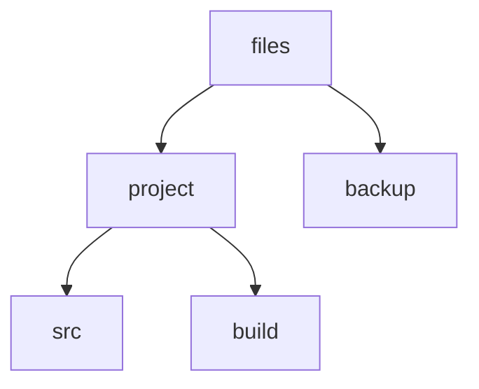
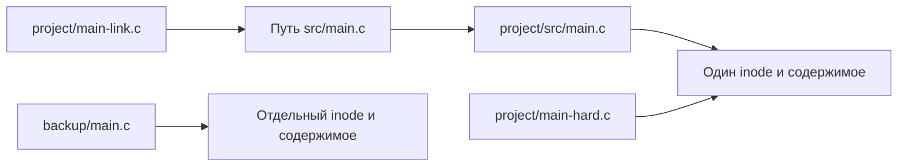

# Файлы, каталоги, права и ссылки

## Содержание

- [Подготовка](#подготовка)
- [Пути и текущий каталог](#пути-и-текущий-каталог)
- [Создание и просмотр файлов](#создание-и-просмотр-файлов)
- [Копирование и перемещение](#копирование-и-перемещение)
- [Поиск файлов](#поиск-файлов)
- [Права доступа](#права-доступа)
- [Символические и жёсткие ссылки](#символические-и-жёсткие-ссылки)
- [Удаление файлов и каталогов](#удаление-файлов-и-каталогов)
- [Источники](#источники)

Файловая система организует данные в виде дерева каталогов и связывает имена с объектами. Основные операции включают поиск, чтение, копирование и перемещение файлов, управление правами доступа и создание ссылок. Примеры ниже используют дерево проекта с исходными файлами, каталогом сборки и резервной копией.

## Подготовка

Все команды выполняйте **на host**, в Bash на Linux или Ubuntu/WSL, в одном терминале и по порядку. Подключение к target не требуется. Нужны GNU Coreutils и `find` из GNU Findutils; обычно они уже установлены в Ubuntu/Debian. В примерах используется [синтаксис Bash](syntax.md).

Для опытов с правами в WSL используйте домашний каталог Linux, как в примерах ниже. Поведение прав в каталогах Windows, например `/mnt/c`, зависит от настроек монтирования.

Создадим отдельный рабочий каталог:

```bash
mkdir -p "$HOME/work/console-lab/files"
cd "$HOME/work/console-lab/files"
pwd
ls -A
```

`mkdir -p` создаёт недостающие родительские каталоги и не считает ошибкой существующий каталог. `cd` меняет текущий каталог оболочки. При успехе обе команды ничего не печатают. Если переход завершился ошибкой, исправьте её до следующих действий.

`pwd` выведет абсолютный путь, например `/home/student/work/console-lab/files`; имя пользователя у вас будет другим. `ls -A` покажет содержимое, включая скрытые имена, но без `.` и `..`. В новом пустом каталоге вывода не будет.

Если здесь остались файлы от прошлого прохождения, выберите новый каталог, например `files-repeat`, в обеих командах подготовки. Последующие команды предполагают новый рабочий каталог; некоторые из них перезаписывают файлы примеров. `sudo` не нужен.

## Пути и текущий каталог

Файловая система Linux имеет единое дерево с корнем `/`. Каталог хранит имена и связи с объектами файловой системы. Путь описывает, через какие каталоги нужно пройти, чтобы найти объект.

| Запись | Значение |
|---|---|
| `/` | Корень дерева файловой системы |
| `/home/student/work` | Абсолютный путь: начинается от корня |
| `project/src/main.c` | Относительный путь: начинается от текущего каталога |
| `.` | Текущий каталог |
| `..` | Родительский каталог |
| `"$HOME/work"` | Каталог `work` внутри домашнего каталога пользователя |

Не путайте `/` с `/root`: `/root` обычно является домашним каталогом пользователя root. В Linux разделитель компонентов пути — прямой слеш `/`.

Создадим структуру:

```bash
mkdir -p project/src project/build backup
cd project
pwd
cd src
pwd
cd ..
pwd
cd ..
pwd
```

`mkdir` получает три пути и создаёт три каталога вместе с недостающими родителями. Команды `pwd` последовательно покажут пути с окончаниями `/files/project`, `/files/project/src`, `/files/project`, `/files`. В конце мы снова находимся в рабочем каталоге примеров.



В пределах этой структуры `project/src`, `./project/src` и `backup/../project/src` приводят в один каталог. Путь `../src` имеет другое значение в зависимости от текущего каталога.

В Linux-файловых системах обычно различаются регистры имён: `main.c` и `Main.c` — разные имена. Расширение `.c` удобно человеку и инструментам, но само по себе не задаёт тип объекта и не делает файл исполняемым.

Пробел может быть частью имени файла, например `project notes.txt`.

## Создание и просмотр файлов

Запишем исходный файл и заметку, создадим пустой файл настроек:

```bash
printf 'int main(void) { return 0; }\n' > project/src/main.c
printf 'Build on host\n' > 'project notes.txt'
touch project/.settings
ls project
ls -a project
cat project/src/main.c
```

`touch` создаёт пустой файл, если его нет; для существующего файла обновляет временные метки, сохраняя содержимое. Эти команды при успехе ничего не печатают.

Первый `ls` покажет `build` и `src`. `ls -a` дополнительно покажет `.`, `..` и `.settings`. Имя, начинающееся с точки, считается скрытым для обычного вывода `ls`; это соглашение отображения, а не защита доступа. Порядок и оформление списка могут зависеть от окружения.

`cat` напечатает:

```text
int main(void) { return 0; }
```

Посмотрим подробные сведения:

```bash
ls -l project/src/main.c
ls -ld project/src
```

У `ls -l` строка обычного файла выглядит примерно так:

```text
-rw-r--r-- 1 student student 29 Oct 21 10:00 project/src/main.c
```

Права, пользователь, группа и время у вас могут отличаться. Поля слева направо: тип и права, число жёстких ссылок, владелец, группа, размер в байтах, время изменения содержимого и имя. Размер нашего файла — 29 байт, включая перевод строки.

Без `-d` команда `ls` для каталога перечисляет его содержимое. С `-d` показывает сам каталог; начало его строки — `d`. Начальный `-` обозначает обычный файл, `l` — символическую ссылку. В Linux есть и другие типы объектов, например файлы устройств в `/dev`.

## Копирование и перемещение

### Копия файла

```bash
cp project/src/main.c backup/main.c
cmp project/src/main.c backup/main.c
printf 'status=%s\n' "$?"
```

У `cp` сначала указывают источник, затем назначение. Получилась отдельная копия: изменение одного файла не меняет другой. `cp` обычно ничего не выводит.

`cmp` сравнивает содержимое побайтно. Для одинаковых файлов вывода нет, а следующая команда печатает `status=0`. Код `1` означает различие, код `2` — ошибку сравнения.

Изменим только копию:

```bash
printf '// backup copy\n' >> backup/main.c
cat backup/main.c
cat project/src/main.c
```

У копии теперь две строки, у исходного файла осталась одна. Повторный `cmp` сообщит о различии.

### Переименование и перемещение

```bash
mv 'project notes.txt' project/notes.txt
mv project/notes.txt project/README.txt
ls project
```

Первый `mv` перемещает файл в существующий каталог и меняет имя, второй переименовывает его внутри каталога. При успехе вывода нет; в списке появится `README.txt`. В отличие от `cp`, `mv` не оставляет файл под старым именем.

Если назначение — существующий каталог, `cp` и `mv` помещают источник внутрь него под исходным именем. Если назначение — существующий обычный файл, его содержимое может быть заменено. Для ручных опытов можно использовать `cp -i` и `mv -i`: перед заменой они запрашивают подтверждение; `y` разрешает замену, `n` отказывается от неё.

В пределах одной файловой системы `mv` обычно меняет расположение имени без копирования содержимого. Между файловыми системами требуется копирование с последующим удалением источника, поэтому такое перемещение может занимать заметное время.

### Копия дерева каталогов

```bash
cp -R project backup/project-copy
ls -a backup/project-copy
```

`-R` означает рекурсивное копирование: обработать каталог и вложенное содержимое. Поскольку `backup/project-copy` ещё не существовал, в нём окажутся `src`, `build`, `README.txt` и `.settings`. Команда копирует скрытые файлы тоже: здесь передан сам каталог, а не шаблон `project/*`.

Если повторить команду при уже существующем `backup/project-copy`, расположение результата изменится: источник `project` будет скопирован внутрь этого каталога. Перед копированием проверяйте, существует ли назначение.

`cp -R` не обещает сохранить все метаданные источника. Для архивной копии в GNU Coreutils есть `cp -a`, сохраняющая, насколько возможно, атрибуты и структуру ссылок. Перенос владельца и некоторых атрибутов зависит от прав пользователя и файловой системы. Подробнее — в [описании cp](https://www.gnu.org/software/coreutils/manual/html_node/cp-invocation.html).

## Поиск файлов

`ls` удобно использовать, когда каталог известен. `find` обходит дерево от указанной точки и отбирает подходящие объекты:

```bash
find project -type f -name '*.c'
find project -type d
find project -name '.settings'
```

Первая команда найдёт обычные файлы (`-type f`), имя которых заканчивается на `.c`:

```text
project/src/main.c
```

Вторая перечислит каталоги (`-type d`): `project`, `project/src` и `project/build`; порядок не гарантирован. Третья найдёт `project/.settings`. Скрытые имена не исключаются из обхода `find`.

Условие `-name` сравнивает последнее имя пути, а не весь путь. Если совпадений нет, эти команды ничего не печатают.

## Права доступа

### Владелец, группа и остальные

У файла есть владелец, группа и набор прав. Обычные права разделены на три тройки:

| Фрагмент `-rwxr-x---` | Кому относится | Разрешения |
|---|---|---|
| `-` | Тип объекта | Обычный файл |
| `rwx` | Владелец, `u` | Чтение, запись, выполнение |
| `r-x` | Группа, `g` | Чтение и выполнение |
| `---` | Остальные, `o` | Нет разрешений |

Посмотреть свою учётную запись и группы можно командой `id`. При обычной проверке сначала выбирается подходящая категория: владелец, иначе подходящая группа, иначе остальные. Разрешения этих категорий не складываются. Ниже рассматриваем обычные права без дополнительных ACL и специальных режимов; привилегированный процесс может обходить часть проверок.

### Значение прав для файла и каталога

| Право | Обычный файл | Каталог |
|---|---|---|
| `r` | Читать содержимое | Перечислять имена внутри |
| `w` | Изменять содержимое | Создавать, удалять и переименовывать записи; обычно требуется также `x` |
| `x` | Запрашивать запуск как программы | Проходить через каталог и обращаться к объектам по известным именам |

Для доступа к файлу нужно право `x` на каталогах по его пути. Чтобы получить подробные сведения о содержимом каталога через `ls -l`, обычно нужны и `r`, и `x` на этом каталоге.

Удаление определяется прежде всего правами на **родительский каталог**, а не правом `w` самого файла. Поэтому файл только для чтения иногда можно удалить, а доступный для записи файл — не всегда. На результат также влияют специальные ограничения, например sticky bit у общего каталога `/tmp`, и режим монтирования файловой системы.

### Изменение прав через chmod

```bash
chmod u=rw,go= project/src/main.c
ls -l project/src/main.c
chmod g+r project/src/main.c
ls -l project/src/main.c
chmod 644 project/src/main.c
ls -l project/src/main.c
```

`chmod` меняет права; обычно это может делать владелец файла. При успехе команда ничего не выводит. Начало строк `ls -l` последовательно будет `-rw-------`, `-rw-r-----`, `-rw-r--r--`.

В символьной записи `u`, `g`, `o` обозначают категории, `a` — все категории. Оператор `=` задаёт точный набор, `+` добавляет права, `-` убирает. Например, `u=rw,go=` оставляет владельцу чтение и запись, а группе и остальным не даёт никаких прав.

В числовой записи каждая цифра — сумма разрешений: `r` = 4, `w` = 2, `x` = 1. Три цифры задают права владельца, группы и остальных:

| Режим | Представление | Пример назначения |
|---|---|---|
| `600` | `rw-------` | Личный файл |
| `644` | `rw-r--r--` | Файл, доступный другим для чтения |
| `700` | `rwx------` | Личный каталог или программа |
| `755` | `rwxr-xr-x` | Каталог или программа с доступом другим |

Это примеры, а не универсальные настройки. Для каталога `644` обычно непригоден: без `x` нельзя нормально обращаться к его содержимому. Не назначайте `777` для устранения любой ошибки доступа: сначала определите, кому и какое действие нужно разрешить.

### Проверка права выполнения

Создадим короткий Bash-скрипт и сравним запуск с правом выполнения и без него:

```bash
printf '#!/bin/bash\nprintf "ready\\n"\n' > project/build/check.sh
chmod 644 project/build/check.sh
bash project/build/check.sh
./project/build/check.sh
printf 'status=%s\n' "$?"
chmod u+x project/build/check.sh
./project/build/check.sh
```

`bash project/build/check.sh` напечатает `ready`: программа Bash читает файл как входной текст, и право `x` скрипту для этого не требуется. Прямой запуск до `chmod u+x` завершится ошибкой `Permission denied` и кодом `126`. После добавления права выполнения прямой запуск напечатает `ready`.

Для прямого запуска также важны разрешения каталогов, доступность интерпретатора и отсутствие запрета выполнения `noexec` у файловой системы. Само добавление `x` не превращает произвольные данные в работающую программу.

### Почему новые файлы имеют разные права

При создании объекта действуют запрошенный программой режим и маска `umask`, запрещающая часть разрешений. Посмотрите текущую маску:

```bash
umask
```

Часто выводится `0022` или `0002`, но значение зависит от окружения. Например, при обычном создании файла с исходным режимом `666` маска `022` даёт `644`; каталог с исходным режимом `777` получает `755`. Это побитовое исключение разрешений, а не обычное арифметическое вычитание. Уже существующие файлы `umask` не меняет. Копирование и программы с собственным выбором режима могут давать другой результат.

Подробнее — в [описании структуры прав GNU Coreutils](https://www.gnu.org/software/coreutils/manual/html_node/Mode-Structure.html).

## Символические и жёсткие ссылки

Копия хранит независимое содержимое. Ссылки позволяют обратиться к существующему объекту через другое имя, но устроены по-разному.

### Символическая ссылка хранит путь

```bash
ln -s src/main.c project/main-link.c
readlink project/main-link.c
cat project/main-link.c
ls -l project/main-link.c
```

У `ln -s` первый аргумент — путь к цели, второй — имя создаваемой ссылки. При успехе вывода нет. `readlink` напечатает `src/main.c`, `cat` — строку исходного кода. У `ls -l` строка начнётся с `l`, а в конце появится `project/main-link.c -> src/main.c`.

Относительная цель `src/main.c` отсчитывается от **каталога самой ссылки**, здесь `project`, а не от текущего каталога терминала. Поэтому запись `ln -s project/src/main.c project/main-link.c` создала бы неверную для нашего дерева цель: `project/project/src/main.c`.

Символическая ссылка может указывать на файл, каталог или отсутствующий путь. Проверим, что происходит при переименовании цели:

```bash
mv project/src/main.c project/src/app.c
readlink project/main-link.c
cat project/main-link.c
mv project/src/app.c project/src/main.c
cat project/main-link.c
```

После первого `mv` путь внутри ссылки не изменится: `readlink` всё ещё выведет `src/main.c`. Но `cat` сообщит, что файл не найден: ссылка стала **оборванной**. После возврата имени `cat` снова прочитает исходный код. Ссылка не отслеживает переименования цели.

### Жёсткая ссылка — ещё одно имя того же файла

В файловой системе содержимое и метаданные файла связаны с объектом, называемым **inode**. Имя в каталоге указывает на этот объект. Жёсткая ссылка добавляет ещё одно такое имя:

```bash
ln project/src/main.c project/main-hard.c
ls -li project/src/main.c project/main-hard.c
printf '// shared data\n' >> project/main-hard.c
cat project/src/main.c
```

Без `-s` команда `ln` создаёт жёсткую ссылку. У обеих строк `ls -li` будут одинаковые номера inode и число ссылок `2`. Конкретный номер inode заранее неизвестен; сравнивать его имеет смысл в пределах одной файловой системы.

Добавленная через `project/main-hard.c` строка появится и при чтении `project/src/main.c`: это один файл с двумя именами. Изменение прав через любое из этих имён тоже относится к одному объекту. Для жёстких ссылок нет отдельной «цели», путь к которой нужно поддерживать.



Обычные жёсткие ссылки нельзя создавать между разными файловыми системами и на каталоги. Символические ссылки таких ограничений не имеют: они хранят путь. Дополнительные правила описаны в [документации ln](https://www.gnu.org/software/coreutils/manual/html_node/ln-invocation.html).

| Действие | Копия | Символическая ссылка | Жёсткая ссылка |
|---|---|---|---|
| Изменить содержимое исходного файла на месте | Останется прежней | Прочитает изменённый файл | Покажет те же изменения |
| Переименовать исходное имя | Не зависит от него | Может оборваться | Продолжит работать |
| Удалить исходное имя | Останется | Оборвётся, если цель исчезла | Сохранит доступ к файлу |

Таблица относится к изменению существующего объекта. Некоторые редакторы сохраняют файл через создание нового объекта и замену имени: тогда другая жёсткая ссылка продолжает указывать на старый объект.

## Удаление файлов и каталогов

Удалим ссылки по отдельности:

```bash
rm project/main-link.c
cat project/src/main.c
rm project/main-hard.c
ls -l project/src/main.c
```

Удаление символической ссылки не удаляет её цель. Удаление одной жёсткой ссылки убирает одно имя: исходное имя продолжает работать, а число ссылок становится `1`. Обе добавленные ранее строки остаются в файле. `rm` при успехе обычно ничего не печатает и не переносит файлы в корзину.

Содержимое файла может сохраняться и после удаления последнего имени, пока его держит открытым работающий процесс. Освобождение места и исчезновение имени — разные события.

Для пустого каталога используйте `rmdir`:

```bash
mkdir empty
rmdir empty
rmdir project
```

Первые две команды выполнятся без вывода. Последняя сообщит `Directory not empty`, поскольку `project` содержит файлы и подкаталоги. Ошибка здесь ожидаема.

Для удаления целого дерева существует `rm -r`, но в этой практике он не нужен. В частности, не используйте его для очистки неизвестного каталога при повторении примеров: проще выбрать новый каталог для примеров.

Файл с именем, начинающимся с дефиса, можно случайно принять за параметр. В GNU-утилитах `--` завершает список параметров:

```bash
touch -- -draft.txt
ls -l -- -draft.txt
rm -- -draft.txt
```

Здесь `-draft.txt` — имя файла. Ещё один способ явно указать путь из текущего каталога — `./-draft.txt`.

## Источники

- [GNU Coreutils: работа с файлами](https://www.gnu.org/software/coreutils/manual/html_node/Basic-operations.html) — копирование, перемещение и удаление.
- [GNU Coreutils: права доступа](https://www.gnu.org/software/coreutils/manual/html_node/File-permissions.html) — режимы файлов и каталогов.
- [GNU Findutils: поиск по имени](https://www.gnu.org/software/findutils/manual/html_node/find_html/Base-Name-Patterns.html) — шаблоны `find -name`.
- [Bash: umask](https://www.gnu.org/software/bash/manual/html_node/Bourne-Shell-Builtins.html#index-umask) — маска прав создаваемых файлов.
- [Microsoft: права файлов в WSL](https://learn.microsoft.com/en-us/windows/wsl/file-permissions) — особенности файлов на дисках Windows.

[К разделу о консоли](README.md). [Предыдущий материал](utilities.md).
