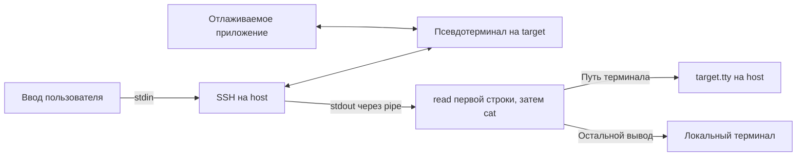

# Консоль Linux и синтаксис Bash

## Содержание

- [Консоль и выполнение команд](#консоль-и-выполнение-команд)
  - [Что такое консоль](#что-такое-консоль)
  - [Терминал, эмулятор терминала и оболочка](#терминал-эмулятор-терминала-и-оболочка)
  - [Приглашение, ввод и результат](#приглашение-ввод-и-результат)
  - [Что такое команда](#что-такое-команда)
  - [Как выполняется программа](#как-выполняется-программа)
  - [Стандартные потоки ввода и вывода](#стандартные-потоки-ввода-и-вывода)
  - [Короткая практика](#короткая-практика)
- [Оболочки и их различия](#оболочки-и-их-различия)
  - [Что означает sh](#что-означает-sh)
  - [POSIX и переносимость](#posix-и-переносимость)
  - [Bash и его расширения](#bash-и-его-расширения)
  - [Другие распространённые оболочки](#другие-распространённые-оболочки)
  - [Встроенные команды и ключевые слова](#встроенные-команды-и-ключевые-слова)
  - [Как проверить свою оболочку](#как-проверить-свою-оболочку)
  - [Интерактивная работа и выполнение скрипта](#интерактивная-работа-и-выполнение-скрипта)
  - [Первая строка скрипта и расширение файла](#первая-строка-скрипта-и-расширение-файла)
- [Последовательное изучение синтаксиса Bash](#последовательное-изучение-синтаксиса-bash)
  - [Командная строка: слова, аргументы и опции](#командная-строка-слова-аргументы-и-опции)
  - [Разделители команд](#разделители-команд)
  - [Комментарии](#комментарии)
  - [Экранирование и продолжение строки](#экранирование-и-продолжение-строки)
  - [Одинарные и двойные кавычки](#одинарные-и-двойные-кавычки)
  - [Переменные и присваивание](#переменные-и-присваивание)
  - [Окружение и export](#окружение-и-export)
  - [Подстановка результата команды](#подстановка-результата-команды)
  - [Шаблоны имён файлов](#шаблоны-имён-файлов)
  - [Операции внутри подстановки параметра](#операции-внутри-подстановки-параметра)
  - [Специальные символы в строках](#специальные-символы-в-строках)
  - [Арифметика](#арифметика)
  - [Раскрытие фигурных скобок](#раскрытие-фигурных-скобок)
  - [Порядок обработки строки](#порядок-обработки-строки)
  - [Код завершения команды](#код-завершения-команды)
  - [Условное выполнение команд](#условное-выполнение-команд)
  - [Потоки и файловые дескрипторы](#потоки-и-файловые-дескрипторы)
  - [Перенаправления](#перенаправления)
  - [Pipeline: передача вывода следующей команде](#pipeline-передача-вывода-следующей-команде)
  - [Группы команд и подоболочка](#группы-команд-и-подоболочка)
  - [Условия if и способы проверки](#условия-if-и-способы-проверки)
  - [Операторы проверок](#операторы-проверок)
  - [Выбор варианта через case](#выбор-варианта-через-case)
  - [Циклы](#циклы)
  - [Чтение данных через read](#чтение-данных-через-read)
  - [Блоки входного текста](#блоки-входного-текста)
  - [Файл скрипта и его запуск](#файл-скрипта-и-его-запуск)
  - [Аргументы скрипта](#аргументы-скрипта)
  - [Функции](#функции)
  - [Массивы Bash](#массивы-bash)
  - [Загрузка команд из другого файла](#загрузка-команд-из-другого-файла)
  - [Процессы: exec, фон и wait](#процессы-exec-фон-и-wait)
  - [Сигналы, Ctrl+C, Ctrl+D и trap](#сигналы-ctrlc-ctrld-и-trap)
  - [Режимы оболочки через set](#режимы-оболочки-через-set)
  - [Подстановка процессов](#подстановка-процессов)
  - [Как читать символы в контексте](#как-читать-символы-в-контексте)
  - [Практический разбор debug-console.sh](#практический-разбор-debug-consolesh)

## Консоль и выполнение команд

### Что такое консоль

Консоль позволяет работать с компьютером с помощью текстовых команд. Вы вводите, что нужно сделать, компьютер выполняет команду и показывает результат текстом.

Например, можно узнать текущую папку, посмотреть файлы, запустить сборку или подключиться к другому устройству. Для этого не обязательно открывать графические окна каждой программы.

В разговорах словом «консоль» часто называют всё окно с командной строкой. В Linux это слово также используется для системной консоли — интерфейса, через который можно войти в систему и работать без графического рабочего стола. В этих уроках под работой в консоли будем понимать ввод команд в терминале Linux.

### Терминал, эмулятор терминала и оболочка

За текстовым окном стоят разные части системы:

| Часть | Что делает |
|---|---|
| Терминал | Обеспечивает текстовый ввод и вывод |
| Эмулятор терминала | Программа, которая предоставляет терминал в графическом окне |
| Оболочка | Читает командную строку, разбирает её и выполняет команды |
| Команда или утилита | Выполняет конкретное действие |

Например, Windows Terminal или встроенный терминал VS Code предоставляет окно. Внутри него может работать Bash, PowerShell или другая оболочка. Само название окна не определяет язык команд.

Если открыть Ubuntu в WSL, команды обычно вводятся в Linux-оболочке внутри Ubuntu. Если открыть вкладку PowerShell, ту же строку будет разбирать PowerShell. Это разные среды выполнения.

В этой серии работаем в **Bash на Linux**. В Windows откройте терминал Ubuntu/WSL; при работе в обычном Linux — терминал с Bash. Выбор и различия оболочек разберём в следующем разделе.

### Приглашение, ввод и результат

Когда оболочка готова принять команду, она показывает **приглашение**. Оно может выглядеть так:

```text
dev@host:~$
```

В таком оформлении `dev` — пользователь, `host` — имя компьютера, `~` обозначает домашнюю папку, `$` отмечает место ввода команды. Оформление можно менять, поэтому ваше приглашение может выглядеть иначе.

Введите:

```bash
pwd
```

Нажмите Enter. Оболочка выполнит команду, которая покажет полный путь текущей папки, а затем появится новое приглашение. Например:

```text
dev@host:~$ pwd
/home/dev
dev@host:~$
```

Здесь только `pwd` — введённая команда. `/home/dev` — её результат. Приглашения оболочка выводит сама: их не нужно копировать или вводить вручную.

Попробуйте ещё одну команду:

```bash
echo hello
```

Она напечатает:

```text
hello
```

Пока команда не отправлена нажатием Enter, строку можно редактировать. Стрелка вверх обычно возвращает предыдущую команду из истории. Если программа работает долго, нового приглашения может не быть до её завершения.

### Что такое команда

У команды есть имя и аргументы. В предыдущем примере:

```text
echo hello
```

`echo` — имя команды, `hello` — один аргумент: текст, который нужно вывести. `pwd` выше была вызвана без аргументов.

Аргументы могут задавать данные, имена файлов или режим работы. Например:

```bash
ls -l
```

Пример вывода для каталога с одним файлом; имена, размеры и даты у вас будут другими:

```text
total 4
-rw-r--r-- 1 dev dev 12 Oct 14 10:00 notes.txt
```

`ls` показывает содержимое текущей папки. `-l` — аргумент-опция: он выбирает подробный формат списка. Значение опции определяет сама команда. Оболочка разбирает строку и передаёт аргументы ей.

По способу выполнения команды бывают разными:

- **Встроенные команды** выполняются самой оболочкой. Например, `cd` меняет её текущую папку.
- **Внешние программы** запускаются из исполняемых файлов. Например, утилита `ls` выводит список файлов.

Узнать, что оболочка понимает под именем команды, можно через `type`:

```bash
type cd
type -a ls
```

Пример вывода Bash с английскими сообщениями, без alias для `ls`; настройки и пути могут отличаться:

```text
cd is a shell builtin
ls is /usr/bin/ls
ls is /bin/ls
```

Для `cd` Bash сообщит, что это встроенная команда. У `ls` могут показаться и сокращённая настройка команды — alias, и пути к исполняемому файлу. Параметр `-a` просит `type` показать все найденные варианты.

Позже добавятся функции и скрипты. Они тоже могут вызываться как команды; на этом этапе достаточно отличать встроенную команду от внешней программы.

### Как выполняется программа

**Программа** — код, который можно запустить. **Процесс** — выполняющийся экземпляр программы. Один и тот же исполняемый файл может быть запущен несколько раз, создавая разные процессы.

При обычном запуске внешней команды происходит следующее:

1. Оболочка читает введённую строку и выделяет имя команды с аргументами.
2. Находит исполняемый файл. Если полный путь не задан, для поиска используются каталоги из настройки `PATH`; переменные окружения изучим далее.
3. Запускает программу в отдельном процессе и передаёт ей аргументы.
4. Программа выполняет работу и выводит результат, если это предусмотрено.
5. При обычном запуске в переднем плане оболочка ожидает завершения программы и снова показывает приглашение.

Терминал остаётся тем же окном, оболочка продолжает работать, а процесс утилиты появляется на время её выполнения. Встроенная команда не требует такого запуска отдельного исполняемого файла.

Программа может выводить обычные данные, сообщения об ошибках или вообще ничего не печатать. Отсутствие текста само по себе не означает ошибку.

При завершении команда также возвращает **код завершения**: обычно 0 означает успех, ненулевое значение — неуспех. Это число не обязано выводиться на экран. Его использование разберём после переменных и подстановок.

### Стандартные потоки ввода и вывода

Программе нужны способы получать данные и отдавать результат. При обычном запуске в Linux для этого доступны три стандартных потока:

| Поток | Полное название | Номер | Что с ним делает программа |
|---|---|---|---|
| `stdin` | Standard input | 0 | Читает входные данные |
| `stdout` | Standard output | 1 | Записывает обычный результат работы |
| `stderr` | Standard error | 2 | Записывает ошибки и диагностические сообщения |

Поток — последовательность данных, которую можно читать или в которую можно писать. У потока нет обязательной связи с клавиатурой или экраном: он может быть подключён к терминалу, файлу или каналу между программами.

Числа 0, 1 и 2 — **файловые дескрипторы**: номера открытых интерфейсов ввода и вывода внутри процесса. В обычном окружении они соответствуют stdin, stdout и stderr. Оболочка подготавливает их перед запуском программы; программа получает уже открытые подключения.

#### Как потоки связаны с терминалом

При обычном интерактивном запуске все три потока подключены к терминалу:


Когда программа ожидает данные из stdin, она может остановиться на операции чтения, пока данные не появятся. Когда пишет в stdout или stderr, текст отображается в терминале. На экране оба потока вывода видны рядом, хотя для программы это разные подключения.

При перенаправлении stdin может читать файл, stdout — записывать в другой файл, а stderr — продолжать показывать ошибки в терминале. Тот же исполняемый файл работает с другими источниками и получателями, не меняя своей логики чтения и записи. Синтаксис перенаправлений разберём после основ командной строки.

#### Простой опыт с чтением и записью

Запустите в терминале:

```bash
cat
```

Без имени файла `cat` читает stdin и передаёт прочитанные данные в stdout. Введите `hello` и нажмите Enter. Обычно получится две одинаковые строки:

```text
hello
hello
```

Первую строку терминал показывает по мере набора — это **эхо ввода**. Вторую печатает `cat`, когда получает введённые данные. Поэтому видимые на экране символы ещё не доказывают, что программа уже их прочитала.

В обычном построчном режиме терминала данные передаются после Enter. Программа может изменить режим терминала и получать отдельные нажатия, но обычным консольным утилитам это не требуется.

Чтобы завершить опыт, нажмите **Ctrl+D на пустой строке**. Чтение получит признак конца ввода — EOF, и `cat` завершится. EOF означает, что данных для чтения больше нет; это не обычный символ, который нужно искать в строке. Для файла EOF наступает при достижении его конца, для pipe — когда данные прочитаны и закрыты все пишущие подключения.

#### Как программа работает с потоками

Программа сама решает, читать ли stdin и что записывать в stdout или stderr. Например, `ls` выводит список файлов, но для обычного вызова ему не нужны данные из stdin.

Аргументы и stdin — разные способы передачи данных. В команде `echo hello` слово `hello` передано как аргумент при запуске. В опыте с `cat` текст приходит позже через stdin, уже работающему процессу.

В программе на C библиотека стандартного ввода и вывода подключается через `<stdio.h>`. Словом **stdio** обычно называют именно этот интерфейс standard input/output. Библиотека предоставляет объекты `stdin`, `stdout` и `stderr` и функции для работы с ними:

| Функция C | Что делает |
|---|---|
| `fgets(buffer, size, stdin)` | Читает строку или её часть из stdin, в пределах размера буфера |
| `getchar()` | Читает следующий символ из stdin или сообщает конец ввода/ошибку |
| `printf(...)` | Записывает форматированный текст в stdout |
| `fprintf(stdout, ...)` | Явно выбирает stdout для записи |
| `fprintf(stderr, ...)` | Явно выбирает stderr для записи диагностики |
| `fflush(stdout)` | Передаёт накопленные библиотекой данные stdout получателю |

Другие языки предоставляют свои функции над теми же стандартными подключениями процесса. Потоки не ограничены программами на C.

Пример на C читает одну строку и выводит её обратно:

```c
#include <stdio.h>

int main(void)
{
    char line[128];

    printf("Enter text: ");
    fflush(stdout);

    if (fgets(line, sizeof(line), stdin) == NULL) {
        if (ferror(stdin)) {
            fprintf(stderr, "Input error\n");
            return 1;
        }
        return 0;
    }

    fprintf(stdout, "Received: %s", line);
    return 0;
}
```

Пример диалога после сборки и запуска этой программы; `hello` вводит пользователь:

```text
Enter text: hello
Received: hello
```

`printf` выводит приглашение. `fgets` ожидает ввод и сохраняет полученную строку в `line`. Последний `fprintf` выводит ответ через stdout. Если строка длиннее буфера, за один вызов будет прочитана только её часть; размер буфера не меняет сам поток.

Если чтение вернуло `NULL`, программа проверяет, была ли ошибка через `ferror`. Конец ввода сам по себе не ошибка. При ошибке сообщение направляется в stderr, а код завершения 1 возвращается отдельно: **запись в stderr автоматически не меняет код завершения**.

#### Почему вывод иногда появляется не сразу

Библиотека C может сначала накапливать записанный текст в памяти — **буфере**, — а потом передавать его получателю. Поэтому вызов `printf` не всегда означает немедленное появление текста на экране.

Для stdout, подключённого к терминалу, обычно используется построчная буферизация: перевод строки помогает вывести накопленные данные. При записи в файл или pipe текст может накапливаться более крупными блоками. Stderr в стандартной библиотеке C не является полностью буферизованным потоком.

В примере приглашение `Enter text: ` не заканчивается переводом строки. `fflush(stdout)` явно отправляет его до ожидания ввода. Это помогает понять случаи, когда программа уже работает, а приглашение или результат ещё не видны.

Стандартные потоки и буферизация библиотеки C описаны в [stdio(3)](https://man7.org/linux/man-pages/man3/stdio.3.html). Перенаправление потока меняет его источник или получателя; буферизация определяет, когда библиотека передаст накопленные данные.

### Короткая практика

Выполните команды по одной и после каждой дождитесь нового приглашения:

```bash
pwd
ls
echo hello
type cd
```

Пример результата, если текущий каталог — `/home/dev` и в нём есть только папка `work`:

```text
/home/dev
work
hello
cd is a shell builtin
```

Теперь можно ответить на четыре вопроса:

1. В какой папке выполняются команды?
2. Что в строке `echo hello` является именем команды, а что аргументом?
3. Какая программа разбирает введённую строку?
4. Почему терминал и оболочка — разные вещи?

Следующий шаг — выбрать оболочку и разобраться, почему строки для Bash не всегда работают через `sh`.

## Оболочки и их различия

Оболочка — это программа со своим языком команд. Простые строки вроде `ls -l` выглядят одинаково во многих оболочках, но правила работы с переменными, условиями и другими конструкциями могут отличаться.

Сначала разберём названия и совместимость, затем проверим окружение и выберем способ запуска скрипта. Команды выполняйте в терминале Linux, в том числе Ubuntu/WSL.

### Что означает sh

Исторически `sh` — имя Bourne shell, одной из ранних Unix-оболочек. Сейчас командой `sh` обычно запускают оболочку, предоставляющую общий, стандартизованный язык команд.

В Linux путь `/bin/sh` часто является **символической ссылкой**: он указывает на другую программу, которая и выполняет команды. Например, в Ubuntu и Debian это обычно dash. В другой системе за `sh` может стоять Bash или BusyBox ash.

Поэтому `sh` и `bash` не обязательно запускают одну программу. Даже если `/bin/sh` указывает на Bash, запуск под именем `sh` влияет на режим его работы.

Когда в инструкции пишут «скрипт для sh», обычно имеют в виду скрипт на общем языке оболочек, без зависимости от расширений Bash. Какую программу запускает `/bin/sh`, нужно проверять в конкретной системе. См. [описание оболочек Debian](https://wiki.debian.org/Shell).

### POSIX и переносимость

**POSIX** — стандарт, который описывает общие интерфейсы Unix-подобных систем. В него входят язык оболочки и поведение многих утилит. Это набор правил, а не программа, которую нужно установить.

Для скриптов POSIX задаёт общую основу: выполнение команд, переменные, кавычки, перенаправления, условия, циклы и функции. Скрипт, использующий эту основу, проще запускать в разных совместимых оболочках.

Но совместимость языка не гарантирует наличие всех внешних программ. Например, корректный sh-скрипт всё равно не запустит `cmake`, если CMake не установлен. Также параметры одной утилиты могут отличаться между GNU и BusyBox.

На практике нужно учитывать две вещи: **какой язык понимает оболочка** и **какие команды доступны в системе**. Общие правила языка описаны в [стандарте POSIX](https://pubs.opengroup.org/onlinepubs/9799919799/utilities/V3_chap02.html).

### Bash и его расширения

**Bash** — Bourne Again Shell. Он используется и для интерактивной работы, и для выполнения скриптов. Bash поддерживает общие конструкции sh и добавляет свои возможности: например, массивы, расширенные проверки и дополнительные виды подстановок.

В этой серии изучаем именно **Bash**. Когда конструкция относится к расширениям Bash, это будет отмечено при её изучении. Пока достаточно помнить: скрипт с такими конструкциями нужно выполнять через Bash; запуск через `sh` не включает поддержку Bash-синтаксиса.

Bash не обязан присутствовать на каждом Linux-устройстве. На рабочем компьютере он часто уже установлен, а в минимальном образе устройства может быть только другая оболочка. См. [официальное описание Bash](https://www.gnu.org/software/bash/).

### Другие распространённые оболочки

| Оболочка | Где встречается и зачем нужна | Что учитывать |
|---|---|---|
| Bash | Рабочие компьютеры, серверы, скрипты разработки | Поддерживает sh-синтаксис и собственные расширения |
| dash | Системные скрипты, в частности в Debian и Ubuntu | Компактная оболочка для sh-скриптов; многие расширения Bash отсутствуют |
| BusyBox ash | Минимальные и встраиваемые Linux-системы | Оболочка в составе BusyBox; возможности зависят от версии и параметров сборки |
| Zsh | Интерактивная работа и скрипты | Язык похож на sh/Bash, но есть различия; Bash-скрипт нельзя автоматически считать Zsh-скриптом |
| Fish | Интерактивная работа с подсказками и дополнением команд | Собственный язык; конструкции sh/Bash нельзя переносить без адаптации |

**dash** ориентирован на общий sh-язык. Если скрипт работает в Bash, это ещё не означает, что он работает в dash. См. [руководство dash](https://manpages.debian.org/testing/dash/sh.1.en.html).

**BusyBox** объединяет множество утилит в одной программе. В его составе может быть оболочка ash. Это удобно для небольших образов, но состав утилит и возможности оболочки выбираются при сборке BusyBox. См. [документацию BusyBox](https://busybox.net/FAQ.html).

**Zsh** отличается от Bash не только настройками приглашения. У него есть свои правила обработки слов и шаблонов. Режимы совместимости существуют, но документация не гарантирует полную совместимость с другими оболочками. См. [раздел совместимости Zsh](https://zsh.sourceforge.io/Doc/Release/Invocation.html#Compatibility).

**Fish** использует другой синтаксис, в частности для переменных и управляющих конструкций. Обычная внешняя программа вроде `ls` остаётся той же, но строку для её запуска разбирает Fish. См. [описание языка Fish](https://fishshell.com/docs/current/language.html).

Оболочка для ручной работы и интерпретатор скрипта могут различаться. Например, из Fish можно выполнить `bash script.sh`: файл прочитает Bash, хотя команда запуска была введена в Fish.

### Встроенные команды и ключевые слова

Оболочка содержит и встроенные команды, например `echo`, и ключевые слова языка, например `while`. Их набор и тип могут различаться между интерпретаторами.

[Сравнение Bash, dash, BusyBox ash, Zsh и Fish](shell-builtins.md) вынесено в отдельный справочник: там приведены проверенные версии, пояснения типов и полная сводная таблица.

### Как проверить свою оболочку

Посмотрите процессы, связанные с текущим терминалом:

```bash
ps
```

В столбце `CMD` обычно будут видны оболочка и сама команда `ps`, например:

```text
    PID TTY          TIME CMD
   1200 pts/0    00:00:00 bash
   1230 pts/0    00:00:00 ps
```

Если оболочек несколько, можно посмотреть их связи:

```bash
ps -f
```

Пример вывода; номера процессов и терминал будут другими:

```text
UID          PID    PPID  C STIME TTY          TIME CMD
dev         1200    1100  0 10:00 pts/0    00:00:00 bash
dev         1230    1200  0 10:00 pts/0    00:00:00 ps -f
```

Здесь `PID` — номер процесса, `PPID` — номер его родительского процесса. Родителем запущенной из приглашения команды `ps` обычно будет текущая оболочка. Так можно отличить её от оболочки, внутри которой ранее запустили другую.

Теперь отдельно проверьте реализацию системного `sh`:

```bash
readlink -f /bin/sh
```

`readlink` работает с символическими ссылками, а параметр `-f` показывает итоговый путь. В Ubuntu результат может выглядеть так:

```text
/usr/bin/dash
```

Это ответ на вопрос «что запускается через `/bin/sh`», а не «в какой оболочке я сейчас ввожу команды».

Чтобы проверить наличие и версию Bash:

```bash
bash --version
```

Начало вывода, например для Bash 5.2.21; далее идут сведения о лицензии. Ваша версия может отличаться:

```text
GNU bash, version 5.2.21(1)-release (x86_64-pc-linux-gnu)
```

Успех этой команды показывает, что Bash доступен, но не означает, что текущая оболочка — Bash. Аналогично переменная окружения `SHELL`, которую часто советуют проверять, обычно указывает оболочку пользователя для входа в систему и может не соответствовать текущему процессу.

### Интерактивная работа и выполнение скрипта

**Интерактивная оболочка** принимает команды от пользователя: показывает приглашение, ждёт ввод и выполняет его. **Скрипт** — текстовый файл с командами, который оболочка читает и выполняет без ввода каждой строки вручную.

Чтобы начать интерактивную работу именно в Bash, выполните:

```bash
bash
```

Появится приглашение вложенной оболочки. Пример; оформление зависит от настроек:

```text
dev@host:~$
```

Запустится вложенная оболочка. Команда `exit` завершит её и вернёт вас в предыдущую оболочку:

```bash
exit
```

Текстового результата команды обычно нет: вложенная оболочка завершается и возвращается приглашение предыдущей. Интерактивный Bash также может напечатать `exit`.

Скрипт может выполнять другую оболочку, независимо от того, где вы ввели команду запуска:

| Способ запуска | Кто читает команды из файла |
|---|---|
| `bash script.sh` | Bash, указанный явно |
| `sh script.sh` | Программа, найденная под именем `sh` |
| `./script.sh` | При наличии строки `#!` — интерпретатор из этой строки; файлу нужно право исполнения |
| `source ./script.sh` в Bash | Текущая оболочка Bash; новый процесс оболочки для чтения файла не создаётся |

При обычном запуске `bash script.sh` изменения переменных и текущей папки внутри скрипта не меняют состояние оболочки, из которой он запущен. При загрузке через `source` команды выполняются в текущей оболочке и могут менять её состояние. Этот способ отдельно разберём после переменных и окружения.

В таблице `script.sh` — условное имя файла. Создавать его сейчас не нужно; это сравнение способов запуска.

### Первая строка скрипта и расширение файла

Строка **shebang** начинается с `#!` и указывает интерпретатор для прямого запуска файла. Для скрипта на общем sh-языке она может выглядеть так:

```sh
#!/bin/sh
```

Для Bash часто используют:

```bash
#!/usr/bin/env bash
```

Во втором случае запускается `/usr/bin/env`, который находит Bash в пути поиска команд `PATH`. Другой вариант — `#!/bin/bash`, если Bash установлен именно по этому пути. Подробно разберём shebang и права исполнения в разделе о файле скрипта.

Если выполнить `bash script.sh` или `sh script.sh`, интерпретатор уже выбран командой запуска. Строка shebang внутри файла не переключит его на другую оболочку.

**Расширение `.sh` не выбирает язык.** Это соглашение об имени, удобное для людей и редакторов. Bash-скрипт может называться `build.sh`, `build` или `environment-setup`; язык и способ запуска от этого не меняются.

Поэтому перед запуском чужого скрипта проверьте, какая оболочка ему нужна и как автор предлагает его выполнять. Для следующих примеров используем Bash; системный `/bin/sh` менять не требуется.

## Последовательное изучение синтаксиса Bash

Идём по порядку: сначала учимся читать одну строку, затем соединяем команды и собираем скрипты. Все примеры этого раздела выполняются **в Bash на рабочем компьютере с Linux или в WSL**.

После команд приведён ожидаемый вывод или описан эффект, если текста нет. Результаты предполагают выполнение примеров по порядку; пути, PID и содержимое каталогов зависят от вашей системы. В диалогах отдельно указано, что вводит пользователь.

В первых примерах используем `echo`: он выводит аргументы и перевод строки. Новые конструкции вводим по мере изучения; команда `printf` появится после объяснения кавычек.

### Командная строка: слова, аргументы и опции

```bash
ls -l /tmp
```

Пример вывода для пустого `/tmp`; обычно здесь будет список временных файлов:

```text
total 0
```

Здесь `ls` — имя команды, `-l` — опция подробного вывода, `/tmp` — путь к каталогу. Для программы и опция, и путь являются аргументами. Их назначение определяет сама программа.

Bash сначала разбирает строку на слова. Обычно первое слово выбирает команду, а остальные передаются ей как аргументы. Позже увидим, как кавычки и подстановки влияют на границы этих слов.

Один или два дефиса часто обозначают опции: например, `-l` и `--version`. Это соглашение утилит, а не особый синтаксис Bash. Многие программы принимают `--` как конец списка опций: следующие слова считаются обычными аргументами, даже если начинаются с дефиса.

Путь к команде тоже можно указать явно. В `./build.sh` символы `./` означают текущий каталог. Без пути Bash ищет команду среди своих функций, встроенных команд и исполняемых файлов в `PATH`.

### Разделители команд

Пробелы и табуляция разделяют слова. Несколько пробелов между словами обычно равнозначны одному. Если пробел должен быть частью аргумента, понадобятся кавычки или экранирование.

Перевод строки заканчивает команду, если конструкция уже завершена. Две команды можно записать на отдельных строках:

```bash
echo first
echo second
```

Результат:

```text
first
second
```

Или разделить точкой с запятой:

```bash
echo first; echo second
```

Результат:

```text
first
second
```

В обоих случаях сначала выполняется первая команда, затем вторая. `;` не проверяет, успешно ли завершилась первая.

### Комментарии

В обычном режиме Bash символ `#` в начале слова, вне кавычек, начинает комментарий. Остаток строки не выполняется:

```bash
# Эта строка ничего не запускает
echo hello # Пояснение к команде
echo hello#world
```

Результат:

```text
hello
hello#world
```

Последняя команда выводит `hello#world`: здесь `#` находится внутри слова и не начинает комментарий. В интерактивном Bash обработку комментариев можно отключить настройкой, но по умолчанию она включена.

### Экранирование и продолжение строки

**Экранировать** символ — значит отменить его специальное значение. Вне кавычек обратный слеш `\` делает следующий символ буквальным:

```bash
echo hello\ world
echo \#hello
```

Результат:

```text
hello world
#hello
```

Первая команда получает один аргумент `hello world`. Вторая выводит `#hello`: экранированный `#` не начинает комментарий.

Обратный слеш непосредственно перед переводом строки соединяет две физические строки в одну команду:

```bash
echo \
    hello
```

Результат:

```text
hello
```

После `\` не должно быть пробела: он экранирует именно следующий символ. Это способ перенести длинную команду, а не запустить несколько команд.

### Одинарные и двойные кавычки

| Запись | Что происходит |
|---|---|
| `'hello world'` | Всё внутри передаётся буквально одним аргументом |
| `"hello world"` | Один аргумент; разрешены подстановки переменных и команд |
| `''` или `""` | Один пустой аргумент |
| `hello" world"` | Соседние части склеиваются в один аргумент `hello world` |

Кавычки нужны оболочке и обычно не входят в переданный аргумент. Проверим это простой командой:

```bash
echo 'hello world'
echo "hello world"
```

Результат:

```text
hello world
hello world
```

Теперь введём `printf`, чтобы показать границы аргументов и пустую строку. Первый аргумент задаёт **формат**: `%s` означает место для строкового значения, а `\n` — перевод строки. Следующие аргументы подставляются в этот формат. Эти обозначения обрабатывает сама команда `printf`, а не Bash.

В формате `'<%s>\n'` угловые скобки — обычный текст. Благодаря кавычкам Bash передаёт всю строку формата одним аргументом:

```bash
printf '<%s>\n' 'hello world' '' hello" world"
```

Результат:

```text
<hello world>
<>
<hello world>
```

Результат — три строки: `<hello world>`, `<>` и `<hello world>`. Формат повторяется для каждого переданного значения.

Кавычки позволяют вывести и текст, который без них имел бы специальное значение:

```bash
echo '# это текст'
```

Результат:

```text
# это текст
```

Если кавычка не закрыта, интерактивный Bash показывает дополнительное приглашение, обычно `>`, и ждёт продолжения строки. Этот символ приглашения вводить не нужно.

В одинарных кавычках даже `$` и обратный слеш остаются обычными символами. Одинарную кавычку нельзя вставить внутрь такой строки с помощью `\`: нужно закончить кавычки и добавить её другим способом, например в двойных кавычках.

В двойных кавычках `$` сохраняет назначение, а обратный слеш может экранировать, в частности, `$`, `"` и сам `\`. Интерактивный Bash также может обрабатывать `!` для обращения к истории команд. Этот механизм в примерах не используем. См. [правила кавычек Bash](https://www.gnu.org/s/bash/manual/html_node/Quoting.html).

### Переменные и присваивание

Переменная хранит значение под именем:

```bash
name=dev
message='hello world'
echo "$name"
echo "${name}_build"
```

Результат:

```text
dev
dev_build
```

При присваивании **вокруг `=` нет пробелов**. Строка `name = dev` будет попыткой выполнить команду `name` с двумя аргументами, а не присваиванием.

Имя переменной обычно состоит из латинских букв, цифр и `_`, причём не начинается с цифры. Имена чувствительны к регистру: `name` и `NAME` — разные переменные.

`$name` заменяется значением переменной. Фигурные скобки в `${name}` явно ограничивают имя: `${name}_build` использует `name`, а `$name_build` использовал бы другую переменную, `name_build`.

Соединение значения с другим текстом называется **конкатенацией**. Без фигурных скобок границу имени можно обозначить кавычками:

```bash
name=dev
echo "$name"_build
echo "$name""_build"
echo "$name"'_build'
```

Результат:

```text
dev_build
dev_build
dev_build
```

Во всех случаях имя переменной заканчивается перед закрывающей двойной кавычкой. Следующая часть добавляется к её значению без пробела:

| Запись | Как добавляется суффикс |
|---|---|
| `"$name"_build` | Обычный текст сразу после кавычек |
| `"$name""_build"` | Соседняя строка в двойных кавычках |
| `"$name"'_build'` | Соседняя буквальная строка в одинарных кавычках |

Для фиксированного суффикса `_build` проще использовать `"$name"_build` или уже знакомое `"${name}_build"`. Кавычки вокруг значения сохраняют его целиком, даже если в нём есть пробелы.

Результат можно сохранить в переменную:

```bash
app_name="$name"_build
echo "$app_name"
```

Результат:

```text
dev_build
```

В записи `"$name_build"` кавычки охватывают всё слово, но не отделяют суффикс от имени: Bash всё равно читает переменную `name_build`.

Обычно значение при передаче команде заключают в двойные кавычки: `"$message"`. Тогда пробелы и символы шаблонов внутри значения не превращаются в дополнительные аргументы или имена файлов.

**Пути тоже хранятся как строки.** Не заключённая в кавычки `~` в начале слова может раскрываться в домашний каталог. В строке `"~/work"` она остаётся буквальной. Для пути в кавычках используйте `"$HOME/work"`:

```bash
work_dir="$HOME/work/console-lab/syntax"
mkdir -p "$work_dir"
cd "$work_dir"
```

При успехе команды ничего не печатают. Создаётся учебный каталог, и он становится текущим; у пользователя `dev` это `/home/dev/work/console-lab/syntax`.

`mkdir -p` создаёт недостающие каталоги, `cd` меняет текущий каталог. Последующие файловые примеры выполняйте здесь: они создают и перезаписывают учебные файлы.

### Окружение и export

Обычная переменная доступна текущей оболочке. **Окружение** — набор значений, которые она передаёт запускаемым программам. `export` добавляет переменную в этот набор:

```bash
export GREETING=hello
bash -c 'echo "$GREETING"'
```

Результат:

```text
hello
```

`bash -c` запускает новую оболочку и выполняет строку из следующего аргумента. Одинарные кавычки сохраняют `$GREETING` для этой новой оболочки; она получает значение из окружения и выводит `hello`.

Значение можно передать только одной команде:

```bash
GREETING=welcome bash -c 'echo "$GREETING"'
echo "$GREETING"
```

Результат:

```text
welcome
hello
```

Дочерняя оболочка выводит `welcome`, текущая сохраняет `hello`. Изменения окружения дочернего процесса не возвращаются родителю.

`PATH` — переменная окружения со списком каталогов поиска команд, разделённых `:`. Посмотреть её можно через `printf '%s\n' "$PATH"`.

### Подстановка результата команды

Конструкция `$(...)` выполняет команды внутри скобок и подставляет их stdout:

```bash
current_dir=$(pwd)
printf 'Каталог: %s\n' "$current_dir"
```

Результат для пользователя `dev`, если выполнен переход в учебный каталог выше:

```text
Каталог: /home/dev/work/console-lab/syntax
```

Завершающие переводы строк в захваченном выводе удаляются. Stderr команды не захватывается этой подстановкой и продолжает идти своим потоком.

При подстановке прямо в аргумент используйте кавычки:

```bash
printf '%s\n' "$(pwd)"
```

Результат в том же каталоге; домашняя папка зависит от пользователя:

```text
/home/dev/work/console-lab/syntax
```

Без кавычек результат может разделиться на слова, а затем подвергнуться поиску файлов по шаблонам. Вывод команды не становится автоматически новым Bash-кодом: содержащиеся в нём `;` или `>` сами по себе не запускают команды и не создают перенаправления.

### Шаблоны имён файлов

Вне кавычек Bash раскрывает шаблон в имена существующих файлов:

```bash
touch alpha.txt beta.txt gamma.log
printf '%s\n' *.txt
```

Результат, если в учебном каталоге нет других файлов с расширением `.txt`:

```text
alpha.txt
beta.txt
```

`touch` создаёт пустые файлы, если их ещё нет. Во втором вызове программа получает два аргумента: `alpha.txt` и `beta.txt`. Поиск выполняет Bash до запуска `printf`.

| Шаблон | Значение |
|---|---|
| `*` | Любая последовательность символов, включая пустую |
| `?` | Один символ |
| `[ab]` | Один из перечисленных символов |
| `[0-9]` | Один символ из диапазона |

В обычном режиме `*` не включает имена, начинающиеся с точки, а `/` отделяет каталоги. Если совпадений нет, Bash по умолчанию оставляет шаблон буквальным. Эти правила могут меняться настройками оболочки.

В `'*.txt'` звёздочка остаётся текстом. Шаблоны оболочки и регулярные выражения — разные языки: например, `*` в них имеет разный смысл.

### Операции внутри подстановки параметра

`${...}` может не только читать значение, но и обрабатывать его. Начнём с удаления части строки:

```bash
path=logs/session.txt
printf '%s\n' "${path#*/}"
printf '%s\n' "${path%.*}"
```

Результат:

```text
session.txt
logs/session
```

Результат: `session.txt` и `logs/session`. Сама переменная `path` не меняется.

| Запись | Действие |
|---|---|
| `${value#pattern}` | Удалить самое короткое совпадение шаблона с началом значения |
| `${value##pattern}` | Удалить самое длинное совпадение с началом |
| `${value%pattern}` | Удалить самое короткое совпадение с концом |
| `${value%%pattern}` | Удалить самое длинное совпадение с концом |
| `${#value}` | Получить длину значения строки |

Здесь `pattern` — шаблон оболочки; `*` означает произвольную последовательность символов. Для пути `one/two/file.txt` подстановка `${path#*/}` уберёт `one/`, а `${path##*/}` — всё до последнего `/`. Здесь используются уже знакомые шаблоны, но они сопоставляются со строкой переменной, а не с файлами. Внутри `${...}` символ `#` не начинает комментарий.

### Специальные символы в строках

В обычных одинарных кавычках `'\n'` — два символа: обратный слеш и `n`. Конструкция `$'...'` позволяет Bash превратить escape-последовательности в реальные символы:

| Последовательность | Символ |
|---|---|
| `\n` | Перевод строки, LF |
| `\r` | Возврат каретки, CR |
| `\t` | Табуляция |
| `\\` | Обратный слеш |

```bash
printf '%s' $'first\nsecond\n'
```

Результат:

```text
first
second
```

Здесь переводы строк создаёт Bash до запуска `printf`. В другой записи их обрабатывает сам `printf`, внутри строки формата:

```bash
printf 'first\nsecond\n'
```

Результат:

```text
first
second
```

Результат одинаков, но символы обрабатывают разные участники. В `printf '%s\n' '\n'` данные остаются текстом `\n`: `%s` не превращает их в перевод строки.

### Арифметика

`$((...))` вычисляет целочисленное выражение и подставляет результат:

```bash
count=3
next=$((count + 1))
echo "$next"
echo "$((7 / 2))"
```

Результат:

```text
4
3
```

Получаем `4` и `3`: целочисленное деление отбрасывает дробную часть. В арифметическом выражении имя переменной можно писать без `$`.

Основные операции: `+`, `-`, `*`, `/`, `%` — остаток от деления. Скобки внутри выражения управляют порядком вычисления. Число с начальным `0` Bash может трактовать как восьмеричное, поэтому `08` не является обычной десятичной записью для такой арифметики.

Существует и отдельная команда `((...))`: она выполняет арифметику и возвращает статус. Если результат выражения равен нулю, её статус — неуспех. Не путайте её с `$((...))`, которая подставляет текст результата.

### Раскрытие фигурных скобок

Раскрытие `{...}` создаёт набор слов и не проверяет существование файлов:

```bash
printf '%s\n' {debug,release}
printf '%s\n' item{1..3}.txt
```

Результат:

```text
debug
release
item1.txt
item2.txt
item3.txt
```

Первая команда получает `debug` и `release`, вторая — `item1.txt`, `item2.txt`, `item3.txt`.

Внутри `{debug,release}` нет пробелов. Кавычки вокруг всей конструкции отключают её раскрытие.

Это отличается от `${name}`, которая читает переменную. Bash выполняет раскрытие фигурных скобок раньше подстановки переменных, поэтому `{1..$count}` не создаёт диапазон до значения `count`. Для такого перебора позже используем цикл.

### Порядок обработки строки

Для обычных аргументов удобно помнить такую последовательность:

1. Bash узнаёт команды, кавычки и специальные операторы.
2. Раскрывает наборы `{...}`.
3. Подставляет домашний каталог, переменные, результаты команд и арифметики.
4. Делит результаты незащищённых подстановок на слова.
5. Раскрывает шаблоны имён файлов.
6. Убирает служебные кавычки и передаёт готовые аргументы команде.

Пример:

```bash
files='alpha.txt beta.txt'
printf '<%s>\n' "$files"
printf '<%s>\n' $files
```

Результат: первая строка от вызова с кавычками, следующие две — без кавычек:

```text
<alpha.txt beta.txt>
<alpha.txt>
<beta.txt>
```

Первый вызов передаёт **один** аргумент с пробелом. Второй — **два** аргумента. Поэтому значение переменной и список аргументов — разные вещи.

Разделение слов использует переменную `IFS`; по умолчанию её разделители — пробел, табуляция и перевод строки. При присваивании переменной такого разделения и поиска файлов нет: `copy=$files` сохраняет всё значение.

Это упрощённая схема для чтения команд; особые контексты, например `[[...]]` и арифметика, имеют свои правила. См. [порядок раскрытий Bash](https://www.gnu.org/s/bash/manual/html_node/Shell-Expansions.html).

### Код завершения команды

Команда возвращает оболочке числовой **код завершения**: `0` означает успех, ненулевой код — неуспех. Подробное значение ненулевых кодов зависит от программы.

`$?` содержит статус последней завершившейся команды:

```bash
true
echo "$?"
false
echo "$?"
```

Результат:

```text
0
1
```

`true` всегда сообщает успех, `false` — неуспех. Увидим `0` и `1`. Это обычные команды, полезные для изучения условий.

Статус нужно читать сразу: следующий `echo`, `pwd` или другой вызов заменит его своим статусом. Если он понадобится позже, сохраните его через `status=$?`.

Вывод текста и код завершения независимы. Программа может ничего не напечатать и завершиться успешно или вывести сообщение в stdout и вернуть ошибку.

### Условное выполнение команд

| Оператор | Когда выполняется команда справа |
|---|---|
| `;` | После завершения команды слева, независимо от её статуса |
| `&&` | Если команда слева успешна |
| `\|\|` | Если команда слева неуспешна |

```bash
true && echo success
false || echo failure
false; echo next
```

Результат:

```text
success
failure
next
```

Результат: `success`, `failure`, `next`.

Для последовательности зависимых действий часто используют `&&`: например, `mkdir -p output && cd output`. Переход произойдёт только после успешного создания каталога.

`&&` и `||` имеют одинаковый приоритет и связываются слева направо. Запись `a && b || c` не является точной заменой «если a, то b, иначе c»: команда `c` выполнится и тогда, когда `a` успешна, но `b` вернула ошибку. Для выбора ветвей ниже используем `if`.

### Потоки и файловые дескрипторы

Ранее разобрали назначение [стандартных потоков](#стандартные-потоки-ввода-и-вывода). Теперь нужны их номера для синтаксиса перенаправлений:

| Номер | Поток | Назначение |
|---|---|---|
| `0` | stdin | Откуда программа читает входные данные |
| `1` | stdout | Куда программа пишет обычный результат |
| `2` | stderr | Куда программа пишет диагностику |

Номер называется **файловым дескриптором**: это номер открытого канала в процессе. Канал может вести в терминал, файл, pipe или другое место. У процесса могут быть и другие дескрипторы.

Bash может настроить эти каналы при запуске команды. Для этого используются перенаправления, а не дополнительные аргументы программы.

### Перенаправления

| Запись | Действие |
|---|---|
| `command < input.txt` | Подключить файл к stdin |
| `command > output.txt` | Подключить файл к stdout; создать или очистить файл |
| `command >> output.txt` | Дописывать stdout в конец файла |
| `command 2> error.txt` | Направить stderr в файл |
| `command 2>&1` | Подключить stderr туда, куда сейчас направлен stdout |
| `command 2>&-` | Закрыть stderr для команды |

```bash
printf '%s\n' first > output.txt
printf '%s\n' second >> output.txt
cat < output.txt
```

Вывод `cat`; такое же содержимое записано в `output.txt`:

```text
first
second
```

Получим две строки: `first` и `second`. `cat` здесь читает stdin; имя файла ему не передаётся. Перенаправления открывает оболочка, поэтому ошибка открытия файла может возникнуть ещё до запуска программы.

У `2>` номер прилегает к оператору. `echo 2 > output.txt` вместо этого передаёт команде аргумент `2` и перенаправляет её stdout.

**Порядок важен:** перенаправления применяются слева направо.

```bash
ls missing-file > combined.log 2>&1
ls missing-file 2>&1 > result.log
```

Первая команда ничего не выводит в терминал: диагностика записывается в `combined.log`. Вторая выводит её в терминал. Пример сообщения GNU `ls` с английскими сообщениями:

```text
ls: cannot access 'missing-file': No such file or directory
```

Здесь отсутствие `missing-file` ожидаемо. В первой строке stdout идёт в `combined.log`, затем stderr подключается к нему: оба потока попадают в файл. Во второй stderr подключается к прежнему stdout — терминалу, — а stdout после этого переключается на `result.log`. Ошибка останется в терминале.

`2>&1` не означает «всегда следовать за stdout»: это подключение к его направлению **в момент применения**. Для удаления ненужного вывода используют `/dev/null`, например `> /dev/null`; `2>&-` именно закрывает канал и может привести к ошибке записи у программы. См. [перенаправления Bash](https://www.gnu.org/s/bash/manual/html_node/Redirections.html).

### Pipeline: передача вывода следующей команде

Оператор `|` соединяет stdout одной команды со stdin другой:

```bash
printf '%s\n' alpha beta | wc -l
```

Результат:

```text
2
```

`printf` создаёт две строки, `wc -l` считает строки и выводит `2`. Промежуточный текст передаётся через **pipe**, канал между процессами.


Команды могут работать одновременно: принимающая команда читает данные по мере появления. Stderr по обычному `|` не передаётся и продолжает идти своим направлением.

По умолчанию код завершения pipeline — статус последней команды. Поэтому `false | cat` обычно даёт статус `0`: `cat` успешно прочитал пустой ввод. Режим `pipefail` ниже поможет учитывать ошибки других участников. Если нужно передать и диагностику, используют `command 2>&1 | next_command`.

### Группы команд и подоболочка

Фигурные скобки объединяют команды в группу в текущей среде:

```bash
{ echo first; echo second; } > group.txt
```

В терминале вывода нет. В `group.txt` записано:

```text
first
second
```

Перенаправление применяется ко всей группе. После `{` нужен разделитель, перед `}` — `;` или перевод строки. В отличие от `{a,b}`, здесь скобки являются отдельными служебными словами.

Круглые скобки выполняют группу в **подоболочке**, отдельной среде с копией состояния:

```bash
name=outer
( name=inner; echo "$name" )
echo "$name"
```

Результат:

```text
inner
outer
```

Результат: `inner`, затем `outer`. Присваивание внутри круглых скобок не меняет переменную снаружи. То же относится к `cd`.

С `{ name=inner; }` значение в текущей оболочке изменилось бы. Но группа `{...}`, помещённая в pipeline, в обычном режиме Bash тоже выполняется в подоболочке. Поэтому изменения переменных внутри `command | { ...; }` обычно не сохраняются после pipeline.

### Условия if и способы проверки

`if` выбирает ветвь по коду завершения команды:

```bash
if test -f output.txt; then
    echo 'Файл существует'
else
    echo 'Файла нет'
fi
```

Результат, если `output.txt` создан в предыдущем примере:

```text
Файл существует
```

`test -f` проверяет, существует ли обычный файл. Успех проверки запускает команды после `then`; неуспех — после `else`. `fi` закрывает конструкцию. Вместо `test` можно использовать и другую команду: например, `if mkdir output; then ...`.

Для нескольких ветвей служит `elif` — дополнительная проверка. `else` необязателен. Условие может находиться на одной строке с `then`, если отделено `;`, или на предыдущей строке.

| Форма | Особенность |
|---|---|
| `test -f file` | Встроенная команда Bash; у неё есть и внешние реализации |
| `[ -f file ]` | Другая запись той же проверки: `[` — команда, `]` — обязательный последний аргумент |
| `[[ -f file ]]` | Конструкция языка Bash с дополнительными возможностями |

В `[ ... ]` пробелы обязательны: `[ "$name" = dev ]`. Значения переменных заключайте в кавычки, чтобы они остались отдельными аргументами.

В `[[ ... ]]` нет обычного разделения значений переменных на слова и раскрытия имён файлов. Эта конструкция удобна для Bash-скриптов, но не относится к переносимому POSIX sh-синтаксису.

### Операторы проверок

| Проверка | Успешна, если |
|---|---|
| `[ -e "$path" ]` | Путь существует; для символической ссылки проверяется её цель |
| `[ -f "$path" ]` | Путь ведёт к обычному файлу |
| `[ -d "$path" ]` | Путь ведёт к каталогу |
| `[ -r "$path" ]` | Файл доступен для чтения |
| `[ -z "$value" ]` | Строка пустая |
| `[ -n "$value" ]` | Строка непустая |
| `[ "$a" = "$b" ]` | Строки равны |
| `[ "$a" != "$b" ]` | Строки различаются |
| `[ "$a" -eq "$b" ]` | Целые числа равны |
| `[ "$a" -lt "$b" ]` | Первое целое число меньше второго |

Для чисел также есть `-ne`, `-le`, `-gt`, `-ge`. Строковое `=` и числовое `-eq` решают разные задачи.

Проверки можно соединять уже знакомыми операторами:

```bash
if [ -f output.txt ] && [ -r output.txt ]; then
    echo 'Файл можно прочитать'
fi
```

Результат для доступного для чтения `output.txt`:

```text
Файл можно прочитать
```

В Bash доступно сопоставление с шаблоном и регулярным выражением:

```bash
file=report.txt
if [[ "$file" == *.txt ]]; then
    echo 'Текстовый файл'
fi

number=42
if [[ "$number" =~ ^[0-9]+$ ]]; then
    echo 'Строка состоит из цифр'
fi
```

Результат:

```text
Текстовый файл
Строка состоит из цифр
```

Справа от `==` здесь стоит шаблон оболочки. Кавычки вокруг `"*.txt"` сделали бы его буквальной строкой. Справа от `=~` — расширенное регулярное выражение: `^` — начало строки, `[0-9]` — цифра, `+` — одно или несколько повторений, `$` — конец строки.

Внутри `[[...]]` можно соединять проверки через `&&` и `||`, отрицать через `!`, группировать круглыми скобками. Регулярные выражения изучаются отдельно; сейчас важно отличать их от шаблонов файлов.

### Выбор варианта через case

`case` удобен, когда одно значение сравнивают с несколькими шаблонами:

```bash
mode=debug
case "$mode" in
    debug)
        echo 'Отладочная сборка'
        ;;
    release)
        echo 'Обычная сборка'
        ;;
    *)
        echo 'Неизвестный режим'
        ;;
esac
```

Результат:

```text
Отладочная сборка
```

`in` начинает список вариантов, `)` отделяет шаблон от команд, `;;` завершает выбранную ветвь. `esac` закрывает весь выбор.

`*` совпадает с любым значением, поэтому последнюю ветвь используют как общий случай. Шаблон `debug|test)` допускает любой из двух вариантов; `|` здесь разделяет шаблоны и не создаёт pipeline.

### Циклы

`for` выполняет команды для каждого значения из списка:

```bash
for mode in debug release; do
    printf 'Режим: %s\n' "$mode"
done
```

Результат:

```text
Режим: debug
Режим: release
```

При первом проходе `mode` содержит `debug`, при втором — `release`. `do` начинает тело цикла, `done` заканчивает.

`while` повторяет тело, пока проверка успешна:

```bash
count=1
while [ "$count" -le 3 ]; do
    echo "$count"
    count=$((count + 1))
done
```

Результат:

```text
1
2
3
```

Получим `1`, `2`, `3`. `until` действует наоборот: повторяет тело, пока проверка **неуспешна**. Проверка выполняется перед каждым проходом, поэтому тело может не выполниться ни разу.

`break` выходит из цикла, `continue` пропускает оставшиеся команды текущего прохода и переходит к следующему. Вложенные циклы допустимы; без числового аргумента эти команды относятся к ближайшему циклу.

### Чтение данных через read

`read` читает строку из stdin и записывает данные в переменные:

```bash
printf 'Введите имя: '
read -r name
printf 'Привет, %s\n' "$name"
```

Диалог при вводе `dev`; имя в первой строке вводит пользователь:

```text
Введите имя: dev
Привет, dev
```

Здесь команда ждёт ввод пользователя и Enter. Перевод строки не входит в значение. Параметр `-r` отключает специальную обработку обратного слеша: введённые `\` сохраняются.

По умолчанию `read` делит строку по `IFS`; начальные и конечные разделители могут исчезнуть. Если нужно сохранить строку целиком, используют `IFS= read -r line`. Это временно устанавливает пустой `IFS` только для этого вызова.

Для файла, в котором строки заканчиваются переводом строки:

```bash
while IFS= read -r line; do
    printf '<%s>\n' "$line"
done < output.txt
```

Результат для `output.txt` из примера с перенаправлениями:

```text
<first>
<second>
```

Каждый успешный `read` запускает тело. На конце файла команда возвращает неуспех, и цикл заканчивается. При этом `read` может сохранить последнюю часть строки даже при неуспехе, если файл не завершён переводом строки.

Чтобы обработать и такой последний фрагмент:

```bash
while IFS= read -r line || [ -n "$line" ]; do
    printf '<%s>\n' "$line"
done < output.txt
```

Результат для того же файла:

```text
<first>
<second>
```

Перенаправление после `done` подаёт файл на весь цикл. Оно позволяет обойтись без pipeline и сохранить изменения переменных цикла в текущей оболочке.

### Блоки входного текста

**Here-document**, оператор `<<`, передаёт программе многострочный текст через stdin:

```bash
cat <<'TEXT'
Первая строка
Здесь $name остаётся текстом
TEXT
```

Результат:

```text
Первая строка
Здесь $name остаётся текстом
```

`TEXT` — выбранный маркер конца блока. Закрывающий маркер должен быть на отдельной строке без лишних символов. Он не передаётся программе.

Кавычки в `<<'TEXT'` отключают подстановки в содержимом. При `<<TEXT` Bash подставит переменные, результаты команд и арифметики. Сам маркер не обязательно называется `EOF`: имя выбираете вы.

Оператор `<<-` дополнительно удаляет начальные **табуляции** из строк блока и маркера, что удобно для отступов. Обычные пробелы он не удаляет.

**Here-string**, `<<<`, передаёт одно раскрытое значение и добавляет перевод строки:

```bash
cat <<< "$name"
```

Результат, если при чтении имени выше введено `dev`:

```text
dev
```

Это конструкция Bash. В отличие от `$(...)`, она не захватывает вывод команды, а создаёт входные данные для неё.

### Файл скрипта и его запуск

Создадим первый законченный скрипт в учебном каталоге. Следующая команда записывает файл; благодаря кавычкам у маркера его содержимое не выполняется сейчас:

```bash
cat > greet.sh <<'SCRIPT'
#!/usr/bin/env bash

printf 'Введите имя: '
IFS= read -r name
printf 'Привет, %s\n' "$name"
SCRIPT
```

При успехе вывода в терминале нет. Создаётся файл `greet.sh` с указанным содержимым.

В файле получаются пять строк: shebang, пустая строка и три команды ввода и вывода. `SCRIPT` — маркер команды создания, а не часть файла.

Запуск через интерпретатор:

```bash
bash greet.sh
```

Диалог при вводе `dev`:

```text
Введите имя: dev
Привет, dev
```

Или напрямую, после добавления права исполнения:

```bash
chmod u+x greet.sh
./greet.sh
```

`chmod` при успехе ничего не выводит. Затем скрипт ведёт тот же диалог; пример при вводе `dev`:

```text
Введите имя: dev
Привет, dev
```

`u+x` добавляет владельцу файла право исполнения. `./` указывает путь в текущем каталоге. При прямом запуске Linux использует интерпретатор из shebang. Не запускайте Bash-скрипт через `sh`, если в нём есть расширения Bash.

В редакторе сохраняйте скрипты с окончаниями строк **LF**. Windows-окончания CRLF могут, например, добавить лишний `\r` к имени интерпретатора в shebang и нарушить запуск.

### Аргументы скрипта

Аргументы запуска доступны внутри скрипта как специальные параметры:

| Параметр | Значение |
|---|---|
| `$0` | Имя или путь, под которым запущен скрипт |
| `$1`, `$2` | Первый и второй аргументы |
| `${10}` | Десятый аргумент; скобки отделяют его номер |
| `$#` | Число аргументов |
| `"$@"` | Все аргументы, каждый остаётся отдельным словом |
| `"$*"` | Все аргументы одной строкой, разделённые первым символом `IFS` |

Создайте `args.sh`:

```bash
cat > args.sh <<'SCRIPT'
#!/usr/bin/env bash

printf 'Количество: %s\n' "$#"
for argument in "$@"; do
    printf '<%s>\n' "$argument"
done
SCRIPT
bash args.sh 'hello world' debug
```

Создание файла ничего не выводит. Результат его запуска:

```text
Количество: 2
<hello world>
<debug>
```

Получим количество `2`, затем `<hello world>` и `<debug>`. Кавычки у `"$@"` сохраняют границы исходных аргументов, включая пустые.

`shift` убирает первый аргумент из набора позиционных параметров: прежний `$2` становится `$1`, количество уменьшается. Это не меняет аргументы родительского процесса. `shift` без аргументов сдвигает на один; `shift 2` — на два. Перед сдвигом нужно убедиться, что аргументов достаточно.

См. [позиционные параметры Bash](https://www.gnu.org/s/bash/manual/html_node/Positional-Parameters.html).

`$0` обычно остаётся прежним. Запись `$10` без скобок означает значение `$1` и добавленный текст `0`, поэтому для номера 10 нужны `${10}`.

### Функции

Функция объединяет команды под именем и выполняется в текущей оболочке:

```bash
say_hello() {
    local name="$1"
    printf 'Привет, %s\n' "$name"
}
say_hello dev
```

Результат:

```text
Привет, dev
```

`()` после имени обозначает объявление функции, а `{...}` содержит тело. Для вызова скобки не нужны: `say_hello dev`.

Внутри функции `$1` — её первый аргумент, а `"$@"` — аргументы её вызова. `local` создаёт переменную с областью видимости функции; она доступна и вызванным из неё функциям Bash. После возврата локальное значение исчезает, а одноимённая внешняя переменная сохраняется.

`return` завершает функцию и задаёт её статус, например `return 1`. Если его нет, статус функции — статус последней выполненной команды.

`return` передаёт **код завершения**, а не строковый результат. Данные можно вывести через stdout и получить с помощью `$(say_hello dev)`. `exit`, в отличие от `return` в функции, завершает всю выполняющую её оболочку.

### Массивы Bash

Если нужно хранить список отдельных значений, используйте массив, а не строку с пробелами:

```bash
files=('alpha.txt' 'file with spaces.txt')
printf '%s\n' "${files[0]}"
for file in "${files[@]}"; do
    printf '<%s>\n' "$file"
done
```

Результат:

```text
alpha.txt
<alpha.txt>
<file with spaces.txt>
```

Индекс первого элемента — `0`. `${files[0]}` читает один элемент, `"${files[@]}"` раскрывает все элементы отдельными аргументами. `${#files[@]}` возвращает число элементов.

Не путайте объявление массива `files=(...)` с группой команд `( ... )`: слева от скобок здесь стоит присваивание.

В ассоциативном массиве вместо числового индекса используется строковый ключ:

```bash
declare -A ports
ports[http]=80
ports[ssh]=22
echo "${ports[ssh]}"
```

Результат:

```text
22
```

`declare -A` объявляет такой массив. Порядок обхода его ключей не следует считать порядком вставки. Массивы относятся к расширениям Bash и не подходят для обычного sh-скрипта.

### Загрузка команд из другого файла

Иногда файл должен настроить **текущую оболочку**, например экспортировать пути SDK. Для этого его загружают через `source`:

```bash
cat > project.env <<'ENV'
export PROJECT_MODE=debug
ENV
source ./project.env
echo "$PROJECT_MODE"
```

Результат:

```text
debug
```

Команды из файла выполняются в текущей оболочке. После загрузки `PROJECT_MODE` доступен здесь и в последующих дочерних процессах.

В Bash можно также написать `. ./project.env`: точка — имя встроенной команды, после неё идёт путь. Такая форма есть и в POSIX sh.

При `bash ./project.env` файл выполнился бы в дочерней оболочке. Её `export` не изменил бы окружение текущего терминала.

Загрузка не создаёт отдельной изолированной среды: `cd`, присваивания и `exit` из файла действуют на текущую оболочку. Shebang не выбирает язык при `source`; файл должен подходить той оболочке, которая его читает.

### Процессы: exec, фон и wait

При обычном запуске внешней программы оболочка создаёт процесс и ждёт его завершения. Оператор `&` запускает команду в фоне: оболочка может продолжить работу, не дожидаясь результата.

```bash
sleep 1 &
worker_pid=$!
echo "Запущен процесс $worker_pid"
wait "$worker_pid"
echo 'Процесс завершился'
```

Пример результата; PID будет другим. Интерактивный Bash также может сообщить номер и состояние фонового задания:

```text
Запущен процесс 1234
Процесс завершился
```

`sleep 1` ждёт одну секунду. `$!` содержит PID последней команды, запущенной в фоне. `wait` ждёт указанный дочерний процесс и возвращает его код завершения. Сам запуск в фоне ещё не подтверждает успешное выполнение программы.

`$$` обозначает PID оболочки. В подоболочке `( ... )` Bash сохраняет это значение от родительской оболочки; для PID фактически выполняющего Bash-процесса есть `BASHPID`.

`exec` заменяет текущую оболочку программой, сохраняя PID. Для проверки выполните его в отдельном дочернем Bash:

```bash
bash -c 'echo before; exec sleep 1; echo after'
```

Результат; после `before` будет пауза около секунды:

```text
before
```

Увидим только `before`: после успешного `exec` этой оболочки больше нет, а значит, некому выполнять `echo after`. Поэтому `exec` подходит для последней передачи управления программе, а не для обычной промежуточной команды. См. [встроенные команды Bash](https://www.gnu.org/software/bash/manual/html_node/Bourne-Shell-Builtins.html).

### Сигналы, Ctrl+C, Ctrl+D и trap

**Сигнал** — уведомление процесса от ОС или другого процесса. Команда `kill` отправляет сигнал; её имя не означает, что каждый сигнал обязательно уничтожает процесс.

| Действие | Что происходит |
|---|---|
| Ctrl+C в обычном режиме терминала | Отправляется SIGINT группе процессов переднего плана |
| Ctrl+D в начале пустой строки ввода | Чтение из терминала может получить конец ввода; это не сигнал |
| `kill PID` | Отправляется SIGTERM, запрос завершения |
| `kill -KILL PID` | Отправляется SIGKILL, принудительное завершение без обработки процессом |

Попробуйте `sleep 30` и нажмите Ctrl+C: ожидание прервётся. Поведение программы зависит от обработки сигнала; программа может выполнить свои действия перед завершением.

`trap` задаёт действия при сигнале или событии оболочки. Проверим обработчик в отдельном Bash, передав ему команды через here-document:

```bash
bash <<'SCRIPT'
trap 'echo finished' EXIT
echo working
SCRIPT
```

Результат:

```text
working
finished
```

Получим `working`, затем `finished`. Здесь `EXIT` — событие завершения оболочки, а не сигнал Linux. Благодаря отдельному запуску обработчик не меняет настройки вашего текущего терминала.

Одинарные кавычки откладывают разбор команды обработчика до момента события. Например, в `trap 'rm -f "$temporary_file"' EXIT` переменная будет прочитана при завершении.

SIGKILL нельзя перехватить; при таком завершении нельзя рассчитывать на обработчик `EXIT`. Внешняя команда переднего плана также может задержать выполнение обработчика Bash до своего завершения.

### Режимы оболочки через set

Эти режимы меняют поведение выполняющей их оболочки. Не добавляйте их автоматически, не разобравшись с последствиями:

| Команда | Назначение и ограничение |
|---|---|
| `set -e` | Завершать оболочку при некоторых неуспешных командах; есть исключения для условий, списков и pipeline |
| `set -u` | Считать обращение к неустановленной переменной ошибкой; пустая, но установленная переменная допустима |
| `set -o pipefail` | Статус pipeline — статус самой правой неуспешной команды, либо 0, если все успешны |
| `set -x` | Печатать трассировку команд после раскрытий, обычно в stderr |

Для проверки запустите режимы в дочерних оболочках:

```bash
bash -c 'set -e; false; echo unreachable'
bash -c 'set -o pipefail; false | cat; echo "$?"'
```

Первый вызов ничего не выводит и завершается с кодом 1. Второй выводит:

```text
1
```

В первом примере `echo` не выполнится. Во втором увидим `1`, хотя последняя команда `cat` успешна.

`set -e` не означает «остановиться при любой ошибке». Например, `false` в условии `if` или слева от `||` — ожидаемая проверка и не завершает оболочку. Без `pipefail` неуспех ранней команды pipeline может остаться незамеченным. Поэтому нужные действия при ошибке иногда лучше явно описать через `if` или `||`.

`set -x` выводит значения аргументов после подстановок: в трассировку могут попасть пароли и другие данные. Для отключения используют `set +x`; аналогично `set +e`, `set +u` и `set +o pipefail`. См. [правила команды set](https://www.gnu.org/s/bash/manual/html_node/The-Set-Builtin.html).

### Подстановка процессов

Иногда программа ожидает два **имени файлов**, а нужно сравнить результаты двух команд. В Bash можно использовать `<(...)`:

```bash
diff <(printf '%s\n' alpha) <(printf '%s\n' beta)
```

Результат GNU `diff`; код завершения — 1, поскольку строки различаются:

```text
1c1
< alpha
---
> beta
```

`diff` сравнивает входные данные и сообщает различия. Его код `1` здесь означает найденные различия, а не сбой сравнения.

Каждое `<(...)` запускает команду и подставляет путь к каналу, из которого другая программа может читать её вывод. На Linux такой путь часто выглядит как `/dev/fd/63`; точный номер не фиксирован.

Обратная форма `>(...)` предоставляет путь для записи: записанные данные поступают на stdin команды внутри скобок. Подстановки процессов выполняются асинхронно, их статусы не становятся автоматически статусом основной команды.

| Конструкция | Что получает внешняя команда |
|---|---|
| `$(command)` | Текст stdout команды, с удалёнными завершающими переводами строк |
| `<(command)` | Путь для чтения stdout команды |
| `>(command)` | Путь для записи в stdin команды |
| `( commands )` | Это группа команд в подоболочке, а не подстановка аргумента |

Между `<` и `(` в подстановке процессов нет пробела. Это возможность Bash, которой нет в общем POSIX sh-синтаксисе. См. [подстановку процессов](https://www.gnu.org/s/bash/manual/html_node/Process-Substitution.html).

### Как читать символы в контексте

У символа нет одного значения на все случаи. Смотрите на конструкцию целиком:

| Запись | Значение |
|---|---|
| `$name`, `${name}` | Значение переменной |
| `$(...)` | Вывод команды |
| `$((...))` | Результат арифметики |
| `$'...'` | Строка с обработкой escape-последовательностей |
| `# comment` | Комментарий |
| `${value#pattern}` | Удаление префикса |
| `${#value}` | Длина значения |
| `$#` | Число аргументов |
| `{a,b}` | Набор слов |
| `{ commands; }` | Группа команд |
| `( commands )` | Подоболочка |
| `name=(a b)` | Массив |
| `command &` | Фоновый запуск |
| `command 2>&1` | Подключение stderr к текущему направлению stdout |
| `a && b` | Условное выполнение |
| `a \| b` | Pipeline |
| `a \|\| b` | Выполнение справа при неуспехе слева |

При чтении строки сначала найдите границы команд и кавычек. Затем отделите присваивания и перенаправления от аргументов. После этого разберите подстановки: что заменится текстом, а что создаст отдельный процесс.

Особенно важно различать **код** и **данные**. В `echo "$name"` значение переменной передаётся как данные. В `bash -c "$command"` содержимое переменной будет заново разбираться как код другой оболочкой. Для обычного вызова команды передавайте аргументы напрямую или через массив.

### Практический разбор debug-console.sh

Теперь прочитаем настоящий [скрипт консоли удалённой отладки](../cross/example/scripts/debug-console.sh). Это разбор существующего примера: для запуска нужны окружение кросс-туториала, созданный каталог сборки и настроенный SSH. Для изучения синтаксиса подключаться к устройству не требуется.

```bash
#!/usr/bin/env bash
set -e

tty_file="$HOST_BUILD_DIR/target.tty"

trap 'rm -f "$tty_file"' EXIT
echo "Opening target console"
ssh -tt "$TARGET_SSH_HOST" "tty; exec sleep infinity" | {
    read -r target_tty
    printf '%s\n' "${target_tty%$'\r'}" > "$tty_file"
    echo "Target console ready"
    cat
}
```

При успешном подключении и чтении пути терминала появится:

```text
Opening target console
Target console ready
```

Разберём по порядку:

1. **Shebang** выбирает Bash при прямом запуске. `set -e` включает завершение при некоторых ошибках; здесь он не включает `pipefail`.
2. **Присваивание `tty_file`** формирует путь из `HOST_BUILD_DIR`. Например, при `/home/dev/work/build` получится `/home/dev/work/build/target.tty`. Кавычки сохраняют путь одним значением. Скрипт не создаёт каталог сборки.
3. **`trap ... EXIT`** регистрирует удаление этого файла при завершении оболочки. `rm -f` удаляет файл и не считает отсутствие файла ошибкой. Одинарные кавычки сохраняют команду обработчика для последующего выполнения.
4. **`ssh -tt`** подключается к хосту из `TARGET_SSH_HOST` и принудительно запрашивает удалённый псевдотерминал. Два `t` позволяют запросить его даже без локального терминала у stdin SSH. Псевдотерминал предоставляет устройству обычный терминальный интерфейс.
5. **`"tty; exec sleep infinity"`** — один аргумент SSH с удалённой командой. На устройстве `tty` выводит путь терминала, например `/dev/pts/1`. Затем `exec` заменяет удалённую оболочку длительным ожиданием, чтобы соединение и терминал оставались открытыми. `sleep infinity` здесь рассчитывает на поддержку такого аргумента установленным `sleep`.
6. **`| { ... }`** передаёт stdout SSH на stdin группы локальных команд. В обычном режиме Bash эта группа работает в подоболочке; её переменная `target_tty` не нужна снаружи.
7. **`read -r target_tty`** читает первую строку — ожидаемый путь удалённого терминала. Это простой скрипт: он рассчитывает, что перед путём не будет других строк stdout от удалённых настроек входа.
8. **`${target_tty%$'\r'}`** убирает один CR с конца строки. `read` уже удалил LF, а CR может остаться из-за обработки вывода удалённым терминалом. Здесь `%` удаляет суффикс, `$'\r'` создаёт символ CR.
9. **`printf ... > "$tty_file"`** записывает очищенный путь с переводом строки в файл на рабочем компьютере. Его затем читает [транспорт отладки](../cross/example/scripts/debug-transport.sh), чтобы направить потоки приложения в этот терминал.
10. **`cat`** читает оставшийся поток SSH и выводит его в локальный терминал. Первая строка уже была прочитана `read`, поэтому путь терминала повторно не печатается. Ввод пользователя идёт на stdin SSH, а не через `cat`.



Сообщение `Target console ready` означает, что скрипт прочитал и сохранил путь терминала. Оно не означает, что приложение уже запущено: его запускает отдельный механизм отладки. Работа этой связки целиком описана в [кросс-туториале](../cross/README.md).

[К серии уроков](README.md).
