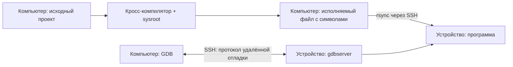

# Кросс-разработка: сборка на компьютере, запуск на устройстве

## Содержание

- [Цель и схема работы](#цель-и-схема-работы)
- [Сравнение с практикой Embedded Linux](#сравнение-с-практикой-embedded-linux)
- [Предварительные условия](#предварительные-условия)
- [Выберите toolchain](#выберите-toolchain)
- [Подготовьте проект и параметры](#подготовьте-проект-и-параметры)
- [Подготовьте sysroot](#подготовьте-sysroot)
- [Сборка и запуск без VS Code](#сборка-и-запуск-без-vs-code)
  - [Назначение скриптов](#назначение-скриптов)
  - [Отладка из терминала](#отладка-из-терминала)
- [Сборка и отладка в VS Code](#сборка-и-отладка-в-vs-code)
  - [Как запускается удалённая отладка](#как-запускается-удалённая-отладка)
  - [Параметры launch.json](#параметры-launchjson)
  - [Как работает консоль](#как-работает-консоль)
- [Готовые файлы окружения](#готовые-файлы-окружения)
- [Если что-то не работает](#если-что-то-не-работает)
- [Проверенные платформы](#проверенные-платформы)

## Цель и схема работы

Соберём приложение для целевого Linux на компьютере, передадим его на устройство и настроим отладку с консольным вводом. Проект, скрипты и организация рабочего каталога аналогичны [нативному туториалу](../native/README.md).

**Компилятор, CMake, Ninja и GDB работают на компьютере в Ubuntu/WSL. На устройстве работают приложение и gdbserver.** Кросс-компилятор создаёт машинный код для целевой архитектуры, которая может отличаться от архитектуры компьютера.

| Где | Что находится и выполняется |
|---|---|
| Компьютер, Ubuntu/WSL | Исходники, toolchain, sysroot, сборка, GDB, расширения VS Code |
| Целевой Linux | Копия исполняемого файла, его библиотеки, gdbserver и консоль приложения |



Цикл работы: редактирование → локальная кросс-сборка → передача программы → запуск или отладка на устройстве. Исходники на устройство не копируются; GDB читает символы из локального исполняемого файла. На устройстве должна запускаться именно его переданная копия.

## Сравнение с практикой Embedded Linux

Сборка на компьютере, запуск на устройстве и локальный GDB с удалённым gdbserver соответствуют обычной организации кросс-разработки. Единого стандарта рабочего процесса нет; для сравнения используем подходы Yocto, Buildroot и документированные механизмы GDB.

| Аспект | Вариант этого туториала | Типичный процесс для продукта |
|---|---|---|
| Компилятор | Кросс-GCC из Ubuntu | Версионированный SDK, согласованный с образом устройства |
| Sysroot | Копирование заголовков и библиотек с устройства | Формирование вместе с образом или получение из SDK |
| Проект | Самостоятельный CMake-проект | Аналогичный проект, подключённый к инфраструктуре продукта |
| Сборка | CMake/Ninja и независимые Bash-скрипты | Аналогично, дополнительно автоматизированная сборка в CI |
| Передача | rsync исполняемого файла | Для разработки — аналогично; для выпуска — пакет, образ или механизм обновления |
| Отладка | Локальный GDB → SSH → gdbserver | Та же архитектура; транспорт зависит от инфраструктуры |
| Консоль | Отдельный SSH-терминал с ручным выбором TTY | Обычно автоматизированная консоль либо отдельное подключение |
| Воспроизводимость | Зависит от текущих пакетов компьютера и устройства | Зафиксированные SDK, зависимости и конфигурация образа |

Главное отличие — происхождение и фиксация **SDK**. Yocto формирует целевой sysroot и инструменты по конфигурации системы. Buildroot экспортирует toolchain и файлы разработки командой `make sdk`. Это позволяет распространять согласованное окружение между разработчиками и использовать его в CI. См. [Yocto SDK](https://docs.yoctoproject.org/sdk-manual/intro.html) и [экспорт SDK Buildroot](https://buildroot.org/downloads/manual/manual.html).

Копирование sysroot удобно для существующего Debian-устройства без готового SDK. Но обновление пакетов устройства меняет получаемое окружение, а обновление компилятора компьютера может изменить используемые runtime-библиотеки. Исправление символических ссылок не гарантирует совместимость всех зависимостей.

Отладка через SSH и оболочка `--wrapper` используют документированные механизмы GDB. Отдельная консоль нужна для интерактивного примера: при stdio-транспорте stdin приложения по умолчанию подключён к `/dev/null`. См. [описание gdbserver](https://www.sourceware.org/gdb/current/onlinedocs/gdb.html/Server.html).

Для учебного материала текущая схема позволяет разбирать этапы отдельно и работать без VS Code. При переходе к продуктовой разработке полезно:

1. Зафиксировать совместимый SDK и его версию.
2. Использовать единый источник настроек для Bash, VS Code и CI.
3. Автоматизировать подключение консоли.
4. Устанавливать приложение и зависимости через пакет или образ.
5. Проверять сборку в CI и сохранять исполняемый файл с отладочными символами.

Это направления развития, а не реализованные возможности примера. Переход на Yocto или Buildroot ради одного приложения не обязателен: сначала стоит обеспечить воспроизводимое окружение сборки.

## Предварительные условия

- Подготовленное [рабочее окружение](../../environment/README.md) и [SSH-доступ по ключу](../ssh/README.md).
- Кросс-компилятор для архитектуры и ABI целевых приложений.
- Заголовки и библиотеки целевой системы: sysroot из SDK либо копия с устройства.
- `gdb-multiarch` на компьютере и `gdbserver` на устройстве для отладки.

## Выберите toolchain

Проверьте **на устройстве**:

```bash
dpkg --print-architecture
uname -m
ldd --version
```

`dpkg` показывает архитектуру пакетов Debian/Ubuntu, `uname` — ядра. На системе без dpkg используйте описание SDK и `file /bin/sh` с учётом символических ссылок. Архитектура ядра сама по себе не определяет архитектуру приложений, библиотек и ABI.

| Целевое пользовательское окружение | Пример семейства компиляторов |
|---|---|
| Linux AArch64 / Debian `arm64` | `aarch64-linux-gnu-gcc`, `aarch64-linux-gnu-g++` |
| Linux ARM с hard-float / Debian `armhf` | `arm-linux-gnueabihf-gcc`, `arm-linux-gnueabihf-g++`; дополнительно проверьте набор инструкций CPU |

Ниже используется **AArch64 Linux с glibc и каталогами Debian multiarch**. Это конкретная конфигурация примера, а не ограничение всего подхода. Для другой платформы замените toolchain, sysroot и способ его получения. Bare-metal-компилятор `arm-none-eabi` не заменяет Linux-toolchain.

На компьютере **в Ubuntu/WSL**:

```bash
sudo apt update
sudo apt install cmake ninja-build gcc-aarch64-linux-gnu g++-aarch64-linux-gnu gdb-multiarch rsync
```

Для реального проекта предпочтителен SDK, соответствующий образу устройства: он согласует компилятор, ABI, sysroot и версии библиотек. Дистрибутивный GCC подходит для нашего проверенного примера, но это не гарантия совместимости любых зависимостей. Даже с `CMAKE_SYSROOT` компилятор может использовать собственные runtime-библиотеки, особенно для C++.

На устройстве с Debian/Ubuntu:

```bash
sudo apt update
sudo apt install gdbserver rsync libc6-dev
```

Компилятор и CMake на устройстве для этого варианта не требуются. Пакеты разработки дополнительных библиотек нужны в источнике sysroot; runtime-библиотеки — на устройстве при запуске.

## Подготовьте проект и параметры

Из корня EmbedLinux **на компьютере**:

```bash
mkdir -p "$HOME/projects/hello-cross"
cp -R tutor/cross/example/. "$HOME/projects/hello-cross/"
cd "$HOME/projects/hello-cross"
```

```text
hello-cross/
├── project/              # самостоятельный CMake-проект
├── cmake/                # toolchain-файл окружения
├── scripts/              # независимые операции
├── .vscode/              # задачи и отладка
├── target.env            # параметры для Bash
└── build/                # создаётся локально
    ├── debug/            # результат кросс-сборки
    └── sysroot/          # копия заголовков и библиотек
```

На устройстве `TARGET_WORK_DIR` — каталог установки и рабочий каталог приложения. В него передаются программа и `console-wrapper.sh`; там также могут находиться данные приложения. В кросс-примере каталог `project/` на устройстве не нужен.

| Переменная | Где действует | Назначение |
|---|---|---|
| `TARGET_SSH_HOST` | Компьютер | SSH-алиас устройства |
| `TARGET_WORK_DIR` | Устройство | Рабочий каталог приложения |
| `TARGET_GDBSERVER` | Устройство | Путь к gdbserver |
| `TARGET_LOADER` | Устройство | Путь к загрузчику glibc для копирования sysroot |
| `HOST_BUILD_DIR` | Компьютер | Полный путь к каталогу сборки |
| `HOST_SYSROOT` | Компьютер | Полный путь к sysroot |
| `HOST_TOOLCHAIN_FILE` | Компьютер | Полный путь к toolchain-файлу CMake |
| `TARGET_LIB_TRIPLE` | Компьютер | Имя каталога библиотек Debian multiarch для копирования sysroot |
| `HOST_GDB` | Компьютер | Путь к GDB с поддержкой целевой архитектуры |
| `TARGET_APP_PATH` | Устройство | Полный путь к исполняемому файлу на target |
| `HOST_WORK_DIR` | Компьютер | Корень рабочего примера на host |
| `HOST_APP_PATH` | Компьютер | Полный путь к собранному файлу на host |
| `BUILD_JOBS`, `BUILD_TYPE` | Компьютер | Параллелизм и тип сборки |

Готовый **`target.env`** ([файл](example/target.env)); загрузите его из корня примера:

```bash
export TARGET_SSH_HOST=pi-dev
export TARGET_WORK_DIR=/home/dev/work/hello-cross
export TARGET_APP_PATH="$TARGET_WORK_DIR/cross_example"
export TARGET_GDBSERVER=/usr/bin/gdbserver
export TARGET_LOADER=/lib/ld-linux-aarch64.so.1
export TARGET_LIB_TRIPLE=aarch64-linux-gnu

export HOST_WORK_DIR="$PWD"
export HOST_BUILD_DIR="$HOST_WORK_DIR/build/debug"
export HOST_APP_PATH="$HOST_BUILD_DIR/cross_example"
export HOST_SYSROOT="$HOST_WORK_DIR/build/sysroot"
export HOST_TOOLCHAIN_FILE="$HOST_WORK_DIR/cmake/linux-toolchain.cmake"
export HOST_GDB=/usr/bin/gdb-multiarch

export BUILD_TYPE=Debug
export BUILD_JOBS=2
```

`TARGET_APP_PATH` в Bash — полный путь, сформированный из `TARGET_WORK_DIR`. В VS Code `target.workDir` — полный путь к каталогу установки на устройстве, `target.appPath` — относительно него. Задачи и отладчик соединяют эти два параметра непосредственно при вызове. Сборка выполняется только на host.


Архитектуру и пути компиляторов изменяйте в `cmake/linux-toolchain.cmake`. Отдельные переменные окружения для них не нужны. `HOST_SYSROOT` остаётся общим параметром для копирования библиотек, CMake и GDB; `TARGET_LIB_TRIPLE` используется только для каталогов Debian multiarch при копировании.

`$PWD` раскрывается при `source target.env`. Скрипты запускайте из корня примера. При смене компилятора, архитектуры или sysroot используйте новый каталог сборки: CMake сохраняет выбор toolchain в кеше. Для параметров удалённых команд используйте значения без кавычек, переводов строк и shell-символов.

## Подготовьте sysroot

Если SDK уже содержит sysroot, укажите его путь в `HOST_SYSROOT` и пропустите копирование с устройства.

Для приведённой Debian multiarch-конфигурации **на компьютере**:

```bash
source target.env
bash scripts/sysroot.sh
bash scripts/fix-sysroot-links.sh
```

Скрипт копирует `/usr/include`, библиотеки `/usr/lib/$TARGET_LIB_TRIPLE` и `/lib/$TARGET_LIB_TRIPLE`, а также загрузчик `TARGET_LOADER`. При первой синхронизации может передаваться большой объём; сжатие не включено, чтобы не нагружать CPU устройства. `--link-dest` повторно использует уже скопированные файлы, когда `/lib` и `/usr/lib` содержат одинаковые библиотеки: это экономит передачу и место. Символические ссылки сохраняются без дублирования больших библиотек. Отдельный `fix-sysroot-links.sh` превращает абсолютные ссылки в относительные пути внутри локального sysroot, чтобы они не обращались к файлам компьютера. `--delete` удаляет устаревшие файлы только в соответствующих локальных каталогах sysroot. После изменения загрузчика замените sysroot целиком либо удалите старую копию загрузчика вручную.

Это sysroot для примера и библиотек из указанных каталогов. Для зависимостей из `/opt`, других каталогов библиотек или другой libc используйте SDK либо дополните процедуру копирования. Исправление символических ссылок не меняет пути внутри linker scripts и файлов pkg-config. Если проект использует pkg-config, отдельно настройте поиск его метаданных в целевом sysroot.

После обновления библиотек устройства повторите синхронизацию sysroot. Она не входит в обычную цепочку каждой сборки. Собственные файлы в зеркалируемых каталогах не храните. См. [CMAKE_SYSROOT и toolchain-файлы](https://cmake.org/cmake/help/latest/manual/cmake-toolchains.7.html).

## Сборка и запуск без VS Code

После подготовки sysroot, **из корня примера на компьютере**:

```bash
source target.env
bash scripts/configure.sh
bash scripts/build.sh
bash scripts/prepare.sh
bash scripts/deploy.sh
bash scripts/run.sh
```

При изменении исходников:

```bash
bash scripts/build.sh && bash scripts/deploy.sh && bash scripts/run.sh
```

При изменении параметров CMake повторите `configure.sh` перед сборкой. Уже переданную программу можно запускать одним `run.sh`; stdin/stdout работают через SSH-терминал. Приложение запрашивает два числа, выводит сумму и произведение, затем повторяет запрос. Ctrl+D на пустой строке завершает ввод.

### Назначение скриптов

Каждый скрипт выполняет одно действие и не вызывает другие операции. Последовательность задаётся командами Bash или составными задачами VS Code.

| Скрипт | Что происходит | Результат |
|---|---|---|
| [sysroot.sh](example/scripts/sysroot.sh) | rsync получает целевые заголовки, библиотеки и загрузчик | Локальный sysroot |
| [fix-sysroot-links.sh](example/scripts/fix-sysroot-links.sh) | Исправляет абсолютные символические ссылки в скопированном sysroot | Относительные ссылки внутри локальной копии |
| [configure.sh](example/scripts/configure.sh) | Локальный CMake читает `project/`, toolchain и параметры | Правила Ninja в `HOST_BUILD_DIR` |
| [build.sh](example/scripts/build.sh) | Локальный Ninja вызывает кросс-компилятор и линковщик | Целевой исполняемый файл с символами |
| [prepare.sh](example/scripts/prepare.sh) | SSH создаёт каталог установки | `TARGET_WORK_DIR` |
| [deploy.sh](example/scripts/deploy.sh) | rsync передаёт программу и оболочку консольного ввода | Программа по пути `TARGET_APP_PATH`; `console-wrapper.sh` в `TARGET_WORK_DIR` |
| [run.sh](example/scripts/run.sh) | SSH с терминалом запускает переданную программу | Обычное выполнение на устройстве |
| [console.sh](example/scripts/console.sh) | SSH открывает терминал, печатает его TTY и удерживает соединение | Консоль stdin/stdout для отладки |
| [debug-transport.sh](example/scripts/debug-transport.sh) | По параметрам вызывает gdbserver через SSH без терминала | Канал протокола удалённой отладки для локального GDB |
| [console-wrapper.sh](example/scripts/console-wrapper.sh) | На устройстве перенаправляет stdin/stdout/stderr в выбранный TTY и выполняет программу | Интерактивный ввод и вывод отдельно от протокола отладки |

`deploy.sh` не использует `--delete`: передаются отдельные файлы, а рабочий каталог может содержать другие программы и данные. Исходники, sysroot и локальные настройки туда не передаются. Символы остаются в локальной программе; наш пример не удаляет их и из удалённой копии.

### Отладка из терминала

После сборки и передачи программы откройте **первый терминал компьютера**:

```bash
source target.env
bash scripts/console.sh
```

Он покажет путь удалённого TTY. В **другом терминале компьютера**, из того же корня примера:

```bash
source target.env
export TARGET_TTY=/dev/pts/2  # путь, показанный первым терминалом
"$HOST_GDB" "$HOST_APP_PATH" \
    -ex "set sysroot $HOST_SYSROOT" \
    -ex "target remote | bash scripts/debug-transport.sh '$TARGET_SSH_HOST' '$TARGET_WORK_DIR' '$TARGET_APP_PATH' '$TARGET_GDBSERVER' '$TARGET_TTY'" \
    -ex "tbreak main" -ex continue
```

GDB остановится в `main`. Команды `next`, `step`, `finish`, `continue`, `print` и `bt` вводятся в терминале GDB; числа приложения — в первом терминале. При новом сеансе gdbserver запускается снова, а консоль можно оставить открытой.

## Сборка и отладка в VS Code

Откройте корень примера через `code .` из WSL и установите расширение C/C++ в WSL.

В `.vscode/settings.json` задайте `target.*` для устройства, `host.*` для компьютера и `build.*` для сборки. `target.workDir` — полный путь на target; `host.workDir` — относительно `${workspaceFolder}` (в примере `.`). `host.buildDir` задаётся относительно `host.workDir`, `host.appPath` — относительно каталога сборки. На target сборки нет: `target.appPath` задаётся относительно каталога установки `target.workDir`. `host.toolchainFile` задаётся относительно `host.workDir`; `host.sysroot` и путь GDB — абсолютные. В `host.sysroot` укажите свой полный путь к sysroot в WSL; он должен совпадать с `HOST_SYSROOT` в Bash. Задачи составляют полные пути в `options.env`. Компиляторы и архитектура задаются в toolchain-файле; `target.debugArch` — архитектура адаптера (`arm64` для AArch64).

- `Sync sysroot` — обновить sysroot при необходимости.
- **Ctrl+Shift+B** — локально настроить и собрать приложение.
- `Deploy cross` — собрать, подготовить удалённые каталоги и передать программу.
- `Run on target` — только запустить ранее переданную программу.
- `Open target console` — открыть консоль отлаживаемой программы.
- **F5** — указать показанный TTY и запустить подготовку и отладку с остановкой в `main`.

IntelliSense использует кросс-компилятор и локальный `compile_commands.json`, включающий параметры sysroot. При изменении `host.buildDir` согласуйте путь `C_Cpp.default.compileCommands`; при смене компилятора в toolchain-файле — `C_Cpp.default.compilerPath`. Автоматическая настройка CMake при открытии папки выключена. Настройки `cmake.*` предназначены для локального CMake Tools; сборка этого туториала выполняется нашими задачами, которые передают toolchain явно.

### Как запускается удалённая отладка

1. VS Code читает `launch.json` и запрашивает TTY ранее открытой консоли.
2. `preLaunchTask: "Deploy cross"` последовательно вызывает локальные `configure.sh`, `build.sh`, затем удалённую подготовку `prepare.sh` и передачу `deploy.sh`. Sysroot автоматически не обновляется.
3. Адаптер запускает GDB **в WSL** и загружает символы из `HOST_APP_PATH`.
4. После явной загрузки локальных символов командой `file` команда `target remote | bash ...` запускает `debug-transport.sh`. Скрипт открывает SSH к устройству и запускает там `gdbserver --once ... stdio`.
5. GDB и gdbserver обмениваются протоколом удалённой отладки через SSH. Сервер запускает приложение через консольную оболочку. Команда `tbreak main` ставит временную точку; адаптер продолжает выполнение до неё, затем можно идти по шагам и ставить свои точки останова.

Отличие от native: там SSH переносит GDB/MI к полноценному удалённому GDB; здесь GDB/MI работает локально между адаптером и GDB, а через SSH идёт протокол GDB ↔ gdbserver. Отдельный TCP-порт на устройстве не открывается. `--once` завершает сервер после окончания первого соединения. См. [gdbserver и транспорт stdio](https://www.sourceware.org/gdb/current/onlinedocs/gdb.html/Server.html).

### Параметры launch.json

| Параметр | Значение и смысл |
|---|---|
| `type`, `request`, `MIMode` | Адаптер `cppdbg`, запуск сеанса `launch`, локальный GDB |
| `program` | **Локальный** исполняемый файл с символами; он должен совпадать с переданной программой |
| `cwd` | Рабочий каталог локального GDB; каталог приложения на устройстве задаётся в `debug-transport.sh` |
| `miDebuggerPath` | Локальный GDB с поддержкой целевой архитектуры |
| `preLaunchTask` | Составная задача `Deploy cross`; при каждом F5 повторяется, Ninja пропускает ненужную компиляцию |
| `targetArchitecture` | Архитектура адаптера из `target.debugArch`; в примере `arm64` |
| `setupCommands: set sysroot` | Место поиска целевых библиотек для локального GDB |
| `customLaunchSetupCommands` | Загружает символы командой `file`, подключает через `target remote` и ставит временную точку `tbreak main` |
| `launchCompleteCommand: exec-continue` | Продолжает уже созданный gdbserver процесс, вместо локального `run` |
| `inputs: targetTty` | Запрашивает путь удалённой консоли, например `/dev/pts/2` |

`debug-transport.sh` получает пять аргументов: SSH-алиас, каталог установки на устройстве, полный путь программы на устройстве, путь gdbserver и TTY. Это параметры транспорта; они не передаются приложению.

Для отладки уже переданной версии можно удалить `preLaunchTask`; предварительно обеспечьте совпадение локального и удалённого исполняемых файлов. `pipeTransport` здесь не нужен: GDB работает локально. Описание настройки адаптера: [C/C++ launch.json](https://code.visualstudio.com/docs/cpp/launch-json-reference).

### Как работает консоль

Откройте задачу `Open target console`, сохраните показанный путь TTY и оставьте терминал открытым. При F5 укажите этот путь. Вводите числа в этом терминале; там же появятся `printf`, `puts` и ошибки приложения. Debug Console используется для управления отладкой.

При stdio-транспорте gdbserver по умолчанию даёт приложению `/dev/null` вместо stdin. Поэтому простого запуска gdbserver через SSH недостаточно для интерактивного ввода. В примере `--wrapper /bin/sh .../console-wrapper.sh <TTY>` запускает оболочку, которая подключает потоки к отдельному терминалу и затем делает `exec` приложения. Это сохраняет исходный проект независимым от способа отладки.

`console.sh` и канал gdbserver — два отдельных SSH-соединения. После закрытия консоли создайте новую и укажите её новый TTY. Для остановки и паузы используйте VS Code. Пример функций, проверки ввода и мест для breakpoint находится в [project/main.c](example/project/main.c); исходник в README не дублируется.

При передаче приложения `deploy.sh` создаёт родительский каталог `TARGET_APP_PATH` и копирует файл из `HOST_APP_PATH` точно по этому пути. Обёртка консоли копируется отдельно в каталог установки `TARGET_WORK_DIR`.

`HOST_APP_PATH` — полный путь к собранному приложению на host: `HOST_WORK_DIR → HOST_BUILD_DIR → HOST_APP_PATH`. В VS Code эта же иерархия задаётся относительными компонентами `host.workDir → host.buildDir → host.appPath`; полные пути составляются в задачах и `launch.json`. Путь на target может отличаться от пути на host.

## Готовые файлы окружения

Имя проекта и приложения — `cross_example`; оно фиксировано в `project/CMakeLists.txt` и не задаётся извне. `TARGET_APP_PATH` в Bash указывает полный путь к готовому файлу на target, а `target.appPath` в VS Code — путь относительно каталога установки для запуска, передачи и отладки; параметр не передаётся в CMake и не переименовывает приложение.

Все файлы создаются **на компьютере**, относительно корня [example](example). Приложение — самостоятельный проект в `project/`; toolchain, скрипты и настройки редактора находятся снаружи. `target.env` приведён выше.

**`project/CMakeLists.txt`** ([файл](example/project/CMakeLists.txt)):

```cmake
cmake_minimum_required(VERSION 3.21)
project(cross_example LANGUAGES C CXX)

add_executable(cross_example main.c)
target_compile_features(cross_example PRIVATE c_std_11)
target_compile_options(cross_example PRIVATE -Wall -Wextra)
```

**`cmake/linux-toolchain.cmake`** ([файл](example/cmake/linux-toolchain.cmake)):

```cmake
set(CMAKE_SYSTEM_NAME Linux)
set(CMAKE_SYSTEM_PROCESSOR aarch64)
set(CMAKE_C_COMPILER /usr/bin/aarch64-linux-gnu-gcc)
set(CMAKE_CXX_COMPILER /usr/bin/aarch64-linux-gnu-g++)

if("$ENV{HOST_SYSROOT}" STREQUAL "")
    message(FATAL_ERROR "Set HOST_SYSROOT before configuring the cross build")
endif()
set(CMAKE_SYSROOT "$ENV{HOST_SYSROOT}")

set(CMAKE_FIND_ROOT_PATH_MODE_PROGRAM NEVER)
set(CMAKE_FIND_ROOT_PATH_MODE_LIBRARY ONLY)
set(CMAKE_FIND_ROOT_PATH_MODE_INCLUDE ONLY)
set(CMAKE_FIND_ROOT_PATH_MODE_PACKAGE ONLY)
```

**`scripts/sysroot.sh`** ([файл](example/scripts/sysroot.sh)):

```bash
#!/usr/bin/env bash
set -eu
mkdir -p "$HOST_SYSROOT/usr/lib" "$HOST_SYSROOT/lib"
rsync -rlt --delete -e 'ssh -o BatchMode=yes' \
    "$TARGET_SSH_HOST:/usr/include/" "$HOST_SYSROOT/usr/include/"
rsync -rlt --delete -e 'ssh -o BatchMode=yes' \
    "$TARGET_SSH_HOST:/usr/lib/$TARGET_LIB_TRIPLE/" "$HOST_SYSROOT/usr/lib/$TARGET_LIB_TRIPLE/"
rsync -rlt --delete --link-dest="$HOST_SYSROOT/usr/lib/$TARGET_LIB_TRIPLE" \
    -e 'ssh -o BatchMode=yes' "$TARGET_SSH_HOST:/lib/$TARGET_LIB_TRIPLE/" "$HOST_SYSROOT/lib/$TARGET_LIB_TRIPLE/"
rsync -rlt -e 'ssh -o BatchMode=yes' \
    "$TARGET_SSH_HOST:$TARGET_LOADER" "$HOST_SYSROOT$TARGET_LOADER"
```

**`scripts/fix-sysroot-links.sh`** ([файл](example/scripts/fix-sysroot-links.sh)):

```bash
#!/usr/bin/env bash
set -eu
find "$HOST_SYSROOT" -type l -print0 |
while IFS= read -r -d '' link; do
    destination=$(readlink "$link")
    if [[ $destination == /* ]]; then
        relative=$(realpath -ms --relative-to="$(dirname "$link")" "$HOST_SYSROOT$destination")
        ln -sfn "$relative" "$link"
    fi
done
```

**`scripts/configure.sh`** ([файл](example/scripts/configure.sh)):

```bash
#!/usr/bin/env bash
set -eu
cmake -S project -B "$HOST_BUILD_DIR" -G Ninja \
    -DCMAKE_TOOLCHAIN_FILE="$HOST_TOOLCHAIN_FILE" \
    -DCMAKE_BUILD_TYPE="$BUILD_TYPE" \
    -DCMAKE_EXPORT_COMPILE_COMMANDS=ON
```

**`scripts/build.sh`** ([файл](example/scripts/build.sh)):

```bash
#!/usr/bin/env bash
set -eu
cmake --build "$HOST_BUILD_DIR" --parallel "$BUILD_JOBS"
```

**`scripts/prepare.sh`** ([файл](example/scripts/prepare.sh)):

```bash
#!/usr/bin/env bash
set -eu
ssh -o BatchMode=yes "$TARGET_SSH_HOST" "mkdir -p '$TARGET_WORK_DIR'"
```

**`scripts/deploy.sh`** ([файл](example/scripts/deploy.sh)):

```bash
#!/usr/bin/env bash
set -eu
ssh -o BatchMode=yes "$TARGET_SSH_HOST" "mkdir -p '$(dirname "$TARGET_APP_PATH")'"
rsync -rltz --protect-args -e 'ssh -o BatchMode=yes' \
    "$HOST_APP_PATH" "$TARGET_SSH_HOST:$TARGET_APP_PATH"
rsync -rltz --protect-args -e 'ssh -o BatchMode=yes' \
    scripts/console-wrapper.sh "$TARGET_SSH_HOST:$TARGET_WORK_DIR/"
```

**`scripts/run.sh`** ([файл](example/scripts/run.sh)):

```bash
#!/usr/bin/env bash
set -eu
ssh -t -o BatchMode=yes "$TARGET_SSH_HOST" \
    "cd '$TARGET_WORK_DIR' && exec '$TARGET_APP_PATH'"
```

**`scripts/console.sh`** ([файл](example/scripts/console.sh)):

```bash
#!/usr/bin/env bash
set -eu
ssh -t -o BatchMode=yes "$TARGET_SSH_HOST" "tty; exec sleep infinity"
```

**`scripts/debug-transport.sh`** ([файл](example/scripts/debug-transport.sh)):

```bash
#!/usr/bin/env bash
set -eu

target_ssh_host=$1
target_work_dir=$2
target_app_path=$3
target_gdbserver=$4
target_tty=$5

ssh -T -o BatchMode=yes "$target_ssh_host" \
    "cd '$target_work_dir' && exec '$target_gdbserver' --once --wrapper /bin/sh '$target_work_dir/console-wrapper.sh' '$target_tty' -- stdio '$target_app_path'"
```

**`scripts/console-wrapper.sh`** ([файл](example/scripts/console-wrapper.sh)):

```sh
#!/bin/sh
target_tty=$1
shift

# Remaining arguments are the application command and its arguments.
exec "$@" < "$target_tty" > "$target_tty" 2>&1
```

**`.vscode/settings.json`** ([файл](example/.vscode/settings.json)):

```json
{
    "target.sshHost": "pi-dev",
    "target.workDir": "/home/dev/work/hello-cross",
    "target.appPath": "cross_example",
    "target.gdbserver": "/usr/bin/gdbserver",
    "target.loader": "/lib/ld-linux-aarch64.so.1",
    "target.libTriple": "aarch64-linux-gnu",
    "target.debugArch": "arm64",
    "host.workDir": ".",
    "host.buildDir": "build/debug",
    "host.appPath": "cross_example",
    "host.sysroot": "/home/dev/sysroots/rpi0",
    "host.toolchainFile": "cmake/linux-toolchain.cmake",
    "host.gdb": "/usr/bin/gdb-multiarch",
    "build.type": "Debug",
    "build.jobs": "2",
    "C_Cpp.default.compilerPath": "/usr/bin/aarch64-linux-gnu-gcc",
    "C_Cpp.default.compileCommands": [
        "${workspaceFolder}/build/debug/compile_commands.json"
    ],
    "cmake.sourceDirectory": "${workspaceFolder}/project",
    "cmake.buildDirectory": "${workspaceFolder}/build/debug",
    "cmake.configureOnOpen": false
}
```

**`.vscode/tasks.json`** ([файл](example/.vscode/tasks.json)):

```json
{
    "version": "2.0.0",
    "options": {
        "cwd": "${workspaceFolder}",
        "env": {
            "TARGET_SSH_HOST": "${config:target.sshHost}",
            "TARGET_WORK_DIR": "${config:target.workDir}",
            "TARGET_APP_PATH": "${config:target.workDir}/${config:target.appPath}",
            "TARGET_GDBSERVER": "${config:target.gdbserver}",
            "TARGET_LOADER": "${config:target.loader}",
            "TARGET_LIB_TRIPLE": "${config:target.libTriple}",
            "HOST_WORK_DIR": "${workspaceFolder}/${config:host.workDir}",
            "HOST_BUILD_DIR": "${workspaceFolder}/${config:host.workDir}/${config:host.buildDir}",
            "HOST_APP_PATH": "${workspaceFolder}/${config:host.workDir}/${config:host.buildDir}/${config:host.appPath}",
            "HOST_SYSROOT": "${config:host.sysroot}",
            "HOST_TOOLCHAIN_FILE": "${workspaceFolder}/${config:host.workDir}/${config:host.toolchainFile}",
            "BUILD_TYPE": "${config:build.type}",
            "BUILD_JOBS": "${config:build.jobs}"
        }
    },
    "tasks": [
        {
            "label": "Copy sysroot",
            "type": "process",
            "command": "bash",
            "args": [
                "scripts/sysroot.sh"
            ],
            "problemMatcher": []
        },
        {
            "label": "Fix sysroot links",
            "type": "process",
            "command": "bash",
            "args": [
                "scripts/fix-sysroot-links.sh"
            ],
            "problemMatcher": []
        },
        {
            "label": "Configure cross",
            "type": "process",
            "command": "bash",
            "args": [
                "scripts/configure.sh"
            ],
            "problemMatcher": []
        },
        {
            "label": "Compile cross",
            "type": "process",
            "command": "bash",
            "args": [
                "scripts/build.sh"
            ],
            "problemMatcher": "$gcc"
        },
        {
            "label": "Prepare target",
            "type": "process",
            "command": "bash",
            "args": [
                "scripts/prepare.sh"
            ],
            "problemMatcher": []
        },
        {
            "label": "Deploy program",
            "type": "process",
            "command": "bash",
            "args": [
                "scripts/deploy.sh"
            ],
            "problemMatcher": []
        },
        {
            "label": "Run on target",
            "type": "process",
            "command": "bash",
            "args": [
                "scripts/run.sh"
            ],
            "problemMatcher": []
        },
        {
            "label": "Open target console",
            "type": "process",
            "command": "bash",
            "args": [
                "scripts/console.sh"
            ],
            "problemMatcher": []
        },
        {
            "label": "Build cross",
            "dependsOrder": "sequence",
            "dependsOn": [
                "Configure cross",
                "Compile cross"
            ],
            "group": {
                "kind": "build",
                "isDefault": true
            },
            "problemMatcher": []
        },
        {
            "label": "Deploy cross",
            "dependsOrder": "sequence",
            "dependsOn": [
                "Build cross",
                "Prepare target",
                "Deploy program"
            ],
            "problemMatcher": []
        },
        {
            "label": "Sync sysroot",
            "dependsOrder": "sequence",
            "dependsOn": [
                "Copy sysroot",
                "Fix sysroot links"
            ],
            "problemMatcher": []
        }
    ]
}
```

**`.vscode/launch.json`** ([файл](example/.vscode/launch.json)):

```json
{
    "version": "0.2.0",
    "configurations": [
        {
            "name": "Cross: local GDB via SSH",
            "type": "cppdbg",
            "request": "launch",
            "program": "${workspaceFolder}/${config:host.workDir}/${config:host.buildDir}/${config:host.appPath}",
            "cwd": "${workspaceFolder}",
            "args": [],
            "MIMode": "gdb",
            "miDebuggerPath": "${config:host.gdb}",
            "preLaunchTask": "Deploy cross",
            "externalConsole": false,
            "setupCommands": [
                {
                    "text": "set sysroot ${config:host.sysroot}"
                }
            ],
            "customLaunchSetupCommands": [
                {
                    "text": "file \"${workspaceFolder}/${config:host.workDir}/${config:host.buildDir}/${config:host.appPath}\""
                },
                {
                    "text": "target remote | bash \"${workspaceFolder}/scripts/debug-transport.sh\" \"${config:target.sshHost}\" \"${config:target.workDir}\" \"${config:target.workDir}/${config:target.appPath}\" \"${config:target.gdbserver}\" \"${input:targetTty}\""
                },
                {
                    "text": "tbreak main"
                }
            ],
            "launchCompleteCommand": "exec-continue",
            "targetArchitecture": "${config:target.debugArch}"
        }
    ],
    "inputs": [
        {
            "id": "targetTty",
            "type": "promptString",
            "description": "Remote TTY printed by Open target console, e.g. /dev/pts/2"
        }
    ]
}
```

## Если что-то не работает

| Ошибка | Что проверить |
|---|---|
| `Exec format error` | Архитектуру ELF и пользовательского окружения устройства |
| Файл есть, но запуск сообщает `No such file or directory` | Путь ELF-загрузчика и его наличие на устройстве: `readelf -l` |
| `GLIBC_*` или `GLIBCXX_* not found` | Версии использованных при линковке и установленных runtime-библиотек; совместимость toolchain/SDK |
| Не найдены заголовки или библиотеки | Sysroot, целевые dev-пакеты и пути поиска CMake |
| GDB не запускается | `host.gdb`, поддержку целевой архитектуры и наличие локальной программы с символами |
| gdbserver не запускается | `target.gdbserver`, копию программы и `console-wrapper.sh` на устройстве |
| Нет консольного ввода | Открытую SSH-консоль и корректный TTY; наличие оболочки и её аргумента |
| Breakpoint не срабатывает | Debug-сборку, соответствие исходников и исполняемых файлов, свежую передачу программы |

## Проверенные платформы

| Компьютер | Целевое устройство | Что проверено |
|---|---|---|
| Ubuntu 24.04 в WSL, x86-64 | [Raspberry Pi Zero 2 W (`rpi0-2w`)](../../hardware/rpi0-2w/README.md), Debian 13, AArch64 | Копирование sysroot и исправление ссылок; кросс-сборка C-примера с GCC 13.3 и sysroot устройства; ARM64 ELF с символами; передача и запуск; ошибки ввода и три ветки результата; повторная сборка; GDB 15.1 ↔ gdbserver 16.3 через SSH, статическая точка останова и остановка в `main` через адаптер C/C++ |

Выполнены копирование всех каталогов, перечисленных в `sysroot.sh`, исправление ссылок, сборка и запуск C-примера. Приложения с дополнительными библиотеками отдельно не проверялись. Полный интерфейс VS Code по F5 отдельно не проверялся: запуск и взаимодействие с консолью проверены через его отладочный адаптер в WSL.

На компьютере Ninja и GDB для проверки запускались из временно распакованных пакетов Ubuntu без системной установки. Команды `sudo apt install` остаются шагом подготовки рабочего окружения.

Параметры sysroot в командах GDB указывайте без кавычек, при этом локальные пути примера не должны содержать пробелов: GDB сохраняет кавычки в значении `set sysroot`.

Версии компилятора и библиотек относятся к конкретной проверке. Поддержку других архитектур и приложений с дополнительными зависимостями необходимо проверять отдельно.

[К туториалам](../README.md) · [К описанию проекта](../../README.md)
