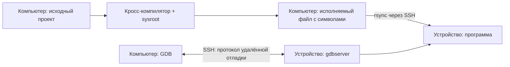

# Кросс-разработка: экспортированное окружение SDK и проекта

## Содержание

- [Цель и схема работы](#цель-и-схема-работы)
- [Сравнение с практикой Embedded Linux](#сравнение-с-практикой-embedded-linux)
- [Предварительные условия](#предварительные-условия)
- [Принцип подготовки кросс-среды](#принцип-подготовки-кросс-среды)
- [Выберите toolchain](#выберите-toolchain)
- [Подготовьте SDK и проект](#подготовьте-sdk-и-проект)
- [Подготовьте sysroot](#подготовьте-sysroot)
- [Сборка и запуск без VS Code](#сборка-и-запуск-без-vs-code)
- [Сборка и отладка в VS Code](#сборка-и-отладка-в-vs-code)
- [Готовые файлы окружения](#готовые-файлы-окружения)
- [Если что-то не работает](#если-что-то-не-работает)
- [Проверенные платформы](#проверенные-платформы)

## Цель и схема работы

Соберём приложение для целевого Linux на компьютере, передадим его на устройство и настроим отладку с консольным вводом. Проект, скрипты и организация рабочего каталога аналогичны [нативному туториалу](../native/README.md).

**Компилятор, CMake, Ninja и GDB работают на компьютере в Ubuntu/WSL. На устройстве работают приложение и gdbserver.** Кросс-компилятор создаёт машинный код для целевой архитектуры, которая может отличаться от архитектуры компьютера.

| Где | Что находится и выполняется |
|---|---|
| Компьютер, Ubuntu/WSL | Исходники, toolchain, sysroot, сборка, GDB, расширения VS Code |
| Целевой Linux | Копия исполняемого файла, его библиотеки, gdbserver и консоль приложения |



Цикл работы: редактирование → локальная кросс-сборка → передача программы → запуск или отладка на устройстве. Исходники на устройство не копируются; GDB читает символы из локального исполняемого файла. На устройстве должна запускаться именно его переданная копия.

## Сравнение с практикой Embedded Linux

Сборка на компьютере, запуск на устройстве и локальный GDB с удалённым gdbserver соответствуют обычной организации кросс-разработки. Единого стандарта рабочего процесса нет; для сравнения используем подходы Yocto, Buildroot и документированные механизмы GDB.

| Аспект | Вариант этого туториала | Типичный процесс для продукта |
|---|---|---|
| Компилятор | Кросс-GCC из Ubuntu, выбранный профилем SDK | Версионированный SDK, согласованный с образом устройства |
| Sysroot | Копирование заголовков и библиотек с устройства | Формирование вместе с образом или получение из SDK |
| Проект | Самостоятельный CMake-проект | Аналогичный проект, подключённый к инфраструктуре продукта |
| Сборка | CMake/Ninja и независимые Bash-скрипты | Аналогично, дополнительно автоматизированная сборка в CI |
| Передача | rsync исполняемого файла | Для разработки — аналогично; для выпуска — пакет, образ или механизм обновления |
| Отладка | Локальный GDB → SSH → gdbserver | Та же архитектура; транспорт зависит от инфраструктуры |
| Консоль | SSH-терминал с автоматическим получением TTY | Обычно автоматизированная консоль либо отдельное подключение |
| Воспроизводимость | Зависит от текущих пакетов компьютера и устройства | Зафиксированные SDK, зависимости и конфигурация образа |

Параметры окружения экспортируются из профиля SDK, как при работе с Buildroot SDK. Главное отличие — происхождение и фиксация **SDK**. Yocto формирует целевой sysroot и инструменты по конфигурации системы. Buildroot экспортирует toolchain и файлы разработки командой `make sdk`. Это позволяет распространять согласованное окружение между разработчиками и использовать его в CI. См. [Yocto SDK](https://docs.yoctoproject.org/sdk-manual/intro.html) и [экспорт SDK Buildroot](https://buildroot.org/downloads/manual/manual.html).

Копирование sysroot удобно для существующего Debian-устройства без готового SDK. Но обновление пакетов устройства меняет получаемое окружение, а обновление компилятора компьютера может изменить используемые runtime-библиотеки. Исправление символических ссылок не гарантирует совместимость всех зависимостей.

Отладка через SSH и оболочка `--wrapper` используют документированные механизмы GDB. Отдельная консоль нужна для интерактивного примера: при stdio-транспорте stdin приложения по умолчанию подключён к `/dev/null`. См. [описание gdbserver](https://www.sourceware.org/gdb/current/onlinedocs/gdb.html/Server.html).

Для учебного материала текущая схема позволяет разбирать этапы отдельно и работать без VS Code. При переходе к продуктовой разработке полезно:

1. Зафиксировать совместимый SDK и его версию.
2. Использовать единый источник настроек для Bash, VS Code и CI.
3. Автоматизировать подключение консоли.
4. Устанавливать приложение и зависимости через пакет или образ.
5. Проверять сборку в CI и сохранять исполняемый файл с отладочными символами.

Это направления развития, а не реализованные возможности примера. Переход на Yocto или Buildroot ради одного приложения не обязателен: сначала стоит обеспечить воспроизводимое окружение сборки.

## Предварительные условия

- Подготовленное [рабочее окружение](../../environment/README.md) и [SSH-доступ по ключу](../ssh/README.md).
- Кросс-компилятор для архитектуры и ABI целевых приложений.
- Заголовки и библиотеки целевой системы: sysroot из SDK либо копия с устройства.
- `gdb-multiarch` на компьютере и `gdbserver` на устройстве для отладки.

## Принцип подготовки кросс-среды

Кросс-среда должна согласовать **инструменты на host** с **пользовательской системой target**. Выбор только по модели платы или процессора недостаточен: важны архитектура приложений, ABI и библиотека C.

| Часть среды | Что содержит | Для чего нужна |
|---|---|---|
| Toolchain | Кросс-компиляторы, ассемблер, линковщик и другие инструменты | Создаёт машинный код и ELF-файлы для target, работая на host |
| Sysroot | Целевые заголовки, библиотеки и файлы разработки | Позволяет собирать приложение с интерфейсами и зависимостями target |
| Toolchain-файл CMake | Пути компиляторов, целевая архитектура, sysroot и правила поиска | Настраивает CMake на кросс-сборку |
| Окружение SDK | Пути к перечисленным частям и инструменты отладки | Даёт скриптам и редактору согласованные настройки |

SDK — согласованный комплект для разработки под определённую целевую систему. Toolchain — его часть; sysroot — другая. Sysroot не обязан быть полным образом устройства: нужны файлы разработки используемых библиотек, а не `/proc`, `/dev` и пользовательские данные. В нашем примере `sdk/` содержит профиль окружения и CMake-файл, инструменты установлены в Ubuntu, sysroot хранится отдельно. Это учебная организация среды, а не готовый дистрибутив SDK.

Подготовка выполняется в таком порядке:

1. **Определите пользовательское окружение target:** архитектуру приложений, ABI и libc. Команды и пример AArch64 приведены в [выборе toolchain](#выберите-toolchain). Возможности CPU и архитектура ядра не заменяют эту проверку.
2. **Выберите согласованный toolchain и sysroot.** Для образов Yocto/Buildroot предпочтителен SDK из той же конфигурации образа. Для существующего Debian-устройства в этом уроке используем кросс-GCC Ubuntu и снимок файлов разработки target; совместимость нужно проверять сборкой и запуском.
3. **Настройте профиль SDK.** В `sdk/cmake/linux-toolchain.cmake` задайте компиляторы и архитектуру. В `sdk/environment-setup` явно задайте пути sysroot, toolchain-файла и GDB. Параметры SDK не зависят от имени приложения и SSH-адреса устройства.
4. **Задайте окружение проекта.** `project.env` описывает исходный проект, каталог сборки, приложение и его запуск на конкретном target. Один SDK можно использовать для нескольких проектов; меняются параметры проекта, а не компилятор и sysroot.
5. **Загрузите окружение и проверьте результат.** Для терминала сначала SDK, затем проект; после настройки CMake и сборки проверьте архитектуру ELF и запустите файл на target. Успешная компиляция сама по себе не подтверждает совместимость runtime-библиотек.

CMake ищет библиотеки, заголовки и пакеты в целевой среде, а программы, выполняемые во время сборки, — на host. Эти правила задаются в toolchain-файле. См. [кросс-сборку Linux в CMake](https://cmake.org/cmake/help/latest/manual/cmake-toolchains.7.html#cross-compiling-for-linux), [SDK Buildroot](https://buildroot.org/downloads/manual/manual.html#_using_the_generated_toolchain_outside_buildroot) и [SDK Yocto](https://docs.yoctoproject.org/sdk-manual/intro.html).

### Имена параметров

Префикс обозначает назначение параметра:

| Префикс | Что настраивает | Где задаётся |
|---|---|---|
| `SDK_*` | Инструменты и целевое окружение, общие для проектов | `sdk/environment-setup` |
| `HOST_*` | Пути конкретного проекта на компьютере | `project.env` |
| `TARGET_*` | Подключение и запуск на устройстве | `project.env` |
| `BUILD_*` | Режим и параллелизм сборки проекта | `project.env` |

Все значения задаются явными строками `export`, без запасных значений. Например, `SDK_SYSROOT` — полный путь к целевым библиотекам **на host**, а `SDK_TARGET_LOADER` — путь загрузчика **в файловой системе target**. `SDK_TARGET_MULTIARCH` используется только при копировании библиотек Debian; это не универсальное имя архитектуры. `SDK_DEBUG_ARCH` задаёт обозначение архитектуры для адаптера VS Code, а архитектура компиляции остаётся в CMake-файле. Пути компиляторов не дублируются в переменных окружения.

## Выберите toolchain

Проверьте **на устройстве**:

```bash
dpkg --print-architecture
uname -m
ldd --version
```

`dpkg` показывает архитектуру пакетов Debian/Ubuntu, `uname` — ядра. На системе без dpkg используйте описание SDK и `file /bin/sh` с учётом символических ссылок. Архитектура ядра сама по себе не определяет архитектуру приложений, библиотек и ABI.

| Целевое пользовательское окружение | Пример семейства компиляторов |
|---|---|
| Linux AArch64 / Debian `arm64` | `aarch64-linux-gnu-gcc`, `aarch64-linux-gnu-g++` |
| Linux ARM с hard-float / Debian `armhf` | `arm-linux-gnueabihf-gcc`, `arm-linux-gnueabihf-g++`; дополнительно проверьте набор инструкций CPU |

Ниже используется **AArch64 Linux с glibc и каталогами Debian multiarch**. Это конкретная конфигурация примера, а не ограничение всего подхода. Для другой платформы замените toolchain, sysroot и способ его получения. Bare-metal-компилятор `arm-none-eabi` не заменяет Linux-toolchain.

На компьютере **в Ubuntu/WSL**:

```bash
sudo apt update
sudo apt install cmake ninja-build gcc-aarch64-linux-gnu g++-aarch64-linux-gnu gdb-multiarch rsync
```

Для реального проекта предпочтителен SDK, соответствующий образу устройства: он согласует компилятор, ABI, sysroot и версии библиотек. Дистрибутивный GCC подходит для нашего проверенного примера, но это не гарантия совместимости любых зависимостей. Даже с `CMAKE_SYSROOT` компилятор может использовать собственные runtime-библиотеки, особенно для C++.

На устройстве с Debian/Ubuntu:

```bash
sudo apt update
sudo apt install gdbserver rsync libc6-dev
```

Компилятор и CMake на устройстве для этого варианта не требуются. Пакеты разработки дополнительных библиотек нужны в источнике sysroot; runtime-библиотеки — на устройстве при запуске.

## Подготовьте SDK и проект

Из корня EmbedLinux **на host в Ubuntu/WSL**:

```bash
mkdir -p "$HOME/projects/hello-cross"
cp -R tutor/cross/example/. "$HOME/projects/hello-cross/"
cd "$HOME/projects/hello-cross"
```

```text
hello-cross/
├── project/                    # самостоятельное приложение
├── sdk/
│   ├── environment-setup         # окружение инструментов и sysroot
│   └── cmake/linux-toolchain.cmake
├── project.env                 # окружение конкретного проекта
├── scripts/                    # независимые операции
├── .vscode/                    # читает экспортированные переменные
└── build/                      # локальная сборка
```

**`sdk/environment-setup`** — профиль учебного SDK: он использует установленные в Ubuntu инструменты и sysroot устройства. Это ещё не архив SDK, экспортированный Buildroot, и не гарантия совместимости всех библиотек. Компиляторы и архитектура фиксированы в toolchain-файле; окружение указывает путь к нему.

**`project.env`** — адрес устройства, каталог установки, пути проекта и параметры сборки. Исходный проект не зависит от этих файлов. Имя `cross_example` фиксировано в `project/CMakeLists.txt`; параметры приложения выбирают готовый файл, а не переименовывают CMake-target.

Загрузите оба файла **из корня примера**:

```bash
source sdk/environment-setup
source project.env
```

В Bash пути формируются последовательно и абсолютно. `HOST_WORK_DIR → HOST_BUILD_DIR → HOST_APP_PATH` описывает локальную сборку. `TARGET_WORK_DIR → TARGET_APP_PATH` описывает установку на устройстве: каталога сборки на target нет. В него напрямую передаётся готовая программа.

| Файл | Параметры | Назначение |
|---|---|---|
| `sdk/environment-setup` | `SDK_ROOT`, `SDK_SYSROOT`, `SDK_TOOLCHAIN_FILE`, `SDK_GDB` | Каталог профиля SDK, sysroot, toolchain и локальный GDB |
| `sdk/environment-setup` | `SDK_TARGET_LOADER`, `SDK_TARGET_MULTIARCH`, `SDK_DEBUG_ARCH` | Загрузчик, каталоги Debian multiarch и архитектура отладчика |
| `project.env` | `HOST_WORK_DIR`, `HOST_BUILD_DIR`, `HOST_APP_PATH` | Корень проекта, сборка и локальное приложение |
| `project.env` | `TARGET_SSH_HOST`, `TARGET_WORK_DIR`, `TARGET_APP_PATH`, `TARGET_GDBSERVER` | SSH-адрес или алиас, каталог установки, приложение и gdbserver |
| `project.env` | `BUILD_TYPE`, `BUILD_JOBS` | Тип и параллелизм сборки |

В `sdk/environment-setup` явно укажите каталог своего sysroot:

```bash
export SDK_SYSROOT="$HOME/sysroots/rpi0"
```

Это строка в файле окружения SDK. Для другого каталога измените её, затем снова загрузите SDK и `project.env`. `SDK_ROOT` в учебном примере формируется как `$PWD/sdk`, поэтому файлы загружаются из корня примера. Если профиль SDK хранится отдельно, укажите его полный путь в строке `SDK_ROOT`.

В Bash используйте `$HOME`, а не литерал `"~/..."`. После изменения файла окружения загрузите его заново. При смене компилятора, ABI или sysroot используйте новый каталог сборки: CMake сохраняет toolchain в кеше. Для удалённых команд в этом коротком примере используйте пути без пробелов, кавычек, переводов строк и shell-символов.

## Подготовьте sysroot

Если готового SDK нет, скопируйте файлы с устройства:

```bash
source sdk/environment-setup
source project.env
bash scripts/sysroot.sh
bash scripts/fix-sysroot-links.sh
```

`sysroot.sh` копирует `/usr/include`, каталоги библиотек Debian multiarch и загрузчик. `--delete` удаляет отсутствующие файлы только в соответствующих каталогах локальной копии. Символические ссылки сохраняются; второй скрипт переводит абсолютные ссылки в относительные внутри sysroot. При объединённом `/usr` ключ `--link-dest` позволяет не хранить одинаковые файлы дважды.

Это снимок библиотек устройства; он не фиксирует автоматически версии компилятора и всех зависимостей. Для SDK Yocto/Buildroot используйте sysroot поставщика.

## Сборка и запуск без VS Code

В корне примера на host:

```bash
source sdk/environment-setup
source project.env
bash scripts/configure.sh
bash scripts/build.sh
bash scripts/deploy.sh
bash scripts/run.sh
```

После первой сборки проверьте файл на host:

```bash
file "$HOST_APP_PATH"
readelf -h "$HOST_APP_PATH"
readelf -l "$HOST_APP_PATH"
```

Для профиля этого примера ожидаются ELF64, AArch64 и загрузчик `/lib/ld-linux-aarch64.so.1`. Затем `run.sh` проверяет запуск в реальной целевой системе.

После изменения исходников:

```bash
bash scripts/build.sh && bash scripts/deploy.sh && bash scripts/run.sh
```

При изменении параметров CMake сначала повторите `configure.sh`. Программа запрашивает два числа и выводит сумму и произведение; Ctrl+D завершает ввод. Для запуска переданной программы достаточно `bash scripts/run.sh`.

### Назначение скриптов

| Скрипт | Что делает | Результат |
|---|---|---|
| [sysroot.sh](example/scripts/sysroot.sh) | Копирует заголовки, библиотеки и загрузчик с target | Sysroot на host |
| [fix-sysroot-links.sh](example/scripts/fix-sysroot-links.sh) | Исправляет абсолютные символические ссылки | Ссылки внутри sysroot |
| [configure.sh](example/scripts/configure.sh) | Вызывает CMake с toolchain | Правила Ninja и `compile_commands.json` в `HOST_BUILD_DIR` |
| [build.sh](example/scripts/build.sh) | Запускает локальную сборку | Исполняемый файл с символами |
| [deploy.sh](example/scripts/deploy.sh) | Передаёт готовое приложение | Программа по `TARGET_APP_PATH` |
| [run.sh](example/scripts/run.sh) | Запускает готовое приложение по SSH | Ввод и вывод в терминале |
| [debug-console.sh](example/scripts/debug-console.sh) | Открывает SSH-консоль и сохраняет TTY | Консоль приложения |
| [debug-transport.sh](example/scripts/debug-transport.sh) | Читает TTY и запускает gdbserver через SSH | Канал отладки для GDB |

В скриптах с несколькими операциями используется `set -e`: при ошибке выполнение прекращается. В скриптах с одной командой он не нужен — её код завершения и так становится кодом скрипта. `set -u` убран; окружение загружается перед работой и проверяется задачей `Show Environment Only`. Строка `#!/usr/bin/env bash` выбирает Bash при прямом запуске файла; при `bash script.sh` интерпретатор уже выбран явно.

SSH использует настройки из `~/.ssh/config`. Для передачи rsync сам вызывает SSH, поэтому отдельный `-e` не нужен. `-t` у SSH оставлен для консоли приложения, `-T` в отладке отключает терминал для протокола GDB.

Скрипты не загружают окружение и не вызывают друг друга. Порядок операций задаёт пользователь или задачи VS Code. `deploy.sh` использует `rsync --mkpath`: недостающие каталоги назначения создаются автоматически, отдельный шаг подготовки не нужен. Для этой опции требуется rsync 3.2.3 или новее на host и target; см. [документацию rsync](https://download.samba.org/pub/rsync/rsync.1#opt--mkpath).

`deploy.sh` передаёт только программу из `HOST_APP_PATH` в `TARGET_APP_PATH`. `--delete` не используется: на устройстве могут находиться собственные конфигурации и данные. Удалённые локально файлы автоматически на target не удаляются.

## Сборка и отладка в VS Code

### Настройка VS Code

Откройте корень примера через `code .`. В WSL установите C/C++ (`ms-vscode.cpptools`) в окружение WSL. Подготавливать окружение редактора и менять `server-env-setup` не требуется.

Параметры VS Code задаются в `.vscode/settings.json`: `sdk.*` — SDK, `host.*` — локальный проект, `target.*` — устройство, `build.*` — сборка. Это отдельная копия значений из `sdk/environment-setup` и `project.env`; при изменении SDK или путей согласуйте их вручную.

`sdk.sysroot` — абсолютный путь в WSL; замените пример `/home/agomanchuk/sysroots/rpi0` своим. `sdk.root` — относительно корня примера, `sdk.toolchainFile` — относительно `sdk.root`. `host.workDir` — относительно корня примера, `host.buildDir` — относительно него, `host.appPath` — относительно каталога сборки. `target.workDir` — полный путь на устройстве, `target.appPath` — относительно него. Полные пути составляются непосредственно в задачах и отладке, без вложенных подстановок в настройках.

Задачи передают значения скриптам через `options.env`. GDB получает пути непосредственно из настроек; `debug-transport.sh` получает необходимые значения аргументами. Поэтому запуск не зависит от переменных процесса VS Code или ранее открытого терминала.

`C_Cpp.default.compileCommands` указывает на локальный файл сборки; при изменении `host.workDir` или `host.buildDir` исправьте и этот путь. После первой настройки CMake файл содержит выбранный компилятор и sysroot. Сборка выполняется нашими задачами.

Запустите `Show Environment Only`, чтобы увидеть значения, которые получат задачи. Они должны соответствовать подготовленному SDK и проекту.

### Команды и отладка

Задачи с `Only` выполняют одну операцию; задачи без суффикса собирают последовательность:

| Задача | Что выполняется |
|---|---|
| `Configure Only` | Только CMake configure |
| `Build Only` | Только сборка существующего каталога |
| `Deploy Only` | Только передача готового приложения |
| `Run Only` | Только запуск на устройстве |
| `Console` | Только открытие консоли отладки |
| `Build` | Configure → Build Only |
| `Deploy` | Build → Deploy Only |
| `Debug` | Deploy → Console, затем запуск GDB |
| `Sync Sysroot` | Copy Sysroot Only → Fix Sysroot Links Only |

- **Ctrl+Shift+B** — `Configure Only → Build Only`.
- `Deploy` — сборка и передача с созданием каталогов на target.
- `Run Only` — запуск без сборки и передачи.
- `Sync Sysroot` — копирование sysroot и исправление ссылок; для готового SDK не запускайте.
- **F5** — задача `Debug` соберёт и передаст приложение, откроет консоль и дождётся её готовности. GDB остановит приложение в `main`.
- Продолжите выполнение и вводите числа в терминале `Console`. Ручного ввода TTY нет.

Ninja пропускает ненужную компиляцию, но задачи `preLaunchTask` повторяются при каждом F5. Для отладки уже переданного приложения можно убрать `preLaunchTask`; тогда заранее откройте `Console`, а актуальность файлов обеспечьте вручную.

### Как запускается удалённая отладка

1. `preLaunchTask: "Debug"` выполняет `Deploy`, затем запускает фоновую задачу `Console`. Sysroot автоматически не обновляется.
2. `debug-console.sh` открывает SSH-терминал, сохраняет его TTY в `HOST_BUILD_DIR/target.tty` и печатает `Target console ready`. Фоновый matcher задачи сообщает VS Code, что консоль готова. Только после этого начинается отладка.
3. VS Code запускает локальный GDB из `sdk.gdb`; символы читаются по пути, составленному из `host.workDir`, `host.buildDir` и `host.appPath`.
4. `set sysroot` указывает локальные библиотеки устройства.
5. Команда `target remote | bash .../debug-transport.sh` читает сохранённый TTY и запускает gdbserver на target через SSH. SSH переносит протокол отладки через stdio, отдельный TCP-порт не нужен.
6. `tbreak main` устанавливает одноразовую точку останова, затем `exec-continue` продолжает выполнение до неё.

Два локальных скрипта связываются только через файл `target.tty`; на target передаётся только приложение. Служебный файл `target.tty` находится в игнорируемой папке сборки и удаляется при закрытии консоли. `customLaunchSetupCommands` заменяет стандартную последовательность, поэтому в ней явно указана команда `file`.

### Параметры launch.json

| Параметр | Назначение |
|---|---|
| `program` | Локальный `HOST_APP_PATH` с отладочными символами |
| `cwd` | Рабочий каталог локального GDB |
| `miDebuggerPath` | Локальный GDB из окружения SDK |
| `preLaunchTask` | Сборка, передача и ожидание готовности фоновой консоли |
| `customLaunchSetupCommands` | По порядку: sysroot → символы приложения → SSH/gdbserver → точка останова в `main` |
| `targetArchitecture` | `SDK_DEBUG_ARCH`; для AArch64 адаптер использует `arm64` |

### Как работает консоль

SSH-канал gdbserver занят протоколом отладки. `debug-console.sh` держит отдельное SSH-соединение с TTY; `debug-transport.sh` использует этот TTY для stdin, stdout и stderr приложения. Перенаправление выполняется встроенной командой оболочки через `--wrapper`, без создания файлов на устройстве.

Вводите числа в терминале `Console`; Debug Console предназначена для GDB. Консоль остаётся открытой между сеансами отладки. Для её закрытия используйте `Tasks: Terminate Task → Console`. После завершения консоли повторный запуск создаст новое соединение и получит новый TTY. Для остановки самого приложения используйте кнопки отладчика.

Без VS Code можно использовать те же два скрипта. В одном терминале, после загрузки окружения:

```bash
bash scripts/debug-console.sh
```

В другом подготовленном терминале, после сборки и передачи:

```bash
"$SDK_GDB" "$HOST_APP_PATH" \
    -ex "set sysroot $SDK_SYSROOT" \
    -ex "target remote | bash '$HOST_WORK_DIR/scripts/debug-transport.sh' '$HOST_BUILD_DIR' '$TARGET_SSH_HOST' '$TARGET_WORK_DIR' '$TARGET_APP_PATH' '$TARGET_GDBSERVER'" \
    -ex "tbreak main" \
    -ex "continue"
```

Статические функции и консольный ввод находятся в [project/main.c](example/project/main.c); исходник здесь не дублируется. Файл `target.tty` обслуживает одну консоль текущего каталога сборки: параллельные сеансы используйте с разными каталогами сборки.

### Команды скриптов отладки

**`debug-console.sh`** открывает терминал приложения. Его первая строка вывода — адрес терминала на target, например `/dev/pts/2`; её скрипт сохраняет локально. Остальной вывод передаётся в терминал VS Code.

| Команда | Что делает |
|---|---|
| `mkdir -p "$HOST_BUILD_DIR"` | Создаёт место для локального файла с адресом TTY |
| `rm -f "$tty_file"` | Удаляет адрес старой консоли перед новым подключением |
| `trap 'rm -f "$tty_file"' EXIT` | Удаляет файл при завершении скрипта |
| `ssh -tt` | Принудительно создаёт терминал на target, даже когда вывод SSH направлен в pipe |
| `tty; exec sleep infinity` | Печатает адрес терминала и держит SSH-соединение открытым; `sleep` не читает ввод приложения |
| `\| { ...; }` | Передаёт вывод SSH группе команд: первая строка сохраняется, остальные выводятся пользователю |
| `IFS= read -r target_tty` | Читает первую строку без обрезания пробелов и обработки обратных слешей |
| `[[ $target_tty == /dev/pts/* ]]` | Проверяет, что получен адрес терминала, а не посторонний вывод |
| `${target_tty%$'\r'}` | Убирает завершающий carriage return, добавленный терминалом |
| `printf ... > "$tty_file"` | Сохраняет адрес TTY в `HOST_BUILD_DIR/target.tty` |
| `echo "Target console ready"` | Сообщает фоновой задаче VS Code, что можно запускать GDB |
| `cat` | Передаёт последующий вывод SSH в терминал задачи |

**`debug-transport.sh`** получает пять именованных параметров через аргументы, читает адрес консоли и запускает gdbserver. Его stdin/stdout заняты протоколом GDB; ввод и вывод приложения уходят в терминал, открытый первым скриптом.

| Команда или параметр | Что делает |
|---|---|
| `host_build_dir=$1` и следующие присваивания | Получают каталог сборки, SSH-адрес, рабочую папку, путь приложения и gdbserver из пяти аргументов |
| `target_tty=$(cat "$tty_file")` | Получает адрес открытой консоли из локального файла |
| `exec ssh -T` | Заменяет локальный скрипт процессом SSH; отключает терминал для канала GDB |
| `cd ... && exec gdbserver` | Выбирает рабочую папку на target и запускает там gdbserver |
| `--once` | Завершает gdbserver после окончания единственного подключения отладчика |
| `--wrapper /bin/sh -c ...` | Запускает приложение через короткую команду оболочки; файл обёртки не нужен |
| `exec APP < TTY > TTY 2>&1` | Запускает приложение: ввод из TTY, обычный вывод и ошибки в тот же TTY |
| `-- stdio APP` | Заканчивает параметры обёртки; задаёт stdio-транспорт отладки и путь приложения |

Вложенные кавычки сохраняют команду перенаправления при обработке её SSH и оболочкой gdbserver. В `launch.json` остаётся короткий вызов `debug-transport.sh`; команда SSH находится в одном месте.

## Готовые файлы окружения

Файлы относительно корня [example](example). SDK можно хранить отдельно: задайте `SDK_ROOT` его полным путём в файле `sdk/environment-setup`. Для работы из терминала загрузите файлы SDK и проекта; для VS Code заполните настройки редактора.

**`sdk/environment-setup`** ([файл](example/sdk/environment-setup)):

```bash
# Source from the example root.
export SDK_ROOT="$PWD/sdk"
export SDK_SYSROOT="$HOME/sysroots/rpi0"
export SDK_TOOLCHAIN_FILE="$SDK_ROOT/cmake/linux-toolchain.cmake"
export SDK_GDB=/usr/bin/gdb-multiarch

export SDK_TARGET_LOADER=/lib/ld-linux-aarch64.so.1
export SDK_TARGET_MULTIARCH=aarch64-linux-gnu
export SDK_DEBUG_ARCH=arm64
```

**`project.env`** ([файл](example/project.env)):

```bash
export HOST_WORK_DIR="$PWD"
export HOST_BUILD_DIR="$HOST_WORK_DIR/build/debug"
export HOST_APP_PATH="$HOST_BUILD_DIR/cross_example"

export TARGET_SSH_HOST=pi-dev
export TARGET_WORK_DIR=/home/dev/work/hello-cross
export TARGET_APP_PATH="$TARGET_WORK_DIR/cross_example"
export TARGET_GDBSERVER=/usr/bin/gdbserver

export BUILD_TYPE=Debug
export BUILD_JOBS=2
```

**`project/CMakeLists.txt`** ([файл](example/project/CMakeLists.txt)):

```cmake
cmake_minimum_required(VERSION 3.21)
project(cross_example LANGUAGES C CXX)

add_executable(cross_example main.c)
target_compile_features(cross_example PRIVATE c_std_11)
target_compile_options(cross_example PRIVATE -Wall -Wextra)
```

**`sdk/cmake/linux-toolchain.cmake`** ([файл](example/sdk/cmake/linux-toolchain.cmake)):

```cmake
set(CMAKE_SYSTEM_NAME Linux)
set(CMAKE_SYSTEM_PROCESSOR aarch64)
set(CMAKE_C_COMPILER /usr/bin/aarch64-linux-gnu-gcc)
set(CMAKE_CXX_COMPILER /usr/bin/aarch64-linux-gnu-g++)

if("$ENV{SDK_SYSROOT}" STREQUAL "")
    message(FATAL_ERROR "Set SDK_SYSROOT before configuring the cross build")
endif()
set(CMAKE_SYSROOT "$ENV{SDK_SYSROOT}")

set(CMAKE_FIND_ROOT_PATH_MODE_PROGRAM NEVER)
set(CMAKE_FIND_ROOT_PATH_MODE_LIBRARY ONLY)
set(CMAKE_FIND_ROOT_PATH_MODE_INCLUDE ONLY)
set(CMAKE_FIND_ROOT_PATH_MODE_PACKAGE ONLY)
```

**`scripts/build.sh`** ([файл](example/scripts/build.sh)):

```bash
#!/usr/bin/env bash
cmake --build "$HOST_BUILD_DIR" --parallel "$BUILD_JOBS"
```

**`scripts/configure.sh`** ([файл](example/scripts/configure.sh)):

```bash
#!/usr/bin/env bash
cmake -S "$HOST_WORK_DIR/project" -B "$HOST_BUILD_DIR" -G Ninja \
    -DCMAKE_TOOLCHAIN_FILE="$SDK_TOOLCHAIN_FILE" \
    -DCMAKE_BUILD_TYPE="$BUILD_TYPE" \
    -DCMAKE_EXPORT_COMPILE_COMMANDS=ON
```

**`scripts/debug-console.sh`** ([файл](example/scripts/debug-console.sh)):

```bash
#!/usr/bin/env bash
set -e

tty_file="$HOST_BUILD_DIR/target.tty"

mkdir -p "$HOST_BUILD_DIR"
rm -f "$tty_file"
trap 'rm -f "$tty_file"' EXIT
echo "Opening target console"
ssh -tt "$TARGET_SSH_HOST" "tty; exec sleep infinity" | {
    IFS= read -r target_tty
    [[ $target_tty == /dev/pts/* ]]
    printf '%s\n' "${target_tty%$'\r'}" > "$tty_file"
    echo "Target console ready"
    cat
}
```

**`scripts/debug-transport.sh`** ([файл](example/scripts/debug-transport.sh)):

```bash
#!/usr/bin/env bash
set -e

host_build_dir=$1
target_ssh_host=$2
target_work_dir=$3
target_app_path=$4
target_gdbserver=$5

tty_file="$host_build_dir/target.tty"

target_tty=$(cat "$tty_file")
exec ssh -T "$target_ssh_host" \
    "cd '$target_work_dir' && exec '$target_gdbserver' --once --wrapper /bin/sh -c '\"exec $target_app_path < $target_tty > $target_tty 2>&1\"' -- stdio '$target_app_path'"
```

**`scripts/deploy.sh`** ([файл](example/scripts/deploy.sh)):

```bash
#!/usr/bin/env bash
rsync -t --mkpath "$HOST_APP_PATH" "$TARGET_SSH_HOST:$TARGET_APP_PATH"
```

**`scripts/fix-sysroot-links.sh`** ([файл](example/scripts/fix-sysroot-links.sh)):

```bash
#!/usr/bin/env bash
set -e
find "$SDK_SYSROOT" -type l -print0 |
while IFS= read -r -d '' link; do
    destination=$(readlink "$link")
    if [[ $destination == /* ]]; then
        relative=$(realpath -ms --relative-to="$(dirname "$link")" "$SDK_SYSROOT$destination")
        ln -sfn "$relative" "$link"
    fi
done
```

**`scripts/run.sh`** ([файл](example/scripts/run.sh)):

```bash
#!/usr/bin/env bash
ssh -t "$TARGET_SSH_HOST" \
    "cd '$TARGET_WORK_DIR' && exec '$TARGET_APP_PATH'"
```

**`scripts/sysroot.sh`** ([файл](example/scripts/sysroot.sh)):

```bash
#!/usr/bin/env bash
set -e
mkdir -p "$SDK_SYSROOT/usr/lib" "$SDK_SYSROOT/lib"
rsync -rlt --delete \
    "$TARGET_SSH_HOST:/usr/include/" "$SDK_SYSROOT/usr/include/"
rsync -rlt --delete \
    "$TARGET_SSH_HOST:/usr/lib/$SDK_TARGET_MULTIARCH/" "$SDK_SYSROOT/usr/lib/$SDK_TARGET_MULTIARCH/"
rsync -rlt --delete --link-dest="$SDK_SYSROOT/usr/lib/$SDK_TARGET_MULTIARCH" \
    "$TARGET_SSH_HOST:/lib/$SDK_TARGET_MULTIARCH/" "$SDK_SYSROOT/lib/$SDK_TARGET_MULTIARCH/"
rsync -rlt \
    "$TARGET_SSH_HOST:$SDK_TARGET_LOADER" "$SDK_SYSROOT$SDK_TARGET_LOADER"
```

**`.vscode/launch.json`** ([файл](example/.vscode/launch.json)):

```json
{
    "version": "0.2.0",
    "configurations": [
        {
            "name": "Cross: local GDB via SSH",
            "type": "cppdbg",
            "request": "launch",
            "program": "${workspaceFolder}/${config:host.workDir}/${config:host.buildDir}/${config:host.appPath}",
            "cwd": "${workspaceFolder}/${config:host.workDir}",
            "MIMode": "gdb",
            "miDebuggerPath": "${config:sdk.gdb}",
            "preLaunchTask": "Debug",
            "customLaunchSetupCommands": [
                {
                    "text": "set sysroot ${config:sdk.sysroot}"
                },
                {
                    "text": "file \"${workspaceFolder}/${config:host.workDir}/${config:host.buildDir}/${config:host.appPath}\""
                },
                {
                    "text": "target remote | bash \"${workspaceFolder}/scripts/debug-transport.sh\" \"${workspaceFolder}/${config:host.workDir}/${config:host.buildDir}\" \"${config:target.sshHost}\" \"${config:target.workDir}\" \"${config:target.workDir}/${config:target.appPath}\" \"${config:target.gdbserver}\""
                },
                {
                    "text": "tbreak main"
                }
            ],
            "launchCompleteCommand": "exec-continue",
            "targetArchitecture": "${config:sdk.debugArch}"
        }
    ]
}
```

**`.vscode/settings.json`** ([файл](example/.vscode/settings.json)):

```json
{
    "sdk.root": "sdk",
    "sdk.sysroot": "/home/agomanchuk/sysroots/rpi0",
    "sdk.toolchainFile": "cmake/linux-toolchain.cmake",
    "sdk.gdb": "/usr/bin/gdb-multiarch",
    "sdk.targetLoader": "/lib/ld-linux-aarch64.so.1",
    "sdk.targetMultiarch": "aarch64-linux-gnu",
    "sdk.debugArch": "arm64",
    "host.workDir": ".",
    "host.buildDir": "build/debug",
    "host.appPath": "cross_example",
    "target.sshHost": "pi-dev",
    "target.workDir": "/home/dev/work/hello-cross",
    "target.appPath": "cross_example",
    "target.gdbserver": "/usr/bin/gdbserver",
    "build.type": "Debug",
    "build.jobs": "2",
    "C_Cpp.default.compileCommands": [
        "${workspaceFolder}/build/debug/compile_commands.json"
    ],
    "C_Cpp.default.cStandard": "c11",
    "C_Cpp.default.cppStandard": "c++17",
    "cmake.configureOnOpen": false
}
```

**`.vscode/tasks.json`** ([файл](example/.vscode/tasks.json)):

```json
{
    "version": "2.0.0",
    "options": {
        "cwd": "${workspaceFolder}",
        "env": {
            "SDK_ROOT": "${workspaceFolder}/${config:sdk.root}",
            "SDK_SYSROOT": "${config:sdk.sysroot}",
            "SDK_TOOLCHAIN_FILE": "${workspaceFolder}/${config:sdk.root}/${config:sdk.toolchainFile}",
            "SDK_GDB": "${config:sdk.gdb}",
            "SDK_TARGET_LOADER": "${config:sdk.targetLoader}",
            "SDK_TARGET_MULTIARCH": "${config:sdk.targetMultiarch}",
            "SDK_DEBUG_ARCH": "${config:sdk.debugArch}",
            "HOST_WORK_DIR": "${workspaceFolder}/${config:host.workDir}",
            "HOST_BUILD_DIR": "${workspaceFolder}/${config:host.workDir}/${config:host.buildDir}",
            "HOST_APP_PATH": "${workspaceFolder}/${config:host.workDir}/${config:host.buildDir}/${config:host.appPath}",
            "TARGET_SSH_HOST": "${config:target.sshHost}",
            "TARGET_WORK_DIR": "${config:target.workDir}",
            "TARGET_APP_PATH": "${config:target.workDir}/${config:target.appPath}",
            "TARGET_GDBSERVER": "${config:target.gdbserver}",
            "BUILD_TYPE": "${config:build.type}",
            "BUILD_JOBS": "${config:build.jobs}"
        }
    },
    "tasks": [
        {
            "label": "Show Environment Only",
            "type": "process",
            "command": "printenv",
            "args": [
                "SDK_ROOT",
                "HOST_WORK_DIR",
                "HOST_BUILD_DIR",
                "HOST_APP_PATH",
                "SDK_SYSROOT",
                "SDK_TOOLCHAIN_FILE",
                "SDK_GDB",
                "TARGET_SSH_HOST",
                "TARGET_WORK_DIR",
                "TARGET_APP_PATH",
                "SDK_DEBUG_ARCH"
            ],
            "problemMatcher": []
        },
        {
            "label": "Copy Sysroot Only",
            "type": "process",
            "command": "bash",
            "args": [
                "scripts/sysroot.sh"
            ],
            "problemMatcher": []
        },
        {
            "label": "Fix Sysroot Links Only",
            "type": "process",
            "command": "bash",
            "args": [
                "scripts/fix-sysroot-links.sh"
            ],
            "problemMatcher": []
        },
        {
            "label": "Configure Only",
            "type": "process",
            "command": "bash",
            "args": [
                "scripts/configure.sh"
            ],
            "problemMatcher": []
        },
        {
            "label": "Build Only",
            "type": "process",
            "command": "bash",
            "args": [
                "scripts/build.sh"
            ],
            "problemMatcher": "$gcc"
        },
        {
            "label": "Deploy Only",
            "type": "process",
            "command": "bash",
            "args": [
                "scripts/deploy.sh"
            ],
            "problemMatcher": []
        },
        {
            "label": "Run Only",
            "type": "process",
            "command": "bash",
            "args": [
                "scripts/run.sh"
            ],
            "problemMatcher": []
        },
        {
            "label": "Console",
            "type": "process",
            "command": "bash",
            "args": [
                "scripts/debug-console.sh"
            ],
            "problemMatcher": {
                "owner": "target-console",
                "pattern": {
                    "regexp": "^(.+):(\\d+): (.+)$",
                    "file": 1,
                    "line": 2,
                    "message": 3
                },
                "background": {
                    "activeOnStart": true,
                    "beginsPattern": "^Opening target console$",
                    "endsPattern": "^Target console ready$"
                }
            },
            "isBackground": true,
            "presentation": {
                "reveal": "always",
                "panel": "dedicated",
                "focus": true
            }
        },
        {
            "label": "Build",
            "dependsOrder": "sequence",
            "dependsOn": [
                "Configure Only",
                "Build Only"
            ],
            "group": {
                "kind": "build",
                "isDefault": true
            },
            "problemMatcher": []
        },
        {
            "label": "Deploy",
            "dependsOrder": "sequence",
            "dependsOn": [
                "Build",
                "Deploy Only"
            ],
            "problemMatcher": []
        },
        {
            "label": "Sync Sysroot",
            "dependsOrder": "sequence",
            "dependsOn": [
                "Copy Sysroot Only",
                "Fix Sysroot Links Only"
            ],
            "problemMatcher": []
        },
        {
            "label": "Debug",
            "dependsOrder": "sequence",
            "dependsOn": [
                "Deploy",
                "Console"
            ],
            "problemMatcher": []
        }
    ]
}
```

## Если что-то не работает

| Симптом | Что проверить |
|---|---|
| Пустые пути в VS Code | `.vscode/settings.json` и значения `options.env` в задачах |
| Пути остались старыми | Настройки VS Code; в терминале повторно загрузите файлы окружения |
| `Set SDK_SYSROOT` при настройке | Загрузку `sdk/environment-setup` перед CMake |
| Не найдены заголовки или библиотеки | Sysroot, пакеты разработки и символические ссылки |
| `Exec format error` на target | Архитектуру приложения, компилятор и ABI устройства |
| Ошибка загрузчика или GLIBC | Загрузчик, runtime-библиотеки и совместимость SDK с образом |
| Нет ввода или вывода при отладке | задачу `Console`, файл `HOST_BUILD_DIR/target.tty` и соединение с устройством |
| GDB не запускается | `SDK_GDB` и поддержку целевой архитектуры |

## Проверенные платформы

Экспортированное окружение проверено в Ubuntu/WSL: CMake/Ninja собрали AArch64-приложение с sysroot устройства; передача и интерактивный запуск на Raspberry Pi Zero 2 W прошли. GDB напрямую через SSH/gdbserver остановил переданную программу в `main`. Автоматическое получение TTY, остановка в `main`, ввод чисел и вывод результата в отдельной консоли проверены с реальным устройством без интерфейса VS Code. Конфигурации VS Code и shell-файлы проверены статически; F5 в интерфейсе редактора отдельно не проверялся.

| Target | Окружение | Примечание |
|---|---|---|
| [rpi0-2w](../../hardware/rpi0-2w/README.md) | Debian 13, AArch64, glibc | Учебный профиль с GCC AArch64 Ubuntu и sysroot устройства |

[К каталогу туториалов](../README.md).
