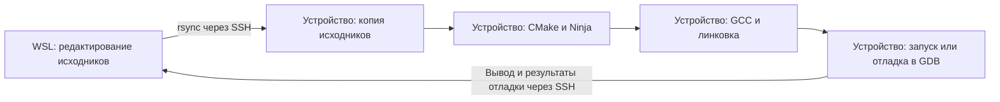

# Нативная разработка: сборка на целевом Linux-устройстве

## Содержание

- [Цель и схема работы](#цель-и-схема-работы)
- [Сравнение с Remote SSH](#сравнение-с-remote-ssh)
- [Как проходит разработка](#как-проходит-разработка)
- [Предварительные условия](#предварительные-условия)
- [Установите инструменты на устройстве](#установите-инструменты-на-устройстве)
- [Подготовьте проект и параметры](#подготовьте-проект-и-параметры)
- [Сборка и запуск без VS Code](#сборка-и-запуск-без-vs-code)
  - [Назначение скриптов](#назначение-скриптов)
- [Сборка и отладка в VS Code](#сборка-и-отладка-в-vs-code)
  - [Как запускается удалённая отладка](#как-запускается-удалённая-отладка)
  - [Параметры launch.json](#параметры-launchjson)
  - [Как работает консоль программы](#как-работает-консоль-программы)
- [Готовые файлы проекта](#готовые-файлы-проекта)
- [Подсказки редактора и изменения проекта](#подсказки-редактора-и-изменения-проекта)
- [Если что-то не работает](#если-что-то-не-работает)
- [Проверенные платформы](#проверенные-платформы)

## Цель и схема работы

Соберём приложение на C на целевом Linux-устройстве, запустим его и настроим отладку из VS Code на компьютере. Подходит физическая плата или виртуальная машина с необходимыми инструментами и доступом по SSH.

**Исходники находятся на компьютере в Ubuntu/WSL. Компилятор, библиотеки, исполняемый файл и GDB — на устройстве.** Это нативная сборка: компилятор работает в целевой системе. Архитектура компьютера разработчика может отличаться от архитектуры устройства.

| Где | Что выполняется |
|---|---|
| Windows | Интерфейс VS Code, если используем WSL |
| Ubuntu/WSL или обычный Linux компьютера | Редактирование, Bash-скрипты, SSH и rsync |
| Целевой Linux | Компиляция, линковка, запуск и GDB |

VS Code вызывает те же Bash-скрипты, которые можно запускать из терминала. VS Code Server на устройстве для этого сценария не требуется.

## Сравнение с Remote SSH

Нативная разработка допускает разные способы организации рабочего места. В этом туториале редактор и расширения работают на компьютере, а сборка и GDB — на устройстве. Другой распространённый вариант — открыть каталог устройства через расширение **Remote SSH**: VS Code устанавливает там серверную часть и запускает удалённые расширения. В обоих случаях приложение компилируется и выполняется на устройстве.

| Аспект | Вариант этого туториала | Remote SSH |
|---|---|---|
| Исходники | Рабочая копия на компьютере, передача на устройство через rsync | Редактирование файлов непосредственно на устройстве |
| Сборка | Bash-скрипты вызывают CMake/Ninja через SSH | Задачи или CMake Tools вызывают CMake/Ninja в удалённом окружении |
| Отладка | GDB на устройстве, управление через `pipeTransport` | GDB запускается из удалённого окружения VS Code |
| Подсказки редактора | В примере используются заголовки и GCC компьютера; возможны отличия от устройства | Можно использовать компилятор, заголовки и описание сборки устройства |
| Консоль приложения | Отдельный SSH-терминал с указанием его TTY | Терминал удалённого окружения; настройка зависит от конфигурации отладки |
| Нагрузка на устройство | Компилятор, приложение и GDB | Дополнительно VS Code Server и удалённые расширения |
| Работа без VS Code | Те же скрипты запускаются из Bash | Команды сборки также доступны из терминала устройства |

Для устройства с достаточными ресурсами Remote SSH обычно требует меньше ручной настройки: нет синхронизации двух копий проекта и проще использовать целевые заголовки. Microsoft указывает минимум **1 ГБ RAM** для удалённого хоста. Для выбранного примера — Raspberry Pi Zero 2 W с 512 МБ RAM — мы оставляем серверную часть редактора на компьютере. См. [требования Remote SSH](https://code.visualstudio.com/docs/remote/ssh) и [описание платформы](../../hardware/rpi0-2w/README.md).

Наш вариант подходит для изучения отдельных этапов разработки и работы с устройством без VS Code Server. Проект самостоятельный, скрипты независимы от редактора, CMake/Ninja обеспечивают сборку вне исходников и повторную компиляцию только необходимых частей. `pipeTransport` — документированный способ управления удалённым GDB, применимый к IoT-устройствам. См. [документацию VS Code](https://code.visualstudio.com/docs/cpp/pipe-transport).

Ограничения текущего примера:

- Настройки терминала и VS Code находятся в разных файлах: `target.env` и `.vscode/settings.json`; их нужно согласовывать.
- Перед F5 повторно запускаются подготовка, синхронизация и настройка CMake. Ninja пропускает ненужную компиляцию, но задачи и SSH-соединения всё равно запускаются.
- Консоль отладки открывается отдельно, а её TTY указывается вручную. Это дополнительный шаг перед отладкой интерактивной программы.
- IntelliSense использует окружение компьютера, а `problemMatcher: []` не связывает ошибки удалённого компилятора со строками локальных файлов в панели Problems.

Единый источник настроек, автоматическое подключение консоли и точная настройка подсказок — возможные дальнейшие улучшения. Здесь они не реализованы.

## Как проходит разработка

Рабочая копия проекта хранится на компьютере в WSL. На устройстве находится её копия для сборки и запуска. Исходники редактируем в WSL: при следующей синхронизации изменения, сделанные только в копии на устройстве, могут быть перезаписаны или удалены.



Один цикл разработки выглядит так:

1. **Редактируем и сохраняем код в VS Code.** Меняется локальный файл, например `project/main.c` в `$HOME/projects/hello-native` внутри WSL.
2. **Передаём исходники на устройство.** `rsync` через SSH обновляет `/home/dev/work/hello-native/project/`. Ключ `--delete` удаляет из этой копии файлы, которых больше нет локально. Передаётся только `project/`, без его `.git`; скрипты и настройки компьютера остаются локально.
3. **Собираем на устройстве.** CMake читает описание проекта и подготавливает правила сборки для Ninja. Ninja вызывает GCC: компилятор превращает исходники в объектные файлы, затем линковщик объединяет их с необходимыми библиотеками в исполняемый файл `native_example` внутри `TARGET_BUILD_DIR`. При повторной сборке обычно пересобираются только части, затронутые изменениями.
4. **Запускаем или отлаживаем на устройстве.** При запуске программа выполняется в Linux устройства, а её вывод приходит в терминал VS Code через SSH. При отладке на устройстве работает GDB: VS Code передаёт ему команды и показывает точки останова, значения переменных и стек вызовов. Debug-сборка содержит сведения, связывающие машинный код с исходниками; настройка путей позволяет открыть соответствующий файл в WSL.
5. **Исправляем код и повторяем цикл.** Готовый исполняемый файл остаётся на устройстве; для следующей сборки передаём обновлённые исходники.

В готовом примере **Ctrl+Shift+B** выполняет передачу и сборку, задача `Run Only` запускает уже собранную программу, а **F5** после сборки запускает отладку. SSH служит каналом для команд и обмена данными; вычисления компилятора и выполнение приложения происходят на устройстве.

Далее подготовим инструменты на устройстве, откроем пример в WSL и проверим этот цикл по шагам.

## Предварительные условия

- Подготовленное [рабочее окружение](../../environment/README.md): Bash, SSH и rsync на компьютере.
- Целевое Linux-устройство с доступом по [SSH-ключу](../ssh/README.md) без интерактивного ввода.
- Отдельный каталог проекта на устройстве и право записи в него.

## Установите инструменты на устройстве

Подключитесь по своему SSH-алиасу. Для Debian/Ubuntu и совместимых систем выполните **на устройстве**:

```bash
sudo apt update
sudo apt install build-essential cmake ninja-build gdb rsync
cmake --version
gcc --version
```

Нужен CMake 3.21 или новее. Для другого дистрибутива установите эти инструменты его менеджером пакетов. Зависимости приложения и их заголовки также устанавливаются на устройстве. Начните с одного процесса сборки; число процессов можно увеличить с учётом памяти и CPU.

## Подготовьте проект и параметры

Из корня EmbedLinux **в Bash на компьютере**:

```bash
mkdir -p "$HOME/projects/hello-native"
cp -R tutor/native/example/. "$HOME/projects/hello-native/"
cd "$HOME/projects/hello-native"
```

Структура локального примера:

```text
hello-native/
├── project/               # самостоятельный проект
│   ├── CMakeLists.txt
│   └── main.c
├── scripts/               # операции с целевым устройством
├── .vscode/               # задачи и отладка
└── target.env             # параметры окружения
```

`project/` можно заменить другим CMake-проектом: его исходники и описание сборки не содержат настроек SSH, путей устройства или файлов VS Code. На устройство копируется сам каталог `project` в `TARGET_WORK_DIR`: исходники остаются внутри `TARGET_WORK_DIR/project/`. `TARGET_WORK_DIR` — рабочий каталог на устройстве. В нём лежат `project/`, папки сборки и при необходимости другие каталоги и файлы. Полный путь папки сборки задаёт `TARGET_BUILD_DIR`; в примере это `$TARGET_WORK_DIR/build`. Для разных вариантов можно выбрать, например, `$TARGET_WORK_DIR/build-debug` и `$TARGET_WORK_DIR/build-release`. Папка сборки должна находиться вне `project/`, который синхронизируется с удалением устаревших файлов.

```text
/home/dev/work/hello-native/    # TARGET_WORK_DIR
├── project/                  # исходный проект
├── build/                    # служебные файлы CMake и программа
└── ...                       # другие файлы и каталоги
```

Для самостоятельной сборки проекта в любой системе с нужными инструментами:

```bash
cmake -S project -B build -G Ninja -DCMAKE_BUILD_TYPE=Debug
cmake --build build
```

Настройки скриптов передаются через переменные окружения. Они подходят и для терминала, и для автоматических запусков. Для терминала параметры собраны в [target.env](example/target.env); скрипты сами конфигурацию не загружают.

| Переменная | Значение в примере | Назначение |
|---|---|---|
| `TARGET_SSH_HOST` | `pi-dev` | SSH-алиас устройства из конфигурации компьютера |
| `TARGET_WORK_DIR` | `/home/dev/work/hello-native` | Рабочий каталог на устройстве |
| `TARGET_BUILD_DIR` | `/home/dev/work/hello-native/build` | Полный путь к папке сборки внутри рабочего каталога устройства |
| `BUILD_JOBS` | `1` | Число процессов сборки |
| `TARGET_APP_PATH` | `/home/dev/work/hello-native/build/native_example` | Полный путь к исполняемому файлу на target |
| `BUILD_TYPE` | `Debug` | Тип сборки CMake |

`pi-dev` — алиас из SSH-туториала. При необходимости укажите свой рабочий алиас. Пользователь и ключ берутся из SSH-конфигурации.

Пример содержимого **`target.env`** ([готовый файл](example/target.env)):

```bash
export TARGET_SSH_HOST=pi-dev
export TARGET_WORK_DIR=/home/dev/work/hello-native
export TARGET_BUILD_DIR="$TARGET_WORK_DIR/build"
export TARGET_APP_PATH="$TARGET_BUILD_DIR/native_example"

export BUILD_TYPE=Debug
export BUILD_JOBS=1
```

`TARGET_APP_PATH` в Bash — полный путь, сформированный из `TARGET_BUILD_DIR`, который получен из `TARGET_WORK_DIR`. В VS Code `target.workDir` — полный путь на устройстве, `target.buildDir` — относительно него, `target.appPath` — относительно каталога сборки. Задачи и отладчик соединяют три параметра непосредственно при вызове.


`rsync --delete` действует внутри передаваемого `TARGET_WORK_DIR/project/`. Соседние каталоги сборки и другие файлы рабочего каталога не затрагиваются. Команды запускайте из корня примера. Для параметров используйте значения без кавычек, переводов строк и shell-символов.

## Сборка и запуск без VS Code

В `target.env` укажите своё устройство. Из корня примера **на компьютере**:

```bash
source target.env
bash scripts/prepare.sh
bash scripts/sync.sh
bash scripts/configure.sh
bash scripts/build.sh
bash scripts/run.sh
```

Каждый скрипт выполняет только своё действие: создать каталог, передать проект, настроить CMake, собрать или запустить. Скрипты не вызывают друг друга и не подключают общие файлы.

### Назначение скриптов

Все скрипты запускаются **на компьютере из корня примера**. `TARGET_SSH_HOST` задаёт устройство, а `TARGET_WORK_DIR` — рабочий каталог на нём. В таблице указаны дополнительные переменные для каждого шага.

| Скрипт | Что делает | Дополнительные параметры | Что должно быть готово | Результат на устройстве |
|---|---|---|---|---|
| [prepare.sh](example/scripts/prepare.sh) | Через SSH выполняет `mkdir -p`: создаёт удалённый каталог, если его ещё нет | Нет | Вход по SSH и право записи в родительский каталог | Каталог `TARGET_WORK_DIR`; существующие файлы сохраняются |
| [sync.sh](example/scripts/sync.sh) | Через rsync и SSH передаёт локальный `project/`, обновляет изменённые файлы и удаляет исчезнувшие | Нет | Локальный `project/`, каталог назначения и rsync на обеих сторонах | Каталог `TARGET_WORK_DIR/project/` с исходниками; соседний `build/` не затрагивается |
| [configure.sh](example/scripts/configure.sh) | Запускает CMake с исходниками из `TARGET_WORK_DIR/project` и каталогом сборки `TARGET_BUILD_DIR`; выбирает Ninja | `TARGET_BUILD_DIR`, `BUILD_TYPE` | Переданный проект, CMake, Ninja и компилятор на устройстве | Правила сборки, `CMakeCache.txt` и `compile_commands.json` в `TARGET_BUILD_DIR`; программа ещё не собрана |
| [build.sh](example/scripts/build.sh) | Запускает `cmake --build`; Ninja вызывает компилятор и линковщик для необходимых частей проекта | `TARGET_BUILD_DIR`, `BUILD_JOBS` | Настроенный CMake каталог `TARGET_BUILD_DIR` и актуальные исходники | Исполняемый файл `TARGET_BUILD_DIR/<имя программы>` либо сообщение, что пересобирать нечего |
| [console.sh](example/scripts/console.sh) | Открывает отдельный SSH-терминал, печатает его путь `tty` и держит соединение открытым | Нет | Вход по SSH | Терминал для stdin/stdout отлаживаемой программы; путь вида `/dev/pts/2` |
| [run.sh](example/scripts/run.sh) | Через SSH запускает готовую программу с рабочим каталогом `TARGET_WORK_DIR` | `TARGET_BUILD_DIR`, `TARGET_APP_PATH` | Собранная программа и её библиотеки на устройстве | Выполнение программы; её вывод отображается в терминале компьютера |

После изменения `TARGET_BUILD_DIR` или `BUILD_TYPE` нужно повторить настройку и сборку. `BUILD_JOBS` влияет только на число параллельных процессов сборки.

В каждом скрипте `set -eu` останавливает выполнение при ошибке команды или обращении к незаданной переменной. Настройки предварительно экспортируются через `source target.env` либо передаются задачей VS Code. `BatchMode=yes` запрещает интерактивные запросы SSH, поэтому для автоматического запуска нужен готовый вход по ключу.

В `sync.sh` ключ `--delete` удаляет устаревшие файлы только внутри `TARGET_WORK_DIR/project/`, `--exclude=/project/.git/` оставляет Git-метаданные вне синхронизации, а `--protect-args` защищает передаваемые rsync пути от обработки удалённой оболочкой.

В `sync.sh` источник указан как `project` **без завершающего `/`**: rsync копирует папку целиком. Запись `project/` скопировала бы только её содержимое.

После изменения исходника достаточно:

```bash
bash scripts/sync.sh && bash scripts/build.sh && bash scripts/run.sh
```

`&&` запускает следующий шаг только при успехе предыдущего. При изменении параметров CMake повторите `configure.sh` перед сборкой. Уже собранную программу можно запустить одним `bash scripts/run.sh`.

Программа запрашивает два числа, выводит результат и предлагает следующую пару. Например:

```text
Enter two integers. Press Ctrl+D to exit.
a (-1000..1000): 13
b (-1000..1000): -20
a = 13, b = -20
sum = -7, product = -260
The sum is negative.
```

Вводите числа в терминале задачи. Для завершения нажмите **Ctrl+D** на пустом приглашении.

## Сборка и отладка в VS Code

Из корня примера выполните `code .`. В WSL установите расширение **C/C++** (`ms-vscode.cpptools`) именно в окружение WSL.

В `.vscode/settings.json` задайте `target.sshHost`, полный `target.workDir`, относительный `target.buildDir` и относительный `target.appPath`. Задачи передают настройки `target.*` и `build.*` скриптам через `options.env`; эти значения имеют приоритет над одноимёнными переменными терминала. Для отладки задаётся `target.gdb` — путь к GDB на устройстве.

- **Ctrl+Shift+B** — последовательность `prepare → sync → configure → build`.
- `Tasks: Run Task` → `Run Only` — только `run`, без передачи и сборки.
- Перед отладкой: `Tasks: Run Task` → `Console`. Терминал покажет путь, например `/dev/pts/2`. Оставьте его открытым.
- **F5** — укажите показанный путь терминала в запросе VS Code. После сборки программа остановится в начале `main`.
- Продолжите выполнение или идите по шагам. Ввод и вывод программы находятся в терминале `Console`.

Задачи не запоминают успешное выполнение предыдущего запуска: `dependsOn` повторно вызывает зависимости. Поэтому сборка и запуск разделены. После изменений сначала выполните **Ctrl+Shift+B**, затем `Run Only`; без изменений запускайте только `Run Only`. Ninja при повторной сборке обычно не компилирует неизменённые файлы, но SSH-команды и задачи всё равно выполняются.

Для отладки уже собранного приложения без подготовки удалите `preLaunchTask` из `.vscode/launch.json`. Тогда F5 сразу запустит GDB; актуальность программы и исходников нужно обеспечить заранее.

`stopAtEntry: true` позволяет увидеть начало отладки даже без точки останова. Если отключить его, короткое приложение может сразу завершиться. Вывод отладчика смотрите в **Debug Console**, вывод сборки — в терминалах задач, ввод и вывод программы — в `Console`.

Сохраните исходники перед запуском. В `tasks.json` каждый шаг вызывает один скрипт. Составные задачи объединяют шаги через `dependsOn` и выполняют их по порядку через `dependsOrder: sequence`.

### Как запускается удалённая отладка

VS Code показывает исходники и состояние программы на компьютере, а **GDB и приложение работают на устройстве**. Компьютер передаёт команды отладчику через SSH; GDB останавливает приложение, читает переменные и выполняет шаги на целевом CPU.

При нажатии F5 происходит следующее:

1. VS Code читает выбранную конфигурацию из `.vscode/launch.json`, подставляет настройки `target.*` и запрашивает путь ранее открытого терминала устройства.
2. VS Code выполняет `preLaunchTask: "Build"` — подготовку приложения перед запуском отладчика.

3. Расширение C/C++ запускает **в WSL** SSH-клиент, который запускает **на устройстве** GDB. Команда по смыслу выглядит так:

   ```bash
   ssh -T -o BatchMode=yes pi-dev '/usr/bin/gdb --interpreter=mi'
   ```

4. Через интерфейс GDB/MI адаптер передаёт путь программы, рабочий каталог, команды настройки и точки останова. MI — машинный протокол команд и ответов, а не консоль приложения.
5. GDB запускает программу и останавливает её в начале `main`. VS Code показывает соответствующий локальный исходник. Дальше команды F10/F11/F5 проходят тем же путём: VS Code → SSH → GDB → приложение.

В этой схеме отдельный `gdbserver` и открытый сетевой порт отладки не требуются. См. [pipeTransport в VS Code](https://code.visualstudio.com/docs/cpp/pipe-transport).

### Параметры launch.json

`${config:target.*}` берёт значение из `.vscode/settings.json`; `${workspaceFolder}` обозначает локальный корень примера в WSL. `${input:targetTty}` — результат запроса пути консоли при запуске.

| Параметр | Для чего нужен в нашем примере |
|---|---|
| `name` | Название конфигурации в списке Run and Debug |
| `type: cppdbg` | Выбирает адаптер отладки C/C++ для GDB/LLDB |
| `request: launch` | GDB запускает новый процесс приложения |
| `program` | Путь к исполняемому файлу **на устройстве**: `target.workDir/target.buildDir/target.appPath` |
| `cwd` | Рабочий каталог приложения **на устройстве**; относительно него открываются файлы программы |
| `args: []` | Аргументы запуска; здесь пусто, поскольку числа вводятся через stdin |
| `MIMode: gdb` | Выбирает GDB и обмен с ним через MI |
| `preLaunchTask` | Имя задачи, которую нужно успешно выполнить до запуска GDB; удалите параметр для отладки уже собранной версии |
| `stopAtEntry: true` | Останавливает приложение в начале `main` |
| `externalConsole: false` | Не запрашивает отдельное окно консоли; удалённый терминал приложения задаём через `set inferior-tty` |
| `pipeTransport.pipeProgram` | Путь к SSH-клиенту **в WSL**, `/usr/bin/ssh` |
| `pipeTransport.pipeArgs` | `-T` отключает терминал для канала MI; `BatchMode=yes` запрещает запросы паролей; `target.sshHost` выбирает устройство |
| `pipeTransport.pipeCwd` | Локальный рабочий каталог SSH-клиента **в WSL** |
| `pipeTransport.debuggerPath` | Путь к GDB **на устройстве**, обычно `/usr/bin/gdb` |
| `setupCommands` | Команды настройки GDB перед запуском приложения |
| `set substitute-path` | Сопоставляет путь исходников на устройстве с локальным `project/`, чтобы VS Code открывал нужные строки |
| `set inferior-tty` | Назначает удалённый терминал для stdin, stdout и stderr приложения |
| `inputs` | Описывает запрос `targetTty`; `promptString` предлагает ввести путь вида `/dev/pts/2` |

Полный готовый `launch.json` приведён ниже. Описание параметров: [документация C/C++ VS Code](https://code.visualstudio.com/docs/cpp/launch-json-reference).

### Как работает консоль программы

Для отладки используются **два SSH-соединения**. Одно переносит команды и ответы GDB/MI, второе соединяет терминал VS Code с терминалом приложения на устройстве.

Задача `Console` вызывает `console.sh`:

```bash
ssh -t -o BatchMode=yes "$TARGET_SSH_HOST" "tty; exec sleep infinity"
```

`-t` создаёт псевдотерминал на устройстве. Команда `tty` печатает его путь, например `/dev/pts/2`. `sleep infinity` удерживает соединение открытым и сам ничего не читает из stdin. Поэтому введённые символы может читать отлаживаемая программа, когда GDB направит её ввод в этот терминал.

После ввода пути в запросе F5 команда `set inferior-tty /dev/pts/2` подключает к нему потоки приложения. `printf`, `puts` и ошибки появляются в `Console`; введённые там строки читает `fgets`. При остановке на breakpoint приложение не исполняется: продолжите выполнение до чтения ввода. `fflush(stdout)` в примере сразу выводит приглашение без перевода строки.

| Окно VS Code | Что в нём происходит |
|---|---|
| Терминалы задач сборки | Вывод скриптов, CMake и компилятора |
| Debug Console | Сообщения адаптера и команды отладки; сюда не вводятся числа приложения |
| Терминал `Console` | Ввод чисел и stdout/stderr отлаживаемой программы |
| Терминал `Run Only` | Ввод и вывод при обычном запуске без GDB; `run.sh` тоже использует `ssh -t` |

Оставляйте консоль открытой на время отладки. Между сеансами можно использовать тот же терминал; после закрытия создайте новый и укажите его новый путь. Управляйте остановкой и паузой из VS Code: Ctrl+C в SSH-консоли может завершить удерживающий её процесс.

В проверенной схеме GDB иногда пишет `Failed to set controlling terminal`: стандартные потоки работают, но управляющий терминал процесса не установлен. Управление выполнением остаётся через GDB. Подробнее: [ввод и вывод GDB](https://www.sourceware.org/gdb/current/onlinedocs/gdb.html/Input_002fOutput.html).

## Готовые файлы проекта

Все файлы создаются **на компьютере**, в корне примера [example](example) или его подкаталогах. Настройки и операции находятся снаружи самостоятельного проекта `project/`. Полное содержимое `target.env` приведено выше.

Имя проекта и приложения — `native_example`; оно фиксировано в `project/CMakeLists.txt` и не задаётся извне. `TARGET_APP_PATH` / `target.appPath` указывает полный путь к этому готовому файлу на target для запуска, передачи и отладки; параметр не передаётся в CMake и не переименовывает приложение.

Исходный код приложения: [project/main.c](example/project/main.c). В нём находятся функции консольного ввода, вычислений и вывода результата.

**`project/CMakeLists.txt`** ([готовый файл](example/project/CMakeLists.txt)):

```cmake
cmake_minimum_required(VERSION 3.21)
project(native_example LANGUAGES C CXX)

add_executable(native_example main.c)
target_compile_features(native_example PRIVATE c_std_11)
target_compile_options(native_example PRIVATE -Wall -Wextra)
```

**`scripts/prepare.sh`** ([готовый файл](example/scripts/prepare.sh)):

```bash
#!/usr/bin/env bash
set -eu
ssh -o BatchMode=yes "$TARGET_SSH_HOST" "mkdir -p '$TARGET_WORK_DIR'"
```

**`scripts/sync.sh`** ([готовый файл](example/scripts/sync.sh)):

```bash
#!/usr/bin/env bash
set -eu
rsync -rltz --protect-args --delete --exclude=/project/.git/ \
    -e 'ssh -o BatchMode=yes' project "$TARGET_SSH_HOST:$TARGET_WORK_DIR/"
```

**`scripts/configure.sh`** ([готовый файл](example/scripts/configure.sh)):

```bash
#!/usr/bin/env bash
set -eu
ssh -o BatchMode=yes "$TARGET_SSH_HOST" \
    "cmake -S '$TARGET_WORK_DIR/project' -B '$TARGET_BUILD_DIR' -G Ninja -DCMAKE_BUILD_TYPE='$BUILD_TYPE' -DCMAKE_EXPORT_COMPILE_COMMANDS=ON"
```

**`scripts/build.sh`** ([готовый файл](example/scripts/build.sh)):

```bash
#!/usr/bin/env bash
set -eu
ssh -o BatchMode=yes "$TARGET_SSH_HOST" \
    "cmake --build '$TARGET_BUILD_DIR' --parallel '$BUILD_JOBS'"
```

**`scripts/run.sh`** ([готовый файл](example/scripts/run.sh)):

```bash
#!/usr/bin/env bash
set -eu
ssh -t -o BatchMode=yes "$TARGET_SSH_HOST" \
    "cd '$TARGET_WORK_DIR' && exec '$TARGET_APP_PATH'"
```

**`scripts/console.sh`** ([готовый файл](example/scripts/console.sh)):

```bash
#!/usr/bin/env bash
set -eu
ssh -t -o BatchMode=yes "$TARGET_SSH_HOST" "tty; exec sleep infinity"
```

**`.vscode/settings.json`** ([готовый файл](example/.vscode/settings.json)):

```json
{
    "target.sshHost": "pi-dev",
    "target.workDir": "/home/dev/work/hello-native",
    "target.buildDir": "build",
    "target.appPath": "native_example",
    "target.gdb": "/usr/bin/gdb",
    "build.type": "Debug",
    "build.jobs": "1",
    "C_Cpp.default.compilerPath": "/usr/bin/gcc",
    "C_Cpp.default.cStandard": "c11",
    "C_Cpp.default.cppStandard": "c++17",
    "cmake.sourceDirectory": "${workspaceFolder}/project",
    "cmake.buildDirectory": "${workspaceFolder}/build"
}
```

**`.vscode/tasks.json`** ([готовый файл](example/.vscode/tasks.json)):

```json
{
    "version": "2.0.0",
    "options": {
        "cwd": "${workspaceFolder}",
        "env": {
            "TARGET_SSH_HOST": "${config:target.sshHost}",
            "TARGET_WORK_DIR": "${config:target.workDir}",
            "TARGET_BUILD_DIR": "${config:target.workDir}/${config:target.buildDir}",
            "TARGET_APP_PATH": "${config:target.workDir}/${config:target.buildDir}/${config:target.appPath}",
            "BUILD_TYPE": "${config:build.type}",
            "BUILD_JOBS": "${config:build.jobs}"
        }
    },
    "tasks": [
        {
            "label": "Prepare Only",
            "type": "process",
            "command": "bash",
            "args": [
                "scripts/prepare.sh"
            ],
            "problemMatcher": []
        },
        {
            "label": "Sync Only",
            "type": "process",
            "command": "bash",
            "args": [
                "scripts/sync.sh"
            ],
            "problemMatcher": []
        },
        {
            "label": "Configure Only",
            "type": "process",
            "command": "bash",
            "args": [
                "scripts/configure.sh"
            ],
            "problemMatcher": []
        },
        {
            "label": "Build Only",
            "type": "process",
            "command": "bash",
            "args": [
                "scripts/build.sh"
            ],
            "problemMatcher": []
        },
        {
            "label": "Run Only",
            "type": "process",
            "command": "bash",
            "args": [
                "scripts/run.sh"
            ],
            "problemMatcher": []
        },
        {
            "label": "Build",
            "dependsOrder": "sequence",
            "dependsOn": [
                "Prepare Only",
                "Sync Only",
                "Configure Only",
                "Build Only"
            ],
            "group": {
                "kind": "build",
                "isDefault": true
            },
            "problemMatcher": []
        },
        {
            "label": "Console",
            "type": "process",
            "command": "bash",
            "args": [
                "scripts/console.sh"
            ],
            "problemMatcher": []
        }
    ]
}
```

**`.vscode/launch.json`** ([готовый файл](example/.vscode/launch.json)):

```json
{
    "version": "0.2.0",
    "configurations": [
        {
            "name": "Native: GDB on target via SSH",
            "type": "cppdbg",
            "request": "launch",
            "program": "${config:target.workDir}/${config:target.buildDir}/${config:target.appPath}",
            "cwd": "${config:target.workDir}",
            "args": [],
            "MIMode": "gdb",
            "preLaunchTask": "Build",
            "stopAtEntry": true,
            "externalConsole": false,
            "pipeTransport": {
                "pipeProgram": "/usr/bin/ssh",
                "pipeArgs": [
                    "-T",
                    "-o",
                    "BatchMode=yes",
                    "${config:target.sshHost}"
                ],
                "pipeCwd": "${workspaceFolder}",
                "debuggerPath": "${config:target.gdb}"
            },
            "setupCommands": [
                {
                    "text": "set substitute-path \"${config:target.workDir}/project\" \"${workspaceFolder}/project\""
                },
                {
                    "text": "set inferior-tty ${input:targetTty}"
                }
            ]
        }
    ],
    "inputs": [
        {
            "id": "targetTty",
            "type": "promptString",
            "description": "Remote TTY printed by Open target console, e.g. /dev/pts/2"
        }
    ]
}
```

## Подсказки редактора и изменения проекта

IntelliSense использует GCC и заголовки компьютера. Они могут отличаться от целевой системы: окончательный результат сборки определяется компилятором устройства. Точные подсказки по целевому окружению рассмотрим отдельно.

Новые исходники добавляйте в `add_executable`, библиотеки — через `target_link_libraries` в `project/CMakeLists.txt`. Для C++ замените `project/main.c` на `project/main.cpp`, а `c_std_11` — на `cxx_std_17`.

Пример читает числа из stdin. При обычном запуске вводите их в терминале `Run Only`, при отладке — в `Console`.

Если копируете пример в отдельный Git-репозиторий, добавьте правило `build/` в его корневой `.gitignore`.

## Если что-то не работает

| Симптом | Что проверить |
|---|---|
| SSH-задача завершается с ошибкой | Алиас и вход по ключу из того же окружения компьютера |
| Не найден rsync | Наличие rsync на компьютере и устройстве |
| Ошибка создания каталога | Пользователя и права записи в удалённый каталог |
| CMake или Ninja не найдены | Установку и версии инструментов на устройстве |
| Подсказки расходятся со сборкой | Отличия заголовков компьютера и устройства |
| Точка останова не срабатывает | Debug-сборку, сохранение исходников и сопоставление путей |
| GDB не запускается | Путь `target.gdb` и наличие GDB на устройстве |

## Проверенные платформы

Статус относится к конкретным выполненным проверкам, а не ко всем возможностям платформы.

| Целевая платформа | ОС и архитектура | Что проверено |
|---|---|---|
| [Raspberry Pi Zero 2 W (`rpi0-2w`)](../../hardware/rpi0-2w/README.md) | Debian 13, AArch64 | SSH, подготовка каталога, синхронизация, сборка GCC 14.2 / CMake 3.31.6 / Ninja, запуск ARM64-программы, повторная сборка без изменений; удаление устаревшего исходника и сохранение каталога `build` |

Дополнительно через отладочный адаптер C/C++ в WSL проверены запуск GDB, остановка в `main`, ввод чисел и вывод результата в отдельной SSH-консоли. Полный запуск через интерфейс VS Code по F5 остаётся отдельной проверкой.

[К туториалам](../README.md) · [К описанию проекта](../../README.md)
