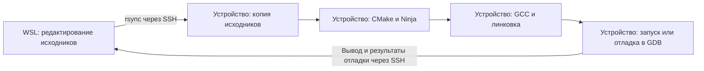

# Нативная разработка: сборка на целевом Linux-устройстве

## Содержание

- [Цель и схема работы](#цель-и-схема-работы)
- [Как проходит разработка](#как-проходит-разработка)
- [Предварительные условия](#предварительные-условия)
- [Установите инструменты на устройстве](#установите-инструменты-на-устройстве)
- [Подготовьте проект и параметры](#подготовьте-проект-и-параметры)
- [Сборка и запуск без VS Code](#сборка-и-запуск-без-vs-code)
- [Сборка и отладка в VS Code](#сборка-и-отладка-в-vs-code)
- [Готовые файлы проекта](#готовые-файлы-проекта)
- [Подсказки редактора и изменения проекта](#подсказки-редактора-и-изменения-проекта)
- [Если что-то не работает](#если-что-то-не-работает)
- [Проверенные платформы](#проверенные-платформы)

## Цель и схема работы

Соберём приложение на C на целевом Linux-устройстве, запустим его и настроим отладку из VS Code на компьютере. Подходит физическая плата или виртуальная машина с необходимыми инструментами и доступом по SSH.

**Исходники находятся на компьютере в Ubuntu/WSL. Компилятор, библиотеки, исполняемый файл и GDB — на устройстве.** Это нативная сборка: компилятор работает в целевой системе. Архитектура компьютера разработчика может отличаться от архитектуры устройства.

| Где | Что выполняется |
|---|---|
| Windows | Интерфейс VS Code, если используем WSL |
| Ubuntu/WSL или обычный Linux компьютера | Редактирование, Bash-скрипты, SSH и rsync |
| Целевой Linux | Компиляция, линковка, запуск и GDB |

VS Code вызывает те же Bash-скрипты, которые можно запускать из терминала. VS Code Server на устройстве для этого сценария не требуется.

## Как проходит разработка

Рабочая копия проекта хранится на компьютере в WSL. На устройстве находится её копия для сборки и запуска. Исходники редактируем в WSL: при следующей синхронизации изменения, сделанные только в копии на устройстве, могут быть перезаписаны или удалены.



Один цикл разработки выглядит так:

1. **Редактируем и сохраняем код в VS Code.** Меняется локальный файл, например `project/main.c` в `$HOME/projects/hello-native` внутри WSL.
2. **Передаём исходники на устройство.** `rsync` через SSH обновляет `/home/dev/projects/hello-native/project`. Ключ `--delete` удаляет из этой копии файлы, которых больше нет локально. Передаётся только `project/`, без его `.git`; скрипты и настройки компьютера остаются локально.
3. **Собираем на устройстве.** CMake читает описание проекта и подготавливает правила сборки для Ninja. Ninja вызывает GCC: компилятор превращает исходники в объектные файлы, затем линковщик объединяет их с необходимыми библиотеками в исполняемый файл `build/hello`. При повторной сборке обычно пересобираются только части, затронутые изменениями.
4. **Запускаем или отлаживаем на устройстве.** При запуске программа выполняется в Linux устройства, а её вывод приходит в терминал VS Code через SSH. При отладке на устройстве работает GDB: VS Code передаёт ему команды и показывает точки останова, значения переменных и стек вызовов. Debug-сборка содержит сведения, связывающие машинный код с исходниками; настройка путей позволяет открыть соответствующий файл в WSL.
5. **Исправляем код и повторяем цикл.** Готовый исполняемый файл остаётся на устройстве; для следующей сборки передаём обновлённые исходники.

В готовом примере **Ctrl+Shift+B** выполняет передачу и сборку, задача `Run on target` добавляет запуск, а **F5** после сборки запускает отладку. SSH служит каналом для команд и обмена данными; вычисления компилятора и выполнение приложения происходят на устройстве.

Далее подготовим инструменты на устройстве, откроем пример в WSL и проверим этот цикл по шагам.

## Предварительные условия

- Подготовленное [рабочее окружение](../../environment/README.md): Bash, SSH и rsync на компьютере.
- Целевое Linux-устройство с доступом по [SSH-ключу](../ssh/README.md) без интерактивного ввода.
- Отдельный каталог проекта на устройстве и право записи в него.

## Установите инструменты на устройстве

Подключитесь по своему SSH-алиасу. Для Debian/Ubuntu и совместимых систем выполните **на устройстве**:

```bash
sudo apt update
sudo apt install build-essential cmake ninja-build gdb rsync
cmake --version
gcc --version
```

Нужен CMake 3.21 или новее. Для другого дистрибутива установите эти инструменты его менеджером пакетов. Зависимости приложения и их заголовки также устанавливаются на устройстве. Начните с одного процесса сборки; число процессов можно увеличить с учётом памяти и CPU.

## Подготовьте проект и параметры

Из корня EmbedLinux **в Bash на компьютере**:

```bash
mkdir -p "$HOME/projects/hello-native"
cp -R tutor/native/example/. "$HOME/projects/hello-native/"
cd "$HOME/projects/hello-native"
```

Структура локального примера:

```text
hello-native/
├── project/               # самостоятельный проект
│   ├── CMakeLists.txt
│   └── main.c
├── scripts/               # операции с целевым устройством
├── .vscode/               # задачи и отладка
└── target.env             # параметры окружения
```

`project/` можно заменить другим CMake-проектом: его исходники и описание сборки не содержат настроек SSH, путей устройства или файлов VS Code. На устройстве рядом с копией `project/` создаётся `build/`. В нём CMake хранит служебные файлы и результат сборки. Исходники остаются отдельно.

Для самостоятельной сборки проекта в любой системе с нужными инструментами:

```bash
cmake -S project -B build -G Ninja -DCMAKE_BUILD_TYPE=Debug
cmake --build build
```

Настройки скриптов передаются через переменные окружения. Они подходят и для терминала, и для автоматических запусков. Для терминала параметры собраны в [target.env](example/target.env); скрипты сами конфигурацию не загружают.

| Переменная | Значение в примере | Назначение |
|---|---|---|
| `TARGET_HOST` | `pi-dev` | SSH-алиас устройства из конфигурации компьютера |
| `TARGET_REMOTE_DIR` | `/home/dev/projects/hello-native` | Отдельный каталог проекта на устройстве |
| `TARGET_PROGRAM` | `hello` | Имя исполняемого файла |
| `TARGET_JOBS` | `1` | Число процессов сборки |
| `TARGET_BUILD_TYPE` | `Debug` | Тип сборки CMake |

`pi-dev` — алиас из SSH-туториала. При необходимости укажите свой рабочий алиас. Пользователь и ключ берутся из SSH-конфигурации.

Пример содержимого **`target.env`** ([готовый файл](example/target.env)):

```bash
export TARGET_HOST=pi-dev
export TARGET_REMOTE_DIR=/home/dev/projects/hello-native
export TARGET_PROGRAM=hello
export TARGET_JOBS=1
export TARGET_BUILD_TYPE=Debug
```

`rsync --delete` действует только внутри удалённого `project/`. Соседний `build/` не затрагивается. Команды запускайте из корня примера. Для параметров используйте значения без кавычек, переводов строк и shell-символов.

## Сборка и запуск без VS Code

В `target.env` укажите своё устройство. Из корня примера **на компьютере**:

```bash
source target.env
bash scripts/prepare.sh
bash scripts/sync.sh
bash scripts/configure.sh
bash scripts/build.sh
bash scripts/run.sh
```

Каждый скрипт выполняет только своё действие: создать каталог, передать проект, настроить CMake, собрать или запустить. Скрипты не вызывают друг друга и не подключают общие файлы.

После изменения исходника достаточно:

```bash
bash scripts/sync.sh && bash scripts/build.sh && bash scripts/run.sh
```

`&&` запускает следующий шаг только при успехе предыдущего. При изменении параметров CMake повторите `configure.sh` перед сборкой. Уже собранную программу можно запустить одним `bash scripts/run.sh`.

Ожидаемый вывод:

```text
Hello, embedded Linux!
```

## Сборка и отладка в VS Code

Из корня примера выполните `code .`. В WSL установите расширение **C/C++** (`ms-vscode.cpptools`) именно в окружение WSL.

В `.vscode/settings.json` задайте `target.host` и `target.remoteDir`. Задачи передают настройки `target.*` скриптам через `options.env`; эти значения имеют приоритет над одноимёнными переменными терминала. Для отладки задаётся `target.gdb` — путь к GDB на устройстве.

- **Ctrl+Shift+B** — последовательность `prepare → sync → configure → build`.
- `Tasks: Run Task` → `Run on target` — та же последовательность, затем `run`.
- Точка останова на `puts` в `project/main.c`, затем **F5** — сборка и запуск GDB на устройстве.

Сохраните исходники перед запуском. В `tasks.json` каждый шаг вызывает один скрипт. Составные задачи объединяют шаги через `dependsOn` и выполняют их по порядку через `dependsOrder: sequence`.

Отладчик связывается с GDB через SSH с помощью `pipeTransport`. `set substitute-path` сопоставляет удалённый `project/` с локальным `project/`. Отдельный `gdbserver` не нужен. См. [документацию VS Code](https://code.visualstudio.com/docs/cpp/pipe-transport).

## Готовые файлы проекта

Все файлы создаются **на компьютере**, в корне примера [example](example) или его подкаталогах. Настройки и операции находятся снаружи самостоятельного проекта `project/`. Полное содержимое `target.env` приведено выше.

**`project/main.c`** ([готовый файл](example/project/main.c)):

```c
#include <stdio.h>

int main(void)
{
    puts("Hello, embedded Linux!");
    return 0;
}
```

**`project/CMakeLists.txt`** ([готовый файл](example/project/CMakeLists.txt)):

```cmake
cmake_minimum_required(VERSION 3.21)
project(native_example LANGUAGES C CXX)

set(APP_NAME hello CACHE STRING "Executable name")
add_executable(${APP_NAME} main.c)
target_compile_features(${APP_NAME} PRIVATE c_std_11)
target_compile_options(${APP_NAME} PRIVATE -Wall -Wextra)
```

**`scripts/prepare.sh`** ([готовый файл](example/scripts/prepare.sh)):

```bash
#!/usr/bin/env bash
set -eu
ssh -o BatchMode=yes "$TARGET_HOST" "mkdir -p '$TARGET_REMOTE_DIR'"
```

**`scripts/sync.sh`** ([готовый файл](example/scripts/sync.sh)):

```bash
#!/usr/bin/env bash
set -eu
rsync -rltz --protect-args --delete --exclude=/.git/ \
    -e 'ssh -o BatchMode=yes' project/ "$TARGET_HOST:$TARGET_REMOTE_DIR/project/"
```

**`scripts/configure.sh`** ([готовый файл](example/scripts/configure.sh)):

```bash
#!/usr/bin/env bash
set -eu
ssh -o BatchMode=yes "$TARGET_HOST" \
    "cmake -S '$TARGET_REMOTE_DIR/project' -B '$TARGET_REMOTE_DIR/build' -G Ninja -DCMAKE_BUILD_TYPE='$TARGET_BUILD_TYPE' -DCMAKE_EXPORT_COMPILE_COMMANDS=ON '-DAPP_NAME=$TARGET_PROGRAM'"
```

**`scripts/build.sh`** ([готовый файл](example/scripts/build.sh)):

```bash
#!/usr/bin/env bash
set -eu
ssh -o BatchMode=yes "$TARGET_HOST" \
    "cmake --build '$TARGET_REMOTE_DIR/build' --parallel '$TARGET_JOBS'"
```

**`scripts/run.sh`** ([готовый файл](example/scripts/run.sh)):

```bash
#!/usr/bin/env bash
set -eu
ssh -o BatchMode=yes "$TARGET_HOST" \
    "cd '$TARGET_REMOTE_DIR' && exec './build/$TARGET_PROGRAM'"
```

**`.vscode/settings.json`** ([готовый файл](example/.vscode/settings.json)):

```json
{
    "target.host": "pi-dev",
    "target.remoteDir": "/home/dev/projects/hello-native",
    "target.program": "hello",
    "target.jobs": "1",
    "target.gdb": "/usr/bin/gdb",
    "C_Cpp.default.compilerPath": "/usr/bin/gcc",
    "C_Cpp.default.cStandard": "c11",
    "C_Cpp.default.cppStandard": "c++17",
    "target.buildType": "Debug"
}
```

**`.vscode/tasks.json`** ([готовый файл](example/.vscode/tasks.json)):

```json
{
    "version": "2.0.0",
    "options": {
        "cwd": "${workspaceFolder}",
        "env": {
            "TARGET_HOST": "${config:target.host}",
            "TARGET_REMOTE_DIR": "${config:target.remoteDir}",
            "TARGET_PROGRAM": "${config:target.program}",
            "TARGET_JOBS": "${config:target.jobs}",
            "TARGET_BUILD_TYPE": "${config:target.buildType}"
        }
    },
    "tasks": [
        {
            "label": "Prepare target",
            "type": "process",
            "command": "bash",
            "args": [
                "scripts/prepare.sh"
            ],
            "problemMatcher": []
        },
        {
            "label": "Sync sources",
            "type": "process",
            "command": "bash",
            "args": [
                "scripts/sync.sh"
            ],
            "problemMatcher": []
        },
        {
            "label": "Configure target",
            "type": "process",
            "command": "bash",
            "args": [
                "scripts/configure.sh"
            ],
            "problemMatcher": []
        },
        {
            "label": "Compile target",
            "type": "process",
            "command": "bash",
            "args": [
                "scripts/build.sh"
            ],
            "problemMatcher": []
        },
        {
            "label": "Run program",
            "type": "process",
            "command": "bash",
            "args": [
                "scripts/run.sh"
            ],
            "problemMatcher": []
        },
        {
            "label": "Build on target",
            "dependsOrder": "sequence",
            "dependsOn": [
                "Prepare target",
                "Sync sources",
                "Configure target",
                "Compile target"
            ],
            "group": {
                "kind": "build",
                "isDefault": true
            },
            "problemMatcher": []
        },
        {
            "label": "Run on target",
            "dependsOrder": "sequence",
            "dependsOn": [
                "Build on target",
                "Run program"
            ],
            "problemMatcher": []
        }
    ]
}
```

**`.vscode/launch.json`** ([готовый файл](example/.vscode/launch.json)):

```json
{
    "version": "0.2.0",
    "configurations": [
        {
            "name": "Native: GDB on target via SSH",
            "type": "cppdbg",
            "request": "launch",
            "program": "${config:target.remoteDir}/build/${config:target.program}",
            "cwd": "${config:target.remoteDir}",
            "args": [],
            "MIMode": "gdb",
            "preLaunchTask": "Build on target",
            "stopAtEntry": false,
            "externalConsole": false,
            "pipeTransport": {
                "pipeProgram": "/usr/bin/ssh",
                "pipeArgs": [
                    "-T",
                    "-o",
                    "BatchMode=yes",
                    "${config:target.host}"
                ],
                "pipeCwd": "${workspaceFolder}",
                "debuggerPath": "${config:target.gdb}"
            },
            "setupCommands": [
                {
                    "text": "set substitute-path \"${config:target.remoteDir}/project\" \"${workspaceFolder}/project\""
                }
            ]
        }
    ]
}
```

## Подсказки редактора и изменения проекта

IntelliSense использует GCC и заголовки компьютера. Они могут отличаться от целевой системы: окончательный результат сборки определяется компилятором устройства. Точные подсказки по целевому окружению рассмотрим отдельно.

Новые исходники добавляйте в `add_executable`, библиотеки — через `target_link_libraries` в `project/CMakeLists.txt`. Для C++ замените `project/main.c` на `project/main.cpp`, а `c_std_11` — на `cxx_std_17`.

Аргументы при отладке задаются в `args` файла `.vscode/launch.json`. При обычном запуске добавьте необходимые аргументы после имени программы в `run.sh`.

Если копируете пример в отдельный Git-репозиторий, добавьте правило `build/` в его корневой `.gitignore`.

## Если что-то не работает

| Симптом | Что проверить |
|---|---|
| SSH-задача завершается с ошибкой | Алиас и вход по ключу из того же окружения компьютера |
| Не найден rsync | Наличие rsync на компьютере и устройстве |
| Ошибка создания каталога | Пользователя и права записи в удалённый каталог |
| CMake или Ninja не найдены | Установку и версии инструментов на устройстве |
| Подсказки расходятся со сборкой | Отличия заголовков компьютера и устройства |
| Точка останова не срабатывает | Debug-сборку, сохранение исходников и сопоставление путей |
| GDB не запускается | Путь `target.gdb` и наличие GDB на устройстве |

## Проверенные платформы

Статус относится к конкретным выполненным проверкам, а не ко всем возможностям платформы.

| Целевая платформа | ОС и архитектура | Что проверено |
|---|---|---|
| [Raspberry Pi Zero 2 W (`rpi0-2w`)](../../hardware/rpi0-2w/README.md) | Debian 13, AArch64 | SSH, подготовка каталога, синхронизация, сборка GCC 14.2 / CMake 3.31.6 / Ninja, запуск ARM64-программы, повторная сборка без изменений; удаление устаревшего исходника и сохранение каталога `build` |

Запуск отладки по F5 требует отдельной проверки в VS Code. Наличие GDB само по себе её не подтверждает.

[К туториалам](../README.md) · [К описанию проекта](../../README.md)
