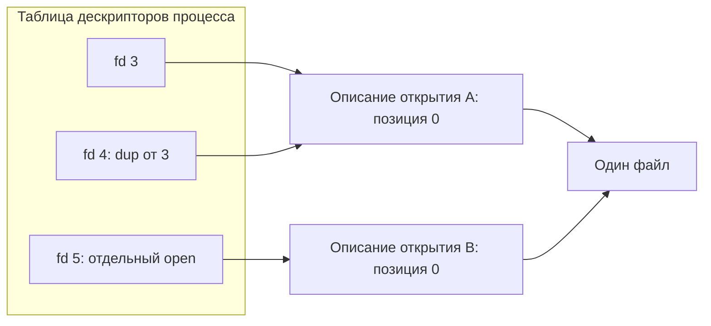
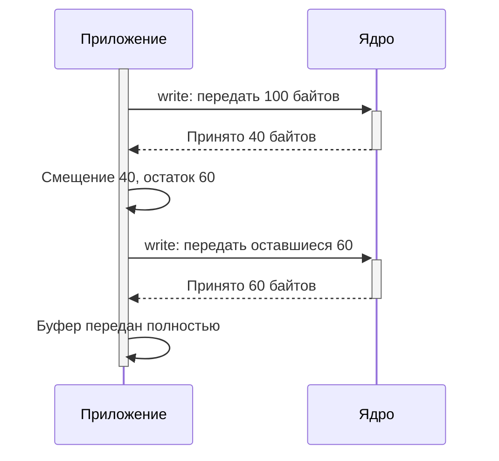
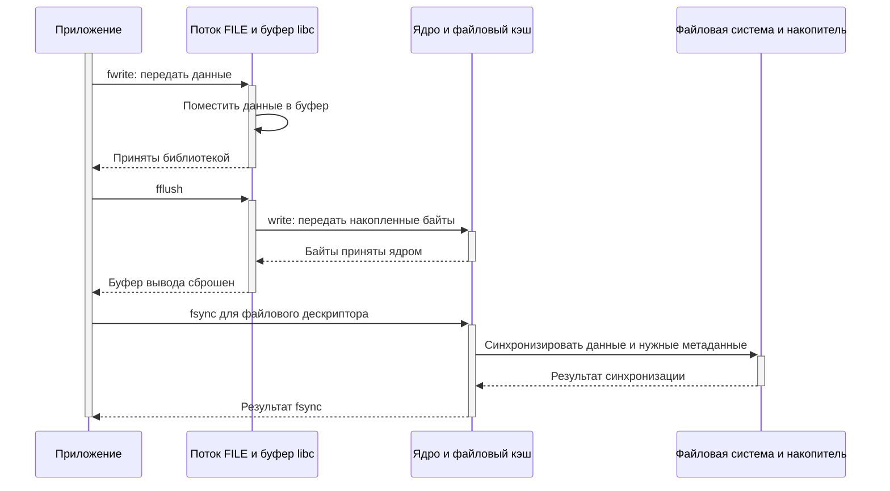
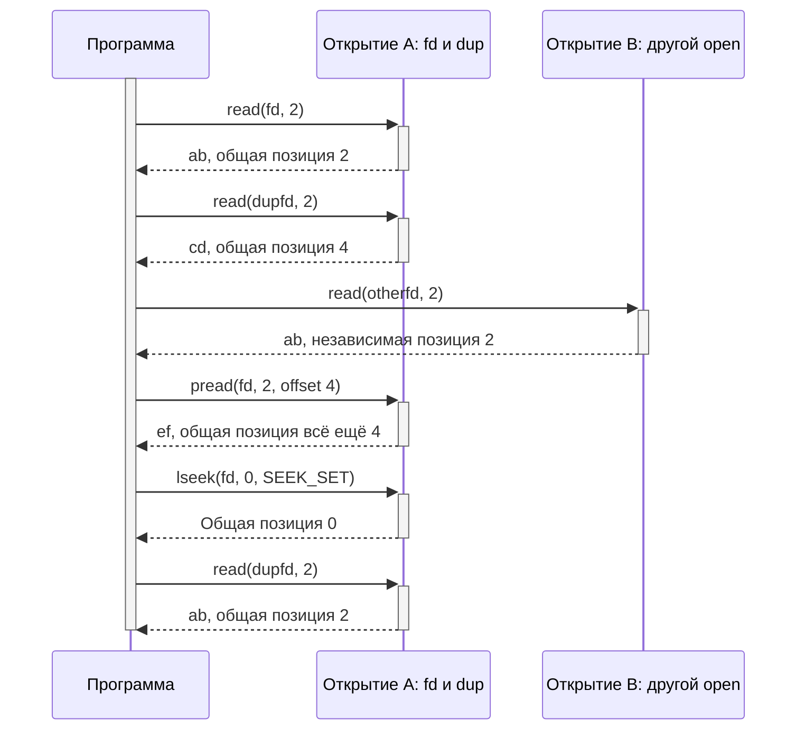

# Файлы и ввод-вывод

## Содержание

- [Уровни работы с файлами](#уровни-работы-с-файлами)
- [Дескриптор и описание открытого файла](#дескриптор-и-описание-открытого-файла)
- [Открытие и создание](#открытие-и-создание)
- [Чтение](#чтение)
- [Запись](#запись)
- [Закрытие и время жизни файла](#закрытие-и-время-жизни-файла)
- [Позиционирование](#позиционирование)
- [Метаданные](#метаданные)
- [Дублирование и перенаправление](#дублирование-и-перенаправление)
- [Буферизованные потоки stdio](#буферизованные-потоки-stdio)
- [Сохранение данных](#сохранение-данных)
- [Примеры программ](#примеры-программ)
- [Типичные ошибки](#типичные-ошибки)
- [Источники](#источники)

Файловый ввод-вывод связывает данные в памяти приложения с открытыми ресурсами системы. Здесь рассматривается программный интерфейс: как открыть объект, передавать байты, управлять позицией и обрабатывать результат. Пути, права и ссылки со стороны командной строки описаны в [материале о файлах](../console/files.md), виды ресурсов и IPC — в [обзорной главе](overview.md#файлы-устройства-и-обмен-данными).

## Уровни работы с файлами

| Уровень | Объект программы | Основные интерфейсы |
|---|---|---|
| Дескрипторы POSIX | Целочисленный `fd` | `open`, `read`, `write`, `close` |
| Потоки стандартной библиотеки C | Указатель `FILE *` | `fopen`, `fread`, `fwrite`, `fclose` |

Дескрипторы дают доступ к системным операциям, включая устройства, каналы и сокеты. Потоки stdio добавляют буферизацию и удобную обработку текста. Они работают поверх нижележащего ввода-вывода, но имеют собственное состояние и правила ошибок.

**Поток stdio** не следует смешивать с **потоком выполнения**. Первый — библиотечный объект ввода-вывода, второй — последовательность исполнения кода.

Обычный файл представляет последовательность байтов. Его чтение не разбирает строки, числа или структуры C. Способ представления данных определяет приложение. Прямая запись структуры может зависеть от выравнивания, порядка байтов и ABI; для долговременного формата эти свойства задают явно.

## Дескриптор и описание открытого файла

Дескриптор — индекс в таблице процесса. Само состояние открытия хранится отдельно в ядре: оно включает текущую позицию и флаги состояния файла. Описание открытого файла ссылается на объект файловой системы.



`dup()` создаёт ещё один дескриптор того же открытия: позиции будут общими. Другой `open()` того же пути обычно создаёт независимую позицию. После fork унаследованные дескрипторы также могут ссылаться на одно описание открытия. Подробнее — [open(2)](https://man7.org/linux/man-pages/man2/open.2.html).

Имена `STDIN_FILENO`, `STDOUT_FILENO`, `STDERR_FILENO` из `<unistd.h>` обозначают стандартные дескрипторы `0`, `1`, `2`. Они могут быть закрыты или перенаправлены, поэтому новый open не обязан вернуть число `3`.

## Открытие и создание

```c
#include <fcntl.h>
#include <sys/types.h>

int open(const char *path, int flags, ...);
int openat(int dirfd, const char *path, int flags, ...);
```

При успехе возвращается неотрицательный дескриптор; `-1` означает ошибку с причиной в errno. Проверка `fd > 0` неверна: `0` тоже допустимый результат.

### Режим доступа

`O_RDONLY` — только чтение.

`O_WRONLY` — только запись.

`O_RDWR` — чтение и запись.

Выбирается один из этих режимов. Это не права пользователя и группы: разрешённость открытия дополнительно проверяет ядро.

### Часто используемые флаги

`O_CREAT` создаёт отсутствующий файл. При этом передают дополнительный аргумент прав, например `0644`; он участвует в создании, а не меняет права уже существующего файла. Для обычного случая без ACL результат ограничивается umask.

`O_EXCL` вместе с O_CREAT требует создания нового файла: если имя уже существует, операция завершается ошибкой. Это позволяет избежать отдельной небезопасной проверки «существует ли файл» перед созданием.

`O_TRUNC` обнуляет длину существующего обычного файла при открытии для записи. Это происходит уже при open, до первой записи приложения.

`O_APPEND` направляет каждую запись в текущий конец файла. Выбор конца и запись выполняются как одна операция для поддерживающего это файла. Несколько write, составляющих одну логическую запись приложения, всё равно не становятся единой транзакцией; у сетевых файловых систем возможны дополнительные ограничения.

`O_CLOEXEC` устанавливает закрытие дескриптора при успешном exec. Он не закрывает дескриптор при fork и не заменяет обычный close.

`O_NONBLOCK` включает неблокирующий режим для объектов, где он поддерживается. Для обычных файлов он не гарантирует, что операции не задержатся на дисковом вводе-выводе.

### Пути и openat

Относительный путь open отсчитывается от текущего каталога процесса. У openat базой может быть уже открытый каталог `dirfd`; `AT_FDCWD` выбирает текущий каталог. Абсолютный путь не зависит от dirfd.

Так можно обращаться к файлам относительно устойчивого дескриптора каталога, не изменяя общий рабочий каталог процесса. Но openat сам по себе не превращает путь в песочницу: ссылки и `..` требуют отдельной политики, если доступ нужно ограничить.

Правила флагов и поиска описаны в [open(2)](https://man7.org/linux/man-pages/man2/open.2.html).

## Чтение

```c
#include <sys/types.h>
#include <unistd.h>

ssize_t read(int fd, void *buffer, size_t count);
```

`fd` выбирает открытый ресурс.

`buffer` указывает на доступную для записи память приложения.

`count` задаёт максимальное число байтов, которое можно разместить в буфере.

| Результат | Значение |
|---|---|
| Больше `0` | Фактически прочитанное число байтов |
| `0` при ненулевом count | Для обычного файла — текущий конец файла; для других ресурсов зависит от их семантики |
| `-1` | Ошибка, причина в errno |

Короткое чтение не является ошибкой. Например, запрошено 4096 байтов, а осталось 20; обработать нужно именно 20. Файл может впоследствии вырасти, поэтому конец обычного файла не обязательно означает, что новые данные никогда не появятся.

`EINTR` означает, что вызов прерван до передачи данных; обычно чтение можно повторить. Если данные уже переданы, результат может быть положительным, и их нельзя игнорировать.

`EAGAIN` в неблокирующем режиме означает «сейчас пришлось бы ждать», а не конец данных. Для сокетов встречается также EWOULDBLOCK. Повторять такой запрос непрерывным циклом без ожидания готовности не следует.

`read()` не добавляет `\0` и не гарантирует получение целой строки. Для двоичных данных нулевой байт вообще может находиться внутри полезного содержимого. См. [read(2)](https://man7.org/linux/man-pages/man2/read.2.html).

## Запись

```c
#include <sys/types.h>
#include <unistd.h>

ssize_t write(int fd, const void *buffer, size_t count);
```

Успешный результат — число принятых байтов, которое может быть меньше count. Для отправки всего буфера нужно смещать указатель на фактически записанное число и уменьшать остаток.



Повтор полной исходной записи после частичного успеха продублирует уже переданные данные. Случай EINTR обрабатывается повтором, когда write вернул `-1`; положительный результат учитывают как продвижение.

Для неблокирующего дескриптора EAGAIN требует ожидания возможности записи. Универсальный цикл для блокирующего файла не следует без изменения использовать для сокета с неблокирующим режимом.

Запись в канал без читателей может завершить процесс сигналом SIGPIPE; если процесс продолжил работу, результат ошибки — EPIPE. Для обычного файла важны также ENOSPC, EDQUOT и ошибки ввода-вывода. См. [write(2)](https://man7.org/linux/man-pages/man2/write.2.html).

## Закрытие и время жизни файла

```c
#include <unistd.h>

int close(int fd);
```

После успешного close дескриптор больше не принадлежит прежнему ресурсу и может быть повторно использован. Если существуют дубликаты или унаследованные ссылки других процессов, описание открытия продолжает жить до освобождения последних ссылок.

Ошибки записи иногда обнаруживаются при close, поэтому его результат тоже проверяют. При этом **на Linux нельзя безусловно повторять close после ошибки**: номер обычно уже освобождён и другой поток мог получить его для нового ресурса. Это отличается от обычного повтора read/write при EINTR и не является универсальным правилом всех ОС. См. [close(2)](https://man7.org/linux/man-pages/man2/close.2.html).

Удаление имени через unlink не закрывает открытый файл. Процесс может продолжить чтение или запись через дескриптор. Если последнее имя удалено, место освобождается после исчезновения последних удерживающих файл ссылок, включая открытия.

Закрывать дескриптор в одном потоке для отмены заблокированного ввода-вывода другого ненадёжно: операция может продолжить работу с удерживаемым объектом, а номер — перейти новому открытию. Нужен согласованный протокол владения и остановки.

## Позиционирование

```c
#define _POSIX_C_SOURCE 200809L
#include <sys/types.h>
#include <unistd.h>

off_t lseek(int fd, off_t offset, int whence);
ssize_t pread(int fd, void *buffer, size_t count, off_t offset);
ssize_t pwrite(int fd, const void *buffer, size_t count, off_t offset);
```

`lseek()` меняет текущую позицию описания открытия и возвращает новую. Ошибка обозначается `(off_t)-1`.

`SEEK_SET` отсчитывает offset от начала.

`SEEK_CUR` прибавляет offset к текущей позиции.

`SEEK_END` отсчитывает offset от текущего размера файла.

Позиция и размер — разные величины. Переход за конец сам по себе не удлиняет файл. Последующая запись может создать промежуток, читаемый как нули; файловая система может представить его разреженной областью без выделения всех блоков. Каналы и сокеты не поддерживают обычное позиционирование. См. [lseek(2)](https://man7.org/linux/man-pages/man2/lseek.2.html).

`pread()` читает с явно указанного смещения, не меняя текущую позицию.

`pwrite()` аналогично записывает по смещению. На Linux сочетание с O_APPEND имеет особенность: запись всё равно направляется в конец. Поэтому для адресной записи используют подходящий дескриптор без O_APPEND.

Эти интерфейсы устраняют гонку между отдельными lseek и read/write на общей позиции, но не обеспечивают согласованность перекрывающихся изменений данных. Частичные результаты и ошибки по-прежнему нужно обрабатывать. См. [pread(2)](https://man7.org/linux/man-pages/man2/pread.2.html).

## Метаданные

```c
#define _POSIX_C_SOURCE 200809L
#include <sys/stat.h>

int stat(const char *path, struct stat *info);
int lstat(const char *path, struct stat *info);
int fstat(int fd, struct stat *info);
```

`stat()` получает сведения об объекте по пути и следует за символической ссылкой.

`lstat()` получает сведения о самой ссылке, если последний компонент является ссылкой.

`fstat()` работает с уже открытым дескриптором. Это полезно, когда имя могло измениться после открытия.

| Поле struct stat | Содержание |
|---|---|
| `st_mode` | Тип объекта и биты прав |
| `st_size` | Для обычного файла — длина в байтах |
| `st_uid`, `st_gid` | Владелец и группа |
| `st_nlink` | Число жёстких ссылок |
| `st_dev`, `st_ino` | Файловая система и номер inode для идентификации объекта |
| `st_mtim` | Время изменения содержимого |
| `st_ctim` | Время изменения состояния inode, а не время создания |

Тип проверяют макросами `S_ISREG(info.st_mode)`, `S_ISDIR(...)` и аналогичными. Поле размера устройства или виртуального файла не обязано описывать объём данных, который можно прочитать.

Проверка stat перед open не гарантирует, что позже будет открыт тот же объект: другой процесс мог изменить имя между вызовами. Где это важно, открывают подходящим способом и проверяют уже открытый объект. См. [stat(2)](https://man7.org/linux/man-pages/man2/stat.2.html).

## Дублирование и перенаправление

```c
#include <unistd.h>

int dup(int oldfd);
int dup2(int oldfd, int newfd);
```

`dup()` возвращает новый дескриптор прежнего описания открытия.

`dup2()` устанавливает ссылку в указанном номере. При необходимости прежнее назначение newfd закрывается как часть операции. Это устраняет окно гонки отдельной последовательности close и dup. При oldfd, равном newfd, допустимый дескриптор остаётся без изменений.

Например, подключение файла к дескриптору `STDOUT_FILENO` меняет назначение системного stdout. Уже существующий буфер FILE stdout при этом никуда не исчезает: перед сменой назначения нужно согласовать его использование и сброс.

Сами флаги дескрипторов, например FD_CLOEXEC, отличаются от флагов общего описания открытия. Обычный dup создаёт новый дескриптор без close-on-exec; это учитывают при запуске других программ. См. [dup(2)](https://man7.org/linux/man-pages/man2/dup.2.html).

## Буферизованные потоки stdio

```c
#include <stdio.h>

FILE *fopen(const char *path, const char *mode);
size_t fread(void *buffer, size_t size, size_t count, FILE *stream);
size_t fwrite(const void *buffer, size_t size, size_t count, FILE *stream);
int fflush(FILE *stream);
int fclose(FILE *stream);
```

### Режимы fopen

| Режим | Операции и поведение |
|---|---|
| `r` | Чтение существующего файла |
| `w` | Запись с созданием или обнулением существующего файла |
| `a` | Запись в конец с созданием при необходимости |
| `r+` | Чтение и запись без обнуления |
| `w+` | Чтение и запись с созданием или обнулением |
| `a+` | Чтение и запись, причём запись направляется в конец |

`b` обозначает двоичный режим. В POSIX-системах он не меняет обработку байтов, но помогает переносимости C-кода. Модификатор `x` вместе с режимом создания требует отсутствия файла, например `wbx` в C11.

У fopen успех — ненулевой указатель, ошибка — NULL. Права нового файла не передаются режимом `0644`, как у open: действуют правила библиотеки и umask. См. [fopen(3)](https://man7.org/linux/man-pages/man3/fopen.3.html).

### Размер элементов и ошибки

fread и fwrite возвращают **число целых элементов**, а не байтов, если size отличается от 1. При `fread(buffer, 1, capacity, stream)` результат удобно трактовать как количество байтов.

Короткий fread может означать конец или ошибку. Их различают через `feof()` и `ferror()`. Feof сообщает об уже установленном признаке конца, а не предсказывает результат следующего чтения. Поэтому цикл `while (!feof(file))` без проверки самого чтения неверен.

После fwrite нужно проверять результат, а после успешной записи — ещё и fclose: ошибка может появиться при позднем сбросе буфера. См. [fread(3)](https://man7.org/linux/man-pages/man3/fread.3.html).

### Буферизация и переключение направлений

Библиотека может объединять мелкие операции в буфер. Для терминального stdout обычно используется построчный вывод, для обычного файла — полная буферизация; конкретный режим можно задать через setvbuf до остальных операций с потоком.

У потока с `+` переход от записи к чтению требует fflush или операции позиционирования. Переход от чтения к записи требует позиционирования, кроме случая достижения конца при чтении. Это правила потока C, дополнительные к семантике файлового дескриптора.

`fdopen()` может создать FILE поверх существующего fd и не дублирует его. После успешного fdopen именно fclose закрывает лежащий под потоком дескриптор. Несогласованное смешивание read/write и stdio над одним открытием приводит к неожиданным позициям и порядку данных. См. [stdio(3)](https://man7.org/linux/man-pages/man3/stdio.3.html).

## Сохранение данных

В типичном пути записи есть несколько разных уровней:



Это упрощённый случай обычного буферизованного файла: fwrite иногда сам вызывает запись раньше, а ядро может писать на накопитель асинхронно.

`fflush()` передаёт накопленный библиотечный вывод ниже. Он не гарантирует устойчивость к отключению питания.

`fsync(fd)` запрашивает синхронизацию данных и метаданных файла с устройством хранения.

`fdatasync(fd)` синхронизирует данные и метаданные, необходимые для последующего чтения; лишние изменения метаданных могут не включаться.

Если данные ещё находятся в FILE-буфере, сначала нужен fflush, затем fsync для соответствующего fd, получаемого через `fileno()`. Все результаты проверяют. Fsync одного файла не обязательно сохраняет новое имя в каталоге: после создания или переименования может требоваться синхронизация каталога. Реальная сохранность зависит также от файловой системы и выполнения гарантий устройством. См. [fsync(2)](https://man7.org/linux/man-pages/man2/fsync.2.html).

При обновлении конфигурации часто записывают новый файл в том же каталоге, синхронизируют его, затем заменяют имя через rename и синхронизируют каталог. Атомарная смена имени и сохранность после сбоя — разные свойства. Полная реализация требует отдельной обработки ошибок и метаданных.

## Примеры программ

Полные исходники находятся в [examples/file-io](examples/file-io/). Команды ниже выполняются в этом каталоге в рабочем окружении; компилятор должен поддерживать C11 и используемые POSIX-интерфейсы.

```bash
cc -std=c11 -Wall -Wextra -Werror fd-copy.c -o fd-copy
cc -std=c11 -Wall -Wextra -Werror offsets.c -o offsets
cc -std=c11 -Wall -Wextra -Werror stdio-copy.c -o stdio-copy
```

### Копирование через дескрипторы

[fd-copy.c](examples/file-io/fd-copy.c) открывает источник для чтения и создаёт новое назначение через O_CREAT и O_EXCL. Существующее назначение не перезаписывается, в том числе при совпадении путей источника и назначения.

Копирование состоит из внешнего цикла чтения и внутреннего цикла полной записи прочитанного блока. EINTR повторяет операцию, а положительный результат сдвигает обработанную границу. После завершения проверяются оба close.

```bash
printf 'alpha\nbeta\n' > source.txt
./fd-copy source.txt copied.txt
cmp source.txt copied.txt
```

Успешные команды не печатают сообщений, cmp возвращает `0`. Повторный запуск с тем же назначением завершается ошибкой открытия и сохраняет существующий файл. Для другого опыта выбирают новое имя.

Пример рассчитан на блокирующий ввод-вывод. Он копирует содержимое, но не права, владельцев и остальные метаданные; не вызывает fsync и не обещает сохранность при потере питания. После ошибки частично созданное назначение может остаться — это не транзакционное обновление.

### Общая и независимая позиция

[offsets.c](examples/file-io/offsets.c) открывает файл, создаёт дубликат и выполняет независимое второе открытие. Он получает метаданные через fstat, читает по два байта и сравнивает поведение позиций.

```bash
printf 'abcdef' > letters.txt
./offsets letters.txt
```

Вывод:

```text
size=6
first=ab
duplicate=cd
independent=ab
pread=ef
shared offset=4
after reset=ab
```

Первое чтение сдвигает общую позицию до `2`, чтение дубликата — до `4`. Независимый дескриптор начинает с `0`. Pread читает с позиции `4`, не сдвигая общую позицию. Lseek через первый дескриптор возвращает общую позицию к нулю, поэтому дубликат снова читает `ab`.



Этот пример предназначен для короткого текстового файла с указанным содержимым. Он сообщает ошибку, если нужных байтов не хватает, и не является универсальным средством вывода двоичных данных.

### Копирование через stdio

[stdio-copy.c](examples/file-io/stdio-copy.c) читает через fread и пишет через fwrite с размером элемента `1`. Источник открыт в rb, назначение — в wbx: оно тоже должно быть новым.

```bash
./stdio-copy source.txt stream-copy.txt
cmp source.txt stream-copy.txt
```

При успехе вывода нет, статус cmp — `0`. После чтения проверяется ferror, а при закрытии назначения — результат fclose, включающий поздний сброс вывода. Короткая запись здесь считается ошибкой копирования; это другой уровень обработки, чем повтор write над дескриптором.

Оба способа работают с двоичным содержимым, включая нулевые байты. Разница — в управлении буферами и интерфейсах, а не в разрешении копировать «текст или бинарник».

## Типичные ошибки

| Ошибка | Последствие | Правильное действие |
|---|---|---|
| Проверять fd как логическое значение | Допустимый fd 0 принят за ошибку | Сравнивать с `-1` |
| Записать sizeof буфера после короткого read | В выход попадают лишние данные | Использовать фактическое число байтов |
| Считать один write полной отправкой | Теряется остаток | Обрабатывать продвижение и ошибки |
| Использовать strlen для произвольных данных | Копирование прекращается на нулевом байте | Хранить явную длину |
| Открыть источник и то же назначение с O_TRUNC | Потерять исходное содержимое до копирования | Проверять модель обновления, не обнулять вслепую |
| Повторять close после любой ошибки | Закрыть уже другой ресурс | Учитывать правила Linux и владение fd |
| Считать dup независимым открытием | Неожиданно общая позиция | Использовать отдельный open либо pread/pwrite |
| Смешать stdio и дескрипторы без согласования | Нарушить порядок данных и позиции | Выбрать уровень или явно синхронизировать |
| Считать fflush подтверждением записи на накопитель | Потерять данные при сбое | Различать уровни буферизации и требования к fsync |

## Источники

- [open(2)](https://man7.org/linux/man-pages/man2/open.2.html), [read(2)](https://man7.org/linux/man-pages/man2/read.2.html), [write(2)](https://man7.org/linux/man-pages/man2/write.2.html), [close(2)](https://man7.org/linux/man-pages/man2/close.2.html).
- [lseek(2)](https://man7.org/linux/man-pages/man2/lseek.2.html), [pread(2)](https://man7.org/linux/man-pages/man2/pread.2.html), [dup(2)](https://man7.org/linux/man-pages/man2/dup.2.html).
- [stat(2)](https://man7.org/linux/man-pages/man2/stat.2.html), [fsync(2)](https://man7.org/linux/man-pages/man2/fsync.2.html).
- [stdio(3)](https://man7.org/linux/man-pages/man3/stdio.3.html), [fopen(3)](https://man7.org/linux/man-pages/man3/fopen.3.html), [fread(3)](https://man7.org/linux/man-pages/man3/fread.3.html).

[К серии User-space](README.md). [Предыдущий материал](processes.md).
