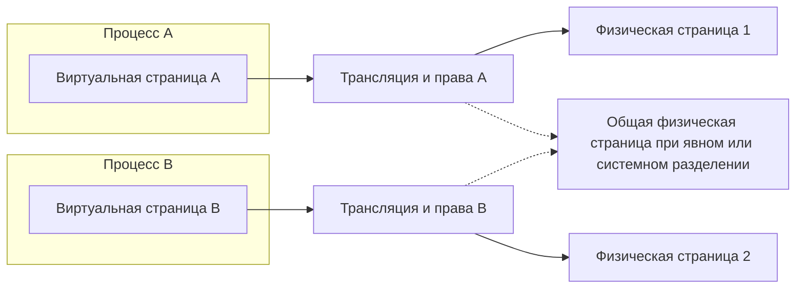
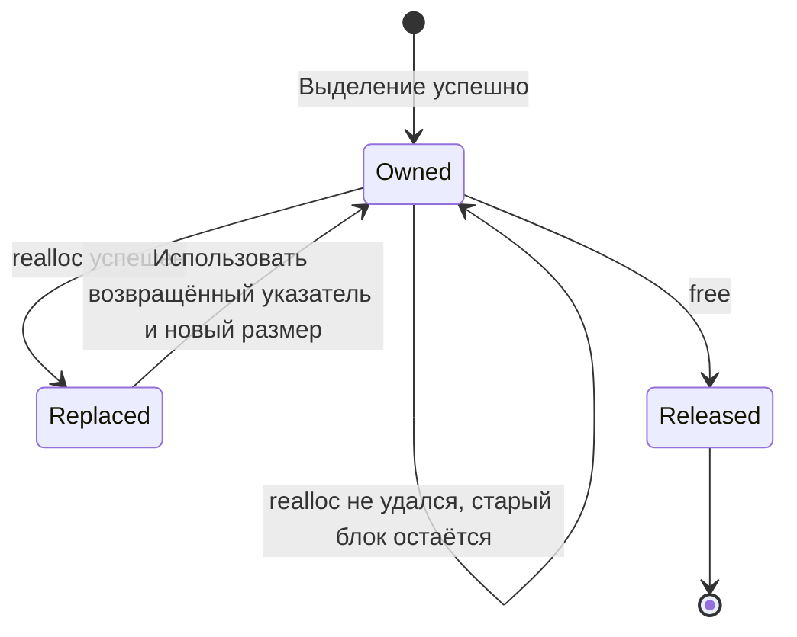
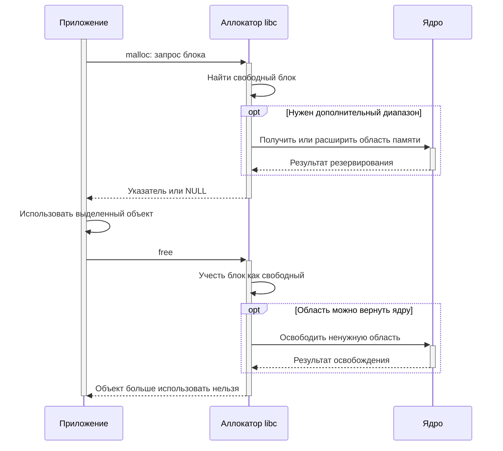
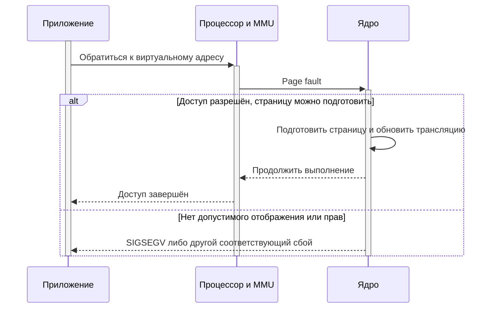
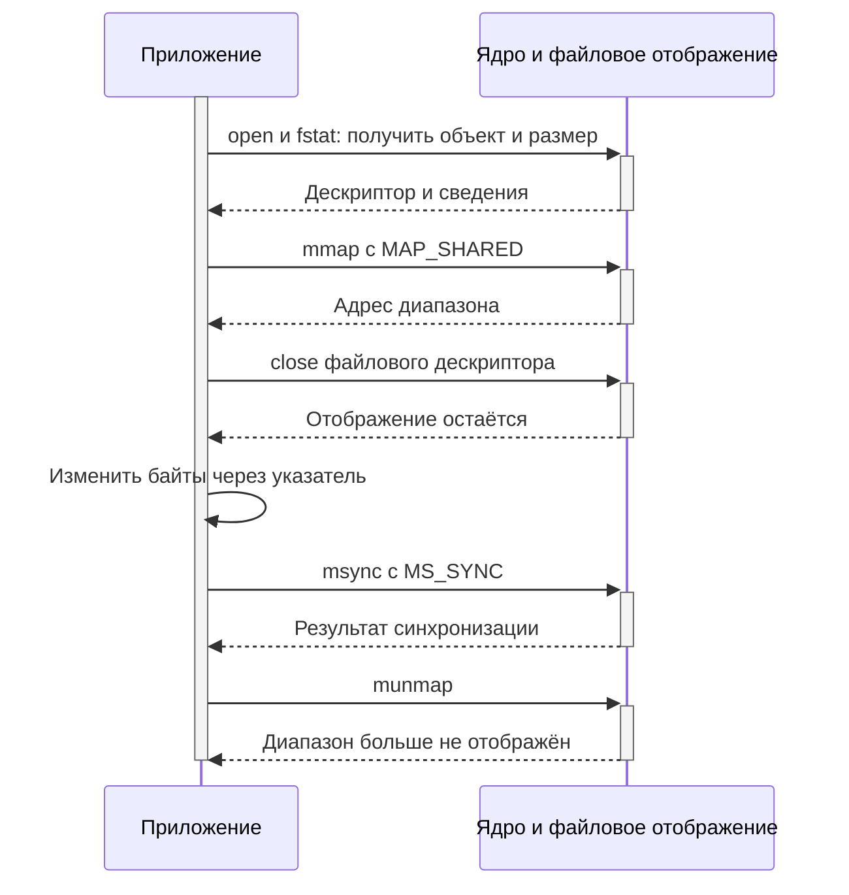

# Память процесса

## Содержание

- [Виртуальные адреса и физическая память](#виртуальные-адреса-и-физическая-память)
- [Области адресного пространства](#области-адресного-пространства)
- [Время жизни и владение](#время-жизни-и-владение)
- [Интерфейсы работы с памятью](#интерфейсы-работы-с-памятью)
- [Динамическое выделение](#динамическое-выделение)
  - [Изменение размера через realloc](#изменение-размера-через-realloc)
  - [Библиотечный аллокатор и ядро](#библиотечный-аллокатор-и-ядро)
- [Страницы и первое обращение](#страницы-и-первое-обращение)
- [Отображения mmap](#отображения-mmap)
  - [Анонимная память](#анонимная-память)
  - [Отображение файла](#отображение-файла)
    - [Практические задачи](#для-чего-отображать-файл-в-память)
    - [Когда удобнее read или stdio](#когда-обычный-ввод-вывод-удобнее)
  - [MAP_PRIVATE и MAP_SHARED](#map_private-и-map_shared)
- [Защита страниц](#защита-страниц)
- [Память после fork и exec](#память-после-fork-и-exec)
- [Наблюдение за памятью](#наблюдение-за-памятью)
- [Ограничения и нехватка памяти](#ограничения-и-нехватка-памяти)
- [Примеры программ](#примеры-программ)
- [Типичные ошибки](#типичные-ошибки)
- [Источники](#источники)

Память приложения включает код, данные, стеки потоков, динамические объекты и отображения. Программа оперирует указателями, библиотека управляет выделенными блоками, а ядро — адресным пространством и страницами. Базовые понятия процесса описаны в [обзорной главе](overview.md#память-процесса), создание и замена процессов — в [главе о жизненном цикле](processes.md).

## Виртуальные адреса и физическая память

**Виртуальный адрес** — адрес в пространстве процесса. Значение указателя относится к этому пространству и не является непосредственно номером ячейки физической RAM.

**Физическая память** содержит страницы с реально размещёнными данными. Аппаратные средства трансляции адресов и таблицы, которыми управляет ядро, связывают виртуальные страницы с физическими и проверяют разрешения доступа. Далее рассматривается обычная система Linux с виртуальной памятью и MMU.

**Страница** — единица отображения и защиты. Её размер зависит от системы; не следует считать 4096 универсальной константой. Базовый размер можно получить через `sysconf(_SC_PAGESIZE)`; существуют также большие страницы с отдельными правилами.



Одинаковое число в указателях двух процессов не означает общие данные. И наоборот, разные виртуальные адреса могут соответствовать общей физической странице. Знание чужого адреса не предоставляет права обратиться к нему.

Разрядность указателя задаёт представление адреса в ABI, но не объём установленной RAM и не гарантированно доступный процессу диапазон. Не все теоретически представимые адреса допустимы для отображения.

## Области адресного пространства

| Область | Что размещается | Кто управляет временем жизни |
|---|---|---|
| Код и константные области | Машинные инструкции, доступные только для чтения данные | Загрузчик и среда выполнения |
| Статические данные | Глобальные и static-объекты | Среда выполнения и правила языка |
| Стек потока | Состояние вызовов и автоматические объекты, если требуется их размещение в памяти | Выполнение функций и блоков |
| Динамические выделения | Объекты malloc/calloc/realloc, а также соответствующие механизмы C++ | Приложение и библиотечный аллокатор |
| Отображения | Библиотеки, файлы, анонимная и общая память | Ядро по запросам приложения и библиотек |
| Локальные данные потока | Объекты thread-local storage | Среда выполнения каждого потока |

Это логические категории, а не фиксированный порядок диапазонов. Адреса зависят от архитектуры, загрузчика, ASLR и других настроек. ASLR изменяет расположение областей для усложнения эксплуатации ошибок памяти; рассчитывать на постоянный адрес нельзя.

### Стек

Каждый поток имеет свой стек. Возврат из функции прекращает время жизни её обычных автоматических объектов. Указатель на локальный массив не становится допустимым для последующего использования только потому, что байты ещё физически не изменились.

Компилятор может держать значения в регистрах или убрать объект оптимизацией. Поэтому правило «каждая локальная переменная обязательно лежит на стеке» слишком грубое.

Глубокая рекурсия и большие автоматические массивы могут исчерпать стек. Его ограничение не равно общему объёму свободной RAM. Механизм создания потоков и настройки их стеков рассматриваются отдельно; лимиты процесса описаны в [getrlimit(2)](https://man7.org/linux/man-pages/man2/getrlimit.2.html).

**Разбор одного запроса.** Локальные счётчики, небольшая структура результата и временный массив фиксированной длины удобно связываются с одним вызовом обработчика. Они автоматически перестают существовать при выходе. Но большой кадр изображения или буфер неопределённой длины лучше хранить отдельно: размер входных данных не должен неконтролируемо увеличивать стек.

### Куча и отображения

Под **кучей** часто понимают всю память динамических объектов. Но отметка `[heap]` в карте Linux — более узкий диапазон, связанный с традиционным управлением границей данных. Аллокатор может получать другие области через mmap; не каждый malloc-блок обязан находиться внутри `[heap]`.

Для C++ владение ресурсами обычно связывают с временем жизни объектов через RAII. Семейства выделения и освобождения должны совпадать: malloc/free, new/delete, new[]/delete[]. Сам free не вызывает деструктор объекта C++.

## Время жизни и владение

**Владелец** отвечает за освобождение ресурса. **Заимствованный указатель** позволяет обратиться к объекту, пока владелец гарантирует его существование. Эти роли полезно явно отражать в интерфейсах даже там, где язык C не проверяет их автоматически.

| Ситуация | Результат |
|---|---|
| Скопировать значение указателя | Появляется ещё один указатель, но не новый объект |
| Вызвать free | Время жизни выделенного объекта заканчивается для всех его указателей |
| Присвоить одному указателю NULL | Меняется только эта переменная, остальные копии не обновляются |
| Успешно выполнить realloc | Старые указатели на прежний объект и его части больше не используются |
| Выполнить munmap | Диапазон отображения больше не принадлежит прежнему объекту |



Доступ после free, повторный free и выход за границы — неопределённое поведение C. Процесс может упасть, незаметно повредить данные или выглядеть работающим. Отсутствие SIGSEGV не является проверкой корректности.

**Передача буфера обработчику.** Сетевая часть получила пакет и передала его на разбор. Если разбор синхронный, он может заимствовать память до возврата. Если задача поставлена в очередь, пакет должен оставаться действительным до её завершения: очередь либо принимает владение, либо хранит собственную копию. Такой договор предотвращает обращение к стековому буферу давно закончившейся функции.

## Интерфейсы работы с памятью

### Стандартная библиотека C

| Функция | Назначение |
|---|---|
| [malloc](#динамическое-выделение) | Выделить неинициализированный блок заданного размера |
| [calloc](#динамическое-выделение) | Выделить массив с обнулёнными байтами и проверкой произведения размеров |
| [realloc](#изменение-размера-через-realloc) | Изменить размер выделения с возможным перемещением |
| [free](#динамическое-выделение) | Освободить блок семейства malloc |
| [memcpy](#копирование-и-инициализация) | Скопировать байты неперекрывающихся областей |
| [memmove](#копирование-и-инициализация) | Скопировать байты с допустимым перекрытием |
| [memset](#копирование-и-инициализация) | Заполнить область одним значением байта |

### Отображения и управление страницами

| Функция | Назначение |
|---|---|
| [mmap](#отображения-mmap) | Создать отображение в виртуальном адресном пространстве |
| [munmap](#отображения-mmap) | Удалить отображение указанного диапазона |
| [mprotect](#защита-страниц) | Изменить разрешения доступа к страницам |
| [msync](#map_private-и-map_shared) | Синхронизировать изменения файлового отображения |
| [sysconf](#страницы-и-первое-обращение) | Получить параметр системы, в том числе базовый размер страницы |

## Динамическое выделение

```c
#include <stdlib.h>

void *malloc(size_t size);
void *calloc(size_t count, size_t size);
void *realloc(void *pointer, size_t size);
void free(void *pointer);
```

`malloc(size)` возвращает блок для size байтов либо NULL при ошибке. Доступный приложению размер определяется запросом, даже если аллокатор внутренне зарезервировал больше. Его байты не инициализированы: сначала записывают корректные данные, затем читают.

`calloc(count, size)` выделяет массив и обнуляет байты. Произведение проверяется библиотекой, в отличие от уже переполненного выражения `malloc(count * size)`. Нулевые байты не являются универсальным конструктором произвольного типа и не заменяют инициализацию объектов C++.

`free(pointer)` принимает начало ещё не освобождённого блока подходящего семейства. Внутренний адрес массива, адрес локальной переменной или mmap-диапазона для него не подходят. `free(NULL)` допустим и ничего не делает.

Возврат NULL не означает единственную причину «кончилась физическая RAM»: возможны лимиты, нехватка адресного пространства и другие ограничения. Поведение выделения размера ноль имеет особые правила; в обычном прикладном интерфейсе лучше обрабатывать пустой размер явно. См. [malloc(3)](https://man7.org/linux/man-pages/man3/malloc.3.html).

### Изменение размера через realloc

При положительном новом размере успешный realloc сохраняет начальную часть данных до минимума старого и нового размеров. Дополнительные байты не инициализированы. Блок может переместиться.

При ошибке прежний блок остаётся действительным. Поэтому результат сначала сохраняют во временную переменную и лишь после проверки заменяют основной указатель. Прямая запись `pointer = realloc(pointer, size)` при ошибке теряет единственную ссылку на прежний блок.

Перед умножением числа элементов на размер проверяют `count <= SIZE_MAX / sizeof(*pointer)`. Проверка результата malloc не обнаружит уже произошедшее переполнение выражения размера.

После успешного realloc используют только возвращённый указатель. Даже совпадение числового адреса не разрешает продолжать использование прежних указателей на объект и его части; нужные внутренние ссылки вычисляют заново. Вызова realloc с нулевым размером избегают из-за различий стандартов и реализаций.

**Накопление входных записей.** При чтении списка неизвестной длины приложение может увеличивать вместимость массива по мере заполнения. Число использованных элементов и вместимость хранят отдельно; память расширяют порциями, а не обязательно после каждого элемента. Для непрерывного приёма измерений с фиксированным бюджетом полезнее заранее ограниченный буфер: иначе медленный потребитель приведёт к неограниченному росту памяти.

### Копирование и инициализация

```c
#include <string.h>

void *memcpy(void *destination, const void *source, size_t count);
void *memmove(void *destination, const void *source, size_t count);
void *memset(void *destination, int byte, size_t count);
```

`memcpy()` требует отсутствия перекрытия источника и назначения.

`memmove()` допускает перекрытие, например при сдвиге содержимого внутри буфера.

`memset()` повторяет один байт, а не присваивает произвольное число каждому элементу массива. Например, заполнение байтом 1 не равно заполнению массива int значением 1.

Эти функции не проверяют вместимость буфера и не выделяют память. Размер и время жизни обеих областей обеспечивает вызывающий код. См. [memcpy(3)](https://man7.org/linux/man-pages/man3/memcpy.3.html) и [memmove(3)](https://man7.org/linux/man-pages/man3/memmove.3.html).

**Сборка и разбор пакета.** Memcpy подходит для переноса полученных байтов в отдельный буфер. Memmove нужен, когда после разбора первой записи остаток сдвигают к началу того же буфера и области перекрываются. Выбор функции определяется размещением данных, а не тем, является ли пакет текстовым.

### Библиотечный аллокатор и ядро

**Аллокатор** — библиотечный механизм учёта свободных и занятых блоков. Он может обслужить malloc из уже полученной области, без нового системного вызова.



Аллокатор может получать память через mmap или изменение program break. Приложению обычно не нужно управлять brk напрямую: это нарушило бы предположения использующей его библиотеки. См. [brk(2)](https://man7.org/linux/man-pages/man2/brk.2.html).

После free RSS не обязан уменьшиться: библиотека может оставить страницы для следующих выделений. Фрагментация означает, что свободные блоки или промежутки не всегда подходят под новую заявку, хотя их суммарный размер велик. Отдельные арены и кэши аллокатора также влияют на потребление.

**Долгоживущий сервер.** Если обработка запроса временно выделяет много памяти, после её освобождения процесс может оставаться крупным по RSS. Это ещё не доказывает утечку: часть памяти пригодна для повторного использования аллокатором. Утечку ищут по росту недоступных приложению живых выделений и по повторяющейся нагрузке, отдельно учитывая буферы, кэши и фрагментацию.

## Страницы и первое обращение

```c
#include <unistd.h>

long sysconf(int name);
```

`sysconf(_SC_PAGESIZE)` возвращает базовый размер страницы. Значение проверяют до преобразования к size_t. Его используют для требований выравнивания, а не как размер любого пользовательского выделения. См. [sysconf(3)](https://man7.org/linux/man-pages/man3/sysconf.3.html).

Создание виртуального диапазона не обязательно выделяет физические страницы для каждого его байта. При первом обращении процессор может вызвать **page fault** — исключение, которое ядро обрабатывает для подготовки страницы.



Page fault сам по себе не означает ошибку приложения. Так могут подгружаться страницы файла и создаваться частные копии при copy-on-write. Недопустимый адрес или нарушение защиты — другой случай.

Доступ к файловому отображению после усечения файла может вызвать SIGBUS. В отличие от read, такое обращение не возвращает обычный код ошибки функции. Поэтому отображаемый файл и его время жизни требуют согласования с другими участниками.

**Первый запрос после запуска.** Сервер может быстро зарезервировать большой буфер, но заметно задержаться при первом заполнении: тогда фактически подготавливаются страницы. Если важна задержка первого запроса, инициализацию необходимых областей выполняют на этапе подготовки и измеряют отдельно от рабочего цикла. Это уменьшает часть первоначальных затрат, но само по себе не гарантирует поведение реального времени.

## Отображения mmap

```c
#define _POSIX_C_SOURCE 200809L
#include <sys/mman.h>
#include <sys/types.h>

void *mmap(void *address, size_t length, int protection,
           int flags, int fd, off_t offset);
int munmap(void *address, size_t length);
```

`address=NULL` поручает ядру выбрать адрес. Без специальных флагов ненулевой адрес обычно является подсказкой; принудительная установка через MAP_FIXED может затронуть существующие отображения и не нужна для обычных примеров.

`length` — ненулевой размер доступной области в байтах. Операции выполняются с учётом границ страниц, но приложение всё равно обязано соблюдать собственную длину данных.

`protection` задаёт разрешённые обращения через PROT_READ, PROT_WRITE, PROT_EXEC либо PROT_NONE.

`flags` определяет тип и семантику отображения, например MAP_PRIVATE или MAP_SHARED.

`fd` выбирает открытый объект при файловом отображении.

`offset` — смещение в файле, обычно кратное базовому размеру страницы. Для данных с произвольного смещения отображают диапазон от предшествующей границы и отдельно учитывают сдвиг внутри него.

Ошибка mmap — **MAP_FAILED**, а не NULL. Возвращённый диапазон освобождают через munmap, а не free. Для munmap начало должно удовлетворять требованиям выравнивания. После удаления отображения прежние указатели не используют. См. [mmap(2)](https://man7.org/linux/man-pages/man2/mmap.2.html).

### Анонимная память

Анонимное отображение не имеет обычного файла-источника. На Linux его создают с MAP_ANONYMOUS, fd равным `-1` и offset равным `0`. Первоначальные байты такой памяти нулевые.

MAP_ANONYMOUS — расширение интерфейса, доступность объявления зависит от feature-test macros libc. В приведённом примере с glibc используется `_DEFAULT_SOURCE`; это отмечено только для данного исходника.

Частное анонимное отображение подходит для крупных буферов и областей с явным временем жизни. Выделять каждый небольшой объект отдельным mmap обычно нецелесообразно: нужны системные операции и учёт диапазонов.

**Большой рабочий буфер.** Обработка изображения может требовать отдельную область на время одного задания. Анонимное отображение позволяет явно управлять её диапазоном и освобождением. Ещё один случай — область, для которой нужны собственные постраничные права: её удобнее отделить от соседних объектов аллокатора. Для небольших обычных структур malloc остаётся более простым интерфейсом.

### Отображение файла

Файл открывают, получают и проверяют его размер, затем создают отображение. Через указатель становятся доступны байты выбранной части файла; позиция дескриптора при этом не служит текущим курсором массива.

После успешного mmap файловый дескриптор можно закрыть: отображение удерживает нужную связь. Но файл нельзя без согласования усекать во время работы с отображением. Проверка fstat перед mmap не предотвращает его последующее изменение другим процессом.

Пустой файл требует отдельной обработки: length равным нулю передавать нельзя. Не следует читать байты за логическим размером файла, даже если конец отображения округляется до страницы.

#### Для чего отображать файл в память

Отображение позволяет работать с содержимым как с адресуемым диапазоном байтов, а не организовывать для каждого обращения отдельное чтение в свой буфер. Приложение задаёт соответствие «смещение в файле — смещение от указателя», а ядро подготавливает страницы по мере обращения. Это особенно удобно, когда алгоритм многократно переходит к разным частям одних данных.

**Индекс или словарь только для чтения.** Служба загрузила индекс с заголовком и таблицами записей. Запрос сообщает номер записи или смещение: обработчик обращается к соответствующему месту отображения, не загружая весь файл в собственный массив заранее. Несколько процессов могут использовать одни файловые страницы; у каждого остаётся своё виртуальное представление. Все размеры и смещения из файла всё равно проверяются до доступа.

**Большой двоичный формат с переходами по смещениям.** У файла измерений есть каталог блоков и отдельные участки данных. Отображение удобно для повторных выборок и обхода индекса: можно вычислять нужные диапазоны относительно начала. При этом байты файла не становятся автоматически корректными структурами C — нужно учитывать выравнивание, порядок байтов и формат. Для очень большого файла можно отображать отдельные окна, согласуя их границы со страницами.

**Повторное использование стабильных данных.** Несколько работников читают общую таблицу коэффициентов или справочник, выпущенный отдельным файлом. Вместо независимых пользовательских копий они используют файловые отображения. Обновление удобно организовать выпуском нового файла и переключением работников на него: старые отображения продолжают относиться к прежнему объекту. Перезаписывать или усекать старый файл при работающих читателях без протокола нельзя.

**Частная рабочая версия.** Приложение отображает файл с MAP_PRIVATE и временно изменяет некоторые области, например помечает посещённые записи при анализе. Исходный файл через эти записи не меняется. Это удобно, когда большая часть данных читается, а изменяется малая доля; массовая запись создаст много частных страниц и потребует соответствующей памяти. Такой режим не заменяет согласованный снимок файла, который продолжает меняться извне.

**Изменяемые страницы собственного хранилища.** Файловое отображение с MAP_SHARED позволяет редактировать подготовленные области и передавать изменения файловой системе. Например, так можно хранить таблицу фиксированных записей. Но для реально надёжного хранилища дополнительно нужны согласование писателей, проверяемый формат и стратегия восстановления после сбоя. Одних mmap и msync недостаточно, чтобы получить готовую базу данных или транзакцию.

#### Когда обычный ввод-вывод удобнее

Для последовательного копирования, потока неизвестной длины или однократной обработки небольшого файла read и stdio часто проще. Они позволяют явно управлять размером буферов и получать ошибки в результате операции. У отображения часть работы происходит во время обычного доступа к памяти, и сбой может проявиться сигналом, например после усечения файла.

Отображение не загружает весь файл мгновенно и не исключает физический ввод-вывод. Оно также не гарантирует ускорение: результат зависит от характера доступа, затрат на page fault, размеров и файловой системы. Выбор проверяют на реальной нагрузке, а не только по отсутствию явных вызовов read.

### MAP_PRIVATE и MAP_SHARED

| Режим | Изменения через указатель | Что требуется учитывать |
|---|---|---|
| MAP_PRIVATE | Не записываются обратно в файл через это отображение | Частная копия при записи, дополнительная память |
| MAP_SHARED | Могут изменять файл и доступны через совместные отображения | Синхронизация доступа и записи в хранилище |

Приватное отображение не является гарантированным неизменяемым снимком всего файла: видимость изменений самого файла после mmap не следует использовать как способ согласования. Для устойчивого снимка нужен отдельный протокол.

Общее отображение не создаёт очереди сообщений или блокировки. Два процесса могут одновременно повредить одну структуру; для взаимодействия нужны подходящая синхронизация и формат данных. Общий объект может отображаться по разным виртуальным адресам, поэтому внутренние абсолютные указатели не являются переносимыми между процессами.

`msync(address, length, MS_SYNC)` ожидает синхронизации изменений файлового отображения. Это не мьютекс и не транзакция. Munmap и close сами по себе не заменяют нужные гарантии сохранения, а создание имени файла может требовать дополнительной синхронизации каталога, как описано в [главе о вводе-выводе](file-io.md#сохранение-данных). См. [msync(2)](https://man7.org/linux/man-pages/man2/msync.2.html).



**Передача большого кадра между процессами.** Общая память полезна, если один процесс получает изображение, а другой обрабатывает его: кадр не нужно заново пересылать целиком через канал на каждом этапе. Отдельно передают состояние «кадр готов» и организуют запрет перезаписи до завершения читателя. Память решает задачу размещения данных, а уведомления и синхронизация — задачу порядка работы.

## Защита страниц

```c
#include <sys/mman.h>

int mprotect(void *address, size_t length, int protection);
```

`address` должен быть выровнен по границе страницы. Разрешения меняются для страниц, затрагиваемых диапазоном, а не только для отдельного C-объекта.

`PROT_READ` разрешает чтение.

`PROT_WRITE` разрешает запись.

`PROT_EXEC` разрешает исполнение инструкций.

`PROT_NONE` запрещает доступ. Сочетания и их фактическая реализация зависят также от архитектуры и политики системы.

Защита полезна для неизменяемых после настройки областей и защитных страниц между буферами. Нельзя произвольно защищать malloc-блок, не учитывая соседей: одна страница может содержать другие объекты и данные аллокатора. Для примера используется отдельное mmap-отображение. См. [mprotect(2)](https://man7.org/linux/man-pages/man2/mprotect.2.html).

Ошибка защиты обычно приводит к SIGSEGV. Однако права страницы не знают границы массива C: выход в соседний объект на той же доступной странице может остаться аппаратно незамеченным.

**Неизменяемая конфигурация после подготовки.** Приложение может собрать таблицы в отдельном отображении, затем оставить только чтение. Случайная запись в эту область станет заметным сбоем вместо скрытого изменения настройки. Это защита от части ошибок собственного кода, а не изоляция от другого произвольного кода в том же процессе, способного менять разрешения.

**Защитная страница рядом с буфером.** Между отдельными областями можно оставить страницу PROT_NONE, чтобы выход через её границу приводил к сбою. Это полезно при диагностике и организации специальных стеков, но не обнаруживает любой выход на один байт внутри доступной страницы.

## Память после fork и exec

Fork создаёт логически независимую частную память с начальным содержимым родителя. При записи применяется copy-on-write; общие отображения сохраняют свою общую семантику. Одинаковые адреса у родителя и ребёнка не означают, что их обычные переменные остаются общими.

Exec заменяет образ программы: старые выделения и отображения не переходят в новую программу как действительные указатели. Аргументы и окружение передаются через предусмотренные интерфейсы. Примеры и ограничения fork многопоточной программы приведены в [главе о процессах](processes.md#наследование-ресурсов).

## Наблюдение за памятью

`/proc/PID/maps` показывает виртуальные диапазоны, разрешения и связанные объекты. Чтобы посмотреть карту уже работающей оболочки, из неё выполняют:

```bash
cat /proc/$$/maps
```

Здесь $$ выбирает оболочку. Путь `/proc/self/maps`, открытый отдельной программой cat, показывал бы сам cat, а не родительскую оболочку.

Типичный формат строки:

```text
address-range  perms  offset  dev  inode  pathname
```

В permissions `r`, `w`, `x` обозначают доступ, `p` — частное отображение, `s` — общее. `[heap]` и `[stack]` обозначают отдельные известные диапазоны, но не перечисляют все динамические объекты и стеки каждого потока. Карта меняется во время работы, а доступ к чужой карте ограничен правами. См. [proc_pid_maps(5)](https://man7.org/linux/man-pages/man5/proc_pid_maps.5.html).

| Показатель | Что отражает |
|---|---|
| Виртуальный размер | Размер диапазонов адресного пространства, а не только занятая RAM |
| RSS | Резидентные страницы процесса; общие страницы учитываются и у других процессов |
| PSS | Резидентные общие страницы с распределением вклада между использующими их процессами |

Более подробные значения по отображениям доступны в `/proc/PID/smaps`, если интерфейс поддержан и разрешён. Сумма RSS нескольких процессов может повторно учитывать общие страницы; PSS помогает оценивать совместное потребление. См. [proc_pid_smaps(5)](https://man7.org/linux/man-pages/man5/proc_pid_smaps.5.html).

**Поиск причины роста потребления.** Если после серии запросов увеличивается виртуальный размер, сначала выясняют, какие отображения появились. Если растёт RSS, смотрят, какие страницы стали резидентными; если работников несколько, учитывают PSS, чтобы не приписать каждому полную стоимость общих страниц. Затем сопоставляют изменения с конкретными буферами и временем жизни объектов, а не объявляют любое увеличение утечкой.

## Ограничения и нехватка памяти

Возможность выделения зависит от адресного пространства, лимитов, политики ядра и доступных ресурсов. RLIMIT_AS ограничивает виртуальное адресное пространство, RLIMIT_STACK — соответствующий лимит стека; ограничения cgroups могут применяться к группе процессов. Успех небольшой malloc-заявки не проверяет весь оставшийся бюджет.

Linux может разрешать резервирование сверх немедленно доступной физической памяти — **overcommit**. Поэтому успешное выделение не всегда гарантирует, что все будущие обращения можно будет обеспечить ресурсами. При нехватке памяти система может завершить выбранный процесс через механизм OOM; это не обычный возврат NULL из очередной операции. Политики описаны в [документации ядра](https://www.kernel.org/doc/html/latest/mm/overcommit-accounting.html).

Для приложения важны явные пределы размеров, проверка переполнений и освобождение ненужных объектов. Для требований к задержкам отдельно анализируют первое обращение к страницам, блокировки и поведение аллокатора; обычный malloc не является гарантией ограниченного времени выполнения.

**Ограниченное по памяти устройство.** Полученный из сети размер нельзя без проверки превращать в запрос выделения. Приложение задаёт максимальный размер кадра, число одновременно обслуживаемых запросов и глубину очереди. При достижении бюджета оно может отказать в новой работе или снизить скорость приёма. Это даёт управляемую реакцию раньше, чем исчерпание ресурсов всей системы.

## Примеры программ

Полные исходники находятся в [examples/memory](examples/memory/). Команды выполняются из этого каталога в подготовленном рабочем окружении.

```bash
cc -std=c11 -Wall -Wextra -Werror allocation.c -o allocation
cc -std=c11 -Wall -Wextra -Werror mapped-file.c -o mapped-file
cc -std=c11 -Wall -Wextra -Werror page-protection.c -o page-protection
```

### Выделение и изменение размера

[allocation.c](examples/memory/allocation.c) создаёт массив из четырёх int через calloc, записывает значения, расширяет до восьми элементов и инициализирует добавленную часть. Перед realloc проверяется размер, результат сохраняется во временный указатель; при отказе прежний блок освобождается.

```bash
./allocation
```

Вывод — `count=8 sum=36`, статус — `0`. После использования выполняется free. Присваивание NULL в конце показывает сброс одной переменной, а не автоматическое исправление других возможных ссылок.

### Приватное и общее отображение файла

[mapped-file.c](examples/memory/mapped-file.c) отображает обычный файл, меняет первый байт на X и закрывает отображение. Программа намеренно изменяет файл только в режиме shared; для каждого опыта используются свои данные.

```bash
printf 'hello\n' > private.txt
./mapped-file private.txt private
cat private.txt
printf 'hello\n' > shared.txt
./mapped-file shared.txt shared
cat shared.txt
```

Вывод для обычной ASCII-совместимой системы:

```text
mode=private before=104 after=88
hello
mode=shared before=104 after=88
Xello
```

Для private байт изменён в частном отображении, исходный файл остаётся прежним. Для shared выполняется msync и изменение видно в файле. Пустой файл даёт сообщение `empty file: no mapping`; отображение нулевой длины не создаётся.

Размер и тип проверяются через fstat, но пример предполагает, что другой процесс не усекает файл во время работы. Это демонстрация режима отображения, а не конкурентная база данных.

### Изменение разрешений страницы

[page-protection.c](examples/memory/page-protection.c) получает размер страницы, создаёт анонимное отображение для чтения и записи, сохраняет строку, меняет разрешения на чтение и выводит строку. Затем устанавливает PROT_NONE и освобождает отображение.

```bash
./page-protection
```

Вывод — `ready`, статус — `0`. После PROT_NONE программа больше не обращается к странице, поэтому пример не требует намеренного аварийного завершения. Каждая операция проверяется.

## Типичные ошибки

| Ошибка | Почему неверно | Что делать |
|---|---|---|
| Принимать указатель за физический адрес | Он относится к виртуальному пространству процесса | Использовать системные интерфейсы для нужного ресурса |
| Вернуть адрес локального массива | Время жизни объекта закончится | Явно определить владение результатом |
| Использовать только sizeof указателя как размер данных | Это размер адреса, а не буфера | Хранить длину отдельно |
| Не проверить count × size | Произведение может переполниться | Проверять границу или использовать подходящий интерфейс массива |
| Присвоить результат realloc единственному указателю | При отказе теряется прежний блок | Использовать временный указатель |
| Применить free к mmap-области | Разные механизмы владения | Применить munmap с нужным диапазоном |
| Проверить mmap на NULL | Ошибка обозначается MAP_FAILED | Сравнивать с MAP_FAILED |
| Считать MAP_SHARED синхронизацией | Совместная память не задаёт порядок обмена | Организовать протокол и блокировки |
| Читать отображение после усечения файла | Нужных страниц файла больше нет | Согласовать время жизни и размер |
| Ждать немедленного уменьшения RSS после free | Аллокатор может сохранить страницы | Различать живые объекты, свободные блоки и резидентную память |
| Считать отсутствие падения доказательством корректности | Ошибка может затронуть доступные данные | Использовать проверки и диагностические инструменты |

## Источники

- [malloc(3)](https://man7.org/linux/man-pages/man3/malloc.3.html), [brk(2)](https://man7.org/linux/man-pages/man2/brk.2.html).
- [mmap(2)](https://man7.org/linux/man-pages/man2/mmap.2.html), [mprotect(2)](https://man7.org/linux/man-pages/man2/mprotect.2.html), [msync(2)](https://man7.org/linux/man-pages/man2/msync.2.html).
- [memcpy(3)](https://man7.org/linux/man-pages/man3/memcpy.3.html), [memmove(3)](https://man7.org/linux/man-pages/man3/memmove.3.html).
- [sysconf(3)](https://man7.org/linux/man-pages/man3/sysconf.3.html), [getrlimit(2)](https://man7.org/linux/man-pages/man2/getrlimit.2.html).
- [proc_pid_maps(5)](https://man7.org/linux/man-pages/man5/proc_pid_maps.5.html), [proc_pid_smaps(5)](https://man7.org/linux/man-pages/man5/proc_pid_smaps.5.html).
- [Linux kernel: Overcommit Accounting](https://www.kernel.org/doc/html/latest/mm/overcommit-accounting.html).

[К серии User-space](README.md). [Предыдущий материал](file-io.md).
