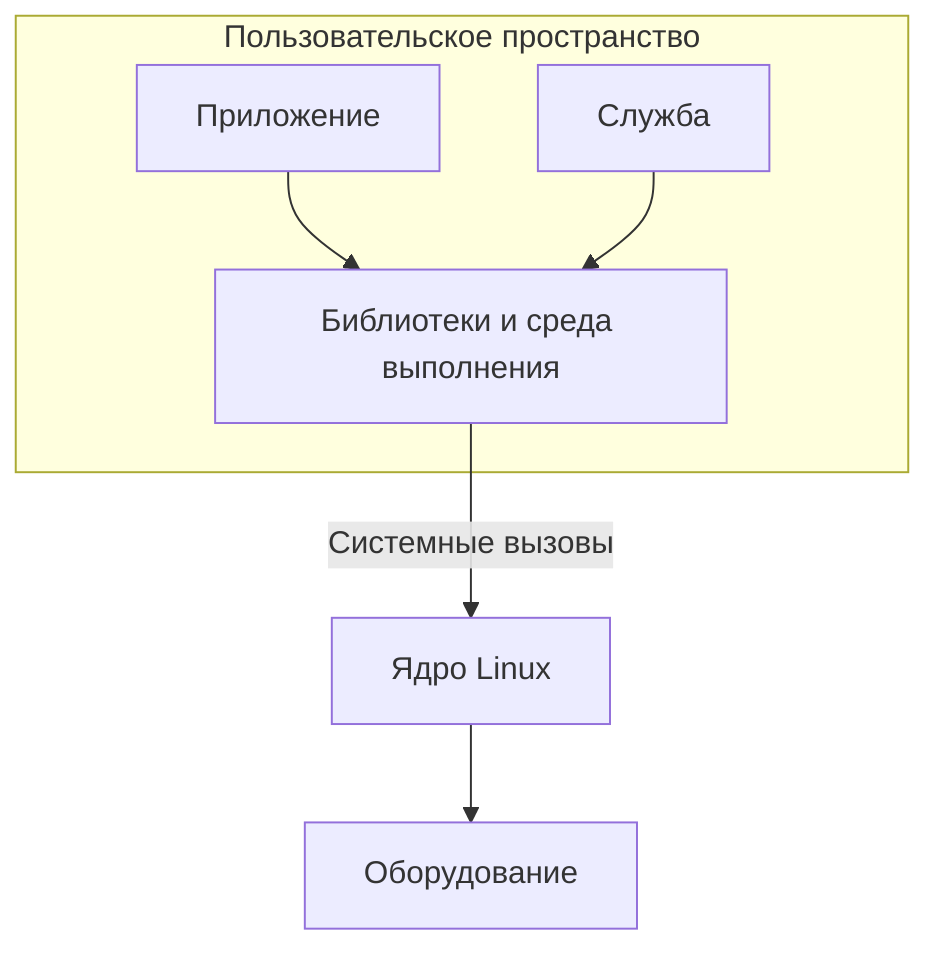
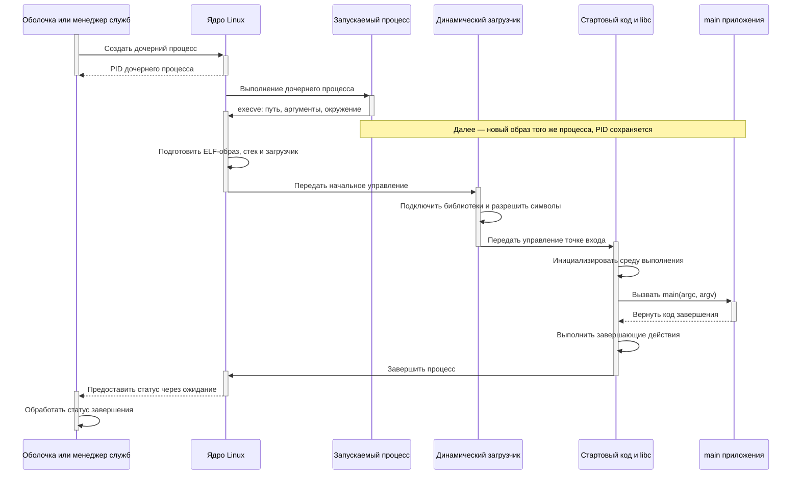
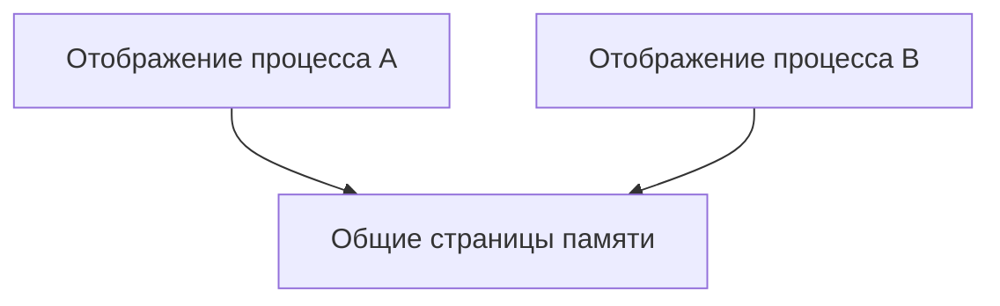

# Пользовательское пространство Linux

## Содержание

- [Что такое пользовательское пространство](#что-такое-пользовательское-пространство)
- [Пользовательское пространство и ядро](#пользовательское-пространство-и-ядро)
- [Программа, процесс и поток](#программа-процесс-и-поток)
- [Память процесса](#память-процесса)
- [Взаимодействие с ядром](#взаимодействие-с-ядром)
  - [Интерфейс системного вызова](#интерфейс-системного-вызова)
  - [Универсальная функция libc syscall](#универсальная-функция-libc-syscall)
  - [Именованная обёртка libc write](#именованная-обёртка-libc-write)
  - [Библиотечный вывод более высокого уровня](#библиотечный-вывод-более-высокого-уровня)
  - [Сравнение уровней](#сравнение-уровней)
- [Библиотеки и среда выполнения](#библиотеки-и-среда-выполнения)
- [Запуск и завершение программы](#запуск-и-завершение-программы)
  - [Кто участвует в запуске](#кто-участвует-в-запуске)
  - [Кто создаёт процесс и выбирает программу](#кто-создаёт-процесс-и-выбирает-программу)
  - [Что передаётся в exec](#что-передаётся-в-exec)
  - [Что подготавливает ядро](#что-подготавливает-ядро)
  - [Что такое динамический загрузчик](#что-такое-динамический-загрузчик)
  - [Как управление доходит до main](#как-управление-доходит-до-main)
  - [Статическая программа и скрипт](#статическая-программа-и-скрипт)
  - [Завершение и получение статуса](#завершение-и-получение-статуса)
- [Файлы, устройства и обмен данными](#файлы-устройства-и-обмен-данными)
  - [Файловый дескриптор](#файловый-дескриптор)
  - [Обычные файлы](#обычные-файлы)
  - [Устройства и виртуальные файлы](#устройства-и-виртуальные-файлы)
  - [Каналы pipe](#каналы-pipe)
  - [Именованные каналы FIFO](#именованные-каналы-fifo)
  - [Сокеты](#сокеты)
  - [Очереди сообщений](#очереди-сообщений)
  - [Разделяемая память](#разделяемая-память)
  - [Ожидание и выбор механизма](#ожидание-и-выбор-механизма)
- [Права и границы изоляции](#права-и-границы-изоляции)
- [Пользовательское пространство встроенной системы](#пользовательское-пространство-встроенной-системы)
- [Источники](#источники)

## Что такое пользовательское пространство

**Пользовательское пространство**, или **user space**, — среда выполнения обычных программ Linux. К ней относятся приложения, оболочки, командные утилиты, фоновые службы, библиотеки и интерпретаторы.

Например, командная оболочка, сетевой сервер и программа опроса датчиков работают в пользовательском пространстве. Они могут выполнять разные задачи и иметь разные права, но используют предоставленные операционной системой интерфейсы для доступа к ресурсам.

Слово «пользовательское» не означает, что программа обязательно взаимодействует с человеком. Служба без окна и терминала также относится к user space. Программа, запущенная от имени root, тоже остаётся пользовательской программой.

Термин употребляется в двух близких смыслах: как область выполнения отдельного процесса и как совокупность программных компонентов вне ядра. Поэтому выражение «состав пользовательского пространства» может обозначать набор библиотек, утилит и служб в установленной системе.

## Пользовательское пространство и ядро

**Ядро** управляет основными ресурсами: процессорным временем, памятью, устройствами, файловыми системами и сетевыми механизмами. Приложение использует эти ресурсы через интерфейсы ядра, а собственные вычисления выполняет в пользовательском режиме процессора.

| Область | Примеры компонентов | Основная роль |
|---|---|---|
| User space | Приложения, оболочки, службы, библиотеки | Логика программ и обработка данных |
| Kernel space | Планировщик, управление памятью, файловые системы, драйверы | Управление ресурсами и выполнение привилегированных операций |



Схема показывает обычный путь обращения к системным ресурсам. Между приложением и оборудованием может быть несколько программных уровней. При этом не каждая операция приложения требует обращения к ядру: вычисление суммы или обработка уже доступного массива обычно выполняются непосредственно в пользовательском коде.

Разделение ограничивает последствия ошибок и позволяет нескольким программам совместно использовать оборудование. Конкретные аппаратные механизмы защиты зависят от архитектуры; далее подразумевается обычная система Linux с виртуальной памятью.

## Программа, процесс и поток

**Программа** — код и данные, подготовленные для выполнения. Исполняемый файл на диске ещё не является работающим процессом.

**Процесс** — экземпляр выполнения программы вместе с его ресурсами и состоянием. У него есть идентификатор PID, адресное пространство, открытые файлы, параметры доступа и другие атрибуты. Несколько запусков одного исполняемого файла могут создать несколько процессов.

**Поток** — отдельная последовательность выполнения внутри процесса. У процесса может быть один поток или несколько. Потоки одного процесса разделяют адресное пространство и многие ресурсы, но имеют собственные стеки и состояние выполнения. См. [описание потоков POSIX](https://man7.org/linux/man-pages/man7/pthreads.7.html).

Например, сервер может обслуживать запросы несколькими потоками одного процесса либо несколькими процессами. В первом случае общий доступ к данным проще организовать, но его нужно синхронизировать; во втором обмен между отдельными адресными пространствами обычно требует явного механизма взаимодействия.

Планировщик ядра определяет, какой готовый к выполнению поток получает процессорное время. Поток может выполняться, ожидать своей очереди или ждать событие: данные от устройства, сетевой пакет, освобождение блокировки. Поэтому запущенная программа не обязательно непрерывно занимает процессор.

## Память процесса

Процесс обращается к памяти через **виртуальные адреса**. Ядро и аппаратные средства управления памятью определяют, каким физическим страницам они соответствуют и какие операции разрешены.

У разных процессов обычно отдельные виртуальные адресные пространства. Одинаковое числовое значение адреса в двух процессах не означает одни и те же данные. Для совместного доступа можно явно организовать общую память; отдельные физические страницы также могут совместно использоваться системой без предоставления произвольного доступа между процессами.

В адресном пространстве находятся несколько видов областей:

| Область | Назначение |
|---|---|
| Код | Машинные инструкции приложения и библиотек |
| Статические данные | Глобальные и статические объекты |
| Куча | Динамически выделяемые объекты, например через `malloc` или `new` |
| Стеки потоков | Состояние вызовов функций и автоматические объекты |
| Отображения | Области, связанные с файлами, общей памятью и другими объектами |

Это логическое описание, а не фиксированная схема адресов. Расположение зависит от архитектуры, загрузчика и настроек системы. Выделение памяти библиотекой не обязательно вызывает ядро при каждом обращении: библиотека может использовать ранее полученные области.

Ошибка обращения к недоступной памяти может привести к сигналу `SIGSEGV` и завершению процесса. Но защита адресного пространства не обнаруживает все ошибки: неверный указатель может попасть в доступную область и повредить собственные данные программы.

## Взаимодействие с ядром

**Системный вызов** — запрос пользовательской программы к ядру через установленный двоичный интерфейс. Он нужен, например, чтобы открыть файл, отправить данные в сокет или дождаться события. Программа передаёт номер операции и аргументы, выполняет специальную инструкцию процессора и получает результат.

Набор правил передачи номера, аргументов и результата называется **ABI** (*Application Binary Interface*, двоичный интерфейс). Это уровень машинного кода. Он отличается от **API** — интерфейса функций, которым пользуется программист в исходном тексте.

### Что происходит при вызове

1. Пользовательский код помещает номер операции и аргументы в предусмотренные ABI регистры или другие места.
2. Специальная инструкция переводит выполнение в обработчик ядра.
3. Ядро проверяет запрос и выполняет операцию. При необходимости вызывающий поток ожидает данные или освобождение ресурса.
4. Для обычного возвращающегося вызова управление переходит обратно в пользовательский код с результатом или ошибкой.

Это не обычный переход к функции библиотеки: меняется режим выполнения и вступают в действие проверки ядра. При этом новый пользовательский процесс не создаётся. Например, чтение файла выполняется от имени вызывающего потока, а не отдельной «программой ядра».

### Интерфейс системного вызова

На уровне C операцию записи описывают прототипом из `write(2)`:

```c
ssize_t write(int fd, const void *buffer, size_t count);
```

`fd` — файловый дескриптор назначения.

`buffer` — адрес данных в пользовательской памяти.

`count` — запрошенное число байтов.

При успехе результат — число записанных байтов, которое может быть меньше `count`.

Это объявление пользовательского интерфейса libc. Сам переход в ядро выполняется внутри реализации; обычный C-прототип не описывает машинные инструкции и регистры. На уровне ядра ошибка кодируется по правилам ABI; библиотека преобразует её в `-1` и устанавливает `errno`.

Если номер операции нужно указать явно, используется универсальный интерфейс:

```c
long syscall(long number, ...);
```

`number` — номер системного вызова, обычно заданный константой `SYS_*` из `<sys/syscall.h>`.

Последующие аргументы соответствуют выбранной операции. Для записи форма обращения — `syscall(SYS_write, fd, buffer, count)`.

`syscall()` также является функцией libc. Поэтому это более низкоуровневый интерфейс на C, но не вызов без участия библиотеки. Номера операций и детали ABI зависят от архитектуры. См. [syscall(2)](https://man7.org/linux/man-pages/man2/syscall.2.html).

### Универсальная функция libc syscall

Можно явно выбрать номер системного вызова, но поручить библиотеке переход по ABI. Для этого существует функция `syscall()`:

```c
#define _DEFAULT_SOURCE
#include <stdio.h>
#include <sys/syscall.h>
#include <unistd.h>

int main(void)
{
    const char message[] = "hello\n";
    const long size = (long)(sizeof(message) - 1);
    const long written = syscall(SYS_write, STDOUT_FILENO, message,
                                 sizeof(message) - 1);

    if (written == -1) {
        perror("syscall write");
        return 1;
    }

    return written == size ? 0 : 1;
}
```

Это **библиотечная функция**, а не непосредственная инструкция входа в ядро в тексте C. Она принимает номер и аргументы, передаёт их ядру и преобразует ошибку в `-1` с установкой `errno`. `SYS_write` берётся из системного заголовка вместо ручного числа.

Такой способ полезен, если у операции нет отдельной библиотечной обёртки. Но он не делает любой вызов переносимым: типы, раскладка аргументов и особенности некоторых ABI всё ещё требуют внимания. Здесь показан вариант с glibc; `_DEFAULT_SOURCE` открывает объявление `syscall()` при строгом режиме компиляции. См. [описание syscall](https://man7.org/linux/man-pages/man2/syscall.2.html).

### Именованная обёртка libc write

Обычный код приложения использует функцию с заданными типами аргументов:

```c
#include <stdio.h>
#include <unistd.h>

int main(void)
{
    const char message[] = "hello\n";
    const size_t size = sizeof(message) - 1;
    const ssize_t written = write(STDOUT_FILENO, message, size);

    if (written == -1) {
        perror("write");
        return 1;
    }

    return written == (ssize_t)size ? 0 : 1;
}
```

`write()` скрывает номер операции и машинное соглашение вызова. Компилятор проверяет аргументы по объявлению из заголовка. Библиотека учитывает архитектуру и свою семантику обёртки; например, у glibc запись участвует в механизме отмены POSIX-потоков.

При успехе возвращается число записанных байтов, при ошибке — `-1`, а `errno` содержит причину. `perror()` выводит её текстовое описание. Проверять `errno` нужно после признака ошибки: успешная операция не обязана обнулять прежнее значение.

Одна успешная запись может передать меньше запрошенного объёма. В примерах это даёт статус `1`; полноценная функция отправки должна учитывать остаток, прерывания и режим дескриптора. Успех `write()` для файла также не означает, что данные уже сохранены на физическом носителе. См. [write(2)](https://man7.org/linux/man-pages/man2/write.2.html).

### Библиотечный вывод более высокого уровня

Библиотека может предоставлять поток `FILE *`, буферизацию и форматирование вместо прямой работы с дескриптором:

```c
#include <stdio.h>

int main(void)
{
    if (fputs("hello\n", stdout) == EOF) {
        perror("fputs");
        return 1;
    }

    if (fflush(stdout) == EOF) {
        perror("fflush");
        return 1;
    }

    return 0;
}
```

`fputs()` пишет строку в библиотечный поток. Данные могут сначала попасть в буфер пользовательской памяти. `fflush()` передаёт накопленный вывод нижележащему механизму; его результат тоже нужно проверять. Для обычного stdout в Linux в конечном счёте используется запись через ядро, но число библиотечных вызовов не обязано совпадать с числом системных.

Несколько операций вывода могут объединиться в одну запись, а один большой вывод — потребовать нескольких записей. Поведение зависит от буферизации и реализации. `fflush()` освобождает буфер библиотеки, но не заменяет синхронизацию файла с носителем. См. [stdio(3)](https://man7.org/linux/man-pages/man3/stdio.3.html).

### Сравнение уровней

| Вариант | Что указывает программа | Что делает библиотека |
|---|---|---|
| `syscall(SYS_write, ...)` | Номер и аргументы системного вызова | Переход по ABI и преобразование ошибки |
| `write(fd, buffer, size)` | Типизированную операцию над дескриптором | Обёртка системного интерфейса |
| `fputs(text, stdout)` | Операцию над библиотечным потоком | Работа с потоком и буфером, при необходимости системный ввод-вывод |

Для трёх C-вариантов каждый блок является отдельным полным файлом. Например, сохранённый как `libc-write.c` вариант с `write()` собирается и запускается так:

```bash
cc -std=c11 -Wall -Wextra -Werror libc-write.c -o libc-write
./libc-write
```

Все C-примеры рассчитаны на доступный stdout и печатают одну строку `hello`. Они показывают разные уровни одной операции, а не разные способы получить дополнительные права. Проверки доступа ядра сохраняются независимо от способа вызова.

## Библиотеки и среда выполнения

**Библиотека** содержит готовую реализацию функций, которые использует приложение. Стандартная библиотека C, например, предоставляет обработку строк, форматирование, выделение памяти и файловый ввод-вывод. Для C++ к этому добавляются собственная стандартная библиотека и средства поддержки языка.

Библиотечный код обычно выполняется в пользовательском пространстве того же процесса. Обычный вызов функции библиотеки сам по себе не означает передачу работы отдельной службе.

Одна функция может полностью обработать данные без ядра, другая — вызвать один или несколько системных интерфейсов. Например, библиотечный вывод может сначала сохранить данные в буфере, а отправить их через системный вызов позже. Поэтому библиотечный вызов и системный вызов не являются взаимозаменяемыми понятиями.

**Среда выполнения** подготавливает выполнение программы и поддерживает необходимые механизмы языка. У программы на C/C++ перед `main` уже выполняется стартовый код; после возврата из `main` также возможны завершающие действия.

При динамической компоновке программа использует разделяемые библиотеки, которые подключаются во время загрузки или работы. При статической компоновке необходимый библиотечный код включается в исполняемый файл. Статически скомпонованное приложение всё равно работает в user space и обращается к ядру за системными ресурсами.

## Запуск и завершение программы

Запуск — совместная работа запускающей программы, ядра, загрузчика и стартового кода. К моменту входа в `main()` адресное пространство и основные механизмы выполнения уже подготовлены.

### Кто участвует в запуске

| Участник | Роль |
|---|---|
| Оболочка, менеджер служб или другое приложение | Выбирает программу, формирует аргументы и окружение, организует запуск |
| Ядро Linux | Создаёт процесс при соответствующем запросе, при exec загружает новый образ и подготавливает начальное состояние |
| Динамический загрузчик | Подключает разделяемые библиотеки и связывает обращения к ним |
| Стартовый код и среда выполнения | Подготавливают выполнение C/C++, инициализацию объектов и вызов main |
| Код приложения | Выполняет прикладную логику после передачи управления |

**Образ процесса** — содержимое и организация его адресного пространства для выполняемой программы: код, данные, стек и отображения.

### Кто создаёт процесс и выбирает программу

При запуске внешней команды оболочка разбирает строку и определяет исполняемый файл. Если имя не содержит слеша, обычно выполняется поиск по `PATH`. При явном пути, например `./app`, такой поиск не нужен. Ядро не интерпретирует командную строку оболочки и не раскрывает её кавычки и подстановки.

Запускающая программа формирует аргументы, переменные окружения, рабочий каталог и подключения стандартных потоков. Менеджер служб делает сходную подготовку по своим настройкам, даже если интерактивной оболочки нет.

Распространённая схема — создать дочерний процесс, затем заменить выполняемую в нём программу через `exec`. Для создания применяются `fork()` и другие интерфейсы; `posix_spawn()` предоставляет более высокоуровневую операцию запуска. Конкретная реализация может отличаться, поэтому последовательность не следует считать обязательным внутренним устройством каждой оболочки.

Создание процесса и загрузка другой программы — разные операции. При успешном `exec` PID сохраняется, а прежний образ заменяется. Родительская оболочка при обычном запуске остаётся отдельным процессом и может ждать завершения команды.

### Что передаётся в exec

Базовый C-интерфейс загрузки:

```c
#include <unistd.h>

int execve(const char *path, char *const argv[], char *const envp[]);
```

`path` — путь к исполняемому файлу. Сам `execve()` не ищет его через `PATH`; это делают другие интерфейсы, например `execvp()`.

`argv` — массив строк аргументов с завершающим нулевым указателем. Первый элемент по соглашению содержит имя программы.

`envp` — массив строк окружения вида `NAME=value`, также завершающийся нулевым указателем.

При успехе возврата к прежней программе нет. Обычная ошибка загрузки возвращает `-1` и устанавливает `errno`. После успешного exec старый код уже не продолжает работу. См. [execve(2)](https://man7.org/linux/man-pages/man2/execve.2.html) и [семейство exec](https://man7.org/linux/man-pages/man3/exec.3.html).

### Что подготавливает ядро

Ядро проверяет доступ и распознаёт поддерживаемый формат файла. Для обычного исполняемого файла Linux часто используется **ELF** (*Executable and Linking Format*). Это контейнер с машинным кодом, данными и описанием того, как их разместить при выполнении.

По заголовкам ELF ядро создаёт отображения загружаемых сегментов: кода, данных и других нужных областей. Область неинициализированных статических данных получает нулевые начальные значения. Подготавливается стек с аргументами, окружением и служебными данными.

Сегменты для загрузки и секции файла — разные представления ELF. Для размещения образа важны прежде всего программные заголовки, в частности `PT_LOAD`; адрес точки входа задаёт поле `e_entry`. См. [elf(5)](https://man7.org/linux/man-pages/man5/elf.5.html).

Подготовка отображения не означает немедленного чтения всех байтов программы в физическую память. Страницы могут подгружаться по мере обращения к ним.

В начальные данные входит **auxiliary vector**, или вспомогательный вектор: пары «тип — значение» со сведениями для загрузчика и среды выполнения, например размером страницы и расположением программных заголовков. Приложение обычно не разбирает его вручную. См. [getauxval(3)](https://man7.org/linux/man-pages/man3/getauxval.3.html).

При exec часть состояния сохраняется: например, рабочий каталог и дескрипторы без признака закрытия при exec. Дескрипторы с `FD_CLOEXEC` закрываются. Поэтому новая программа может получить уже подключённые stdin, stdout и stderr, хотя её образ памяти заменён.

### Что такое динамический загрузчик

У динамически скомпонованного ELF-файла обычно указан **интерпретатор ELF** — путь к динамическому загрузчику в сегменте `PT_INTERP`. Ядро загружает этот компонент и передаёт ему начальное управление.

**Динамический загрузчик**, также называемый динамическим компоновщиком, — пользовательский код, подготавливающий библиотеки приложения. В системах с glibc встречаются имена `ld-linux` и `ld.so`; точный путь зависит от архитектуры и реализации libc.

Он находит требуемые разделяемые библиотеки, отображает их в адресное пространство и разрешает ссылки на функции и данные. Настройка адресных ссылок называется **релокацией**, а сопоставление имени функции с её реализацией — разрешением символа.

Поиск библиотек использует записанные в ELF сведения, настройки загрузчика и допустимые переменные окружения. Некоторые символы могут разрешаться при первом обращении, а не полностью до начала приложения. Порядок и ограничения описаны в [ld.so(8)](https://man7.org/linux/man-pages/man8/ld.so.8.html).

Загрузчик работает **в том же процессе**, а не как отдельная фоновая служба. Он сам выполняется в user space и обращается к ядру для открытия файлов и создания отображений.

Его не следует путать с загрузчиком операционной системы: тот запускает ядро при включении устройства. Также он отличается от компоновщика сборки, который объединяет объектные файлы при создании исполняемого файла.

### Как управление доходит до main

Точка входа ELF обычно связана со стартовым символом `_start`, а не непосредственно с `main()`. Этот код поставляется средствами сборки и средой выполнения; в обычном приложении его не пишут самостоятельно.

Для динамической программы после подготовки библиотек управление доходит до стартового кода исполняемого файла. Совместно с libc и загрузчиком он организует необходимые настройки языка и вызов функции приложения:

```c
int main(int argc, char *argv[]);
```

`argc` — число аргументов, `argv` — их массив. После последнего элемента расположен нулевой указатель.

До входа в main выполняется предусмотренная средой инициализация. Она включает подготовку библиотечных механизмов и запуск функций инициализации; для C++ — необходимую динамическую инициализацию объектов со статическим временем хранения. Точный порядок между компонентами зависит от реализации и правил языка.

В glibc в передаче управления участвует `__libc_start_main`. Это внутренний механизм старта, а не функция, которую приложению нужно вызывать. Реализация видна в [стартовом коде glibc](https://github.com/bminor/glibc/blob/master/csu/libc-start.c).



Диаграмма показывает обычный динамический запуск. Загрузчик, стартовый код и main обозначены отдельно как этапы выполнения внутри одного процесса. Он может завершиться ошибкой до main: например, если загрузчик не найдёт требуемую библиотеку.

### Статическая программа и скрипт

У обычной статически скомпонованной программы необходимые библиотеки включены в исполняемый файл и внешний динамический загрузчик для начального запуска не требуется. Стартовый код и инициализация языка всё равно существуют; статическая компоновка не означает, что ядро вызывает main напрямую. У отдельных вариантов, например статического PIE, может быть собственная ранняя релокация.

Скрипт содержит текст для интерпретатора. Строка `#!` указывает программу, которая будет его выполнять при прямом запуске. Например, для Bash-скрипта запускается Bash, и уже он читает команды файла. Интерпретатор, в свою очередь, может быть динамически скомпонован и проходить описанную подготовку библиотек.

Таким образом, **интерпретатор ELF** подготавливает машинный код и библиотеки, а **интерпретатор скрипта** выполняет текст соответствующего языка. Это разные назначения одного термина.

### Завершение и получение статуса

Возврат из main приводит к нормальному завершению через среду выполнения. Выполняются предусмотренные завершающие действия, в том числе обработчики `atexit`, сброс буферов стандартного ввода-вывода и соответствующая очистка объектов языка. Вызов `exit()` тоже инициирует нормальное завершение, но в C++ не раскручивает стек текущих вызовов как обычный возврат. См. [exit(3)](https://man7.org/linux/man-pages/man3/exit.3.html).

При `_exit()` или принудительном завершении сигналом обычная библиотечная очистка может не выполняться. Поэтому оставшиеся в пользовательском буфере данные могут быть потеряны, хотя ядро закроет дескрипторы и освободит память процесса.

После завершения ядро сохраняет сведения о результате до получения их родителем. Родитель использует интерфейсы ожидания, например `waitpid()`, и различает нормальный код завершения и завершение сигналом. Не получивший такую обработку завершившийся процесс может оставаться в состоянии zombie: он уже не выполняет программу, но запись о результате ещё существует.

## Файлы, устройства и обмен данными

Приложению нужны не только вычисления, но и получение, сохранение и передача данных. Linux предоставляет несколько видов объектов с частично общими операциями. Общий интерфейс упрощает работу, но свойства файла, канала и сокета существенно различаются.

### Файловый дескриптор

**Файловый дескриптор** — неотрицательное целое число, через которое процесс обращается к открытому ресурсу. Оно обозначает запись в таблице дескрипторов процесса, а не адрес данных и не постоянный номер файла в системе.

Например, успешный `open()` возвращает дескриптор, который затем передают `read()`, `write()` и `close()`. Имя пути нужно для поиска и открытия, а дальнейшие операции выполняются через полученный дескриптор.

```c
#include <fcntl.h>
#include <unistd.h>

int open(const char *path, int flags, ...);
ssize_t read(int fd, void *buffer, size_t count);
ssize_t write(int fd, const void *buffer, size_t count);
int close(int fd);
```

Это прототипы интерфейсов, а не последовательность команд. Дополнительный аргумент `open()` нужен, в частности, при создании файла: он задаёт права создаваемого объекта.

Обычно `0`, `1` и `2` используются как stdin, stdout и stderr. Они могут указывать на терминал, обычный файл или канал: программа не обязана знать, куда оболочка перенаправила её стандартный вывод.

В разных процессах одинаковый номер может обозначать разные ресурсы. После `close()` номер может быть повторно выдан другому открытию, поэтому использовать сохранённый номер закрытого дескриптора нельзя.

Дескриптор ссылается на **описание открытого файла** — объект ядра с состоянием открытия, например текущей позицией и флагами. Дублирование дескриптора или наследование при создании процесса может дать несколько ссылок на одно такое описание. Независимые вызовы `open()` обычно создают разные описания даже для одного файла. См. [open(2)](https://man7.org/linux/man-pages/man2/open.2.html).

### Обычные файлы

**Обычный файл** хранит последовательность байтов. Формат определяет приложение: ядро не обязано понимать, является ли содержимое журналом, изображением или настройками.

Для файла обычно доступны чтение, запись и изменение текущей позиции через `lseek()`. Текстовая строка не является единицей системного чтения: один `read()` может вернуть часть строки или сразу несколько строк. Добавлять строковый терминатор `\0` к прочитанным данным приложение должно самостоятельно, если он нужен.

Результат `read()` — фактически полученное число байтов. Оно может быть меньше запрошенного без ошибки. При ненулевом запрошенном размере `0` для обычного файла означает достижение его текущего конца; если файл позже вырос, данные могут появиться. `-1` означает ошибку с причиной в `errno`. См. [read(2)](https://man7.org/linux/man-pages/man2/read.2.html).

Файл и постоянное хранение — разные понятия: файловая система может находиться в памяти. Для файла на накопителе успешная запись также не гарантирует немедленной фиксации на носителе: между приложением и устройством могут быть кэши.

### Устройства и виртуальные файлы

**Файл устройства** — специальный объект файловой системы, через который операции приложения направляются драйверу. Он обычно находится в `/dev` и не содержит обычные данные файла на накопителе.

**Символьные устройства** предоставляют интерфейс последовательных данных или специальных операций: например, терминал либо последовательный порт. **Блочные устройства** предоставляют доступ к устройствам блочного хранения. Конкретная семантика чтения, записи и управления определяется драйвером. Типы файлов описаны в [inode(7)](https://man7.org/linux/man-pages/man7/inode.7.html).

Управляющие операции часто доступны через `ioctl()`: приложение передаёт код запроса и аргумент нужного формата. Универсального набора запросов для любого устройства нет. Например, настройка скорости последовательного порта и получение параметров другого устройства требуют разных интерфейсов.

Файлы в `/proc` и `/sys` часто предоставляют сведения или настройки ядра, формируемые при обращении. Они не обязательно соответствуют сохранённому на диске тексту. Наличие пути само по себе не означает, что объект поддерживает все привычные операции обычного файла.

### Каналы pipe

**Канал**, или **pipe**, — однонаправленный поток байтов между участниками. Ядро предоставляет буфер и два конца: для чтения и для записи.

```c
#include <unistd.h>

int pipe(int pipefd[2]);
```

При успехе `pipefd[0]` — дескриптор чтения, `pipefd[1]` — записи. После создания дочернего процесса стороны обычно закрывают ненужные концы и пользуются оставшимися.


Канал не сохраняет границы сообщений. Две записи `abc` и `def` могут быть прочитаны вместе как `abcdef` или частями. Получатель сам выделяет сообщения: например, по длине или разделителю.

Пустой канал при наличии открытого конца записи обычно заставляет блокирующий `read()` ждать. После закрытия всех концов записи и чтения оставшихся данных `read()` возвращает `0`. Заполненный буфер может задержать писателя. Поэтому данные не пропадают только из-за того, что читатель медленнее, но возникает ожидание освобождения места.

При записи без читателей возникает `SIGPIPE`; если сигнал не завершил процесс, операция сообщает `EPIPE`. Лишний незакрытый конец может мешать обнаружить завершение обмена. Обычный pipe подходит для передачи данных в одном направлении, для обмена в обе стороны обычно используют два канала или сокеты. См. [pipe(7)](https://man7.org/linux/man-pages/man7/pipe.7.html).

Оператор оболочки `|` — знакомое применение этого механизма: оболочка соединяет stdout одной программы со stdin другой. Сам канал не интерпретирует команды, строки или формат передаваемых данных.

### Именованные каналы FIFO

**FIFO** — канал с именем в файловой системе. Независимые процессы могут найти его по пути и открыть, не получая дескриптор через общего родителя.

```c
#include <sys/types.h>
#include <sys/stat.h>

int mkfifo(const char *path, mode_t mode);
```

`mkfifo()` создаёт специальный объект, а открывают его через `open()`. После открытия передача похожа на pipe: это поток байтов без границ сообщений.

Путь нужен как точка встречи; передаваемые данные не записываются в обычное содержимое этого файла. Имя FIFO может оставаться после завершения участников, но это не сохранённая история сообщений. В блокирующем режиме открытие одного конца обычно ждёт появления другого. Доступ ограничивается правами объекта. См. [fifo(7)](https://man7.org/linux/man-pages/man7/fifo.7.html).

### Сокеты

**Сокет** — конечная точка обмена данными. Она позволяет строить локальное взаимодействие процессов или связь через сеть.

```c
#include <sys/socket.h>

int socket(int domain, int type, int protocol);
int socketpair(int domain, int type, int protocol, int sv[2]);
```

`socket()` создаёт одну конечную точку. Её связывают с адресом, подключают либо используют для приёма соединений — в зависимости от типа. `socketpair()` создаёт сразу связанную пару, обычно для локального обмена.

| Вид | Свойства | Применение |
|---|---|---|
| Локальный потоковый сокет | Двусторонний поток байтов между процессами одной системы | Связь приложения со службой |
| TCP-сокет | Упорядоченный поток байтов через соединение | Сетевой клиент и сервер |
| UDP-сокет | Отдельные датаграммы без гарантии доставки и порядка | Обмен независимыми пакетами |

Поток TCP не сохраняет границы вызовов отправки, как и pipe. Приложению нужен собственный способ выделения сообщений. UDP сохраняет границы датаграмм, но требует учитывать потери, повторы, порядок и размер приёмного буфера.

Локальному сокету не требуется сетевая связь с другим компьютером. У обычного сетевого адреса есть адрес узла и порт; у локального сокета способом адресации может быть путь. Часть операций возможна через `read()` и `write()`, а специальные свойства доступны через `send()`, `recv()` и другие интерфейсы. См. [socket(7)](https://man7.org/linux/man-pages/man7/socket.7.html).

### Очереди сообщений

**Очередь сообщений** передаёт отдельные записи, а не непрерывный поток байтов. Получатель извлекает сообщения, сохраняя их границы.

В POSIX-интерфейсе очередь открывают через `mq_open()`, отправляют через `mq_send()`, принимают через `mq_receive()`. У сообщений есть приоритеты; более приоритетные получают раньше, а сообщения одного приоритета — в порядке поступления.

Размер сообщений и вместимость очереди ограничены. Полная очередь может задерживать отправителя, пустая — получателя. POSIX-очереди используют собственный тип дескриптора `mqd_t` и операции `mq_*`; считать их обычными файлами для `read()` и `write()` нельзя. См. [mq_overview(7)](https://man7.org/linux/man-pages/man7/mq_overview.7.html).

### Разделяемая память

**Разделяемая память** — область, которую несколько процессов отображают в свои адресные пространства. После настройки участники читают и изменяют общие данные обычными обращениями к памяти, без отдельной отправки каждой порции через канал.

Например, POSIX-объект создают через `shm_open()`, задают размер через `ftruncate()` и отображают через `mmap()`. Отображения могут иметь разные виртуальные адреса, хотя представляют одни данные. Поэтому абсолютный указатель одного процесса обычно нельзя просто передать другому как адрес общего объекта.

Общая память не задаёт порядок обмена. Нужна синхронизация: межпроцессные семафоры, соответствующим образом настроенные мьютексы или другой согласованный протокол. Иначе читатель может увидеть недописанную структуру или потерять обновление. См. [shm_overview(7)](https://man7.org/linux/man-pages/man7/shm_overview.7.html).



Такой механизм удобен для больших общих буферов, но управление состоянием и временем жизни данных сложнее, чем у готовой очереди сообщений.

### Ожидание и выбор механизма

**Блокирующая операция** может приостановить вызывающий поток до появления данных или свободного места. Пока поток ждёт, планировщик может выполнять другие потоки.

**Неблокирующая операция** возвращает управление без такого ожидания. Например, для пустого pipe с открытым писателем чтение с `O_NONBLOCK` сообщает `EAGAIN`, а не конец потока. Код должен различать «пока нет данных», «обмен завершён» и «ошибка».

Для наблюдения сразу за несколькими дескрипторами применяют `poll()`, `select()` или `epoll`. Уведомление о готовности не означает получения целого сообщения: приложение всё равно проверяет результат чтения и свой формат данных.

| Механизм | Когда подходит | Что учитывает приложение |
|---|---|---|
| Обычный файл | Хранение и последующее чтение | Формат, позиции, ошибки и требования к сохранности |
| Устройство | Работа с драйвером | Конкретный API и права доступа |
| Pipe | Однонаправленная передача потока | Границы сообщений и закрытие концов |
| FIFO | Поток между процессами, находящими друг друга по пути | Порядок открытия, права и время жизни имени |
| Сокет | Двусторонний локальный или сетевой обмен | Адресация, протокол и обработка разрыва |
| Очередь сообщений | Передача отдельных записей | Размеры, вместимость и приоритеты |
| Разделяемая память | Совместная работа с общими данными | Синхронизация, размещение и время жизни объектов |

Обмен между процессами называется **IPC** (*Interprocess Communication*). Выбор зависит от структуры данных, направления обмена, допустимого ожидания и того, находятся ли участники в одной системе. Единого лучшего механизма для всех задач нет.

## Права и границы изоляции

С процессом связаны идентификаторы пользователя и групп. Вместе с правами объектов и другими механизмами безопасности они участвуют в проверке доступа. См. [описание идентификаторов процессов](https://man7.org/linux/man-pages/man7/credentials.7.html).

Право читать файл, открывать устройство или управлять другим процессом определяется проверками системы. Оно не появляется только потому, что приложение знает путь, адрес или PID.

Привилегированная учётная запись может получить более широкий доступ к ресурсам, но её приложение продолжает выполняться в user space. **Права процесса** и **режим выполнения процессора** — разные понятия.

Изоляция помогает ограничивать ошибки, но пользовательская программа всё ещё может повредить доступные ей файлы, исчерпать ресурсы или неправильно управлять оборудованием через разрешённый интерфейс. Поэтому обработка ошибок, корректная работа с памятью и ограничения ресурсов остаются частью разработки.

## Пользовательское пространство встроенной системы

Во встроенном устройстве действуют те же основные понятия: приложение выполняется в процессе, использует библиотеки и обращается к ядру. Отличается состав установленного программного обеспечения и доступных ресурсов.

Система может содержать только несколько служебных программ и одно основное приложение. Наличие графического интерфейса, интерактивной оболочки или пакетного менеджера не является условием работы user space.

При загрузке ядро запускает первую пользовательскую программу — init, которая становится процессом PID 1 в начальном пространстве PID. Организация последующего запуска зависит от выбранного устройства системы: init может запускать службы и основное приложение. Возможные причины отказа запуска init описаны в [документации ядра](https://www.kernel.org/doc/html/latest/admin-guide/init.html).

Набор программ, библиотек, конфигураций и файлов устройств формирует окружение приложения. Наличие самого исполняемого файла ещё не гарантирует запуск: должны соответствовать архитектура, требуемые интерфейсы и зависимости. Поэтому перенос приложения на устройство включает проверку его окружения, а не только копирование файла.

## Источники

- [Linux man-pages: системные вызовы](https://man7.org/linux/man-pages/man2/intro.2.html).
- [Linux man-pages: библиотечные функции](https://man7.org/linux/man-pages/man3/intro.3.html).
- [pthreads(7): потоки процесса](https://man7.org/linux/man-pages/man7/pthreads.7.html).
- [execve(2): загрузка программы](https://man7.org/linux/man-pages/man2/execve.2.html).
- [credentials(7): идентификаторы и параметры доступа](https://man7.org/linux/man-pages/man7/credentials.7.html).
- [Документация ядра: запуск init](https://www.kernel.org/doc/html/latest/admin-guide/init.html).

[К серии User-space](README.md). [Следующий материал](processes.md).
