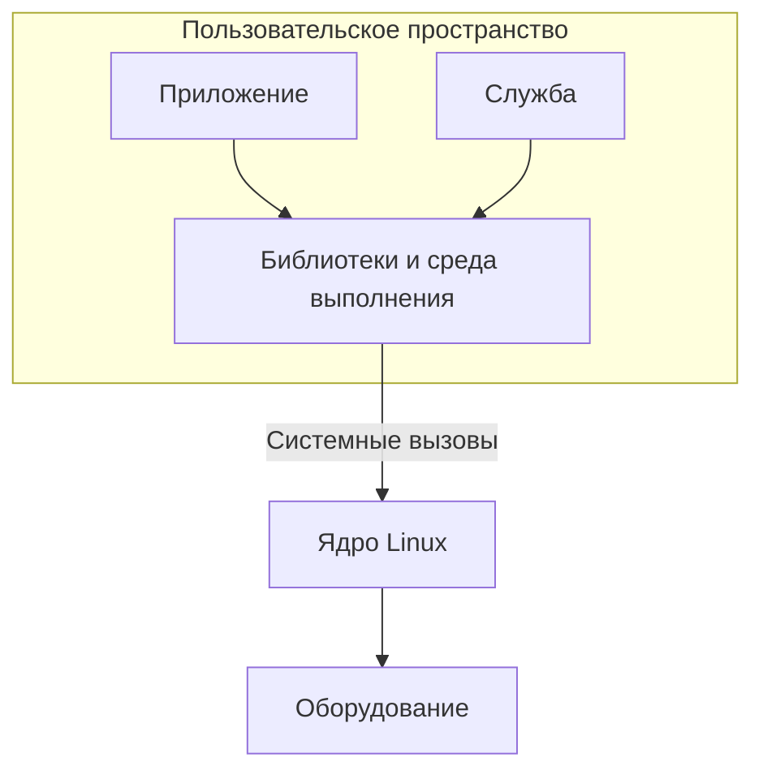

# Пользовательское пространство Linux

## Содержание

- [Что такое пользовательское пространство](#что-такое-пользовательское-пространство)
- [Пользовательское пространство и ядро](#пользовательское-пространство-и-ядро)
- [Программа, процесс и поток](#программа-процесс-и-поток)
- [Память процесса](#память-процесса)
- [Взаимодействие с ядром](#взаимодействие-с-ядром)
- [Библиотеки и среда выполнения](#библиотеки-и-среда-выполнения)
- [Запуск и завершение программы](#запуск-и-завершение-программы)
- [Файлы, устройства и обмен данными](#файлы-устройства-и-обмен-данными)
- [Права и границы изоляции](#права-и-границы-изоляции)
- [Пользовательское пространство встроенной системы](#пользовательское-пространство-встроенной-системы)
- [Источники](#источники)

## Что такое пользовательское пространство

**Пользовательское пространство**, или **user space**, — среда выполнения обычных программ Linux. К ней относятся приложения, оболочки, командные утилиты, фоновые службы, библиотеки и интерпретаторы.

Например, командная оболочка, сетевой сервер и программа опроса датчиков работают в пользовательском пространстве. Они могут выполнять разные задачи и иметь разные права, но используют предоставленные операционной системой интерфейсы для доступа к ресурсам.

Слово «пользовательское» не означает, что программа обязательно взаимодействует с человеком. Служба без окна и терминала также относится к user space. Программа, запущенная от имени root, тоже остаётся пользовательской программой.

Термин употребляется в двух близких смыслах: как область выполнения отдельного процесса и как совокупность программных компонентов вне ядра. Поэтому выражение «состав пользовательского пространства» может обозначать набор библиотек, утилит и служб в установленной системе.

## Пользовательское пространство и ядро

**Ядро** управляет основными ресурсами: процессорным временем, памятью, устройствами, файловыми системами и сетевыми механизмами. Приложение использует эти ресурсы через интерфейсы ядра, а собственные вычисления выполняет в пользовательском режиме процессора.

| Область | Примеры компонентов | Основная роль |
|---|---|---|
| User space | Приложения, оболочки, службы, библиотеки | Логика программ и обработка данных |
| Kernel space | Планировщик, управление памятью, файловые системы, драйверы | Управление ресурсами и выполнение привилегированных операций |

Схема показывает обычный путь обращения к системным ресурсам. Между приложением и оборудованием может быть несколько программных уровней. При этом не каждая операция приложения требует обращения к ядру: вычисление суммы или обработка уже доступного массива обычно выполняются непосредственно в пользовательском коде.

Разделение ограничивает последствия ошибок и позволяет нескольким программам совместно использовать оборудование. Конкретные аппаратные механизмы защиты зависят от архитектуры; далее подразумевается обычная система Linux с виртуальной памятью.

## Программа, процесс и поток

**Программа** — код и данные, подготовленные для выполнения. Исполняемый файл на диске ещё не является работающим процессом.

**Процесс** — экземпляр выполнения программы вместе с его ресурсами и состоянием. У него есть идентификатор PID, адресное пространство, открытые файлы, параметры доступа и другие атрибуты. Несколько запусков одного исполняемого файла могут создать несколько процессов.

**Поток** — отдельная последовательность выполнения внутри процесса. У процесса может быть один поток или несколько. Потоки одного процесса разделяют адресное пространство и многие ресурсы, но имеют собственные стеки и состояние выполнения. См. [описание потоков POSIX](https://man7.org/linux/man-pages/man7/pthreads.7.html).

Например, сервер может обслуживать запросы несколькими потоками одного процесса либо несколькими процессами. В первом случае общий доступ к данным проще организовать, но его нужно синхронизировать; во втором обмен между отдельными адресными пространствами обычно требует явного механизма взаимодействия.

Планировщик ядра определяет, какой готовый к выполнению поток получает процессорное время. Поток может выполняться, ожидать своей очереди или ждать событие: данные от устройства, сетевой пакет, освобождение блокировки. Поэтому запущенная программа не обязательно непрерывно занимает процессор.

## Память процесса

Процесс обращается к памяти через **виртуальные адреса**. Ядро и аппаратные средства управления памятью определяют, каким физическим страницам они соответствуют и какие операции разрешены.

У разных процессов обычно отдельные виртуальные адресные пространства. Одинаковое числовое значение адреса в двух процессах не означает одни и те же данные. Для совместного доступа можно явно организовать общую память; отдельные физические страницы также могут совместно использоваться системой без предоставления произвольного доступа между процессами.

В адресном пространстве находятся несколько видов областей:

| Область | Назначение |
|---|---|
| Код | Машинные инструкции приложения и библиотек |
| Статические данные | Глобальные и статические объекты |
| Куча | Динамически выделяемые объекты, например через `malloc` или `new` |
| Стеки потоков | Состояние вызовов функций и автоматические объекты |
| Отображения | Области, связанные с файлами, общей памятью и другими объектами |

Это логическое описание, а не фиксированная схема адресов. Расположение зависит от архитектуры, загрузчика и настроек системы. Выделение памяти библиотекой не обязательно вызывает ядро при каждом обращении: библиотека может использовать ранее полученные области.

Ошибка обращения к недоступной памяти может привести к сигналу `SIGSEGV` и завершению процесса. Но защита адресного пространства не обнаруживает все ошибки: неверный указатель может попасть в доступную область и повредить собственные данные программы.

## Взаимодействие с ядром

**Системный вызов** — способ запросить операцию ядра из пользовательского кода. Например, приложению может потребоваться открыть файл, прочитать данные, создать процесс или дождаться события.

Обычная последовательность обращения:

1. Программа передаёт параметры операции через программный интерфейс.
2. Выполнение переходит в ядро, которое проверяет аргументы, права и состояние ресурсов.
3. Ядро выполняет запрос или ставит вызывающий поток в ожидание, если это требуется.
4. При завершении вызова программа получает результат или сведения об ошибке.

Переход в ядро не создаёт новый пользовательский процесс. Это выполнение системной операции от имени вызывающего потока. Ожидание внутри вызова также не требует постоянного активного опроса со стороны приложения.

В C системные вызовы обычно доступны через функции-обёртки библиотеки. На уровне исходного текста обращение выглядит как вызов функции, но внутри обёртки происходит переход к ядру. См. [введение в системные вызовы Linux](https://man7.org/linux/man-pages/man2/intro.2.html).

Системный вызов может завершиться ошибкой из-за отсутствия файла, недостатка прав, нехватки ресурсов или других условий. Программа должна проверять результат согласно документации конкретного интерфейса; единого правила возвращаемых значений для всех функций нет.

## Библиотеки и среда выполнения

**Библиотека** содержит готовую реализацию функций, которые использует приложение. Стандартная библиотека C, например, предоставляет обработку строк, форматирование, выделение памяти и файловый ввод-вывод. Для C++ к этому добавляются собственная стандартная библиотека и средства поддержки языка.

Библиотечный код обычно выполняется в пользовательском пространстве того же процесса. Обычный вызов функции библиотеки сам по себе не означает передачу работы отдельной службе.

Одна функция может полностью обработать данные без ядра, другая — вызвать один или несколько системных интерфейсов. Например, библиотечный вывод может сначала сохранить данные в буфере, а отправить их через системный вызов позже. Поэтому библиотечный вызов и системный вызов не являются взаимозаменяемыми понятиями.

**Среда выполнения** подготавливает выполнение программы и поддерживает необходимые механизмы языка. У программы на C/C++ перед `main` уже выполняется стартовый код; после возврата из `main` также возможны завершающие действия.

При динамической компоновке программа использует разделяемые библиотеки, которые подключаются во время загрузки или работы. При статической компоновке необходимый библиотечный код включается в исполняемый файл. Статически скомпонованное приложение всё равно работает в user space и обращается к ядру за системными ресурсами.

## Запуск и завершение программы

Командная оболочка — один из возможных способов запуска. Приложение также может запустить менеджер служб или другая программа.

В распространённой схеме родитель создаёт дочерний процесс, после чего дочерний загружает нужную программу. Для создания могут использоваться разные интерфейсы; детали будут рассмотрены отдельно.

Семейство `exec` **заменяет выполняемую программу в существующем процессе**. Успешный `exec` сам по себе не создаёт новый PID. Ядро подготавливает новый образ программы, передаёт аргументы и окружение; при необходимости в запуске участвует динамический загрузчик. Затем стартовый код передаёт управление приложению. См. [execve(2)](https://man7.org/linux/man-pages/man2/execve.2.html).

При нормальном завершении приложение возвращает код результата. Завершение также может быть вызвано сигналом. Ядро освобождает ресурсы процесса, например его память и открытые дескрипторы, но это не заменяет прикладные завершающие действия: сохранение данных или удаление временных файлов.

Родитель может получить сведения о завершении дочернего процесса через интерфейсы ожидания. В командной строке часть этого взаимодействия выполняет оболочка.

## Файлы, устройства и обмен данными

Для многих операций ввода-вывода приложение использует **файловый дескриптор** — небольшое целое число, обозначающее открытый ресурс внутри процесса. Таким ресурсом может быть обычный файл, канал, сокет или устройство. Число имеет смысл в контексте таблицы дескрипторов конкретного процесса.

Общие операции чтения, записи и закрытия упрощают работу с разными ресурсами, но не делают их поведение одинаковым. Например, у сокета нет обычного позиционирования по файлу, а чтение устройства может ждать появления данных.

Несколько процессов могут взаимодействовать через каналы, сокеты, общую память и другие механизмы. Сам по себе запуск двух программ не даёт им прямого доступа к внутренним объектам друг друга.

Доступ к оборудованию обычно организован через драйвер ядра и предоставленный им интерфейс. Приложение работает с этим интерфейсом, а не произвольно обращается к регистрам устройства. Существуют и специальные способы предоставления аппаратных ресурсов пользовательскому коду; они также требуют согласованной настройки и контроля доступа.

## Права и границы изоляции

С процессом связаны идентификаторы пользователя и групп. Вместе с правами объектов и другими механизмами безопасности они участвуют в проверке доступа. См. [описание идентификаторов процессов](https://man7.org/linux/man-pages/man7/credentials.7.html).

Право читать файл, открывать устройство или управлять другим процессом определяется проверками системы. Оно не появляется только потому, что приложение знает путь, адрес или PID.

Привилегированная учётная запись может получить более широкий доступ к ресурсам, но её приложение продолжает выполняться в user space. **Права процесса** и **режим выполнения процессора** — разные понятия.

Изоляция помогает ограничивать ошибки, но пользовательская программа всё ещё может повредить доступные ей файлы, исчерпать ресурсы или неправильно управлять оборудованием через разрешённый интерфейс. Поэтому обработка ошибок, корректная работа с памятью и ограничения ресурсов остаются частью разработки.

## Пользовательское пространство встроенной системы

Во встроенном устройстве действуют те же основные понятия: приложение выполняется в процессе, использует библиотеки и обращается к ядру. Отличается состав установленного программного обеспечения и доступных ресурсов.

Система может содержать только несколько служебных программ и одно основное приложение. Наличие графического интерфейса, интерактивной оболочки или пакетного менеджера не является условием работы user space.

При загрузке ядро запускает первую пользовательскую программу — init, которая становится процессом PID 1 в начальном пространстве PID. Организация последующего запуска зависит от выбранного устройства системы: init может запускать службы и основное приложение. Возможные причины отказа запуска init описаны в [документации ядра](https://www.kernel.org/doc/html/latest/admin-guide/init.html).

Набор программ, библиотек, конфигураций и файлов устройств формирует окружение приложения. Наличие самого исполняемого файла ещё не гарантирует запуск: должны соответствовать архитектура, требуемые интерфейсы и зависимости. Поэтому перенос приложения на устройство включает проверку его окружения, а не только копирование файла.

## Источники

- [Linux man-pages: системные вызовы](https://man7.org/linux/man-pages/man2/intro.2.html).
- [Linux man-pages: библиотечные функции](https://man7.org/linux/man-pages/man3/intro.3.html).
- [pthreads(7): потоки процесса](https://man7.org/linux/man-pages/man7/pthreads.7.html).
- [execve(2): загрузка программы](https://man7.org/linux/man-pages/man2/execve.2.html).
- [credentials(7): идентификаторы и параметры доступа](https://man7.org/linux/man-pages/man7/credentials.7.html).
- [Документация ядра: запуск init](https://www.kernel.org/doc/html/latest/admin-guide/init.html).

[К серии User-space](README.md).
