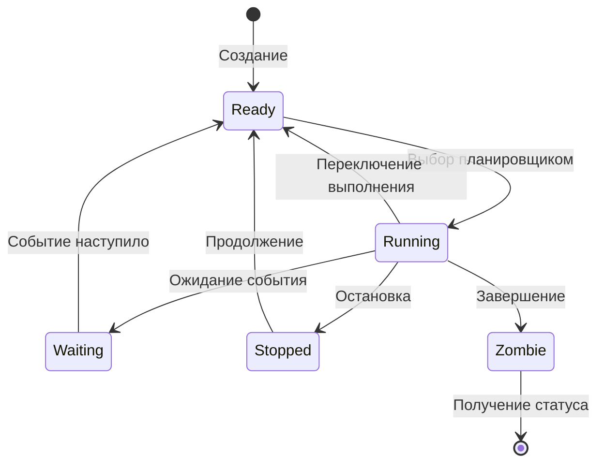
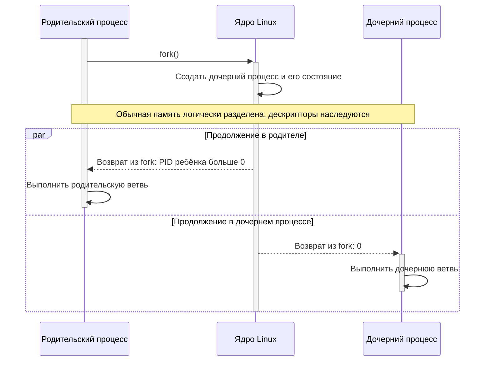
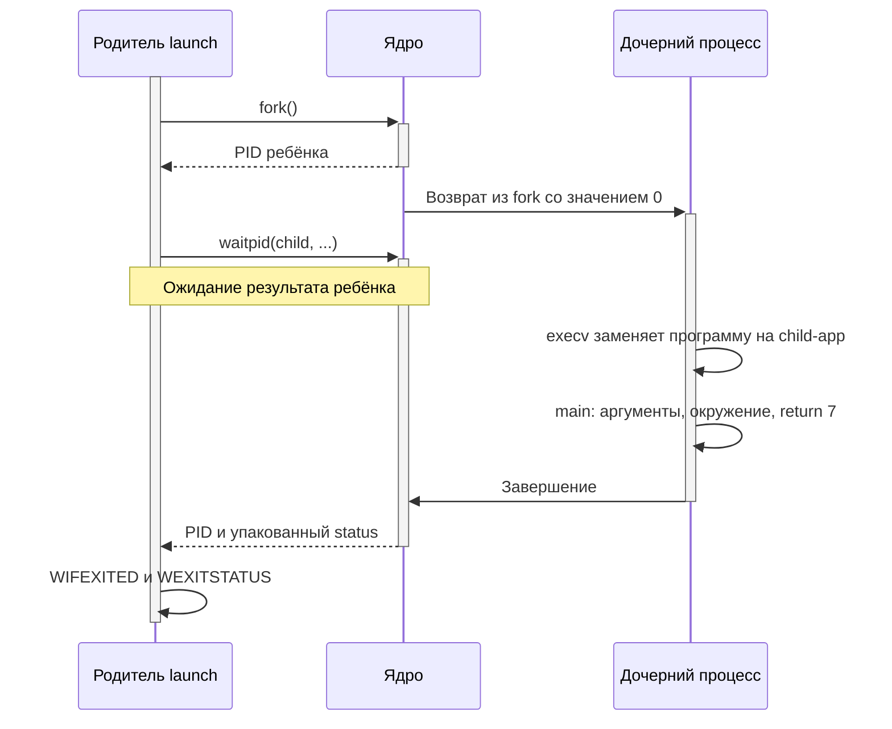
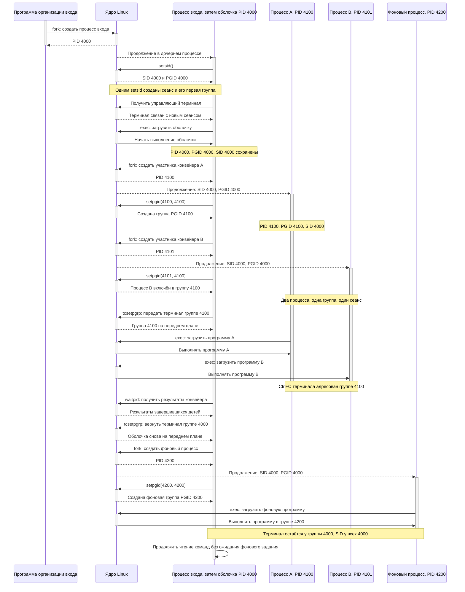
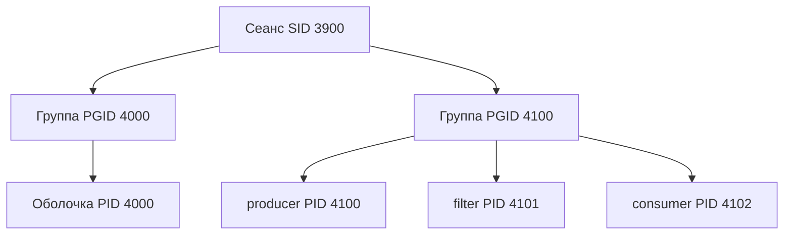
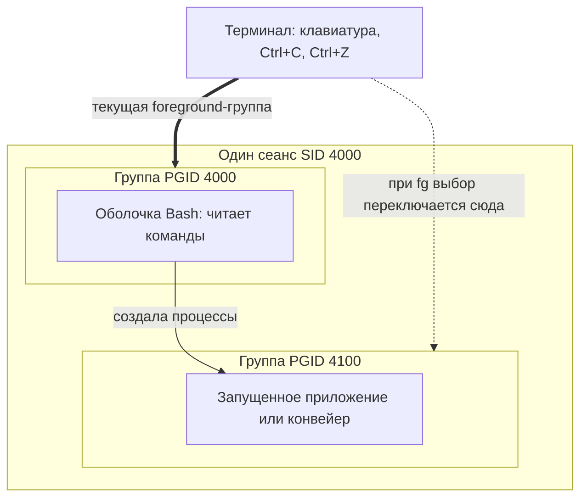
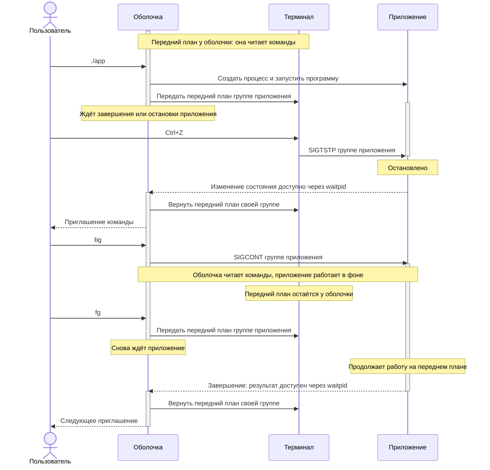
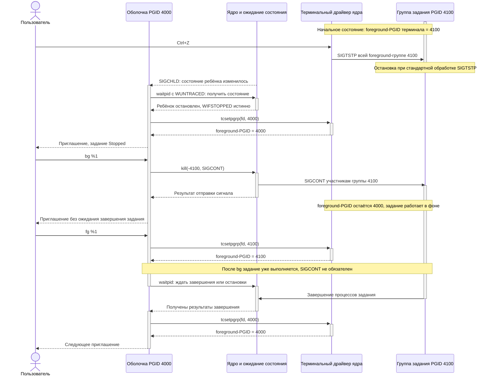
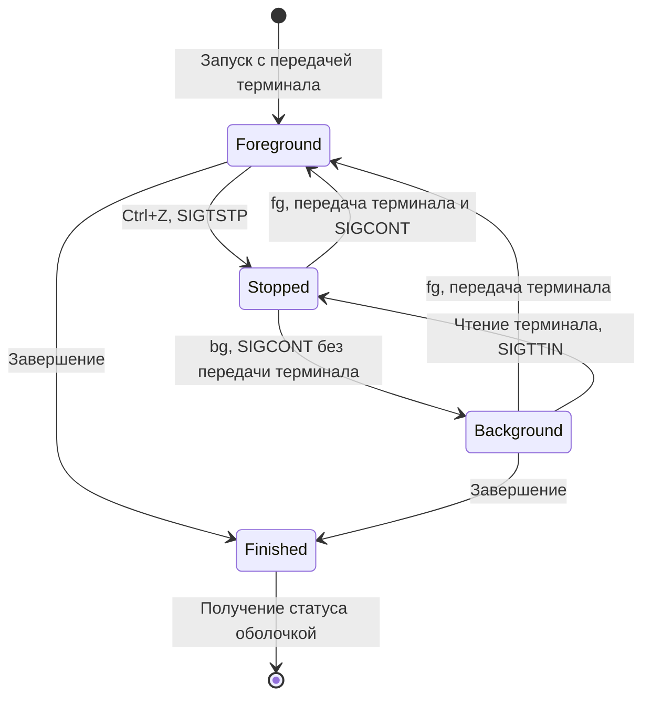

# Процессы и жизненный цикл программы

## Содержание

- [Процесс как объект операционной системы](#процесс-как-объект-операционной-системы)
- [Идентификаторы и родственные связи](#идентификаторы-и-родственные-связи)
- [Состояния процесса](#состояния-процесса)
- [Создание процесса через fork](#создание-процесса-через-fork)
  - [Применения fork](#для-чего-применяется-fork)
  - [Процесс или поток](#когда-процесс-подходит-лучше-потока)
  - [Интерфейс и возвращаемое значение](#интерфейс-и-возвращаемое-значение)
  - [Отдельные значения после fork](#отдельные-значения-после-fork)
- [Наследование ресурсов](#наследование-ресурсов)
  - [Ограничение многопоточного родителя](#ограничение-многопоточного-родителя)
- [Замена программы через exec](#замена-программы-через-exec)
  - [Применения exec](#для-чего-применяется-exec)
  - [Замена программы через execvp](#замена-текущей-программы-через-execvp)
  - [Аргументы и окружение через execve](#явные-аргументы-и-окружение-через-execve)
  - [Обычный запуск и exec в оболочке](#обычный-запуск-и-exec-в-оболочке)
- [Аргументы и окружение](#аргументы-и-окружение)
- [Завершение процесса](#завершение-процесса)
- [Ожидание и получение результата](#ожидание-и-получение-результата)
- [Пример создания и запуска дочерней программы](#пример-создания-и-запуска-дочерней-программы)
- [Запуск через posix_spawn](#запуск-через-posix_spawn)
- [Zombie и процессы без прежнего родителя](#zombie-и-процессы-без-прежнего-родителя)
- [Сеансы и группы процессов](#сеансы-и-группы-процессов)
  - [Назначение сеансов и групп](#для-чего-нужны-сеансы-и-группы)
  - [Когда это нужно разработчику](#когда-это-нужно-разработчику)
  - [Отличие от init и systemd](#почему-это-не-то-же-самое-что-init-или-systemd)
  - [Что такое сеанс](#что-такое-сеанс)
  - [Кто создаёт сеанс](#кто-создаёт-сеанс)
  - [Сеанс и управляющий терминал](#сеанс-и-управляющий-терминал)
  - [Интерфейсы сеанса](#интерфейсы-сеанса)
  - [Зачем объединять процессы](#зачем-объединять-процессы)
  - [Пример оболочки и конвейера](#пример-оболочки-и-конвейера)
  - [Создание и изменение группы](#создание-и-изменение-группы)
  - [Отправка сигнала группе](#отправка-сигнала-группе)
  - [Передний план и фон терминала](#передний-план-и-фон-терминала)
  - [Где проходят границы механизма](#где-проходят-границы-механизма)
- [Источники](#источники)

Процесс объединяет выполнение программы, ресурсы и состояние, которыми управляет ядро. Здесь рассмотрены интерфейсы создания процесса, загрузки программы и получения результата. Подготовка ELF-образа, динамический загрузчик и путь до `main` описаны в [обзорной главе](overview.md#запуск-и-завершение-программы).

## Процесс как объект операционной системы

Исполняемый файл хранит программу, а процесс представляет её выполнение. Один файл можно запустить несколько раз с разными аргументами, окружением и открытыми ресурсами.

С процессом связаны адресное пространство, один или несколько потоков, таблица файловых дескрипторов, текущий каталог, идентификаторы доступа, настройки сигналов и ограничения ресурсов. Потоки выполняют код, а многие перечисленные ресурсы являются общими внутри процесса.

Создание процесса, замена программы и завершение — отдельные операции:

| Операция | Новый процесс | Новый образ программы | Результат |
|---|---|---|---|
| `fork()` | Да | Нет | Дочерний процесс продолжает выполнение кода родителя |
| Успешный `exec*()` | Нет | Да | Текущая программа заменяется, PID сохраняется |
| `posix_spawn()` | Да | Да | Запускается дочерний процесс с указанной программой |
| `exit()` / `_exit()` | Нет | Нет | Выполнение процесса завершается |
| `waitpid()` | Нет | Нет | Родитель получает состояние своего дочернего процесса |

## Идентификаторы и родственные связи

**PID** — идентификатор процесса. **PPID** — идентификатор его текущего родителя. В C они представлены типом `pid_t`:

```c
#include <sys/types.h>
#include <unistd.h>

pid_t getpid(void);
pid_t getppid(void);
```

`getpid()` возвращает PID вызывающего процесса.

`getppid()` возвращает PID его родителя. Родитель может измениться, если прежний завершился.

После `fork()` у дочернего процесса новый PID, а его PPID первоначально равен PID создавшего его процесса. После `exec` PID сохраняется: загрузка другой программы не создаёт новую родственную связь.

PID может использоваться повторно после освобождения. Поэтому сохранённое число не является бессрочным идентификатором одного экземпляра программы. Видимые значения также зависят от пространства имён PID. Подробнее — в [credentials(7)](https://man7.org/linux/man-pages/man7/credentials.7.html).

## Состояния процесса

Запущенный процесс не обязан постоянно исполнять инструкции. Его потоки могут ожидать данные, процессорное время или другое событие. В инструментах диагностики встречаются следующие основные обозначения:

| Обозначение | Смысл |
|---|---|
| `R` | Выполняется или готов к выполнению |
| `S` | Прерываемое ожидание события |
| `D` | Непрерываемое ожидание, часто связанное с вводом-выводом |
| `T` / `t` | Остановка сигналом или остановка при трассировке |
| `Z` | Выполнение завершено, результат ещё не получен родителем |

В многопоточной программе разные потоки могут иметь разные состояния. Столбец состояния процесса не заменяет анализ каждого потока. Описание обозначений приведено в [руководстве ps](https://gitlab.com/procps-ng/procps/-/blob/master/man/ps.1).



Это упрощённая схема типичного жизненного цикла с ожиданием родителем. Linux объединяет выполнение и готовность в обозначении `R`; отдельные состояния на схеме помогают объяснить планирование.

## Создание процесса через fork

`fork()` применяют, когда программе нужен отдельный процесс с начальным состоянием родителя. Родитель сохраняет управление основной задачей, а дочерний процесс получает собственное выполнение. Он может продолжить прежний код или заменить программу через exec.

### Для чего применяется fork

#### Запуск внешней утилиты из приложения

Например, служба сбора данных вызывает архиватор для упаковки журналов или программу преобразования изображения. Родитель создаёт процесс, дочерний выполняет exec нужной утилиты, а родитель получает код завершения и при необходимости читает stdout и stderr через каналы.

Так приложение использует готовую программу без включения её реализации в свою память. Если ожидание выполняется не в основном потоке обработки событий, интерфейс или основной цикл могут продолжать работу. Сам fork не делает последующее ожидание неблокирующим.

#### Построение конвейера обработки

Для последовательности «получить данные → отфильтровать → сжать» управляющая программа создаёт каналы и несколько дочерних процессов. Каждый получает нужные stdin и stdout и через exec запускает свою утилиту. Поток данных проходит через буферы каналов, без обязательного промежуточного файла.

Это программная основа конвейеров оболочки. Родителю нужно закрыть лишние концы каналов и получить результаты всех участников. Иначе читатель может не увидеть конец потока. Пример наследования концов канала приведён в [pipe(2)](https://man7.org/linux/man-pages/man2/pipe.2.html).

#### Отдельный процесс для клиентского соединения

Сетевой сервер принимает соединение, затем вызывает fork. Родитель закрывает свою копию принятого соединения и возвращается к приёму новых клиентов. Дочерний процесс закрывает ненужный слушающий сокет, обслуживает клиента и завершается. Exec здесь не нужен: обе ветви выполняют серверный код.

Ошибка памяти в одном обработчике обычно не разрушает частную память родителя и других обработчиков. Но создание процесса на каждое соединение расходует ресурсы: число одновременно работающих детей ограничивают, а завершившихся обязательно получают через wait.

#### Заранее созданный пул работников

Родитель загружает конфигурацию и создаёт несколько рабочих процессов до появления запросов. Работники получают задачи через сокет, канал или общий слушающий сокет. Родитель следит за их завершением и при необходимости запускает замену.

Это позволяет не создавать процесс на каждую короткую задачу и ограничивать параллелизм. Для нагруженного сервера пул часто практичнее неограниченного fork на каждый запрос. Реальный пример такой организации — [Apache MPM prefork](https://httpd.apache.org/docs/2.4/mod/prefork.html), где родитель управляет пулом серверных процессов.

#### Параллельная обработка независимых задач

Например, программа делит набор изображений, журналов или измерений между несколькими дочерними процессами. Каждый обрабатывает свою часть и передаёт результат через канал либо отдельный выходной файл; родитель объединяет результаты.

Exec не обязателен, если обработчик уже входит в программу. Изменённый ребёнком массив не появится автоматически у родителя: нужно явно передать результат или использовать общую память. Количество работников выбирают по доступным CPU, памяти и ограничениям ввода-вывода, а не только по числу задач.

#### Изоляция обработки ненадёжного формата

Просмотрщик может поручить отдельному процессу разбор повреждённого изображения, сложного документа или стороннего формата. При аварии декодера родитель получает результат завершения и может показать сообщение вместо падения всего приложения.

Отдельное адресное пространство ограничивает повреждение частной памяти, но fork сам по себе не создаёт песочницу. Дочерний процесс наследует доступ к файлам и другим ресурсам; для ограничения полномочий нужны дополнительные механизмы и закрытие ненужных дескрипторов.

Если родитель многопоточный, произвольный декодер нельзя просто вызвать в дочерней ветви сразу после fork: действуют ограничения до exec. В этом случае обработчик запускают отдельной программой или организуют процессы до создания потоков.

#### Фоновое сохранение состояния

Программа с большой структурой данных в памяти может создать дочерний процесс для записи состояния в файл. Родитель продолжает обслуживать запросы, а ребёнок читает унаследованное состояние и сохраняет его. Exec в этом случае не используют: он уничтожил бы нужный образ памяти.

Copy-on-write позволяет некоторое время совместно использовать неизменённые страницы, но изменения увеличивают расход памяти. Fork также имеет собственную стоимость и может задержать родителя. Такой подход применяется для фонового создания RDB-снимков в [Redis](https://redis.io/docs/latest/operate/oss_and_stack/management/persistence/).

Это не автоматический согласованный снимок любых ресурсов. Общая память, устройства, открытые файлы и несколько потоков требуют отдельного протокола подготовки состояния.

#### Выполнение тестов в отдельных процессах

Тестовый исполнитель может запускать потенциально аварийный тест в дочернем процессе. Тогда завершение теста через exit, сигнал или ошибку памяти не прекращает работу исполнителя. Родитель фиксирует результат и переходит к следующему тесту.

Для зависающих тестов добавляют ограничение времени и управление завершением. Если тест порождает собственных детей, завершения одного PID может оказаться недостаточно: нужно контролировать всю группу или другой контейнер ресурсов. Повреждение внешних файлов при этом не отменяется автоматически.

#### Ограниченный по времени обработчик

Например, шлюз поручает отдельному процессу преобразование большого пакета данных или обращение к нестабильному стороннему инструменту. Родитель контролирует срок выполнения, сохраняет работоспособность основной службы и при превышении срока инициирует завершение работника.

Обычно ребёнок выполняет exec обработчика. Такая схема даёт независимый жизненный цикл, но требует протокола отмены: завершение процесса не откатывает уже отправленные команды устройству и изменения внешних данных.

#### Роль главного процесса службы

Главный процесс может создавать дочерние процессы для разных функций: сетевого обслуживания, обработки данных и формирования отчётов. Он собирает статусы, организует остановку и перезапуск работников. Для каждого работника можно выбрать продолжение того же кода или exec отдельной программы.

Такое устройство полезно, когда компонентам нужны независимые жизненные циклы. Но простое создание ребёнка не заменяет менеджер служб: политику перезапуска, обработку повторных сбоев и корректную остановку нужно реализовать явно.

### Когда процесс подходит лучше потока

Отдельный процесс полезен для независимой памяти, запуска другой программы и получения отдельного результата завершения. Поток удобнее, когда исполнителям нужен частый совместный доступ к одним структурам данных и общие ресурсы процесса.

Fork не является обязательным способом распараллеливания и не гарантирует ускорение. Создание процессов, копирование таблиц памяти и обмен результатами имеют стоимость. Для обычного запуска внешней программы подходит также [posix_spawn](#запуск-через-posix_spawn), а для большого числа сетевых соединений возможен событийный ввод-вывод без отдельного процесса на каждого клиента.

### Интерфейс и возвращаемое значение

```c
#include <sys/types.h>
#include <unistd.h>

pid_t fork(void);
```

Один вызов создаёт дочерний процесс. При успехе выполнение продолжается **в обоих процессах после вызова**, но возвращаемые значения различаются:

| Результат | Где получен | Значение |
|---|---|---|
| Больше `0` | Родитель | PID созданного дочернего процесса |
| `0` | Дочерний процесс | Признак дочерней ветви |
| `-1` | Родитель | Ошибка; дочерний процесс не создан, причина в `errno` |

По форме продолжения это напоминает `setjmp()` и `longjmp()`: выполнение может оказаться после одной точки вызова с разными возвращаемыми значениями. Но механизмы различаются:

| Механизм | Что происходит | Где продолжается выполнение |
|---|---|---|
| `setjmp()` / `longjmp()` | Сохраняется точка возврата, затем выполняется переход к ней | В том же потоке того же процесса, в разные моменты |
| `fork()` | Создаётся дочерний процесс | В двух отдельных процессах после одного вызова |

`setjmp()` при непосредственном вызове возвращает `0`; после `longjmp()` возвращает ненулевое значение. Второй процесс при этом не появляется, а память не откатывается к сохранённой копии. Это сохранение контекста управления, а не снимок всей программы.

У `fork()` результат `0` получает ребёнок, а положительный PID — родитель. Оба продолжения существуют независимо: ребёнок не делает прыжок назад в родительский процесс и не должен ждать специального аналога `longjmp()`. Поэтому выражение «fork возвращает дважды» означает возврат в двух процессах, а не повторный возврат в одном.

Порядок выполнения родительской и дочерней ветвей не определён. Даже если родитель получил PID первым, это не гарантирует, что дочерний код ещё не начал работу.

У процессов отдельная обычная память. Linux обычно использует **copy-on-write**: страницы могут оставаться физически общими, пока одна сторона не изменит данные. Логически изменения частной памяти после fork независимы; явно разделяемые отображения сохраняют свои правила общего доступа. См. [fork(2)](https://man7.org/linux/man-pages/man2/fork.2.html).



Диаграмма показывает успешный fork. Дочерний процесс не вызывает fork повторно: он начинает с продолжения после того же вызова. Блок `par` обозначает независимость двух ветвей; порядок их выполнения не задан и на одном процессорном ядре они могут чередоваться. Полосы активности показывают этапы выполнения, а не непрерывное владение процессором.

При ошибке новое продолжение не возникает: только родитель получает `-1`, а причину читает из `errno`.

### Отдельные значения после fork

Полный файл `fork-state.c`:

```c
#define _POSIX_C_SOURCE 200809L
#include <errno.h>
#include <stdio.h>
#include <sys/wait.h>
#include <unistd.h>

int main(void)
{
    int value = 10;
    pid_t child = fork();

    if (child == -1) {
        perror("fork");
        return 1;
    }

    if (child == 0) {
        value = 20;
        _exit(value == 20 ? 0 : 1);
    }

    int status;
    pid_t result;
    do {
        result = waitpid(child, &status, 0);
    } while (result == -1 && errno == EINTR);

    if (result == -1) {
        perror("waitpid");
        return 1;
    }

    printf("parent value=%d\n", value);
    return WIFEXITED(status) && WEXITSTATUS(status) == 0 ? 0 : 1;
}
```

Вывод — `parent value=10`, статус — `0`. Дочернее присваивание не меняет значение родителя. В примере ожидание также позволяет убедиться, что дочерний процесс завершился; его интерфейс разобран ниже.

## Наследование ресурсов

Ребёнок получает начальное состояние от родителя, но не все ресурсы превращаются в независимые копии.

| Ресурс | После fork | После успешного exec |
|---|---|---|
| PID | Новый у дочернего процесса | Сохраняется |
| Частная память | Логически отдельная копия | Заменяется новым образом |
| Явно общая память | Сохраняется общий доступ | Прежние отображения удаляются |
| Файловые дескрипторы | Копия таблицы со ссылками на прежние описания открытия | Остаются, кроме помеченных close-on-exec |
| Текущий каталог | Наследуется | Сохраняется |
| Окружение | Отдельная копия значений | Задаётся интерфейсом exec |
| Обработчики сигналов | Наследуются | Установленные обработчики сбрасываются |

Дескрипторы родителя и ребёнка могут ссылаться на **одно описание открытого файла** и разделять его текущую позицию. Закрытие одной копии не закрывает другую, но чтение через неё может изменить общую позицию. Новый `open()` того же пути создаёт другое описание открытия. См. [open(2)](https://man7.org/linux/man-pages/man2/open.2.html).

Для предотвращения передачи дескриптора новой программе используют `FD_CLOEXEC`, например при открытии через `O_CLOEXEC`. Этот признак действует при exec, а не непосредственно при fork.

Буферы stdio находятся в пользовательской памяти и тоже копируются. Если перед fork в буфере оставался вывод, обычный `exit()` в обеих ветвях может сбросить его дважды. Перед созданием процесса нужно осознанно завершить нужный вывод; дочернюю ветвь после ошибки exec обычно завершают через `_exit()`.

### Ограничение многопоточного родителя

После fork в дочернем процессе остаётся только вызвавший поток, но память и состояние блокировок копируются. Мьютекс мог быть захвачен другим потоком, которого у ребёнка уже нет.

Поэтому между fork и exec в ребёнке многопоточного процесса допускаются только async-signal-safe операции. Обычные `printf()`, выделение памяти и произвольная сложная логика здесь могут привести к зависанию. Это ограничение разобрано в [signal-safety(7)](https://man7.org/linux/man-pages/man7/signal-safety.7.html). Для типичного запуска отдельной программы удобен также posix_spawn.

## Замена программы через exec

Функции семейства exec загружают другую программу **в текущий процесс**. При успехе они не возвращают управление прежнему коду. Подготовка загрузчиком описана в [обзорной главе](overview.md#что-такое-динамический-загрузчик).

| Интерфейс | Программа | Аргументы | Окружение |
|---|---|---|---|
| `execve` | Явный путь | Массив | Явный массив |
| `execv` | Явный путь | Массив | Текущее |
| `execvp` | Имя с поиском в PATH либо путь | Массив | Текущее |
| `execl` | Явный путь | Перечень аргументов | Текущее |
| `execlp` | Имя с поиском в PATH либо путь | Перечень аргументов | Текущее |
| `execle` | Явный путь | Перечень аргументов | Явный массив |

Буква `v` обозначает вектор аргументов, `l` — список отдельных аргументов, `p` — поиск через PATH, `e` — явно переданное окружение. Массивы и списки завершаются нулевым указателем; у вариативных функций завершающий аргумент передают как `(char *)NULL`.

Если exec вернулся, загрузить программу не удалось: результат `-1`, причина в `errno`. Частые причины — отсутствующий путь, недостаточные разрешения, неподдерживаемый формат или отсутствие указанного ELF-интерпретатора. Поэтому сообщение «файл не найден» возможно и при существующем исполняемом файле.

Способ передачи аргументов, поиск и окружение описаны в [exec(3)](https://man7.org/linux/man-pages/man3/exec.3.html), изменение атрибутов процесса — в [execve(2)](https://man7.org/linux/man-pages/man2/execve.2.html).

### Для чего применяется exec

| Ситуация | Что делает exec | Нужен ли отдельный ребёнок |
|---|---|---|
| Запуск архиватора из приложения | Загружает готовую утилиту с подготовленными аргументами | Обычно да, если приложение должно продолжить работу |
| Подготовительный скрипт службы | Заменяет оболочку основной программой службы | Нет, если задача оболочки закончена |
| Программа-обёртка | После настройки окружения передаёт свой процесс рабочей программе | Не обязательно |
| Работник сервера | Загружает отдельный обработчик в созданном процессе | Да, если главный процесс остаётся |
| Этап конвейера | Загружает утилиту после подключения её stdin и stdout к каналам | Обычно каждый этап выполняется отдельным процессом |
| Смена интерактивной оболочки | Заменяет ash на bash в том же процессе | Нет |

**Готовая утилита вместо собственного кода.** Например, приложение сбора данных создаёт ребёнка и загружает в нём архиватор. Родитель продолжает приём данных, следит за результатом упаковки и получает ошибки через отдельный поток или канал. Здесь fork отвечает за независимый процесс, exec — за выполнение архиватора в нём.

**Завершение подготовительного скрипта.** Скрипт службы может проверить каталоги, сформировать переменные, затем выполнить `exec ./app`. Оболочка больше не нужна и заменяется приложением. PID процесса сохраняется; менеджер службы наблюдает уже основную программу, а не лишнюю оболочку, которая должна передавать ей сигналы.

**Выбор реализации через обёртку.** Небольшая программа определяет режим работы, выбирает путь к обработчику, формирует аргументы и заменяет себя. Например, один входной интерфейс запускает разные преобразователи форматов. После exec память и код обёртки не остаются действующим приложением; новую программу нельзя вызвать как функцию с последующим возвратом.

**Перенаправленный обработчик.** Родитель создаёт каналы и ребёнка. В дочерней ветви дескрипторы подключаются к stdin и stdout, затем выполняется exec фильтра. Фильтр работает со стандартными потоками, не зная, что их подготовила другая программа. Ненужные дескрипторы закрывают до exec или помечают close-on-exec.

**Отдельное окружение запуска.** Через execve можно передать обработчику только необходимые переменные, например режим и локаль. Это задаёт его настройки, но не создаёт изоляцию прав: открытые ресурсы, рабочий каталог и полномочия нужно контролировать отдельно.

### Замена текущей программы через execvp

Полный файл `replace.c`:

```c
#define _POSIX_C_SOURCE 200809L
#include <stdio.h>
#include <unistd.h>

int main(int argc, char *argv[])
{
    if (argc < 2) {
        fprintf(stderr, "usage: %s program [arguments...]\n", argv[0]);
        return 1;
    }

    execvp(argv[1], &argv[1]);
    perror("execvp");
    return 127;
}
```

Программа передаёт новой программе свой процесс без fork. `argv[1]` выбирает программу, а `&argv[1]` — начало массива её аргументов, уже заканчивающегося нулевым указателем. Поиск через PATH выполняется, если имя не содержит слеша.

```bash
cc -std=c11 -Wall -Wextra -Werror replace.c -o replace
./replace ./child-app alpha 'two words'
printf 'status=%s\n' "$?"
```

Используется `child-app.c` из [полного примера ниже](#дочернее-приложение). Его ожидаемый вывод при отсутствии DEMO_MODE:

```text
argv[0]=./child-app
argv[1]=alpha
argv[2]=two words
DEMO_MODE=unset
status=7
```

Если DEMO_MODE уже экспортирована, вывод содержит её значение. Возвращаемый в оболочку `7` — код child-app, а не replace: строка `return 127` после успешного exec не выполняется. PID replace при замене сохраняется.

Если выполнить `./replace ./missing-app`, execvp вернётся, perror выведет причину, а replace завершится с выбранным в примере кодом `127`. Прежняя программа способна обработать ошибку именно потому, что замена не произошла.

Когда аргументы известны заранее, вариант со списком выглядит как `execl("./child-app", "child-app", "alpha", "two words", (char *)NULL)`. В отличие от execvp, этот вызов использует явный путь и отдельные аргументы C, а не массив. При ошибке его результат также нужно обработать.

### Явные аргументы и окружение через execve

Полный файл `replace-env.c`:

```c
#define _POSIX_C_SOURCE 200809L
#include <stdio.h>
#include <unistd.h>

int main(int argc, char *argv[])
{
    if (argc != 2) {
        fprintf(stderr, "usage: %s path-to-app\n", argv[0]);
        return 1;
    }

    char *next_args[] = {argv[1], "alpha", "two words", NULL};
    char *next_env[] = {"DEMO_MODE=isolated", "LC_ALL=C", NULL};

    execve(argv[1], next_args, next_env);
    perror("execve");
    return 127;
}
```

```bash
cc -std=c11 -Wall -Wextra -Werror replace-env.c -o replace-env
DEMO_MODE=parent ./replace-env ./child-app
printf 'status=%s\n' "$?"
```

Результат:

```text
argv[0]=./child-app
argv[1]=alpha
argv[2]=two words
DEMO_MODE=isolated
status=7
```

Новый образ получает именно next_env, а не дополнение к окружению replace-env. Поэтому значение `parent` заменено на `isolated`, а неуказанные переменные не передаются. PATH здесь отсутствует и не нужен для поиска: execve получает явный путь. Однако загружаемой программе могут понадобиться другие переменные — их состав выбирают по её требованиям.

Оба примера заменяют **себя**. Если вызывающее приложение должно продолжить свою работу после завершения обработчика, exec выполняют в дочерней ветви fork, как в [примере запуска дочерней программы](#пример-создания-и-запуска-дочерней-программы), либо используют posix_spawn.

### Обычный запуск и exec в оболочке

При `./app arg1 arg2` оболочка обычно запускает приложение в дочернем процессе, а сама остаётся. При `exec ./app arg1 arg2` заменяется сама оболочка. Например, `exec bash` из ash переводит текущий процесс в Bash: после выхода возврата в Ash не будет.

Команда оболочки exec предоставляет механизм замены; обычный запуск тоже использует его внутри, но для дочернего процесса. Это не разные режимы работы самой app.

## Аргументы и окружение

Обычная сигнатура точки входа приложения:

```c
int main(int argc, char *argv[]);
```

`argc` — число элементов аргументов.

`argv[0]` — по соглашению имя запускаемой программы; оно не является надёжным доказательством фактического пути исполняемого файла.

`argv[1]` и последующие — переданные параметры. `argv[argc]` — нулевой указатель.

Кавычки оболочки формируют аргументы и обычно не входят в их содержимое. Вызов `./app alpha 'two words'` передаёт два пользовательских аргумента, второй содержит пробел. При exec из C массив задаётся непосредственно: текстовые кавычки внутри строк не нужны для группировки.

Окружение — отдельный набор строк `NAME=value`. `getenv()` читает значение, `setenv()` и `unsetenv()` изменяют окружение текущего процесса. Уже запущенный родитель или соседний процесс этих изменений не получает. Интерфейс описан в [environ(7)](https://man7.org/linux/man-pages/man7/environ.7.html).

Рабочий каталог — ещё один отдельный атрибут. Он не обязан совпадать с каталогом исполняемого файла. Например, запуск `/opt/app/bin/app` из `/tmp` сам по себе не переводит приложение в `/opt/app/bin`.

## Завершение процесса

| Способ | Действия пользовательской среды |
|---|---|
| Возврат из main | Нормальное завершение, библиотечная очистка |
| `exit(status)` | Обработчики завершения и сброс stdio; функция не возвращается |
| `_exit(status)` / `_Exit(status)` | Завершение без обработчиков atexit и сброса stdio |
| Завершающий сигнал | Зависит от сигнала и его обработки; обычная очистка не гарантируется |

При нормальном завершении main код `0` обычно означает успех, ненулевой — согласованный приложением результат. Родитель получает младшие восемь бит обычного кода завершения: большие числа не подходят для передачи произвольного результата.

`exit()` не является обычным возвратом через все функции. В частности, в C++ он не обеспечивает уничтожение автоматических объектов всех активных вызовов как при выходе из их областей видимости. Для нормального библиотечного завершения см. [exit(3)](https://man7.org/linux/man-pages/man3/exit.3.html).

`_exit()` не сбрасывает пользовательские буферы stdio, но ядро закрывает файловые дескрипторы и освобождает ресурсы. Закрытие может потребовать времени, поэтому «немедленно» здесь означает отсутствие обычной библиотечной очистки, а не гарантированное отсутствие задержек. См. [_exit(2)](https://man7.org/linux/man-pages/man2/_exit.2.html).

Сигнал SIGTERM позволяет приложению организовать обработку, а SIGKILL обработать нельзя. Родитель различает код завершения и номер завершающего сигнала; это разные данные.

## Ожидание и получение результата

```c
#include <sys/types.h>
#include <sys/wait.h>

pid_t wait(int *status);
pid_t waitpid(pid_t pid, int *status, int options);
```

`wait()` ждёт завершения одного из подходящих дочерних процессов.

`waitpid()` позволяет выбрать конкретного ребёнка и режим. Положительный `pid` выбирает этот PID, `-1` — любого ребёнка. Отрицательные значения меньше `-1` и `0` имеют смысл выбора группы.

Результат больше `0` — PID ребёнка, состояние которого получено.

Результат `0` возможен с `WNOHANG`, если подходящий ребёнок есть, но доступного изменения состояния пока нет.

Результат `-1` — ошибка. `EINTR` означает прерывание ожидания сигналом, `ECHILD` — отсутствие подходящего ребёнка, которого можно ожидать.

Параметр `options=0` обычно нужен для ожидания завершения.

`WNOHANG` не блокирует вызов. Сам цикл частого опроса с этим флагом не является эффективным ожиданием.

`WUNTRACED` позволяет получать остановки.

`WCONTINUED` позволяет получать продолжение после остановки.

`status` — упакованное состояние, а не готовый код возврата приложения:

| Проверка | Когда использовать | Результат |
|---|---|---|
| `WIFEXITED(status)` | После успешного ожидания | Обычное завершение |
| `WEXITSTATUS(status)` | Только если WIFEXITED истинно | Код завершения |
| `WIFSIGNALED(status)` | После успешного ожидания | Завершение сигналом |
| `WTERMSIG(status)` | Только если WIFSIGNALED истинно | Номер сигнала |
| `WIFSTOPPED(status)` | Если ожидались также остановки | Остановка |
| `WIFCONTINUED(status)` | Если ожидалось продолжение | Возобновление |

Ожидание не требует, чтобы ребёнок ещё выполнялся в момент вызова: уже завершившийся процесс может быть получен сразу. Обычно ожидать можно собственных детей, а не произвольную программу по её PID. Полные правила — в [wait(2)](https://man7.org/linux/man-pages/man2/waitpid.2.html).

## Пример создания и запуска дочерней программы

Два файла демонстрируют всю последовательность: создание, exec, получение аргументов и окружения, возврат результата. Все исходники и команды сборки относятся к текущему рабочему окружению; файлы размещаются рядом в отдельном каталоге примера.

### Дочернее приложение

Полный файл `child-app.c`:

```c
#include <stdio.h>
#include <stdlib.h>

int main(int argc, char *argv[])
{
    for (int i = 0; i < argc; ++i) {
        printf("argv[%d]=%s\n", i, argv[i]);
    }

    const char *mode = getenv("DEMO_MODE");
    printf("DEMO_MODE=%s\n", mode != NULL ? mode : "unset");
    return 7;
}
```

Программа печатает полученные данные и намеренно возвращает `7`. Здесь это результат демонстрации передачи статуса, а не ошибка запуска.

### Родительский процесс

Полный файл `launch.c`:

```c
#define _POSIX_C_SOURCE 200809L
#include <errno.h>
#include <stdio.h>
#include <sys/wait.h>
#include <unistd.h>

int main(int argc, char *argv[])
{
    if (argc != 2) {
        fprintf(stderr, "usage: %s path-to-app\n", argv[0]);
        return 1;
    }

    char *child_args[] = {argv[1], "alpha", "two words", NULL};
    pid_t child = fork();

    if (child == -1) {
        perror("fork");
        return 1;
    }

    if (child == 0) {
        execv(argv[1], child_args);
        const char message[] = "execv failed\n";
        (void)write(STDERR_FILENO, message, sizeof(message) - 1);
        _exit(127);
    }

    int status;
    pid_t result;
    do {
        result = waitpid(child, &status, 0);
    } while (result == -1 && errno == EINTR);

    if (result == -1) {
        perror("waitpid");
        return 1;
    }

    if (WIFEXITED(status)) {
        const int code = WEXITSTATUS(status);
        printf("child exit=%d\n", code);
        return code;
    }

    if (WIFSIGNALED(status)) {
        printf("child signal=%d\n", WTERMSIG(status));
    }
    return 1;
}
```

Код после exec в дочерней ветви выполняется только при ошибке. Там используются write и _exit, без обычного stdio и обработчиков родителя. Короткая диагностика намеренно упрощена: её запись может не удаться и не заменяет протокол передачи подробной причины.

`127` — выбранный этим примером код ошибки exec. Другая программа тоже может вернуть `127`, поэтому один такой статус не доказывает причину завершения. Для точного различения родитель и ребёнок могут передавать `errno` по служебному каналу с close-on-exec; это требует отдельной реализации.

### Сборка и наблюдаемый результат

```bash
cc -std=c11 -Wall -Wextra -Werror child-app.c -o child-app
cc -std=c11 -Wall -Wextra -Werror launch.c -o launch
DEMO_MODE=demo ./launch ./child-app
printf 'status=%s\n' "$?"
```

Ожидаемый вывод:

```text
argv[0]=./child-app
argv[1]=alpha
argv[2]=two words
DEMO_MODE=demo
child exit=7
status=7
```

Ожидание гарантирует, что сообщение родителя о результате появится после завершения ребёнка. Без него порядок вывода двух процессов в общем случае не определён.



Ребёнок и родитель выполняются независимо; диаграмма показывает один возможный порядок входа в waitpid. Если ребёнок успел завершиться раньше, ожидание всё равно получает его результат.

## Запуск через posix_spawn

`posix_spawn()` объединяет создание ребёнка и загрузку программы. `posix_spawnp()` дополнительно выполняет поиск имени по PATH. Через отдельные объекты настройки задаются действия с дескрипторами и часть атрибутов ребёнка; пользовательская дочерняя ветвь, как после fork, не требуется.

В отличие от большинства предыдущих функций, ошибка возвращается **непосредственно как номер**, а не как `-1` с обязательной установкой errno. После успешного запуска результат программы всё равно получают через waitpid.

Полный файл `spawn-launch.c`, использующий прежний `child-app`:

```c
#define _POSIX_C_SOURCE 200809L
#include <errno.h>
#include <spawn.h>
#include <stdio.h>
#include <string.h>
#include <sys/wait.h>

extern char **environ;

int main(int argc, char *argv[])
{
    if (argc != 2) {
        fprintf(stderr, "usage: %s path-to-app\n", argv[0]);
        return 1;
    }

    char *child_args[] = {argv[1], "alpha", "two words", NULL};
    pid_t child;
    const int error = posix_spawn(&child, argv[1], NULL, NULL,
                                  child_args, environ);
    if (error != 0) {
        fprintf(stderr, "posix_spawn: %s\n", strerror(error));
        return 1;
    }

    int status;
    pid_t result;
    do {
        result = waitpid(child, &status, 0);
    } while (result == -1 && errno == EINTR);

    if (result == -1) {
        perror("waitpid");
        return 1;
    }

    if (WIFEXITED(status)) {
        const int code = WEXITSTATUS(status);
        printf("child exit=%d\n", code);
        return code;
    }

    if (WIFSIGNALED(status)) {
        printf("child signal=%d\n", WTERMSIG(status));
    }
    return 1;
}
```

```bash
cc -std=c11 -Wall -Wextra -Werror spawn-launch.c -o spawn-launch
DEMO_MODE=demo ./spawn-launch ./child-app
printf 'status=%s\n' "$?"
```

Ожидаемый вывод совпадает с предыдущим примером. Отдельный запуск `fork-state.c` собирается теми же параметрами и показывает независимость памяти.

Внутренний механизм posix_spawn зависит от libc и не обязан буквально вызывать fork. Некоторые ошибки подготовки ребёнка могут проявляться как его завершение с `127`; поэтому успешный возврат функции не равнозначен успешному выполнению прикладной задачи. См. [posix_spawn(3)](https://man7.org/linux/man-pages/man3/posix_spawn.3.html).

## Zombie и процессы без прежнего родителя

**Zombie** — завершившийся ребёнок, чей результат ещё не получен родителем. Он уже не выполняет код приложения и не хранит весь прежний образ памяти, но ядру нужна запись с идентификатором и результатом. Обычное ожидание завершения освобождает эту запись.

Убивать zombie сигналом бессмысленно: он уже завершился. Исправлять нужно получение результатов в родителе. Для сервера с множеством детей это обязанность в течение работы, а не только перед собственным завершением.

Если родитель завершился раньше, ребёнок может продолжить работу и получить нового родителя — ближайший подходящий subreaper или init. Это **осиротевший процесс**, а не обязательно zombie. У нового родителя появляются обязанности по получению результатов. В Linux конкретное поведение связано также с пространствами PID.

О завершении детей обычно сообщает SIGCHLD, но его обработка не заменяет ожидание. Один сигнал не стоит считать точным счётчиком завершившихся детей. Явное игнорирование SIGCHLD и SA_NOCLDWAIT меняют правила хранения результатов; их применяют осознанно, если результат не нужен. См. [wait(2)](https://man7.org/linux/man-pages/man2/waitpid.2.html).

## Сеансы и группы процессов

### Для чего нужны сеансы и группы

Дерево процессов показывает происхождение: кто кого создал. Но для управления работающей системой нужны другие связи: какие программы выполняют одно задание, кому адресовать Ctrl+C и какие задания используют один терминал. Для этого существуют группы процессов и сеансы.

Например, оболочка запустила `producer | filter | consumer`. У неё три дочерних процесса. Пользователь хочет прервать весь конвейер, но сохранить оболочку и другие задания. Сигнал только одному PID решит задачу не полностью, а сигнал всем детям оболочки затронет лишние программы. Отдельная группа конвейера задаёт нужную область управления.

| Механизм | На какой вопрос отвечает | Практическая задача |
|---|---|---|
| Родство PID/PPID | Кто создал процесс и кто получает его результат? | Дождаться своих детей и освободить записи об их завершении |
| Группа PGID | Какие процессы относятся к одному управляемому заданию? | Совместно остановить, продолжить или прервать конвейер |
| Сеанс SID | Какие группы относятся к одному контексту управления терминалом? | Объединить оболочку и её задания, сохранив их отдельные группы |
| Foreground-группа терминала | Какое задание сейчас взаимодействует с терминалом? | Направить ввод и терминальные сигналы текущему заданию |

**Группа нужна для совместных действий.** Управляющая программа может поместить несколько обработчиков в отдельную группу и отправлять ей сигналы, не включая себя. Состав группы определяется настройкой PGID, а не автоматически всем деревом потомков. Поэтому групповой сигнал удобен для контролируемого набора работников, но не гарантирует охват процессов, которые перешли в другие группы.

**Сеанс задаёт общую рамку для групп и терминала.** В одной интерактивной работе могут существовать оболочка, foreground-конвейер и несколько фоновых заданий. Они относятся к одному сеансу, но имеют разные PGID. При переключении задания меняется foreground-группа; создавать заново весь сеанс не требуется.

**Отдельный сеанс отделяет контекст терминального управления.** Например, два независимых интерактивных SSH-сеанса могут иметь собственные оболочки и псевдотерминалы. Ctrl+C в одном терминале адресован его foreground-группе и не выбирает задания другого терминала. Для неинтерактивного процесса setsid позволяет начать без управляющего терминала, но не закрывает унаследованные дескрипторы.

Эти связи учитываются и при событиях терминала, например разрыве связи: возможна доставка SIGHUP, а оболочка может дополнительно уведомлять свои задания. Поэтому «запустить в фоне» и «организовать независимую длительную службу» — разные задачи. Конкретные правила зависят от терминала, оболочки и настроек сигналов; основы описаны в [credentials(7)](https://man7.org/linux/man-pages/man7/credentials.7.html).

### Когда это нужно разработчику

Обычное приложение часто ничего не создаёт вручную: оболочка или менеджер запуска уже определили его PGID, SID и стандартные потоки. Приложение наследует это окружение и работает внутри него.

Явная организация полезна, когда программа сама управляет другими программами:

- **Собственная оболочка или терминал:** объединять конвейер в группу, передавать ему foreground и возвращать терминал после завершения или остановки.
- **Исполнитель сборки или тестов:** отделять управляемый набор процессов от себя, чтобы запрос отмены не завершал сам исполнитель.
- **Служба с несколькими работниками:** совместно отправлять сигналы работникам, получать их статусы и организовывать остановку.
- **Организатор входа или удалённого терминала:** создавать отдельный сеанс и связывать его с нужным терминалом.

Не каждому приложению нужно вызывать setsid или setpgid. Если достаточно запустить одну утилиту и дождаться результата, отдельная новая группа или сеанс могут вообще не потребоваться. Настройки выбираются по требуемому поведению сигналов и терминала.

### Почему это не то же самое, что init или systemd

Сеанс и группа — объекты учёта и управления в ядре. `init` и `systemd` — программы, которые организуют работу системы. Системный менеджер с PID 1 запускает и сопровождает службы; сеансы и группы могут использоваться при подготовке отдельных процессов, но не определяют всю его роль.

Управление службой обычно шире: порядок запуска, перезапуск, зависимости, права и ограничения ресурсов. В systemd для учёта процессов службы используются в том числе cgroups. Это другой механизм: он позволяет объединять процессы по принадлежности службе, а не только по терминальному PGID или SID. См. [описание systemd](https://www.freedesktop.org/software/systemd/man/latest/systemd.html).

Создание нового сеанса не означает создание службы, а создание группы не добавляет автоматический перезапуск. Их основная роль здесь — определить, **какими процессами управлять вместе и как связать их с терминалом**.

### Что такое сеанс

**Сеанс** — объединение групп процессов с идентификатором SID. **Лидер сеанса** имеет PID, равный SID. Один сеанс может содержать оболочку и несколько групп её заданий; группа принадлежит только одному сеансу.

Сеанс создаётся по запросу пользовательской программы через `setsid()`. Ядро выполняет этот запрос, а вызвавший процесс становится лидером нового сеанса. Сам вход пользователя, открытие окна терминала или установление сетевого соединения не являются системным вызовом создания сеанса: соответствующие программы организуют необходимые действия.

### Кто создаёт сеанс

| Ситуация | Кто организует сеанс |
|---|---|
| Вход через текстовый терминал | Цепочка программ подготовки терминала и входа, например getty/login |
| Интерактивный вход через SSH | Процесс обработки входа в составе SSH-сервера |
| Открытие псевдотерминала в эмуляторе | Процесс, подготавливающий дочернюю оболочку и терминал |
| Отделение фоновой программы | Сама программа или запускающая её обёртка, если предусмотрен вызов setsid |

Конкретное распределение действий зависит от реализации. Оболочка обычно запускается уже внутри подготовленного сеанса и не создаёт новый SID для каждой команды. Менеджер служб тоже может организовать отдельный сеанс, но наличие нового сеанса не является обязательным свойством каждой службы.

Например, обработчик входа создаёт сеанс и затем через exec запускает оболочку. PID и SID сохраняются при замене. Оболочка создаёт детей для команд: они наследуют её SID, но могут быть распределены по разным группам процессов для управления заданиями.



Числа условные; показаны успешные операции. Исходный процесс входа не является лидером группы до setsid. После exec участник «процесс входа» становится оболочкой в том же PID, а не создаёт ещё один процесс.

Сначала setsid создаёт сеанс и его первую группу. Затем fork создаёт процессы с унаследованными SID и PGID. Только setpgid создаёт отдельную группу задания или присоединяет к ней второго участника. Tcsetpgrp выбирает, какая из существующих групп получает передний план терминала.

Диаграмма упрощает настройку каналов и синхронизацию детей до exec. В реальной оболочке вызовы setpgid могут выполняться также в дочерних ветвях, чтобы исключить гонку запуска. Ожидание конвейера означает получение результата каждого участника, а не обязательно один вызов waitpid.

Полосы активности обозначают этапы жизни и выполнения участников, включая ожидание, а не непрерывное занятие процессора. Завершение полосы фонового процесса означает конец показанного фрагмента: фоновая программа продолжает работать, а оболочка позднее должна получить её статус. Ядро не обязательно выполняет операции именно в изображённом порядке: это один допустимый сценарий организации входа и заданий.

### Сеанс и управляющий терминал

Сеанс не равен окну терминала, SSH-соединению или записи о входе пользователя. Он является объектом организации процессов. Можно создать сеанс без интерактивного входа, и у него может не быть управляющего терминала.

У сеанса может быть один управляющий терминал, а у терминала — один связанный с ним сеанс. Для него выбирается foreground-группа из этого сеанса. Поэтому разные фоновые и передние задания одной оболочки связаны общим терминальным окружением, хотя выполняют разные программы.

После setsid управляющего терминала первоначально нет. Его приобретение — отдельная операция организации терминального доступа. При этом открытые файловые дескрипторы могут по-прежнему ссылаться на прежний терминал: наличие дескриптора и статус управляющего терминала — разные свойства.

### Интерфейсы сеанса

```c
#define _POSIX_C_SOURCE 200809L
#include <sys/types.h>
#include <unistd.h>

pid_t getsid(pid_t pid);
pid_t setsid(void);
```

`getsid(pid)` получает SID процесса; `pid=0` выбирает текущий.

`setsid()` создаёт новый сеанс и новую группу. Вызывающий процесс становится их лидером, поэтому его PID, PGID и SID совпадают. Новый сеанс первоначально не имеет управляющего терминала.

Лидер существующей группы не может выполнить setsid успешно. Поэтому при классическом отделении службы часто сначала создают ребёнка, который не является лидером группы. Однако сама операция setsid не закрывает stdin, stdout и stderr: унаследованные дескрипторы всё ещё могут ссылаться на терминал. См. [setsid(2)](https://man7.org/linux/man-pages/man2/setsid.2.html).

### Зачем объединять процессы

**Группа процессов** объединяет несколько процессов для совместного управления, прежде всего сигналами и доступом к терминалу. Например, конвейер `producer | filter | consumer` содержит три программы, но пользователь воспринимает его как одно задание: остановить, продолжить или прервать нужно весь конвейер.

Каждый процесс принадлежит одной группе. Группа обозначается **PGID** (*Process Group ID*). Это не группа пользователей: PGID не даёт разрешений на чтение файлов и не создаёт общую память.

| Идентификатор | Что обозначает | Пример назначения |
|---|---|---|
| PID | Отдельный процесс | Отправить сигнал одному обработчику |
| PPID | Текущий родитель процесса | Установить родственную связь |
| PGID | Группу процессов | Отправить сигнал всему конвейеру |
| SID | Сеанс, объединяющий группы | Организовать управление заданиями и терминалом |

Дерево родителей и группы — разные структуры. Родитель может иметь детей в нескольких группах. При fork ребёнок первоначально наследует PGID и SID родителя; exec сохраняет их. Само создание ребёнка не создаёт новую группу.

### Пример оболочки и конвейера

Предположим, интерактивная оболочка имеет PID и PGID `4000`, а её SID — `3900`. Для конвейера она создаёт три процесса и помещает их в отдельную группу:

| Процесс | PID | PPID | PGID | SID |
|---|---|---|---|---|
| Оболочка | 4000 | 3900 | 4000 | 3900 |
| producer | 4100 | 4000 | 4100 | 3900 |
| filter | 4101 | 4000 | 4100 | 3900 |
| consumer | 4102 | 4000 | 4100 | 3900 |

Числа условные. У всех участников конвейера PGID `4100`, хотя PID различаются. Оболочка остаётся в своей группе, поэтому сигнал группе конвейера не обязан затрагивать оболочку. Конкретное дерево детей зависит от реализации оболочки; таблица показывает одну обычную организацию.

**Лидер группы** — процесс, у которого PID совпадает с PGID. В примере это producer. Он не обязан управлять остальными: «лидер» здесь определяет идентификатор. Если лидер завершился, группа может продолжить существование с другими участниками.



Для наблюдения за своей оболочкой можно выполнить:

```bash
ps -p "$$" -o pid,ppid,pgid,sid,tpgid,stat,comm
```

`TPGID` показывает группу переднего плана терминала; при отсутствии управляющего терминала значение может быть `-1`. Числа зависят от сеанса. При включённом управлении заданиями сама команда ps обычно запускается как отдельное foreground-задание, поэтому группа переднего плана в этот момент может отличаться от PGID оболочки.

### Создание и изменение группы

```c
#define _POSIX_C_SOURCE 200809L
#include <sys/types.h>
#include <unistd.h>

pid_t getpgrp(void);
pid_t getpgid(pid_t pid);
int setpgid(pid_t pid, pid_t pgid);
```

`getpgrp()` возвращает PGID текущего процесса.

`getpgid(pid)` получает PGID указанного процесса. Значение `pid=0` выбирает текущий процесс.

`setpgid(pid, pgid)` помещает процесс в группу. `pid=0` выбирает вызывающий процесс, `pgid=0` использует PID выбранного процесса как новый PGID. Поэтому `setpgid(0, 0)` создаёт группу текущего процесса, если выполнены условия операции, и делает его лидером.

Родитель может менять группу собственного ребёнка с учётом ограничений, в частности до выполнения ребёнком exec. Процессы должны оставаться в одном сеансе; лидера сеанса переместить в другую группу нельзя. Возврат `-1` требует проверки errno.

При создании задания оболочки часто вызывают setpgid и в родительской, и в дочерней ветвях. Это устраняет зависимость от того, какая ветвь первой получит процессор: нужная группа должна быть установлена до дальнейших действий. Самостоятельно менять группу любого чужого процесса нельзя. См. [setpgid(2)](https://man7.org/linux/man-pages/man2/setpgid.2.html).

### Отправка сигнала группе

```c
#define _POSIX_C_SOURCE 200809L
#include <signal.h>
#include <sys/types.h>

int kill(pid_t pid, int sig);
```

Положительный аргумент выбирает один процесс. Отрицательное значение меньше `-1` выбирает группу с противоположным по знаку PGID: для условной группы `4100` вызов `kill(-4100, SIGTERM)` адресован её участникам.

`pid=0` выбирает группу самого отправителя, включая его самого, если применимы условия доставки. Значение `-1` имеет отдельный широкий смысл выбора процессов и не означает группу 1.

Отправитель должен иметь право посылать сигнал выбранным получателям. Успех группового вызова означает, что сигнал удалось отправить хотя бы одному участнику, а не обязательное завершение всех. SIGTERM может обрабатываться программой; результаты собственных детей всё равно получают через waitpid. См. [kill(2)](https://man7.org/linux/man-pages/man2/kill.2.html).

Групповой сигнал не означает «сигнал всем потомкам». Потомок, перешедший в другую группу, им не охватывается. Для надёжного управления всей службой, включая меняющих группы работников, обычно нужны дополнительные средства менеджера служб, например учёт через cgroups.

### Передний план и фон терминала

**Управляющий терминал** связан с сеансом. Среди его групп одна выбирается группой **переднего плана** — foreground; остальные относятся к фону — background. У сеанса может вообще не быть управляющего терминала.

При обычных настройках терминала Ctrl+C формирует SIGINT для foreground-группы, Ctrl+Z — SIGTSTP. Поэтому в примере конвейера сигнал получают все три участника, а оболочка — нет.

Фоновая группа при попытке чтения управляющего терминала обычно получает SIGTTIN и останавливается. Вывод из фона часто разрешён; при включённом TOSTOP терминал может останавливать его через SIGTTOU. Фоновый режим не запрещает процессорные вычисления и доступ к обычным файлам. Правила управления терминалом описаны в [credentials(7)](https://man7.org/linux/man-pages/man7/credentials.7.html).

```c
#include <sys/types.h>
#include <unistd.h>

pid_t tcgetpgrp(int fd);
int tcsetpgrp(int fd, pid_t pgid);
```

`tcgetpgrp()` получает foreground-PGID управляющего терминала, открытого через fd.

`tcsetpgrp()` назначает переднюю группу из того же сеанса. Этим интерфейсом оболочка передаёт терминал заданию и затем возвращает себе. Фоновый вызывающий процесс может получить SIGTTOU, поэтому реализация управления заданиями отдельно учитывает сигналы. См. [tcsetpgrp(3)](https://man7.org/linux/man-pages/man3/tcsetpgrp.3.html).

#### Foreground и background относятся к группе

Управляющий терминал хранит **PGID группы переднего плана**. Процесс считается foreground, если принадлежит этой группе; остальные группы того же сеанса находятся в background относительно терминала. Это не постоянный тип программы и не приоритет планировщика.

Например, у конвейера `producer | consumer` два процесса, но одна группа. Когда оболочка отдаёт ему терминал, оба процесса относятся к foreground, хотя consumer может получать stdin из канала, а не с клавиатуры.

В один момент у терминала одна foreground-группа. Фоновых групп может быть несколько. Без управляющего терминала такое деление обычно неприменимо: фоновая служба и background-задание оболочки — разные понятия.

| Свойство | Foreground-группа | Background-группа |
|---|---|---|
| PGID совпадает с foreground-PGID терминала | Да | Нет |
| Обычное чтение управляющего терминала | Разрешено при выполнении остальных условий | Обычно вызывает SIGTTIN и остановку |
| Ctrl+C / Ctrl+Z при обычных настройках | Получает SIGINT / SIGTSTP | Не выбирается терминалом для этих клавиш |
| Обычный вывод в терминал | Возможен | Часто тоже возможен; зависит от TOSTOP и других условий |
| Выполнение вычислений и файлового ввода-вывода | Возможно | Возможно |

**Background не означает «приостановлен».** Работающая фоновая группа получает процессорное время и может читать файлы, обслуживать сеть и писать данные. Остановка — отдельное состояние, которое может возникнуть по сигналу.

#### Терминал, оболочка и приложение

В одном сеансе оболочка и запущенное задание находятся в разных группах. Терминал выбирает одну из них как foreground-группу. На схеме показан момент, когда оболочка читает команды; при передаче терминала приложению выбор меняется.



Foreground — группа, которой сейчас отдан терминал. Другие группы этого сеанса находятся в background относительно него. Приложение может продолжать выполняться в фоне, пока оболочка получает команды пользователя.



Диаграмма показывает обычный интерактивный сценарий с управлением заданиями. Сообщения от приложения к оболочке обозначают получение состояния через ядро, а не прямой вызов оболочки приложением. Остановленное приложение не выполняется; фоновое приложение может выполняться. Передача терминала определяет терминальное управление, а не расположение программы внутри другой программы.

#### Что делает оболочка

При обычном интерактивном запуске с управлением заданиями оболочка создаёт группу задания, передаёт ей терминал через tcsetpgrp и ждёт завершения или остановки. После этого возвращает терминал собственной группе и снова читает команды.

При запуске с `&` оболочка оставляет терминал своей группе и не ждёт задание перед показом следующего приглашения. Запущенная программа может продолжать писать в тот же терминал, смешивая вывод с приглашением оболочки.

Команды управления заданиями:

| Действие | Значение |
|---|---|
| `jobs` | Показать задания, известные текущей оболочке, и их состояние |
| Ctrl+Z | Обычно остановить текущую foreground-группу сигналом SIGTSTP |
| `bg %1` | Продолжить остановленное задание в фоне |
| `fg %1` | Передать терминал заданию и, если нужно, продолжить его |

`%1` — номер задания внутри текущей оболочки, а не PID или PGID ядра. Другой экземпляр оболочки не обязан знать это задание.

В выводе jobs рядом с номером могут стоять отметки `+` и `-`:

```text
[1]-  Stopped                 sleep 100
[2]+  Stopped                 sleep 10
```

`+` обозначает текущее задание оболочки. Его выбирают fg и bg без явного номера; обозначения `%+` и `%%` также ссылаются на него.

`-` обозначает предыдущее задание. Его можно выбрать через `%-`, например `fg %-`.

В этом примере `fg` продолжит sleep 10 на переднем плане, а `fg %-` — sleep 100. Явные `fg %2` и `fg %1` выбирают задания по номерам независимо от отметок.

Отметки показывают выбор задания, а не его состояние: оба задания в примере остановлены, что отдельно указано словом Stopped. По мере запуска, остановки и завершения заданий оболочка обновляет текущий и предыдущий выбор.


Обычная последовательность для `sleep 60`: запуск на переднем плане → Ctrl+Z → остановленное задание → `bg %1` → выполнение в фоне → `fg %1` → выполнение на переднем плане. Номер задания нужно брать из собственного вывода jobs, а не считать всегда равным 1.

При bg оболочка посылает сигнал продолжения, но терминал заданию не передаёт. При fg она меняет foreground-PGID и ожидает задание. Поэтому «продолжить» и «перевести на передний план» — разные операции.

#### Последовательность Ctrl+Z, bg и fg

Пусть оболочка находится в группе `4000`, а запущенное задание — в группе `4100`. У задания может быть несколько процессов. Под «терминалом» на диаграмме понимается его обработка в ядре, а не программа эмулятора терминала.



Ctrl+Z при обычных настройках обрабатывает терминальный драйвер: именно он формирует SIGTSTP для foreground-группы. Оболочка не обязана сначала прочитать этот символ из stdin, чтобы затем переслать сигнал.

SIGCHLD уведомляет родителя об изменении состояния, а waitpid получает само состояние. На практике оболочка уже может находиться внутри ожидания; взаимный порядок уведомления и возврата из ожидания не следует считать жёстким протоколом из двух последовательных действий. Для задания с несколькими процессами оболочка учитывает их состояния, а не только один PID.

`bg` отправляет SIGCONT остановленной группе и оставляет foreground-PGID у оболочки. Поэтому задача продолжает вычисления, но не получает право обычного чтения управляющего терминала. При попытке такого чтения она может снова остановиться через SIGTTIN.

`fg` сначала передаёт терминал группе задания. Если задание остановлено, оболочка также посылает SIGCONT; если оно уже выполняется после bg, продолжать его повторно не требуется. Затем оболочка ждёт завершения или очередной остановки и возвращает терминал себе.



Это сценарий интерактивной оболочки с включённым управлением заданиями и обычной обработкой сигналов. Программа может обрабатывать или игнорировать SIGTSTP, а особые настройки терминала меняют действие клавиш. Полосы активности показывают выполнение участников и ожидание по сценарию, а не точное распределение процессорного времени.

#### Это не маршрутизация stdio

Foreground/background не задают, куда указывают дескрипторы `0`, `1` и `2`. Перенаправления настраиваются отдельно:

```bash
./app > app.log 2>&1 &
```

Здесь `>` и `2>&1` направляют stdout и stderr в файл. `&` отдельно задаёт фоновый запуск. Без перенаправлений фоновая программа могла бы писать в терминал; без `&` приложение с теми же перенаправлениями оставалось бы foreground-заданием.

Наследование stdin зависит от режима оболочки. В частности, при выключенном управлении заданиями оболочка может подключить стандартный ввод асинхронной команды к `/dev/null`, если явного перенаправления нет. Поэтому само наличие `&` не гарантирует один и тот же stdin во всех режимах.

Проверки фонового терминального доступа срабатывают при обращении к управляющему терминалу. Если stdin — обычный файл или канал, чтение из него не становится запрещённым только из-за фоновой группы. Аналогично перенаправление stdout в файл не переводит процесс в background.

Для наблюдения применяют `ps` со столбцами `PGID`, `TPGID`, `STAT`. Совпадение PGID и положительного TPGID указывает на foreground-группу; в procps дополнительный признак `+` в STAT также обозначает принадлежность foreground-группе. Это состояние на момент наблюдения, а не постоянное свойство процесса.

#### Границы фонового запуска

`&` не закрывает автоматически все терминальные дескрипторы, не создаёт новый сеанс и не обеспечивает переживание выхода оболочки. Обработка SIGHUP, сохранение задания после выхода и его перезапуск — отдельные вопросы.

Для долгоживущей службы обычно используют менеджер служб. `nohup`, отключение задания от учёта оболочки и новый сеанс решают отдельные части задачи, но не равнозначны полноценному управлению жизненным циклом.

Подробности управления заданиями описаны в [руководстве Bash](https://www.gnu.org/software/bash/manual/html_node/Job-Control-Basics.html), правила терминальных групп — в [credentials(7)](https://man7.org/linux/man-pages/man7/credentials.7.html).

### Где проходят границы механизма

`&` означает фоновое задание оболочки, а не новую службу. `setpgid()` создаёт группу управления, а не отдельную защитную область. `setsid()` создаёт сеанс, а не контейнер ресурсов.

Ни одна из этих операций сама по себе не обеспечивает перезапуск после сбоя, ограничение памяти, закрытие лишних файлов или изоляцию прав. Для службы эти свойства обычно задаёт менеджер служб. Создавать отдельную группу полезно, например, чтобы совместно останавливать конвейер обработчиков, не включая в неё управляющее приложение.

## Источники

- [fork(2)](https://man7.org/linux/man-pages/man2/fork.2.html), [execve(2)](https://man7.org/linux/man-pages/man2/execve.2.html), [exec(3)](https://man7.org/linux/man-pages/man3/exec.3.html).
- [wait(2)](https://man7.org/linux/man-pages/man2/waitpid.2.html), [exit(3)](https://man7.org/linux/man-pages/man3/exit.3.html), [_exit(2)](https://man7.org/linux/man-pages/man2/_exit.2.html).
- [posix_spawn(3)](https://man7.org/linux/man-pages/man3/posix_spawn.3.html).
- [environ(7)](https://man7.org/linux/man-pages/man7/environ.7.html), [credentials(7)](https://man7.org/linux/man-pages/man7/credentials.7.html), [signal-safety(7)](https://man7.org/linux/man-pages/man7/signal-safety.7.html).

[К серии User-space](README.md). [Предыдущий материал](overview.md). [Следующий материал](file-io.md).
