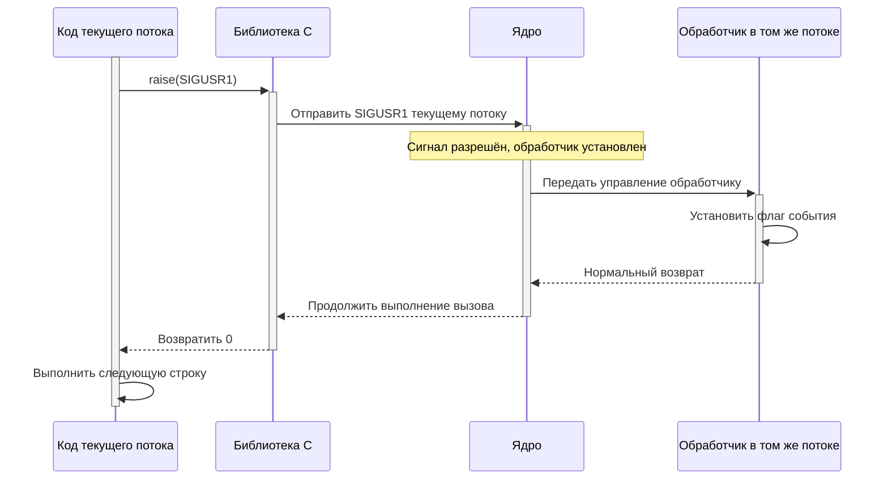
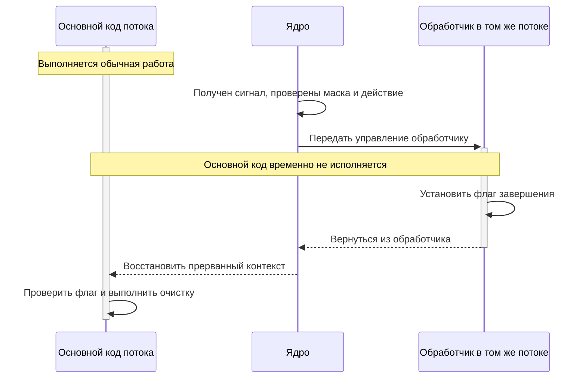
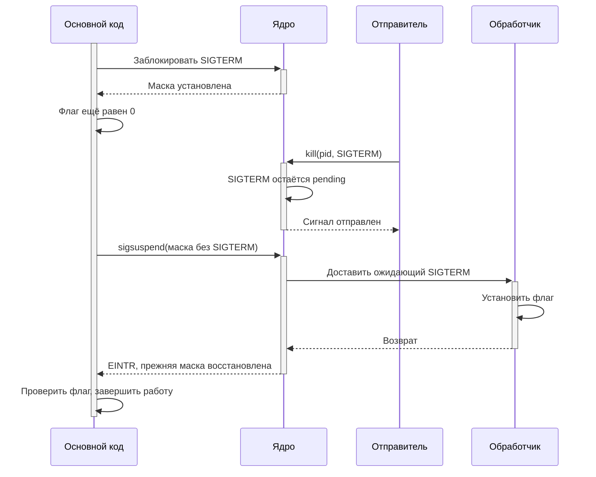
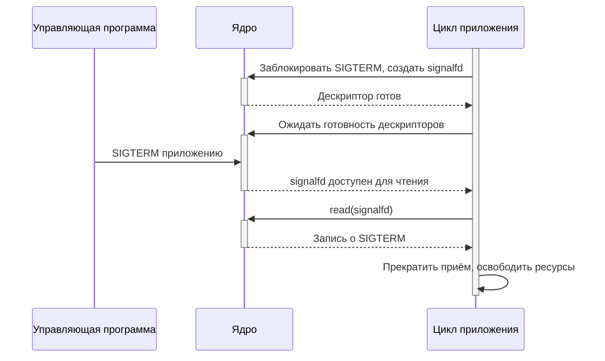
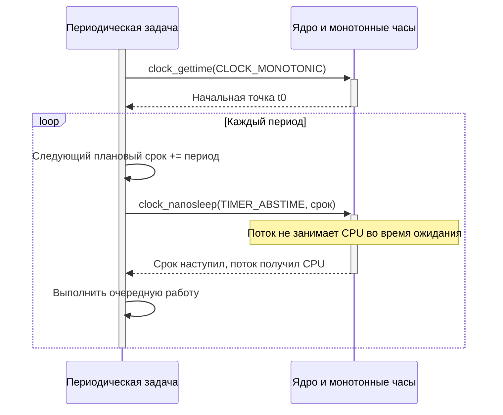
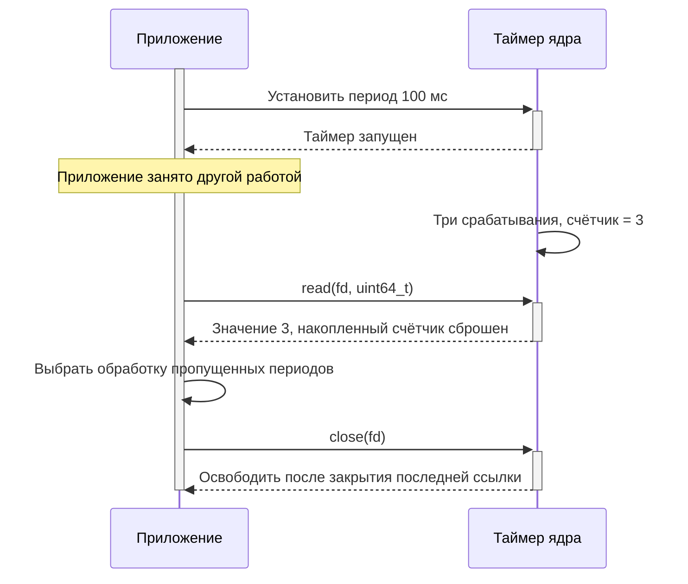

# Сигналы и время

## Содержание

- [Сигналы как уведомления](#сигналы-как-уведомления)
  - [Обычные сигналы](#обычные-сигналы)
  - [Псевдонимы и архитектурные сигналы](#псевдонимы-и-архитектурные-сигналы)
  - [Сигналы реального времени](#сигналы-реального-времени)
  - [Список сигналов в текущей системе](#список-сигналов-в-текущей-системе)
- [Отправка сигналов](#отправка-сигналов)
- [Обработчик сигнала](#обработчик-сигнала)
- [Маски и ожидание сигналов](#маски-и-ожидание-сигналов)
- [Сигналы через файловый дескриптор](#сигналы-через-файловый-дескриптор)
- [Часы и представление времени](#часы-и-представление-времени)
- [Задержки и абсолютные сроки](#задержки-и-абсолютные-сроки)
- [Таймеры через файловый дескриптор](#таймеры-через-файловый-дескриптор)
- [Выбор механизма для приложения](#выбор-механизма-для-приложения)
- [Программы и проверка](#программы-и-проверка)
- [Источники](#источники)

## Сигналы как уведомления

**Сигнал** — уведомление, доставку которого организует ядро. Источником может быть другая программа, терминал, таймер или исключение при выполнении инструкции. Механика процессов, групп и терминала разобрана в [предыдущем материале о процессах](processes.md). Здесь рассматривается реакция приложения из C-кода.

Для сигнала устанавливается **действие**: стандартная реакция, игнорирование или вызов обработчика. Стандартная реакция зависит от сигнала: завершение, остановка, продолжение или игнорирование. `SIGKILL` и `SIGSTOP` нельзя перехватить, заблокировать или игнорировать. [signal(7)](https://man7.org/linux/man-pages/man7/signal.7.html).

### Обычные сигналы

Префикс **SIG** означает **signal** («сигнал»). В колонке «Расшифровка» раскрыта оставшаяся часть имени; для исторических названий приведён их исходный смысл.

В таблице приведены обычные сигналы Linux. Названия описывают типичную причину генерации; многие из этих сигналов также можно отправить программно.

**Завершение с core** означает завершение с возможностью формирования дампа памяти. Фактическое создание и место хранения дампа зависят от настроек системы и ограничений процесса.

| Сигнал | Расшифровка | Назначение | Действие по умолчанию |
|---|---|---|---|
| `SIGHUP` | Hang up | Потеря управляющего терминала или завершение управляющего процесса | Завершение |
| `SIGINT` | Interrupt | Прерывание с терминала, обычно Ctrl+C | Завершение |
| `SIGQUIT` | Quit | Выход с терминала, обычно Ctrl+\ | Завершение с core |
| `SIGILL` | Illegal instruction | Недопустимая инструкция процессора | Завершение с core |
| `SIGTRAP` | Trap | Отладочная ловушка, например точка останова | Завершение с core |
| `SIGABRT` | Abort | Аварийное завершение через `abort()` | Завершение с core |
| `SIGBUS` | Bus error | Ошибка доступа к памяти, например обращение к недоступной части отображённого файла | Завершение с core |
| `SIGFPE` | Floating-point exception | Арифметическое исключение, например целочисленное деление на ноль | Завершение с core |
| `SIGKILL` | Kill | Безусловное завершение без выполнения очистки приложения | Завершение |
| `SIGUSR1` | User-defined signal 1 | Назначение определяет приложение | Завершение |
| `SIGSEGV` | Segmentation violation | Недопустимое обращение к памяти | Завершение с core |
| `SIGUSR2` | User-defined signal 2 | Назначение определяет приложение | Завершение |
| `SIGPIPE` | Pipe | Запись в канал или потоковый сокет без принимающей стороны | Завершение |
| `SIGALRM` | Alarm | Срабатывание таймера реального прошедшего времени, например `alarm()` | Завершение |
| `SIGTERM` | Terminate | Запрос завершения, допускающий обработку приложением | Завершение |
| `SIGSTKFLT` | Stack fault | Историческая ошибка стека сопроцессора; ядром не используется, доступен не на всех архитектурах | Завершение |
| `SIGCHLD` | Child | Завершение, остановка или продолжение дочернего процесса | Игнорирование |
| `SIGCONT` | Continue | Продолжение остановленного процесса | Продолжение |
| `SIGSTOP` | Stop | Безусловная остановка процесса | Остановка |
| `SIGTSTP` | Terminal stop | Остановка с терминала, обычно Ctrl+Z | Остановка |
| `SIGTTIN` | Terminal input | Попытка чтения управляющего терминала из фоновой группы | Остановка |
| `SIGTTOU` | Terminal output | Терминальная операция фоновой группы, например запись при включённом `TOSTOP` | Остановка |
| `SIGURG` | Urgent | Срочное событие сокета | Игнорирование |
| `SIGXCPU` | Exceeded CPU time limit | Превышение мягкого лимита процессорного времени | Завершение с core |
| `SIGXFSZ` | Exceeded file size limit | Превышение допустимого размера файла | Завершение с core |
| `SIGVTALRM` | Virtual timer alarm | Срабатывание таймера пользовательского CPU-времени | Завершение |
| `SIGPROF` | Profiling | Срабатывание таймера CPU-времени в пользовательском режиме и ядре | Завершение |
| `SIGWINCH` | Window change | Изменение размеров окна терминала | Игнорирование |
| `SIGIO` | Input/output | Уведомление асинхронного ввода-вывода о готовности | Завершение |
| `SIGPWR` | Power | Уведомление о событии питания | Завершение |
| `SIGSYS` | System call | Недопустимый системный вызов, в частности нарушение определённого правила `seccomp` | Завершение с core |

Историческое имя `SIGFPE` буквально означает «исключение плавающей точки», но сигнал применяется и к некоторым целочисленным арифметическим ошибкам.

Набор и номера зависят от архитектуры. Полная таблица различий приведена в [signal(7)](https://man7.org/linux/man-pages/man7/signal.7.html).

Игнорирование `SIGCHLD` по умолчанию не означает автоматический сбор завершившихся детей. Родитель по-прежнему должен получать их статусы через `waitpid()` или аналогичный интерфейс. Явная установка `SIG_IGN` для `SIGCHLD` имеет другую семантику: завершившиеся дети не остаются зомби.

`SIGKILL` и `SIGSTOP` нельзя перехватить, заблокировать или игнорировать. `SIGTSTP`, напротив, допускает обработку, поэтому остановка через Ctrl+Z отличается от безусловного `SIGSTOP`.

### Псевдонимы и архитектурные сигналы

Псевдоним — другое имя того же сигнала, а не дополнительное независимое уведомление. Наличие исторического имени в заголовках зависит от архитектуры и библиотеки C.

| Имя | Расшифровка | Значение и особенности |
|---|---|---|
| `SIGIOT` | Input/output trap | Псевдоним `SIGABRT`, историческое название ловушки IOT |
| `SIGCLD` | Child | Псевдоним `SIGCHLD` там, где определён |
| `SIGPOLL` | Poll | Псевдоним `SIGIO` в Linux |
| `SIGINFO` | Information | Псевдоним `SIGPWR` на Alpha; не следует переносить сюда семантику одноимённого сигнала других ОС |
| `SIGUNUSED` | Unused | Исторический псевдоним `SIGSYS`; glibc начиная с 2.26 его не определяет |
| `SIGEMT` | Emulator trap | Ловушка эмулятора на некоторых архитектурах, например SPARC и MIPS; по умолчанию завершает процесс |
| `SIGLOST` | Lost | Исторический сигнал потери файловой блокировки, не используется; архитектурное имя на SPARC, по умолчанию завершает процесс |

Подробности доступности перечислены в [signal(7), Signal numbering for standard signals](https://man7.org/linux/man-pages/man7/signal.7.html).

### Сигналы реального времени

**RT** означает **real-time** («реальное время»), **MIN** — **minimum**, **MAX** — **maximum**. Поэтому `SIGRTMIN` — нижняя граница диапазона сигналов реального времени, а `SIGRTMAX` — верхняя.

Полный диапазон задаётся макросами **`SIGRTMIN` … `SIGRTMAX` включительно**: `SIGRTMIN`, `SIGRTMIN+1`, `SIGRTMIN+2` и так далее до `SIGRTMAX`. Индивидуальных имён с заранее установленным назначением у них нет: смысл определяет приложение.

В отличие от обычных сигналов, несколько экземпляров сигнала реального времени могут находиться в очереди. Для одинакового номера сохраняется порядок отправки; из нескольких ожидающих номеров первым доставляется меньший. Через `sigqueue()` можно передать дополнительное значение, но это не делает указатель пригодным для разыменования в другом адресном пространстве. Очередь ограничена ресурсами системы.

Ядро Linux предоставляет номера 32–64, однако библиотека потоков может резервировать часть диапазона. Например, glibc с NPTL использует 32 и 33 для внутренних нужд, и доступный приложению `SIGRTMIN` обычно равен 34. В коде используют макросы и проверяют, что `SIGRTMIN + n <= SIGRTMAX`, а не фиксируют числа. Действие по умолчанию для сигналов реального времени — завершение процесса. [signal(7), Real-time signals](https://man7.org/linux/man-pages/man7/signal.7.html).

Словосочетание «реального времени» относится к механизму сигналов и не гарантирует немедленную доставку или жёсткий срок исполнения обработчика.

### Список сигналов в текущей системе

В Linux-оболочке список известных ей имён и номеров выводится командой:

```bash
kill -l
```

В C-программе имена сигналов предоставляет `<signal.h>`. Значение `0`, допускаемое в `kill(pid, 0)`, не является отдельным сигналом: оно выбирает проверку адресата без доставки уведомления.

Названия используйте из `<signal.h>`, числовые значения не переносимы между всеми архитектурами. Соглашение «SIGHUP перечитывает конфигурацию» реализует сама программа: ядро не знает ни её файла настроек, ни порядка применения параметров.

Практический сценарий: служба получает `SIGTERM`, перестаёт принимать задания, завершает или отменяет текущие операции, сохраняет необходимое состояние и выходит. Управляющая программа задаёт предельный срок ожидания и при необходимости отправляет `SIGKILL`. Поэтому сохранность данных должна обеспечиваться обычным протоколом записи, а не надеждой на обязательный вызов обработчика при любом завершении.

**Обычные сигналы не являются счётчиком событий.** Несколько одинаковых стандартных сигналов, ожидающих доставки, могут объединиться в один. Получив `SIGCHLD`, родитель проверяет всех доступных завершившихся детей, а не делает один `waitpid()` на каждый ожидаемый сигнал. Сигналы реального времени `SIGRTMIN…SIGRTMAX` поддерживают очередь, но она ограничена; для потока заданий удобнее канал, сокет или очередь сообщений. [signal(7)](https://man7.org/linux/man-pages/man7/signal.7.html).

## Отправка сигналов

| Функция | Описание |
|---|---|
| [`kill()`](#kill) | Отправляет сигнал процессу или группе процессов |
| [`raise()`](#raise) | Отправляет сигнал вызывающему потоку |

### kill

```c
#include <signal.h>

int kill(pid_t pid, int sig);
```

`pid > 0` выбирает процесс с данным PID.

`pid == 0` выбирает текущую группу процессов отправителя.

`pid < -1` выбирает группу с PGID, равным `-pid`.

`pid == -1` имеет широкую область действия: процессы, которым отправитель вправе посылать сигнал, с оговорками Linux. Для адресного управления приложением этот вариант не нужен.

`sig` — номер сигнала. Значение `0` выполняет проверку существования адресата и разрешений без доставки сигнала. Это не гарантия, что процесс останется жив после проверки. `kill()` возвращает `0` при успехе или `-1` с `errno`, например `ESRCH` или `EPERM`. Успешная отправка ещё не подтверждает завершение адресата: дочерний процесс подтверждается через `waitpid()`. [kill(2)](https://man7.org/linux/man-pages/man2/kill.2.html).

В диспетчере внешних программ сигнал группе позволяет остановить весь конвейер, а не только его первый процесс. Но группа должна быть заранее создана и принадлежать управляемому заданию: случайный отрицательный PID может затронуть посторонние процессы. Между сохранением PID и последующим обращением к нему возможна его повторная выдача; для долгоживущих Linux-супервизоров существуют дескрипторы процессов `pidfd`. [pidfd_send_signal(2)](https://man7.org/linux/man-pages/man2/pidfd_send_signal.2.html).

### raise

```c
#include <signal.h>

int raise(int sig);
```

**Raise a signal** означает «возбудить сигнал», то есть программно инициировать его отправку. `raise()` отправляет сигнал самому вызывающему потоку. PID передавать не нужно.

`sig` — сигнал, например `SIGUSR1`, `SIGTERM` или `SIGTRAP`. Его действие определяется ранее установленной настройкой: обработчик, игнорирование или стандартная реакция.

Результат — `0` при успешной отправке, ненулевое значение при ошибке. Не следует проверять исключительно `-1` или считать, что интерфейс гарантирует диагностику через `errno`, как `kill()`.

В однопоточной программе вызов эквивалентен `kill(getpid(), sig)`, в многопоточной — `pthread_kill(pthread_self(), sig)`. Это существенное отличие от `kill(getpid(), sig)`: сигнал процессу может получить другой подходящий поток, тогда как `raise()` адресует текущий. [raise(3)](https://man7.org/linux/man-pages/man3/raise.3.html).

#### Когда продолжается выполнение

| Состояние сигнала | Что происходит с `raise()` |
|---|---|
| Сигнал разрешён и имеет обработчик | Обработчик выполняется в текущем потоке; при его нормальном возврате затем возвращается `raise()` |
| Сигнал заблокирован | Сигнал остаётся ожидающим, `raise()` может вернуться до его обработки |
| Сигнал игнорируется | Обработчик не вызывается, выполнение продолжается |
| Действие завершает процесс | До следующей строки программа не доходит |
| Действие останавливает процесс | Выполнение возобновляется только после продолжения процесса |

Таким образом, успешный возврат не всегда означает, что обработчик уже отработал: необходимо учитывать маску. Блокировка здесь означает отсрочку доставки, а не ожидание внутри `raise()`. Подробности приведены в [разделе о масках](#маски-и-ожидание-сигналов).



На схеме библиотека и обработчик показаны отдельно для объяснения переходов управления; дополнительных потоков они не создают. Ограничения обработчика сохраняются и при программной отправке: внутри него не следует произвольно использовать небезопасные библиотечные операции.

#### Где применяется

**Проверка реакции на сигнал.** После установки обработчика программа вызывает `raise(SIGUSR1)` и проверяет установленный им флаг. Это позволяет проверить локальный путь обработки без второй программы и поиска PID. Такая проверка не подтверждает работу межпроцессных разрешений или маршрутизации сигнала другому потоку.

**Отладочная остановка в выбранной точке.** В диагностическом режиме `raise(SIGTRAP)` позволяет передать отладчику событие именно в месте обнаружения проблемы. Без отладчика стандартное действие `SIGTRAP` — аварийное завершение с возможным core, поэтому вызов не является безусловно безопасной заменой печати сообщения.

**Повторная отправка после восстановления стандартного действия.** Специализированный диагностический код может перехватить сигнал, записать минимальные сведения, восстановить `SIG_DFL` и отправить сигнал себе, чтобы завершение оставалось сигнальным. Нужно учитывать маску: внутри обработчика этот сигнал обычно временно заблокирован. Для ошибок памяти такой путь не означает возможность продолжать повреждённую программу.

**Повторное использование сигнального интерфейса управления.** Если приложение уже обрабатывает `SIGTERM`, внутренний диагностический сценарий может инициировать тот же механизм через `raise(SIGTERM)`. Для обычного запроса остановки из своего кода зачастую проще вызвать общую функцию управления: это не требует доставки сигнала и не зависит от его маски.

#### Отличие от abort

`raise(SIGABRT)` только отправляет сигнал: если он игнорируется, заблокирован или обработчик нормально возвращается, вызов может продолжить выполнение.

`abort()` предназначен для аварийного завершения и не возвращается. Он разблокирует `SIGABRT`; если игнорирование или вернувшийся обработчик помешали завершению, восстанавливает стандартное действие и повторяет отправку. Поэтому для сообщения о фатальном нарушении внутреннего состояния `raise(SIGABRT)` не является полной заменой `abort()`. [abort(3)](https://man7.org/linux/man-pages/man3/abort.3.html).

## Обработчик сигнала

| Функция | Описание |
|---|---|
| [`sigaction()`](#sigaction) | Устанавливает или читает действие для сигнала |

### sigaction

```c
#include <signal.h>

int sigaction(int signum, const struct sigaction *act,
              struct sigaction *oldact);
```

`signum` — сигнал, действие которого изменяется.

`act` — новая настройка; `NULL` оставляет её неизменной.

`oldact` — место для прежней настройки; `NULL` означает, что она не нужна.

В `struct sigaction` поле `sa_handler` задаёт функцию `void handler(int)`, `SIG_DFL` или `SIG_IGN`.

`sa_mask` задаёт дополнительные сигналы, блокируемые на время обработчика. Обычно доставленный сигнал также временно блокируется, чтобы этот же обработчик не входил сам в себя.

`sa_flags` изменяет режим. `SA_SIGINFO` выбирает `sa_sigaction` с прототипом `void handler(int, siginfo_t *, void *)` вместо `sa_handler`: можно получить дополнительные сведения об источнике. Эти два поля не следует заполнять одновременно.

`SA_RESTART` разрешает автоматический перезапуск части прерванных блокирующих операций. Он не отменяет необходимость понимать `EINTR`: некоторые ожидания всё равно завершаются при доставке сигнала. Успех `sigaction()` — `0`, ошибка — `-1` с `errno`. Для явной установки обработчика предпочтителен этот интерфейс, а не исторический `signal()`. [sigaction(2)](https://man7.org/linux/man-pages/man2/sigaction.2.html).

### Где выполняется обработчик

**Доставка сигнала с вызовом обработчика похожа на прерывание в микроконтроллере:** обычный код временно уступает управление обработчику, а после его нормального возврата продолжает работу с восстановленным контекстом. Эта аналогия помогает понять, почему обработчик должен быть коротким и почему нужно осторожно обращаться к данным, используемым основным кодом.

| Прерывание микроконтроллера | Сигнал с обработчиком в Linux |
|---|---|
| Событие вызывает переход к ISR — обработчику прерывания | Ядро организует переход к установленному обработчику сигнала |
| Сохраняется контекст прерванного выполнения | Сохраняется контекст потока, необходимый для возврата |
| Маскирование откладывает обработку соответствующего прерывания | Маска потока откладывает доставку блокируемого сигнала |
| ISR отмечает событие, основной цикл выполняет длительную работу | Обработчик устанавливает флаг, основной код выполняет обработку и очистку |
| Возврат из ISR восстанавливает прерванное выполнение | Нормальный возврат из обработчика позволяет восстановить выполнение потока |

Различие в уровне механизма: аппаратное прерывание обслуживает процессор и код обработчика платформы, а сигнал доставляет ОС пользовательскому потоку. Обработчик сигнала выполняется в пользовательском режиме и не получает привилегий ядра. Сигнал не задаёт аппаратный приоритет прерывания и не гарантирует жёсткий срок реакции: доставка зависит от маски и выполнения потока. В многопоточной программе остальные потоки могут продолжать работу.

Аналогия относится именно к **вызову обработчика**. Сигнал также может быть проигнорирован, завершить или остановить процесс, а при синхронном приёме через `sigwaitinfo()` или `signalfd()` приложение получает его как событие без асинхронного перехода в пользовательский обработчик. [signal(7)](https://man7.org/linux/man-pages/man7/signal.7.html).

Обработчик не становится новым процессом или самостоятельной фоновой задачей. Он временно получает управление в потоке, которому доставлен сигнал; после нормального возврата продолжается прерванное выполнение. Настройка действия общая для процесса, а маска блокировки индивидуальна для каждого потока.



### Что допустимо внутри обработчика

Обработчик может прервать библиотечную функцию посередине изменения её внутренних данных. Поэтому в нём нельзя произвольно выделять память, работать со stdio или захватывать обычные мьютексы. Для вызова допустимы функции с гарантией **async-signal-safe**; даже для них нужно учитывать блокировку и побочные эффекты. Если обработчик меняет `errno`, его прежнее значение сохраняют и восстанавливают. [signal-safety(7)](https://man7.org/linux/man-pages/man7/signal-safety.7.html).

Простой способ — присвоить значение объекту `volatile sig_atomic_t`, а всю работу выполнить позже в основном коде. Такой флаг пригоден для просьбы «остановиться», но не хранит количество запросов и не заменяет синхронизацию между потоками. Полная реализация приведена в [graceful-stop.c](examples/signals-time/graceful-stop.c).

Для перечитывания конфигурации обработчик только отмечает запрос. Основной код открывает файл, проверяет все параметры, подготавливает новую конфигурацию и лишь после успешной проверки заменяет действующую. Ошибка нового файла не должна оставлять службу с частично обновлёнными настройками.

## Маски и ожидание сигналов

| Функция | Описание |
|---|---|
| [`sigemptyset()`, `sigfillset()`](#наборы-сигналов) | Создают пустой или полный набор сигналов |
| [`sigaddset()`, `sigdelset()`, `sigismember()`](#наборы-сигналов) | Изменяют набор и проверяют наличие сигнала |
| [`sigprocmask()`](#sigprocmask) | Читает и изменяет маску в однопоточной программе |
| [`sigsuspend()`](#sigsuspend) | Атомарно меняет маску и ожидает обработчика |
| [`sigwaitinfo()`, `sigtimedwait()`](#sigwaitinfo-и-sigtimedwait) | Принимают выбранный сигнал в обычном потоке выполнения |

### Наборы сигналов

```c
#include <signal.h>

int sigemptyset(sigset_t *set);
int sigfillset(sigset_t *set);
int sigaddset(sigset_t *set, int signum);
int sigdelset(sigset_t *set, int signum);
int sigismember(const sigset_t *set, int signum);
```

`set` — объект набора сигналов, который сначала инициализируют через `sigemptyset()` или `sigfillset()`. Нельзя считать, что обнуление байтов эквивалентно созданию пустого набора на любой системе.

`signum` — добавляемый, удаляемый или проверяемый сигнал. Изменяющие функции возвращают `0` при успехе, `-1` при ошибке. `sigismember()` возвращает `1`, если сигнал есть, `0`, если его нет, либо `-1` при ошибке. [sigsetops(3)](https://man7.org/linux/man-pages/man3/sigsetops.3.html).

### sigprocmask

```c
#include <signal.h>

int sigprocmask(int how, const sigset_t *set, sigset_t *oldset);
```

`how == SIG_BLOCK` добавляет сигналы к блокируемым.

`how == SIG_UNBLOCK` удаляет их из маски.

`how == SIG_SETMASK` заменяет всю маску.

`set` — набор для изменения; при `NULL` выполняется только чтение старой маски.

`oldset` — место для сохранения прежнего набора или `NULL`.

Блокировка откладывает доставку: сигнал может остаться **pending**, то есть ожидающим. Это отличается от `SIG_IGN`, при котором сигнал игнорируется. В многопоточной программе применяют `pthread_sigmask()`; поток наследует маску создавшего его потока. Дочерний процесс наследует маску через `fork()`, и она сохраняется через `exec()`, поэтому перед запуском внешней программы важно восстановить предназначенную для неё маску. [sigprocmask(2)](https://man7.org/linux/man-pages/man2/sigprocmask.2.html).

### sigsuspend

```c
#include <signal.h>

int sigsuspend(const sigset_t *mask);
```

`mask` — временная маска на время ожидания. После обработчика возвращается прежняя маска, а вызов возвращает `-1` с `errno == EINTR`. Это штатный выход из ожидания. [sigsuspend(2)](https://man7.org/linux/man-pages/man2/sigsuspend.2.html).

Проблема конструкции «проверить флаг, затем вызвать `pause()`» — промежуток между двумя действиями. Если сигнал уже обработан в этом промежутке, программа уснёт в ожидании следующего сигнала, хотя флаг установлен.

Правильная последовательность: заблокировать интересующий сигнал, установить обработчик, проверить флаг при заблокированном сигнале и вызвать `sigsuspend()` с маской, разрешающей его доставку. Смена маски и засыпание образуют одну операцию ожидания: отдельного окна потери уведомления нет. Проверку выполняют в цикле, поскольку разбудить поток может и другой обработчик.



Это ожидание подходит программе, чья работа сейчас состоит в ожидании управляющего сигнала. Если основной код должен одновременно принимать соединения или читать устройство, нужен механизм совместного ожидания событий: например, `signalfd()` вместе с дескрипторами ввода-вывода.

### sigwaitinfo и sigtimedwait

```c
#include <signal.h>
#include <time.h>

int sigwaitinfo(const sigset_t *set, siginfo_t *info);
int sigtimedwait(const sigset_t *set, siginfo_t *info,
                 const struct timespec *timeout);
```

`set` — принимаемые сигналы. Их предварительно блокируют, чтобы они не доставлялись обычным способом. В многопоточной программе обычно блокируют их до создания рабочих потоков.

`info` — дополнительные сведения о принятом сигнале или `NULL`.

`timeout` — относительный предел ожидания `sigtimedwait()`; нулевой интервал даёт опрос без ожидания, `NULL` снимает предел.

Успех — номер принятого сигнала, ошибка — `-1` с `errno`. У `sigtimedwait()` истечение времени обозначается `EAGAIN`; посторонний обработчик может прервать ожидание с `EINTR`. Принятый сигнал удаляется из ожидающих, отдельный обработчик для этого приёма не вызывается. [sigwaitinfo(2)](https://man7.org/linux/man-pages/man2/sigwaitinfo.2.html).

Так можно выделить управляющий поток: он ждёт `SIGTERM` и затем через обычную синхронизацию сообщает рабочим потокам об остановке. В этом пути допустимы обычные библиотечные операции, поскольку выполнение идёт после возврата из функции ожидания, а не внутри асинхронного обработчика. Не следует одновременно назначать один и тот же сигнал разным конкурирующим механизмам приёма.

## Сигналы через файловый дескриптор

| Функция | Описание |
|---|---|
| [`signalfd()`](#signalfd) | Создаёт Linux-дескриптор для приёма сигналов |

### signalfd

```c
#include <sys/signalfd.h>

int signalfd(int fd, const sigset_t *mask, int flags);
```

`fd == -1` создаёт новый дескриптор. Передача существующего signalfd меняет его набор сигналов.

`mask` — набор принимаемых сигналов. Их предварительно блокируют в соответствующих потоках.

`flags` — `SFD_CLOEXEC`, чтобы закрыть дескриптор при `exec()`, и при необходимости `SFD_NONBLOCK` для работы без блокирующего чтения.

Результат — дескриптор или `-1` с `errno`. Чтение возвращает одну или несколько структур `struct signalfd_siginfo`; буфер должен вмещать хотя бы одну целую запись. Пустой неблокирующий дескриптор даёт `EAGAIN`. [signalfd(2)](https://man7.org/linux/man-pages/man2/signalfd.2.html).

Например, сетевой демон ждёт в одном цикле готовность клиентских сокетов, сигнал завершения и таймер проверки соединений. После чтения signalfd он закрывает приём новых клиентов и начинает обычную процедуру остановки. Обработчик с ограничениями async-signal-safe не нужен. Сам signalfd не создаёт отдельный поток; приложение должно прочитать событие.



## Часы и представление времени

| Функция | Описание |
|---|---|
| [`clock_gettime()`](#clock_gettime-и-clock_getres) | Читает выбранные часы |
| [`clock_getres()`](#clock_gettime-и-clock_getres) | Читает разрешение выбранных часов |

### Какие часы выбирать

**Часы** — источник отсчёта, **интервал** — длительность, **срок** — конкретное показание выбранных часов. Число секунд без указания часов не определяет смысл значения.

| Часы | Что измеряют | Где применять |
|---|---|---|
| `CLOCK_REALTIME` | Календарное системное время; может скачкообразно измениться при установке часов | Временная метка журнала, запуск по календарной дате |
| `CLOCK_MONOTONIC` | Непрерывный отсчёт без скачков от ручной установки календарного времени; не включает системный suspend | Тайм-аут обмена, длительность операции, периодический опрос |
| `CLOCK_BOOTTIME` | Монотонный отсчёт с учётом системного suspend | Срок годности данных, который должен истечь и во время сна системы |
| `CLOCK_PROCESS_CPUTIME_ID` | Процессорное время всех потоков процесса | Оценка затрат CPU на обработку |
| `CLOCK_THREAD_CPUTIME_ID` | Процессорное время текущего потока | Оценка вычислительной нагрузки отдельного исполнителя |

Монотонные часы могут плавно корректироваться системой синхронизации времени. «Монотонные» не означает «каждое чтение строго больше предыдущего»: соседние чтения могут совпасть. Время CPU не включает обычное ожидание ввода и не заменяет измерение задержки ответа. [clock_gettime(2)](https://man7.org/linux/man-pages/man2/clock_gettime.2.html).

Если запрос должен завершиться через две секунды, срок вычисляют по монотонным часам. Перевод календарного времени оператором тогда не даст запросу лишний час и не завершит его преждевременно. Для журналирования этой же операции отдельно читают календарные часы: по ним можно сопоставить записи разных систем при согласованном времени.

### clock_gettime и clock_getres

```c
#include <time.h>

int clock_gettime(clockid_t clockid, struct timespec *tp);
int clock_getres(clockid_t clockid, struct timespec *res);
```

`clockid` — выбранный источник времени.

`tp` — место для показания часов: `tv_sec` хранит секунды, `tv_nsec` — наносекундную часть от `0` до `999999999`.

`res` — место для разрешения часов. Для `clock_getres()` допустим `NULL`, если нужна только проверка поддержки часов. Обе функции возвращают `0` при успехе и `-1` с `errno` при ошибке. [clock_getres(2)](https://man7.org/linux/man-pages/man2/clock_getres.2.html).

При сложении интервалов наносекунды нормализуют: миллиард наносекунд переносится в секунды. При вычитании может потребоваться заём секунды. Длительности и сроки сравнивают в одной шкале; показание `CLOCK_MONOTONIC` нельзя вычитать из `CLOCK_REALTIME`. Для потенциально больших значений также проверяют переполнение `time_t` и промежуточных вычислений.

Разрешение часов и точность пробуждения — разные свойства. Даже если структура хранит наносекунды, планировщик может дать приложению CPU позже срока. Измерение разрешения не подтверждает гарантированное выполнение управляющего цикла каждую микросекунду.

## Задержки и абсолютные сроки

| Функция | Описание |
|---|---|
| [`nanosleep()`](#nanosleep) | Приостанавливает поток на относительный интервал |
| [`clock_nanosleep()`](#clock_nanosleep) | Ожидает интервал или абсолютный срок по выбранным часам |

### nanosleep

```c
#include <time.h>

int nanosleep(const struct timespec *duration, struct timespec *remain);
```

`duration` — требуемая длительность паузы.

`remain` — оставшийся интервал при прерывании сигналом; `NULL`, если остаток не нужен.

Успех — `0`, ошибка — `-1` с `errno`. При `EINTR` можно продолжить ожидание остатка. Но если сигнал означает завершение программы, сначала нужно обработать запрос остановки, а не безусловно снова засыпать. [nanosleep(2)](https://man7.org/linux/man-pages/man2/nanosleep.2.html).

Относительная пауза полезна для задержки перед повторной попыткой подключения. Важно ограничить число попыток или общий срок: бесконечные повторные ожидания могут скрыть устойчивую неисправность.

### clock_nanosleep

```c
#include <time.h>

int clock_nanosleep(clockid_t clockid, int flags,
                    const struct timespec *request,
                    struct timespec *remain);
```

`clockid` — часы ожидания, например `CLOCK_MONOTONIC`.

`flags == 0` задаёт относительную длительность. `TIMER_ABSTIME` задаёт абсолютный срок в `request`.

`request` — длительность или срок, в зависимости от `flags`.

`remain` — остаток относительного ожидания; для абсолютного режима он не используется.

Особенность интерфейса: возвращается `0` либо **сам номер ошибки**, например `EINTR`, а не `-1` с установкой `errno`. При прерывании абсолютного ожидания повторяют вызов с тем же сроком. Если срок уже прошёл, ожидание завершается сразу. `SA_RESTART` этот вызов не перезапускает. [clock_nanosleep(2)](https://man7.org/linux/man-pages/man2/clock_nanosleep.2.html).

### Почему периодический цикл смещается

Если программа сначала выполняет работу 20 мс, затем спит 100 мс, следующий запуск начнётся примерно через 120 мс. Дополнительные задержки накапливаются. Для периода 100 мс следующий срок вычисляют от предыдущего планового срока: `t0 + 100 мс`, `t0 + 200 мс`, `t0 + 300 мс`.



Просрочка требует отдельной политики. Система измерений может пропустить устаревшие опросы и перейти к ближайшему будущему сроку; расчётная модель может обработать все пропущенные шаги; интерфейс пользователя обычно обновляет только актуальное состояние. Бесконтрольное «догоняние» при длительной перегрузке создаёт цикл без сна. [periodic-deadline.c](examples/signals-time/periodic-deadline.c) показывает три коротких ожидания с сохранением плановой сетки; выбор политики длительной перегрузки остаётся задачей приложения.

## Таймеры через файловый дескриптор

| Функция | Описание |
|---|---|
| [`timerfd_create()`](#timerfd_create) | Создаёт Linux-таймер с файловым дескриптором |
| [`timerfd_settime()`, `timerfd_gettime()`](#timerfd_settime-и-timerfd_gettime) | Задают срабатывание и читают настройку таймера |

### timerfd_create

```c
#include <sys/timerfd.h>

int timerfd_create(int clockid, int flags);
```

`clockid` — часы таймера. Для периодической проверки соединений обычно подходит `CLOCK_MONOTONIC`; для учёта времени системного сна — `CLOCK_BOOTTIME`.

`flags` — `TFD_CLOEXEC` и при необходимости `TFD_NONBLOCK`. Результат — дескриптор либо `-1` с `errno`. Timerfd предназначен для Linux; срабатывание делает дескриптор готовым к чтению и не вызывает обработчик сигнала. [timerfd_create(2)](https://man7.org/linux/man-pages/man2/timerfd_create.2.html).

### timerfd_settime и timerfd_gettime

```c
#include <sys/timerfd.h>

int timerfd_settime(int fd, int flags,
                    const struct itimerspec *new_value,
                    struct itimerspec *old_value);
int timerfd_gettime(int fd, struct itimerspec *curr_value);
```

`fd` — дескриптор таймера.

`flags == 0` интерпретирует первое срабатывание как относительный интервал. `TFD_TIMER_ABSTIME` задаёт абсолютный срок по часам таймера.

`new_value->it_value` — первое срабатывание. Нулевые секунды и наносекунды **отключают таймер**, даже при ненулевом периоде.

`new_value->it_interval` — период последующих срабатываний. Нулевой период делает таймер одноразовым.

`old_value` — прежняя настройка или `NULL`. `curr_value` — текущий оставшийся интервал до срабатывания и установленный период. Оба вызова возвращают `0` либо `-1` с `errno`.

При чтении получают `uint64_t`: сколько срабатываний накопилось с предыдущего чтения или перенастройки. Буфер меньше восьми байтов недопустим. Если событий нет, чтение блокируется либо возвращает `EAGAIN` в неблокирующем режиме. [timerfd_settime(2)](https://man7.org/linux/man-pages/man2/timerfd_settime.2.html).



Например, шлюз раз в секунду проверяет срок последнего пакета от каждого устройства. Если timerfd вернул `5`, это признак задержки обработки, а не пять новых измерений. Можно один раз проверить все устройства по текущему времени и записать факт пропуска периодов. [timer-events.c](examples/signals-time/timer-events.c) демонстрирует чтение счётчика.

Timerfd по `CLOCK_BOOTTIME` учитывает сон, но сам по себе не обязан будить спящую систему. Для пробуждения существуют варианты часов с суффиксом `_ALARM` и соответствующими полномочиями. Календарные абсолютные таймеры требуют продуманной реакции на перевод часов; `TFD_TIMER_CANCEL_ON_SET` позволяет обнаружить скачок через `ECANCELED` при подходящей настройке таймера. [timerfd_create(2)](https://man7.org/linux/man-pages/man2/timerfd_create.2.html).

## Выбор механизма для приложения

| Потребность | Подход | Что учитывать |
|---|---|---|
| Корректно остановить небольшую программу | `sigaction()` и флаг | Проверка флага должна сочетаться с безопасным ожиданием |
| Выделить поток для управляющих сигналов | Блокировка и `sigwaitinfo()` | Все соответствующие потоки должны иметь правильную маску |
| Ждать сокеты, сигналы и таймеры в одном цикле | `signalfd()`, `timerfd()`, ожидание готовности | Дескрипторы нужно обслуживать; сами они код приложения не запускают |
| Сделать паузу перед повторной попыткой | `nanosleep()` | Запрос остановки может отменять повтор |
| Выполнять работу по периодической сетке | `clock_nanosleep()` с абсолютным сроком | Нужна политика пропущенных периодов |
| Измерить задержку ответа | Два чтения `CLOCK_MONOTONIC` | Использовать одну шкалу времени |
| Поставить календарную метку | `CLOCK_REALTIME` | Учитывать перевод часов и синхронизацию систем |
| Измерить вычислительные затраты | Часы CPU процесса или потока | Время ожидания в эту оценку не входит |

POSIX также предоставляет `timer_create()` и `timer_settime()` с настраиваемым уведомлением, а исторические `alarm()` и `setitimer()` используют сигналы. При поддержке уже существующей программы важно понимать их механизм; для нового Linux-цикла с дескрипторами timerfd обычно проще включить в общую обработку. Несколько таймерных API не следует смешивать без проверки их взаимодействия.

Тайм-аут всей операции отличается от тайм-аута одной попытки. При передаче сообщения несколькими частями общий срок вычисляют один раз, а после каждого частичного результата определяют оставшийся бюджет. Иначе каждая новая попытка может снова получать полный интервал, и операция никогда не достигнет общего предела.

## Программы и проверка

Исходники рассчитаны на Linux и компилятор C. Команды ниже выполняются в Linux-оболочке из корня репозитория; бинарные файлы создаются во временном каталоге.

```bash
build_dir=$(mktemp -d)
cc -std=c11 -Wall -Wextra -Werror tutor/user-space/examples/signals-time/graceful-stop.c -o "$build_dir/graceful-stop"
cc -std=c11 -Wall -Wextra -Werror tutor/user-space/examples/signals-time/periodic-deadline.c -o "$build_dir/periodic-deadline"
cc -std=c11 -Wall -Wextra -Werror tutor/user-space/examples/signals-time/timer-events.c -o "$build_dir/timer-events"
```

[graceful-stop.c](examples/signals-time/graceful-stop.c) устанавливает обработчики `SIGINT` и `SIGTERM`, ожидает без гонки и выполняет обычный путь завершения. Запустите программу на переднем плане и нажмите Ctrl+C после строки `ready`:

```bash
"$build_dir/graceful-stop"
```

Ожидаются строки `ready` и `stopped`, код выхода `0`. Вывод и очистка выполняются вне обработчика. Для проверки `SIGTERM` можно запустить программу в одном терминале, узнать её PID через `ps` и отправить `kill -TERM PID` из другого. Номер сигнала в исходник не зашит.

[periodic-deadline.c](examples/signals-time/periodic-deadline.c) выводит три строки `tick 1`…`tick 3` с периодом 50 мс по абсолютным монотонным срокам:

```bash
"$build_dir/periodic-deadline"
```

[timer-events.c](examples/signals-time/timer-events.c) ждёт как минимум три срабатывания timerfd с периодом 20 мс:

```bash
"$build_dir/timer-events"
```

Каждая строка содержит накопленное число срабатываний `expirations=N`. Обычно получается три строки с единицей; под нагрузкой одно чтение может получить больше одного события, и строк будет меньше. Проверять следует сумму счётчиков, а не точное число строк или наносекундную точность запуска.

## Источники

- [signal(7)](https://man7.org/linux/man-pages/man7/signal.7.html), [sigaction(2)](https://man7.org/linux/man-pages/man2/sigaction.2.html), [signal-safety(7)](https://man7.org/linux/man-pages/man7/signal-safety.7.html).
- [sigsetops(3)](https://man7.org/linux/man-pages/man3/sigsetops.3.html), [sigprocmask(2)](https://man7.org/linux/man-pages/man2/sigprocmask.2.html), [sigsuspend(2)](https://man7.org/linux/man-pages/man2/sigsuspend.2.html), [sigwaitinfo(2)](https://man7.org/linux/man-pages/man2/sigwaitinfo.2.html).
- [signalfd(2)](https://man7.org/linux/man-pages/man2/signalfd.2.html), [clock_gettime(2)](https://man7.org/linux/man-pages/man2/clock_gettime.2.html), [nanosleep(2)](https://man7.org/linux/man-pages/man2/nanosleep.2.html), [clock_nanosleep(2)](https://man7.org/linux/man-pages/man2/clock_nanosleep.2.html).
- [timerfd_create(2)](https://man7.org/linux/man-pages/man2/timerfd_create.2.html), [timer_create(2)](https://man7.org/linux/man-pages/man2/timer_create.2.html).

[К серии User-space](README.md). [Предыдущий материал](memory.md).
